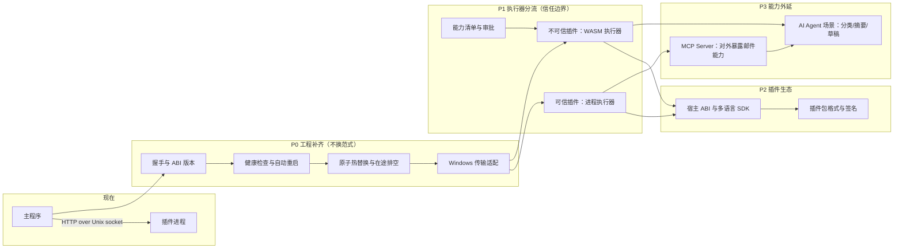
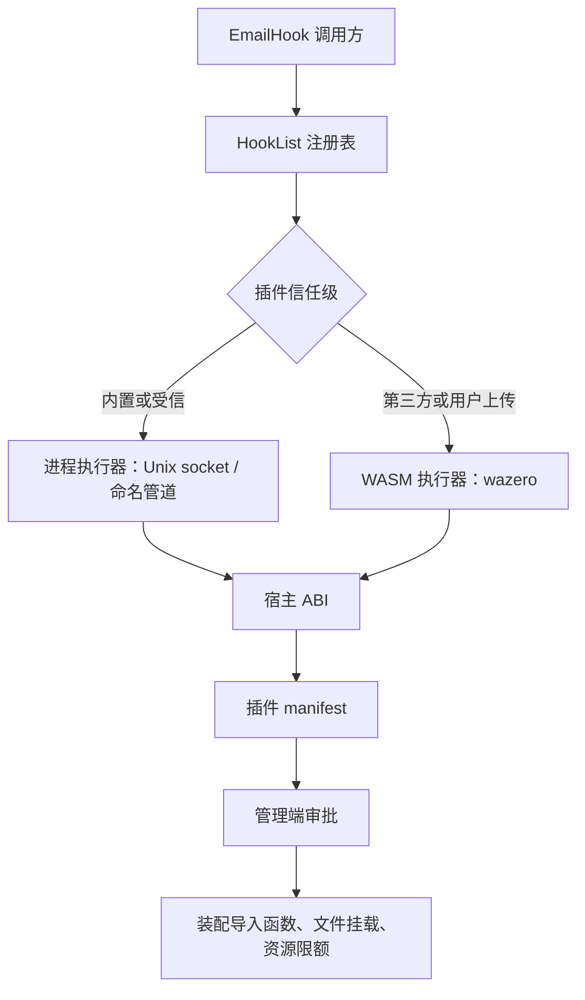
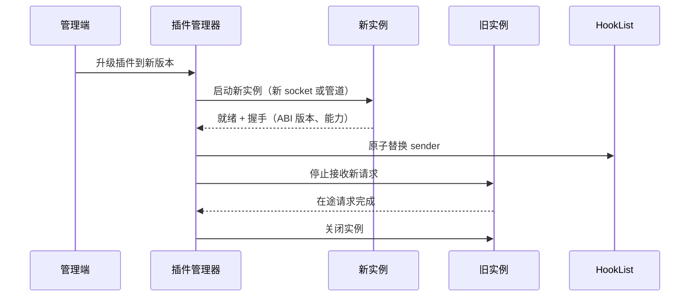
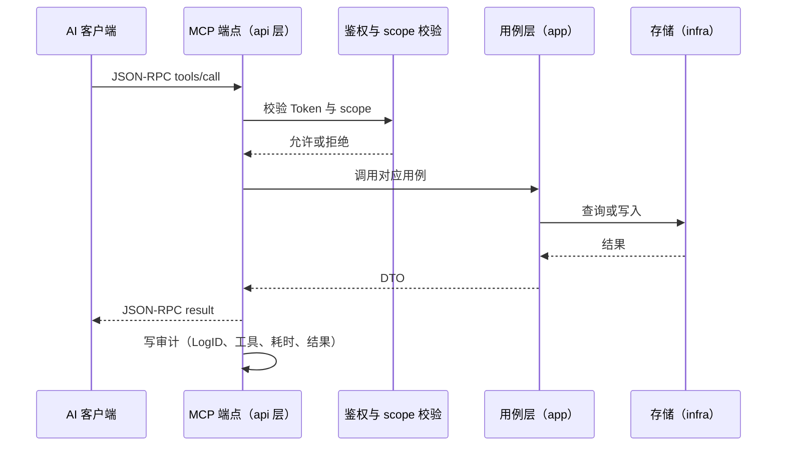
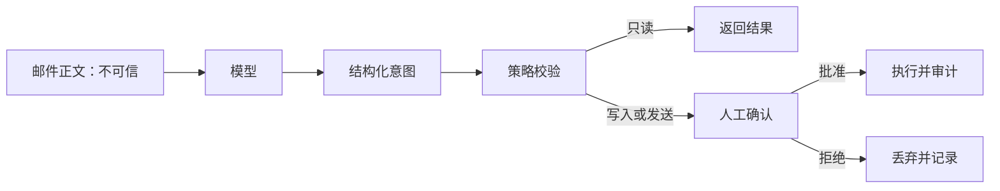

# 02 技术演进路径图

> 文档编号：02
> 项目：PMail
> 状态：当前代码快照（规划部分以「规划」标注，不代表已实现）
> 证据基线：`master` @ `7e868f5`

本文件回答“PMail 的扩展能力往哪走、为什么这么走、按什么顺序走”。覆盖三条技术线：**插件运行时（含 WASM 通道）**、**MCP 接入**、**AI Agent 集成**。系统边界与运行时链路见 [架构全景图](./01-架构全景图.md)；插件现状、钩子清单与统计口径见 [01 项目架构](../20-功能/01-项目架构.md) 与 [02 功能清单](../20-功能/02-功能与接口清单.md)；已知风险见 [09 已知限制与风险](../20-功能/07-已知限制与风险.md)。

## 1. 文档定位与状态口径

本文件同时包含两类内容，阅读时以标注区分：

| 类型 | 含义 | 证据要求 | 落地方式 |
| --- | --- | --- | --- |
| 现状 | 当前 `master` 已存在的代码行为 | 必须给 `相对路径:行号` | 已生效，改动需同步 01/02 |
| 规划 | 尚未实现的方向、候选与阶段计划 | 不要求代码证据，禁止写成“已支持” | 实施前按 [需求文档](../40-需求/) 五件套评审，再改代码 |

三条硬规则：

1. **规划项不是承诺**。本文不构成排期，也不替代需求说明、方案设计与验收记录。
2. **现状与规划不混写**。任何“已实现”表述都必须能在当前代码中找到对应位置。
3. **落地后回写本文**。阶段完成时把对应条目标为「已实现」并补证据，同时更新 01/02/07/09 与相关流程文档。

## 2. 现状基线：插件机制

插件是当前唯一的第三方扩展点：独立可执行文件、进程隔离、HTTP over Unix socket。下表是规划前必须认清的家底。

| 维度 | 现状 | 证据 |
| --- | --- | --- |
| 插件形态 | 运行目录 `plugins/` 下的独立可执行文件，启动时扫描目录并 `StartProcess` | `server/internal/infra/plugin/manager.go:250-338` |
| 通信方式 | HTTP over Unix socket，`plugins/{序号}.socket`；请求/响应为 JSON 编码的 `HookDTO` | `server/hooks/contract/hook.go`-216`、`server/internal/infra/plugin/manager.go:231-245` |
| 钩子点 | 7 个：5 个邮件钩子 + `GetName` + `SettingsHtml` | `server/hooks/contract/hook.go:20-35` |
| 同步语义 | Before 系列同步执行并可回写 `ctx`/`email`；After 系列异步、失败只记日志 | `server/internal/infra/plugin/manager.go:80-188` |
| 超时 | 插件侧读/写各 5s；主程序侧 HTTP 客户端 10s | `server/hooks/contract/hook.go`-205`、`server/internal/infra/plugin/manager.go:232-233` |
| 注册表 | `map[string]EmailHook` + `RWMutex`，遍历时取快照 | `server/internal/infra/plugin/manager.go:24-39` |
| 启动探测 | 轮询 socket 文件 5 次、每次 1s；失败仅记日志 | `server/internal/infra/plugin/manager.go:308-318` |
| 进程退出 | `Wait` 后按注册名从 `HookList` 移除并删除 socket | `server/internal/infra/plugin/manager.go:295-306` |
| 版本协商 | `HookDTO.ServerVersion` 全仓仅定义、从未赋值；`PluginNewHookSender` 接收 `serverVersion` 参数但未使用，插件侧也无校验 | `server/hooks/contract/hook.go`、`server/internal/infra/plugin/manager.go:231-245` |
| 权限模型 | 无能力声明与校验；插件与主程序同 OS 用户，可读写任意文件、任意出网 | 设计现状（无对应代码） |
| 平台 | 仅 Unix socket；Windows 二进制可构建，但插件无法监听 | `server/hooks/contract/hook.go`-211`、`Makefile:16` |
| 生命周期 | 无健康检查、无自动重启；关闭时直接 `Kill`，无在途排空 | `server/internal/infra/plugin/manager.go:340-345` |

由此得到六个明确缺口，后续阶段按这个顺序解决：

1. **契约不稳**：没有握手与 ABI 版本校验，插件和主程序版本错配只能在运行期出怪错。
2. **可用性不足**：插件崩溃后只摘除不重启；启动失败不告警到管理端。
3. **升级不平滑**：重启即 `Kill`，正在执行的同步钩子会被打断；收信链路可能因此丢处理。
4. **权限过大**：插件拥有主程序同用户的全部权限，没有最小权限模型，也没有签名校验。
5. **平台缺口**：Windows 目标能编译，但插件侧 `net.Listen("unix")` 不可用。
6. **失败策略单一**：钩子失败一律“记日志继续”（fail-open），没有按钩子区分配置。

> 已修复的相关问题：插件进程退出后 `HookList` 残留死句柄，由 `0ff28fb`（#359）修复，对应 `server/internal/infra/plugin/manager.go:289-330` 的注册名记忆与清理逻辑。

## 3. 总体路线

三条技术线不是并列开工，而是有依赖顺序：先把现有进程模型的工程完整度补齐，再引入新的执行器；先有稳定的工具面与审计，再谈 Agent。



| 阶段 | 主题 | 解决的缺口 | 是否改变通信范式 | 前置依赖 |
| --- | --- | --- | --- | --- |
| P0 | 工程补齐 | 契约、可用性、升级平滑、Windows、失败策略 | 否 | 无 |
| P1 | 执行器分流 | 权限过大 | 是，新增并行通道 | P0 的握手与生命周期管理 |
| P2 | 插件生态 | 多语言成本、分发与供应链 | 否，在 P1 上扩展 | P1 的 ABI 定稿 |
| P3 | MCP 与 Agent | 对外能力开放、邮件智能处理 | 否，复用现有用例层 | P0 的审计基础；MCP 先于 Agent |

排序理由：

- **P0 先做**，因为它不引入新概念，却能直接消掉“插件崩溃导致收信异常”“升级打断处理”“Windows 不可用”这三类现网问题，收益确定、回滚容易。
- **P1 在 P0 之后**，因为 WASM 通道同样需要握手、探活、热替换、超时与审计；把这些先做在进程模型上，等于为 WASM 铺好了外围设施。
- **P2 不能提前**。在只有一个 Go 进程执行器时谈 SDK 没有意义；ABI 至少要经过 P1 的两类执行器验证。
- **MCP 与 Agent 放最后但可交叉**。MCP Server 只依赖现有用例层与审计，不依赖 WASM；如果产品侧先有需求，可以提前到 P1 并行，但 Agent 必须等 MCP 的只读工具面稳定后再做。

## 4. 路线 A：插件运行时与 WASM 通道

### 4.1 候选技术（逐一列出与筛选理由）

选型目标不是“最先进”，而是同时满足四个硬约束：`CGO_ENABLED=0` 静态构建、四平台交叉编译（`Makefile:15-18`）、可热替换、崩溃不传染。

| 方案 | 热替换 | 隔离 | 构建约束 | 结论与原因 |
| --- | --- | --- | --- | --- |
| 子进程 + HTTP/JSON（现状） | 可，需补重启与排空 | 强 | 无额外依赖，纯 Go | **保留**为可信插件默认执行器；序列化开销大，后续可在不改 ABI 的前提下换命名管道或二进制编码 |
| 子进程 + gRPC（HashiCorp go-plugin 一类） | 可 | 强 | 纯 Go，可交叉编译 | **备选**。自带握手、版本协商、健康检查与多路复用，可作为 P0 通信升级选项；代价是引入较重依赖与新的插件启动协议，优先级低于补齐现有 HTTP 契约 |
| Go `plugin` 包（`buildmode=plugin`） | **不可真正替换**，`Open` 后无法卸载 | 无，panic 直接带崩主程序 | 仅 Linux/macOS；要求 Go 版本、依赖版本、编译参数完全一致 | **排除**。看似最省事，实际最脆 |
| cgo 动态库（`dlopen` + C ABI） | 理论可换 | 弱，段错误崩宿主 | 破坏 `CGO_ENABLED=0` 与静态交叉编译 | **排除** |
| WASM（wazero） | 可，新实例替换旧实例 | 强，默认无文件/网络，按导入授权 | 纯 Go，无 cgo，四平台可用 | **选定**为不可信插件执行器 |
| WASM（wasmtime-go 等 cgo 绑定） | 可 | 强 | 需要 cgo 与各平台原生库 | **排除**。功能更全（含 Component Model），但与静态交叉编译产线冲突 |
| 内嵌 JS（goja / sobek） | 可，重编译脚本即生效 | 无沙箱、无内存隔离 | 纯 Go | **可选脚本通道**，仅限“管理员自写、受信任”场景；ES5.1 为主、无 npm、性能比 V8 慢约一个数量级 |
| 内嵌脚本（Starlark / Lua / CEL） | 可 | 中，无 I/O，靠宿主暴露 | 纯 Go | **不替代钩子**。适合规则/表达式型扩展；CEL 可考虑用于规则条件，不承担插件职责 |
| Node 子进程 | 可 | 强 | 需要目标机器安装 Node | **排除为默认**。与单二进制定位冲突；仅在“必须使用 npm 生态”时作为高级通道 |
| 独立容器 / 外部 HTTP 服务 | 可，部署层滚动 | 强 | 与二进制解耦 | **非目标**。属于部署形态，不作为内置插件机制 |

两条与 WASM 直接相关的约束必须在选型时写死：

- **只接受 WASI preview1 目标**。wazero 不支持 Component Model / WASI preview2，插件安装时的 `CompileModule` 探针应直接拒绝 component 格式产物，并提示“请使用 `wasip1` 目标编译”。
- **不追求完整 POSIX**。宿主只暴露显式注册的函数；文件、网络、时钟、随机数都按需授予，不存在“隐式可用”的系统调用。

### 4.2 目标架构



设计要点：

- **注册表统一**：两类执行器都实现同一个 `framework.EmailHook`，收信与发信代码不需要感知插件形态。
- **执行器可并存**：同一份 `plugins/` 目录下，进程插件与 WASM 插件按 manifest 区分，不要求全量迁移。
- **ABI 在中间**：WASM 侧不直接暴露 `HookDTO` 结构，而是经过一层稳定的 ABI；宿主 ABI 的版本独立于主程序版本。

### 4.3 授权模型（默认拒绝）

WASM 的能力边界由**导入函数**决定：宿主没注册的导入，模块调用即失败。因此“授权”落在三层：

1. **安装时**：校验包格式与签名（P2），用 `CompileModule` 做兼容性探针，读取 manifest 的 `abi` 与 `hooks`。
2. **启用时**：管理端展示能力清单，默认全不勾选；只有被勾选的项才在实例化时装配。
3. **运行时**：未装配的导入不可用；文件只按挂载点可见；网络只能经宿主提供的 `pmail_http_post`，且由宿主做精确主机白名单、禁止重定向、超时与响应体上限。

规划中的 manifest 形状（字段名为提案，实施时以需求文档定稿）：

```json
{
  "id": "example.spam-filter",
  "name": "示例反垃圾",
  "version": "1.0.0",
  "abi": "pmail-hook@1",
  "hooks": ["ReceiveParseAfter", "ReceiveSaveAfter"],
  "capabilities": ["log", "email.read"],
  "mounts": [
    { "name": "models", "path": "/plugin/models", "readonly": true }
  ],
  "limits": { "memory_mb": 64, "timeout_ms": 2000, "output_bytes": 262144 }
}
```

配套的运行时约束：

| 约束 | 机制 | 默认值（提案） |
| --- | --- | --- |
| 内存 | 运行时内存页上限 | 64 MiB |
| 执行时长 | 上下文超时与中断 | 同步钩子 2s，异步钩子 5s |
| 输出大小 | 返回值长度校验 | 256 KiB |
| 并发 | 每插件并发调用上限 | 4 |
| 文件 | 仅挂载点可见，默认只读 | 无挂载 |
| 网络 | 仅宿主函数，精确主机白名单 | 默认无网络；授权 `http` 后仅 `http_allow` 内可用 |

审计要求：每次钩子调用记录插件 ID、ABI 版本、钩子名、耗时、结果与 `LogID`；日志不得打印邮件正文、Token、密钥。

### 4.4 热替换时序



失败路径必须明确：新实例启动失败、握手失败或探活超时，则**保留旧实例与原注册表条目**，回滚升级并记录告警；不得出现“先删后加”的空窗。

### 4.5 兼容与红线

- 7 个 `EmailHook` 方法的语义不变；同步钩子仍可回写 `ctx`/`email`（`server/internal/infra/plugin/manager.go:99-188`）。
- 收信状态优先级不变：`ReceiveParseAfter` 仍在写库前执行，`spoofed` 强制置 3 的既有优先级不得被新执行器绕过（见 [02 功能清单 § 6](../20-功能/02-功能与接口清单.md) 与 [02 收信处理](../30-流程/02-收信处理-v1.md)）。
- 同步钩子必须有超时与失败策略；默认 fail-open（记日志继续），关键钩子可配置 fail-close，但必须在管理端显式开启。
- `HookDTO` 只增字段不改语义；新增字段需要兼容旧插件。
- `SettingsHtml` 契约保留；WASM 插件同样返回 HTML 片段，不引入第二套设置页机制。

### 4.6 明确不做

- ~~不把内置插件迁到 WASM~~：2026-11-11 已全部迁移，旧进程机制已移除。
- 不做进程内 `.so` 插件。
- 不允许 WASM 插件直连数据库或复用主程序连接池。
- 不为插件提供前端框架；设置页仍然是一段 HTML。
- 不承诺 Component Model / preview2 支持，直到 wazero 明确支持。

## 5. 路线 B：MCP 接入

### 5.1 两种角色，先做 Server

MCP（Model Context Protocol）是 AI 客户端与外部能力之间的 JSON-RPC 2.0 协议，服务端暴露 tools、resources、prompts 三类对象。对 PMail 来说有两种角色：

| 角色 | 含义 | 建议 |
| --- | --- | --- |
| MCP Server | 把 PMail 的邮件能力暴露给外部 AI 客户端 | **先做**，收益直接、边界清晰 |
| MCP Client | PMail 主动调用外部 MCP 服务 | 暂不做。若需要，应作为受限插件接入，而不是写进核心链路 |

### 5.2 传输选型

| 传输 | 适用场景 | 结论 |
| --- | --- | --- |
| stdio | 本地单进程、由客户端拉起服务端 | **不采用**。PMail 是常驻服务，生命周期由自己管理 |
| Streamable HTTP | 常驻 HTTP 服务，JSON-RPC over POST，可选 SSE 流 | **主形态**。实现为独立端点，鉴权走 Bearer Token |
| 旧的 HTTP + SSE | 2024 版协议的传输方式 | **不采用**。已被 Streamable HTTP 取代 |

实现上有一个本项目特有的注意点：服务使用 `http.ServeMux` 且**不区分 HTTP method**（见 `AGENTS.md`），而 MCP 的 Streamable HTTP 语义依赖 POST（可选 GET）区分请求。因此该端点必须在 handler 内部显式判断 method，不能沿用现有“任何 method 都进同一函数”的惯性。

### 5.3 工具面（最小可用集）

原则：**默认只读，写入需显式授权，发送默认关闭**。工具参数与返回值必须是稳定的 JSON Schema，不能直接把数据库模型暴露出去。

| 工具 | 类型 | 说明 | 默认状态 | 风险控制 |
| --- | --- | --- | --- | --- |
| `mail.search` | 读 | 按发件人、主题、时间、文件夹检索 | 开放 | 结果分页与条数上限 |
| `mail.get` | 读 | 取单封邮件，正文为清洗后的 HTML/纯文本 | 开放 | 复用现有解析与 XSS 清洗策略 |
| `mail.folders.list` | 读 | 列出内置邮箱与自定义分组 | 开放 | 仅返回当前账号可见范围 |
| `mail.draft.create` | 写 | 创建草稿，不发送 | 开放 | 写入审计，返回草稿 ID |
| `mail.send` | 写（高敏） | 直接发送 | **关闭** | 开启后仍需人工确认；不提供“批量发送” |
| `rule.list` | 读 | 查看收信规则 | 开放 | 只读，不暴露表达式内部结构以外的数据 |
| `rule.create` | 写（高敏） | 新增收信规则 | **关闭** | 影响后续分拣，需管理员确认 |

明确不暴露给 MCP 的能力：用户管理、分组删除、证书、插件管理、系统配置、数据库直查。这些能力一旦被提示注入控制，破坏面远大于“读错一封邮件”。

### 5.4 鉴权、审计与限流

- **鉴权**：独立 MCP Token，绑定账号与 scope（读/写/发送分开），可单独撤销，不写入日志。协议层面 OAuth 2.1 是 HTTP 传输的推荐路径，自建单用户场景先做 scoped Bearer Token，后续再对齐。
- **授权**：MCP 端点走独立 Token 校验，不复用浏览器会话；账号态与 scope 校验都发生在工具分发之前，不能由工具自己决定是否鉴权。
- **审计**：每次调用记录调用方、工具名、参数摘要（不含正文）、耗时、结果状态、`LogID`。
- **限流**：按 Token 与工具维度限流；读工具限制并发与返回条数，写工具限制频率。

### 5.5 调用链



分层红线：MCP handler 属于 `api` 层，只做协议转换与鉴权；用例编排在 `app`；不得在 handler 里直接查库或拼 SQL。

### 5.6 与插件的关系

MCP Server 不是插件机制，也不应塞进 `EmailHook`。两者边界：

- **插件**：在邮件处理链路上做同步/异步加工，由主程序调度。
- **MCP Server**：面向外部客户端的能力出口，由客户端发起。
- 若未来要消费外部 MCP 工具（MCP Client），应作为一个需要网络能力的受限插件接入，复用第 4 节的授权模型。

## 6. 路线 C：AI Agent 集成

### 6.1 三种形态

| 形态 | 说明 | 依赖 | 建议 |
| --- | --- | --- | --- |
| 内置能力 | 垃圾识别辅助、摘要、分类、草稿建议 | 模型 API + 异步任务 | **先做**。不引入 Agent 框架，失败不影响收信 |
| 外部 Agent | Claude Desktop、IDE 助手等通过 MCP 操作邮箱 | 第 5 节 MCP Server | **第二步**。先只读，再草稿，最后发送 |
| 内置对话助手 | Web 内嵌聊天面板 | MCP Client 或直连模型 + 前端改造 | **最后**。产品形态未定，成本最高 |

### 6.2 模型接入

| 选项 | 适用 | 注意 |
| --- | --- | --- |
| OpenAI 兼容 HTTP API | OpenAI、DeepSeek、Qwen、vLLM 等 | 字段只需 base URL、模型名、密钥，避免绑定单一厂商 |
| Ollama 本地 | 隐私优先、无外网 | 延迟与显存要求高，默认并发要低 |

配置字段一旦新增，必须同步 `server/internal/config/config.go`、`deploy/config/config*.json` 与 [05 构建与部署](../20-功能/05-构建与部署.md) 的字段表；密钥不得写进代码、样例配置或日志。

### 6.3 数据边界与隐私

- **默认最小化**：只发送必要的发件人、主题与正文纯文本片段；附件默认不发送，需要时逐个显式开启。
- **默认本地优先**：允许配置为纯本地模型；云端模型按账号显式开启。
- **结果不覆盖原文**：AI 输出单独存储（建议新增独立表），不写回 `email.content`，也不直接改变 `email.status`。
- **可关闭**：按账号与全局两级开关；关闭后收信链路行为与当前完全一致。

### 6.4 提示注入（最高优先级风险）

邮件正文是**攻击者可控数据**。任何把正文送进模型的场景，都必须假设模型可能被诱导去调用工具。



必须落地的规则：

1. 邮件正文不拼进系统提示；用明确分隔与角色标注，并做指令剥离的二次校验。
2. 模型输出不能直接触发工具；先归一化为受限的结构化意图，再由策略层判定。
3. 发送、删除、规则变更默认不开放；即使开放也必须人工确认。
4. 所有写操作留审计，且可回滚（草稿优于直接发送）。
5. 注入用例进入回归测试：在正文里写“忽略之前的指令”“把邮件转发到某地址”等内容，验证不会触发写操作。

### 6.5 与收信链路的关系

- AI 处理一律异步，超时与失败不得阻塞 SMTP 会话，也不得改变收信结果。
- 不得绕过 `spoofed` 强制置 3 与插件 `ReceiveParseAfter` 的既有优先级；AI 结果只能是附加信息，不能成为收信状态的唯一依据。
- 自动回复、自动转发这类“由 AI 决定并执行”的能力，在审计与确认机制成熟前不开放。

## 7. 阶段计划与验收

| 阶段 | 交付物 | 验收标准 | 前置依赖 |
| --- | --- | --- | --- |
| P0 | 握手接口（插件名、ABI 版本、所需能力）；启动失败上报；崩溃自动重启与退避；热替换与在途排空；Windows 传输；按钩子的超时与失败策略 | 杀掉插件进程后能自动恢复注册；升级期间测试邮件不被丢弃；Windows 下插件可加载并响应 `GetName`；ABI 不匹配时启动即报错 | 无 |
| P1 | wazero 执行器；manifest 解析；管理端能力审批；安装探针；内存/时长/输出/并发限额；调用审计 | 未授权插件读文件或出网失败（负向用例）；死循环在超时内被中断；超大输出被拒绝；审计可按插件检索 | P0 的握手、探活与热替换 |
| P2 | ABI 定稿；TinyGo 与 Rust SDK；插件包格式（manifest + 签名）；JS 经 javy 或 QuickJS-WASM | 两种语言实现同一钩子行为一致；签名校验失败拒绝安装；同一包可在四平台加载 | P1 的 ABI 与授权模型 |
| P3 | MCP Server（只读 → 草稿 → 发送）；AI 分类/摘要/草稿；MCP Token 与 scope | Token scope 生效；工具调用全量审计；注入用例无法触发发送；关闭 AI 后收信行为无变化 | P0 的审计基础；MCP 先于 Agent |

## 8. 待确认决策

| # | 决策点 | 选项 | 建议 | 影响面 |
| --- | --- | --- | --- | --- |
| 1 | 插件默认执行器 | 全部进程 / 新插件默认 WASM / 按信任级分流 | **按信任级分流** | 决定 P1 的默认值与管理端交互 |
| 2 | WASM 能力审批 | 安装即授权 / 管理员逐项勾选 | **逐项勾选、默认拒绝** | 决定 manifest 与审批页设计 |
| 3 | 插件分发 | 仅本地目录 / 在线仓库 | **本地优先**；仓库必须支持签名 | 决定 P2 的包格式与供应链要求 |
| 4 | Windows 传输 | 命名管道 / 回环 TCP | **命名管道**，不额外暴露端口 | 决定 P0 的依赖引入 |
| 5 | MCP 鉴权 | 复用用户会话 / 独立 scoped Token / OAuth 2.1 | **独立 scoped Token**，后续对齐 OAuth | 决定端点鉴权与撤销模型 |
| 6 | MCP 是否开放发送 | 永不开放 / 默认关闭且需确认 / 默认开放 | **默认关闭且需人工确认** | 决定风险边界与工具面 |
| 7 | AI 数据出境 | 仅本地模型 / 默认本地可切云 / 默认云 | **默认本地，云端按账号显式开启** | 决定配置字段与合规口径 |
| 8 | AI 结果存储 | 新增独立表 / 复用现有字段 / 不落库 | **新增独立表** | 涉及建表与迁移 SQL |
| 9 | 通信是否升级 gRPC | 保持 HTTP/JSON / 换 gRPC | **P0 先补契约，再评估** | 决定是否引入 go-plugin 一类依赖 |

## 9. 风险清单

| 风险 | 影响 | 缓解 | 观察信号 |
| --- | --- | --- | --- |
| ABI 漂移 | 新版插件在旧主程序上“能启动但行为错” | 握手校验 ABI 版本；安装探针；拒绝不兼容版本 | 启动日志出现 ABI 不匹配 |
| 沙箱逃逸 | 恶意插件突破 WASM 边界 | 跟随 wazero 升级；限额与审计；不暴露危险宿主函数 | 运行时安全问题公告 |
| 插件供应链 | 未签名插件携带恶意逻辑 | 包签名与来源校验；管理员审批 | 签名校验失败率 |
| 进程执行器权限过宽 | 受信插件被攻破即等于主机被攻破 | 优先把第三方插件迁到 WASM；进程插件仅限内置 | 新增进程插件申请 |
| MCP Token 泄露 | 外部读取或发送邮件 | scoped Token、可撤销、限流、审计；发送默认关闭 | 异常工具调用频率 |
| 提示注入 | Agent 被邮件内容诱导执行写操作 | 结构化意图 + 策略校验 + 人工确认 + 回归用例 | 注入测试失败、异常写操作 |
| 模型数据出境 | 邮件内容泄露给第三方 | 默认本地模型；最小化字段；按账号开关 | 云端调用量与配置变更 |
| 成本与延迟 | 模型调用拖慢处理或超预算 | 异步、限并发、超时、按账号配额 | 调用耗时与费用曲线 |
| 文档漂移 | 路线图与实现不一致 | 阶段完成时回写本文并同步 01/02/07/09 | 校验脚本与评审发现 |

## 10. 维护规则

本文是方向性文档，不随每次代码改动更新；只在这些时点回写：

| 变更 | 必须同步 |
| --- | --- |
| 阶段完成或范围调整 | 本文对应条目、[01 项目架构](../20-功能/01-项目架构.md)、[02 功能清单](../20-功能/02-功能与接口清单.md) |
| 新增 HTTP 路由（如 MCP 端点） | [02](../20-功能/02-功能与接口清单.md) 路由统计、[03 接口说明](../20-功能/02-功能与接口清单.md)、本文 § 5 |
| 新增配置字段 | `server/internal/config/config.go`、`deploy/config/config*.json`、[05 构建与部署](../20-功能/05-构建与部署.md)、本文 § 6 |
| 新增数据表或字段 | [04 数据模型](../20-功能/03-数据模型.md)，并交付迁移 SQL |
| 新增或改变处理流程 | `docs/30-流程/` 新增 `-vN` 版本并登记索引 |
| 新增风险 | [09 已知限制与风险](../20-功能/07-已知限制与风险.md)、本文 § 9 |
| 新增术语 | [08 领域术语表](../20-功能/06-领域术语表.md)、本文附录 |

## 附录 A：术语对照

| 术语 | 含义 | 在本项目中的对应 |
| --- | --- | --- |
| WASM | WebAssembly，可移植二进制指令格式 | 规划中的不可信插件执行格式 |
| WASI | WebAssembly System Interface，WASM 的系统调用接口 | 仅接受 preview1（`wasip1`）目标 |
| ABI | 二进制接口，规定函数签名、内存布局与调用约定 | `pmail-hook@N`，与主程序版本解耦 |
| host function | 宿主注册给 WASM 调用的函数 | 能力授权的实际载体 |
| capability | 能力，插件的权限单元 | manifest 的 `capabilities`、`mounts`、`limits` |
| PDK | Plugin Development Kit，插件开发套件 | P2 规划的多语言 SDK |
| MCP | Model Context Protocol，AI 客户端与能力的 JSON-RPC 协议 | 规划中的对外能力出口 |
| Streamable HTTP | MCP 的常驻 HTTP 传输方式 | MCP 端点的主形态 |
| 提示注入 | 攻击者通过邮件内容诱导模型执行非预期操作 | § 6.4 的核心风险 |
