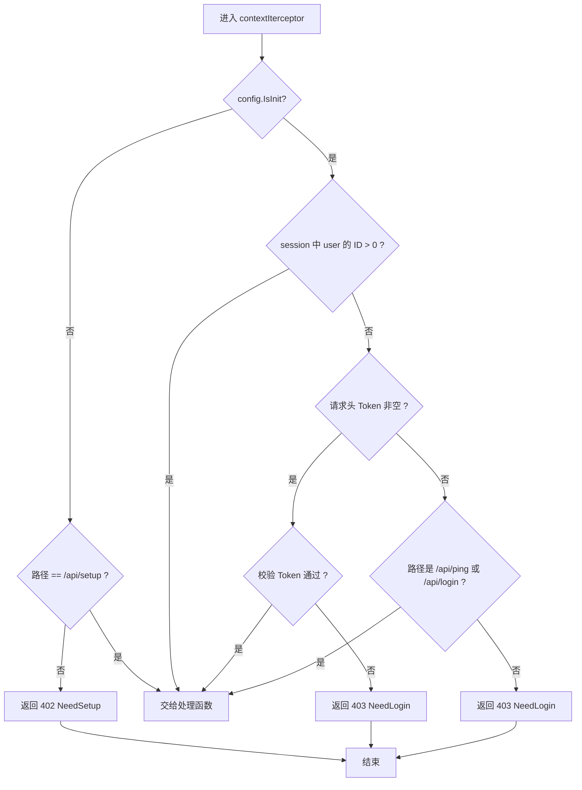

# 02 功能与接口清单

> 文档编号：02
> 项目：PMail
> 状态：当前代码快照
> 证据基线：`master` @ `7e868f5`

本文件由原「02 功能清单」与「03 接口说明」合并：Part I 统计功能面，Part II 描述接口契约。运行态路由数量以 Part I 第 1 节为唯一口径。

## Part I 功能清单

## 1. 统计口径与汇总

| 类别 | 数量 | 分母 / 计算方式 | 证据 |
| --- | --- | --- | --- |
| 运行态 HTTP 路由（`httpsEnabled != 2`） | 41 | `router()` 内 `mux.HandleFunc` 调用数：`/api/` 37 + 非 `/api/` 3（`/attachments/`、`/attachments/download/`、`/.well-known/`）+ 静态资源 `mux.Handle("/")` 1 | `server/internal/api/http/http_routes.go` |
| 运行态 HTTP 路由（`httpsEnabled == 2`，走 HTTP 直连） | 41 | 同一 `router()`；另加 `/.well-known/`、`/api/ping` 的重复注册不重复计数 | `server/internal/api/http/http_routes.go` |
| 跳转模式 HTTP 路由（Web 仅 HTTPS） | 3 | `/.well-known/`、`/api/ping`、`/` 301 | `server/internal/api/http/http_routes.go` |
| 引导期 HTTP 路由（首次部署） | 2 | `/` 静态页、`/api/`（全部步骤共用一个入口）、`/.well-known/` | `server/internal/api/http/http_setup.go` |
| 引导期 `/api/` 步骤动作 | 9 | `step × action` 组合：database get/set、password get/set、domain get/set、dns get、ssl get/getParams/set | `server/internal/api/http/setup_handler.go` |
| 管理 API 的请求路径数 vs 控制器函数 | 27 路径 / 26 函数 | `/api/rule/add` 与 `/api/rule/update` 复用 `UpsertRule` | `http_server.go:48-49` |
| SMTP 协议入口 | 3 个监听端口、1 个会话实现 | 25 / 465 / 587；`Backend.NewSession` 共用 | `server/internal/api/smtp/smtp_listener.go` |
| SMTP 会话回调方法 | 9 | `NewSession`、`AuthMechanisms`、`Auth`、`AuthPlain`、`Mail`、`Rcpt`、`Data`、`Reset`、`Logout` | `server/internal/api/smtp/smtp_action.go`、`read_content.go:37` |
| IMAP 会话方法 | 22 | `serverSession` 实现的方法 + `NewSession` | `server/internal/api/imap_session_*.go`、`server.go:40` |
| IMAP 未实现（空实现）方法 | 4 | `Subscribe`、`Unsubscribe`、`Append`、`Close` | `server/internal/api/imap/imap_server.go` |
| POP3 命令回调 | 13 | `action` 实现的方法（见 4.1） | `server/internal/api/pop3/pop3_action.go` |
| 插件钩子点 | 7 | `EmailHook` 接口方法 | `server/hooks/contract/hook.go` |
| 仓库内置插件 | 3 个 WASM 插件（2 发布用 + 1 调试） | `spam_block`、`wechat_push`、`debug` | `server/hooks/wasm_plugins/`、`Makefile` |
| 定时任务 | 1 个循环，2 条分支 | `sslUpdateLoop` / `sslCheck` | `server/internal/bootstrap/scheduler.go` |
| 数据库表 | 7 | `syncTables()` 中 `Sync2` 调用数 | `server/internal/infra/persistence/database.go` |
| 前端页面路由 | 6 | `web/desktop/src/router/index.ts` 的 `routes` | `web/desktop/src/router/index.ts` |
| 前端管理组件 | 7 | `web/desktop/src/components/*.vue` | `web/desktop/src/components/` |

> 统计基线：`7e868f5`。若路由或接口发生增删，先更新本节数字再更新下游表格。

> 与 [03 接口说明](./02-功能与接口清单.md) 的口径对应：运行态的 运行态路由（数量见 Part I 第 1 节）在 03 中拆为「`/api/` 接口 37 条（#1-#36）+ 非 `/api/` 接口 3 条（`/attachments/`、`/attachments/download/`、`/.well-known/`，合计 40 条可调用的 `HandleFunc`）+ 静态资源兜底 1 条（`mux.Handle("/", ...)`）」，两处合计同为 41；引导期 `/api/setup` 与重定向模式 3 条（`/.well-known/`、`/api/ping`、`/`）均不计入。

## 2. HTTP 接口清单（运行态）

鉴权列说明：`登录` = 需要 session Cookie 或 `Token` 头，否则返回 `errorNo=403`；`无需` = `contextIterceptor` 白名单（仅 `/api/ping`、`/api/login`）；`方法` 列统一为 `—`，因为项目使用 `http.ServeMux`，**不区分 HTTP method**，POST/GET 都能命中同一处理器。

### 2.1 基础与静态资源

| # | 路径 | 处理函数 | 鉴权 | 功能 | 状态 | 备注 |
| --- | --- | --- | --- | --- | --- | --- |
| 1 | `/` | `http.FileServer`（内嵌 `dist`） | 无需 | 提供 Vue 单页应用 | 有效 | history 路由，未知路径由 SPA fallback 返回 `index.html` |
| 2 | `/.well-known/` | `controllers.AcmeChallenge` | 无需 | 输出 ACME HTTP-01 挑战内容 | 有效 | 仅在证书签发期间有数据 |
| 3 | `/api/ping` | `controllers.Ping` | 无需 | 健康检查，返回 `pong` | 有效 | 也用于启动时 `waitHTTPReady` |

### 2.2 登录与会话

| # | 路径 | 处理函数 | 鉴权 | 功能 | 状态 | 备注 |
| --- | --- | --- | --- | --- | --- | --- |
| 4 | `/api/login` | `controllers.Login` | 无需 | 账号密码登录，写入 scs session；已绑定 MFA 时返回 `challengeToken` | 有效 | 返回 `account/name/is_admin/domains` 或 `mfaRequired` |
| 4A | `/api/login/mfa` | `HTTPLoginMFA` | 无需（需有效 challenge） | 校验 TOTP/恢复码，完成登录并写入 session | 有效 | `challengeToken` 5 分钟有效、单次使用、最多 5 次尝试 |
| 5 | `/api/logout` | `controllers.Logout` | 登录 | 清除会话 | 有效 | |
| 6 | `/api/settings/modify_password` | `controllers.ModifyPassword` | 登录 | 修改当前用户密码 | 有效 | 空密码时直接返回成功 |
| 7 | `/api/user/info` | `controllers.Info` | 登录 | 当前用户信息 | 有效 | |

### 2.3 邮件

| # | 路径 | 处理函数 | 鉴权 | 功能 | 状态 | 备注 |
| --- | --- | --- | --- | --- | --- | --- |
| 8 | `/api/email/list` | `email.EmailList` | 登录 | 分页列表 + 关键词搜索 | 有效 | tag 为 JSON 字符串，见 `dto.SearchTag` |
| 9 | `/api/email/detail` | `email.EmailDetail` | 登录 | 邮件详情，含附件元数据 | 有效 | 非本人邮件返回无权限 |
| 10 | `/api/email/read` | `email.MarkRead` | 登录 | 标记已读/未读 | 有效 | |
| 11 | `/api/email/del` | `email.EmailDelete` | 登录 | 删除邮件（软删除/彻底删除） | 有效 | `forcedDel` 决定是否物理删除 |
| 12 | `/api/email/move` | `email.Move` | 登录 | 移动邮件到自定义分组或内置邮箱 | 有效 | |
| 13 | `/api/email/send` | `email.Send` | 登录 | Web 发信 | 有效 | 先入库立即返回，异步投递 |
| 14 | `/attachments/` | `controllers.GetAttachments` | 登录 | 按 Content-ID 取内嵌附件 | 有效 | 用于 HTML 正文内联图片 |
| 15 | `/attachments/download/` | `controllers.Download` | 登录 | 附件下载 | 有效 | |

### 2.4 分组（邮箱文件夹）

| # | 路径 | 处理函数 | 鉴权 | 功能 | 状态 | 备注 |
| --- | --- | --- | --- | --- | --- | --- |
| 16 | `/api/group` | `controllers.GetUserGroup` | 登录 | 单个分组详情 | 有效 | |
| 17 | `/api/group/list` | `controllers.GetUserGroupList` | 登录 | 分组树（含未读数） | 有效 | |
| 18 | `/api/group/add` | `controllers.AddGroup` | 登录 | 新建分组 | 有效 | |
| 19 | `/api/group/del` | `controllers.DelGroup` | 登录 | 删除分组（含子分组） | 有效 | |

### 2.5 收信规则

| # | 路径 | 处理函数 | 鉴权 | 功能 | 状态 | 备注 |
| --- | --- | --- | --- | --- | --- | --- |
| 20 | `/api/rule/get` | `controllers.GetRule` | 登录 | 规则列表 | 有效 | 只查当前用户 |
| 21 | `/api/rule/add` | `controllers.UpsertRule` | 登录 | 新增规则 | 有效 | 与 22 复用同一处理函数 |
| 22 | `/api/rule/update` | `controllers.UpsertRule` | 登录 | 更新规则 | 有效 | 按 `id` 是否大于 0 区分 |
| 23 | `/api/rule/del` | `controllers.DelRule` | 登录 | 删除规则 | 有效 | |

### 2.6 用户管理

| # | 路径 | 处理函数 | 鉴权 | 功能 | 状态 | 备注 |
| --- | --- | --- | --- | --- | --- | --- |
| 24 | `/api/user/create` | `controllers.CreateUser` | 登录 + 管理员 | 新建邮箱账号 | 有效 | 非管理员在处理器内拒绝 |
| 25 | `/api/user/edit` | `controllers.EditUser` | 登录 + 管理员 | 改名/改密/禁用/管理员标记 | 有效 | |
| 26 | `/api/user/list` | `controllers.UserList` | 登录 + 管理员 | 用户列表 | 有效 | |

### 2.7 插件

| # | 路径 | 处理函数 | 鉴权 | 功能 | 状态 | 备注 |
| --- | --- | --- | --- | --- | --- | --- |
| 27 | `/api/plugin/list` | `controllers.GetPluginList` | 登录 | 已加载插件名称列表 | 有效 | 仅 WASM 插件 |
| 28 | `/api/plugin/settings/` | `controllers.SettingsHtml` | 登录 | 渲染插件自带设置页 | 有效 | 插件可返回任意 HTML 片段 |
| 29 | `/api/plugin/manage/list` | `HTTPPluginManageList` | 登录 + 管理员 | WASM 插件状态、授权项与计数 | 有效 | 只返回 WASM 插件 |
| 30 | `/api/plugin/manage/approve` | `HTTPPluginManageApprove` | 登录 + 管理员 | 授权钩子与能力，状态转 `approved` | 有效 | 授权项必须已在 manifest 声明 |
| 30A | `/api/plugin/manage/upload` | `HTTPPluginManageUpload` | 登录 + 管理员 | 上传 zip 插件包并落盘，状态转 `pending` | 有效 | 包内仅允许 manifest.json 与入口 wasm，最大 32 MB |
| 31 | `/api/plugin/manage/enable` | `HTTPPluginManageEnable` | 登录 + 管理员 | 加载插件并注册钩子 | 有效 | 需处于 `approved`、`disabled` 或 `error` |
| 32 | `/api/plugin/manage/disable` | `HTTPPluginManageDisable` | 登录 + 管理员 | 摘除钩子并关闭实例，保留授权 | 有效 | 需处于 `enabled` |
| 33 | `/api/plugin/manage/reject` | `HTTPPluginManageReject` | 登录 + 管理员 | 清空授权并置为 `rejected` | 有效 | 可从任意状态执行 |
| 34 | `/api/plugin/manage/reload` | `HTTPPluginManageReload` | 登录 + 管理员 | 热重载并切换新实例 | 有效 | 失败保留旧实例 |

### 2.7A 两步验证（MFA）

| # | 路径 | 处理函数 | 鉴权 | 功能 | 状态 | 备注 |
| --- | --- | --- | --- | --- | --- | --- |
| 35 | `/api/mfa/status` | `HTTPMFAStatus` | 登录 | 当前账号 MFA 状态与剩余恢复码数 | 有效 | GET |
| 36 | `/api/mfa/setup` | `HTTPMFASetup` | 登录 | 生成 TOTP 密钥与二维码 | 有效 | 管理员可传 `account` 为其他账号生成 |
| 37 | `/api/mfa/confirm` | `HTTPMFAConfirm` | 登录 | 校验动态码，启用 MFA 并返回恢复码 | 有效 | 管理员可传 `account` 操作其他账号 |
| 38 | `/api/mfa/disable` | `HTTPMFADisable` | 登录 | 校验当前密码 + 动态码/恢复码后解绑 | 有效 | 仅操作当前账号 |
| 39 | `/api/mfa/reset` | `HTTPMFAReset` | 登录 + 管理员 | 管理员校验自身密码后重置目标账号 MFA | 有效 | 用于用户丢失验证器 |

`/api/user/list` 的列表项新增 `MfaEnabled`、`MfaRecoveryCodesRemaining` 两个字段，供「用户管理」的 MFA 状态列使用；该路径不计入新增路由。

合计数：3（基础）+ 5（登录会话）+ 8（邮件）+ 4（分组）+ 4（规则）+ 3（用户）+ 9（插件）+ 5（MFA 管理）= 41，与第 1 节口径一致。

### 2.8 引导期接口（不计入运行态）

| 路径 | 处理函数 | 说明 |
| --- | --- | --- |
| `/api/` | `controllers.Setup` | 单一入口，按 `step` + `action` 分派 9 个动作 |
| `/.well-known/` | `controllers.AcmeChallenge` | 引导期证书签发也要响应挑战 |
| `/` | 内嵌静态页 | 首次部署向导页面 |

注意：`/api/setup` 只在 `contextIterceptor` 的非初始化分支里被提及（`server/internal/api/http/http_middleware.go`），但运行态路由表中**并不存在**该路径；引导期真正的入口是 `/api/`（任意子路径都会命中）。

## 3. 入站/出站邮件能力清单

| 能力 | 触发入口 | 实现位置 | 状态 |
| --- | --- | --- | --- |
| 接收外部邮件（25 端口） | SMTP `Data` | `server/internal/app/email_receive.go` | 有效 |
| 客户端认证发信（465/587） | SMTP `Auth` → `Data` 登录态分支 | `action.go:67`、`read_content.go:75` | 有效 |
| SPF 校验 | 收信分支 | `read_content.go:244` | 有效 |
| DKIM 验签 | 收信分支 | `server/dto/parsemail/dkim.go:86` | 有效 |
| DKIM 签名 | 出站邮件构造 | `server/dto/parsemail/dkim.go:69`、`email.go:602` | 有效 |
| 发件域名伪造判定（本地域名 + SPF 失败 → status=3） | 收信分支 | `read_content.go:105-125` | 有效 |
| 未知收件人丢弃/转交管理员 | 收件分支 | `audit_persistence.go:140-177` | 有效，受代码常量 `DropUnknownRecipientEmails` 控制 |
| 收信规则（已读/转发/删除/移动） | 收信分支 | `server/internal/app/rule_service.go` | 有效 |
| 对外投递 MX 故障转移 | 出站 | `server/pkg/send/send.go:155-200` | 有效 |
| 投递审计与状态回写 | 出站（SMTP 客户端路径） | `server/internal/app/email_delivery.go` | 有效 |
| 定时发送 | — | 仅模型字段 `CronSendTime` | **未实现**：字段存在，未观察到调度逻辑 |

## 4. 协议侧清单

### 4.1 POP3 命令（`action` 实现）

| 命令 | 方法 | 说明 |
| --- | --- | --- |
| CAPA | `Capa` | 返回支持的命令列表 |
| USER | `User` | 用户名 |
| PASS | `Pass` | 密码 |
| APOP | `Apop` | 摘要认证 |
| STAT | `Stat` | 邮件数与总大小 |
| LIST | `List` | 单封/全部大小 |
| UIDL | `Uidl` | 唯一 ID 列表 |
| RETR | `Retr` | 取信 |
| DELE | `Delete` | 标记删除 |
| REST | `Rest` | 撤销删除标记 |
| TOP | `Top` | 取信头与前 n 行 |
| NOOP | `Noop` | 空操作 |
| QUIT | `Quit` | 结束并以删除标记真实删除 |

`Custom` 为未知命令兜底，返回“不支持”。

### 4.2 IMAP 能力

- 声明能力集：`IMAP4rev1`、`IDLE`（`server/internal/api/imap/imap_listener.go`）。
- 已实现：`Login`、`List`、`Select`、`Status`、`Fetch`、`Search`、`Store`、`Move`、`Copy`、`Expunge`、`Create`、`Rename`、`Delete`、`Namespace`、`Idle`、`Poll`、`Unselect`。
- 未实现（空实现，返回成功）：`Subscribe`、`Unsubscribe`、`Append`（仅记录错误日志并返回 nil）、`Close`。
- 只允许 993 隐式 TLS；没有 143 明文端口（`imap_server.go:21` 注释也写明）。

### 4.3 SMTP 能力

- 认证机制：`PLAIN`、`LOGIN`（`action.go:45`）。
- 端口策略：25 不允许不安全认证；465 隐式 TLS；587 明文接入后 STARTTLS。
- 限制：单封 30MB（`MaxMessageBytes`）、最多 50 个收件人（`MaxRecipients`）、读写超时 10 秒。

## 5. 定时任务与后台循环

| 任务 | 周期 | 行为 | 证据 |
| --- | --- | --- | --- |
| 证书自动续期 | 24 小时 | 自动模式：剩余 <30 天或无证书则续期；续期后发重启信号 | `server/internal/bootstrap/scheduler.go` |
| 证书变更检测 | 24 小时 | 手动证书模式：过期时间变化则重启加载新证书 | `ssl_update.go:37` |
| HTTP 就绪探测 | 启动时最多 90 次 | 轮询 `http://127.0.0.1:{httpPort}/api/ping` | `server/internal/bootstrap/bootstrap.go` |
| HTTP 就绪探测（定时任务内） | 每轮续期前 | 同上 | `ssl_update.go:71` |

## 6. 插件与钩子

| 钩子 | 触发时机 | 同步性 | 主程序位置 |
| --- | --- | --- | --- |
| `ReceiveParseBefore` | 收到原始邮件字节、解析前 | 同步 | `read_content.go:52` |
| `ReceiveParseAfter` | 解析后、落库前 | 同步 | `read_content.go:113` |
| `ReceiveSaveAfter` | 落库后、规则执行后 | 异步并发 | `read_content.go:153` |
| `SendBefore` | 出站邮件发送前 | 同步 | `read_content.go:82`、`server/internal/api/email_send_handler.go` |
| `SendAfter` | 出站投递结束 | 异步并发 | `audit_persistence.go:61`、`server/internal/api/email_send_handler.go` |
| `GetName` | 插件启用/重载时 | 同步 | `server/internal/infra/plugin/plugin_manager.go` |
| `SettingsHtml` | Web 插件设置页请求 | 同步 | `server/internal/api/http/plugin_handler.go` |

WASM 插件（`pluginWasmEnabled=1` 时启用）：

- 包结构：`plugins/wasm/{id}/plugin.wasm` + `manifest.json`；manifest 声明 7 个钩子的子集与 `log`、`email.read`、`email.write`、`http` 能力。
- 执行器：wazero v1.12.0，纯 Go、无 cgo；不挂载文件；网络仅通过 `http` 能力与 `http_allow` 精确主机白名单开放，不跟随重定向；内存 64 MiB、同步 2s、异步 5s、输出 256 KiB、原始报文 8 MiB。
- 内置 WASM 插件统一在 `server/hooks/wasm_plugins`：
  - `spam_block`：`ReceiveParseAfter` 调用外部模型 API，广告置 5、诈骗置 3；需自行部署 TensorFlow Serving。
  - `wechat_push`：`ReceiveSaveAfter` 给管理员发微信模板消息，识别验证码；配置在 manifest 的 `config`。
  - `debug`：记录钩子请求大小，`ReceiveParseAfter` 强制状态 5；仅调试。
- 构建 `make wasm_plugins`；旧进程插件机制已移除。
- 审批：`pending → approved → enabled → disabled`，`reject` 清空授权；manifest 版本或哈希变化回到 `pending`。状态保存在 `plugins/wasm/state.json`。
- 管理接口：7 条 `/api/plugin/manage/*`，仅管理员可用；页面入口在设置弹窗的「插件设置」页签。

## 7. 前端功能

| 页面路由 | 视图 | 功能 |
| --- | --- | --- |
| `/`、`/list` | `ListView` | 邮件列表、侧边栏分组、搜索 |
| `/detail/:id` | `EmailDetailView` | 邮件详情、附件、回复/转发入口 |
| `/editer` | `EditerView` | 写邮件（wangEditor-next 富文本） |
| `/login` | `LoginView` | 登录 |
| `/setup` | `SetupView` | 首次部署向导（数据库/密码/域名/DNS/SSL） |

管理组件：`HomeAside`、`HomeHeader`、`GroupSettings`、`RuleSettings`、`SecuritySettings`、`UserManagement`、`PluginSettings`。详见 [06 前端应用](./04-前端应用.md)。

## 8. 已知未实现与预留

| 项 | 证据 | 结论 |
| --- | --- | --- |
| 定时发送 | `models.Email.CronSendTime`、`server/internal/api/email_send_handler.go` | 字段写入但无调度读取 |
| IMAP `Append`/`Subscribe`/`Unsubscribe` | `server/internal/api/imap/imap_server.go` | 空实现 |
| IMAP 明文 143 | `server/internal/api/imap/imap_listener.go` | 明确不做 |
| Web 发信中异步失败无重试 | `server/internal/api/email_send_handler.go` | 失败仅置 status=2 |
| 引导设置后的运行时 `/api/setup` | 运行时路由表 | 未注册 |
| 多域名 `domains` 配置 | `config.Config.Domains` | 收信识别多域名，Web 端默认发信域名取 `Domains[0]` |

---

## Part II 接口契约

本部分逐条列出 HTTP 接口的路由注册、鉴权方式、请求体、响应结构与错误码。

## 1. 阅读前提

| 项 | 事实 | 证据 |
| --- | --- | --- |
| 路由机制 | 标准库 `http.ServeMux`，**只按路径前缀分发，不区分 HTTP method**；同一路径 GET/POST 行为完全一致 | `server/internal/api/http/http_routes.go`、`:33`-`:58` |
| 请求体 | 绝大多数接口**无论 method 如何都读取请求体 JSON**（`io.ReadAll(req.Body)` 后 `json.Unmarshal`） | `server/internal/api/email_list_handler.go`、`server/internal/api/auth_handler.go` |
| 前端调用 | 前端统一用 `http.post`/`http.get` 混合调用，实测并无 method 约束 | `web/desktop/src/components/HomeAside.vue:61`、`web/desktop/src/views/ListView.vue:131` |
| 响应外壳 | 统一为 `{"errorNo":int,"errorMsg":string,"data":any}`；`Content-Type` 在 `contextIterceptor` 中默认设为 `application/json` | `server/dto/response/response.go:16`、`server/internal/api/http/http_middleware.go` |
| 语言 | 文案语言取请求头 `Lang`，空值回退 `en`；仅 `zhCn` 返回中文 | `server/internal/api/http/http_middleware.go`、`server/internal/app/translation.go` |

### 1.1 错误码

错误码是业务码，与 HTTP 状态码无关（成功与失败都返回 HTTP 200）。

| 常量 | 值 | 含义 | 证据 |
| --- | --- | --- | --- |
| （成功） | `0` | `NewSuccessResponse` 不设置 `ErrorNo`，零值即 0 | `server/dto/response/response.go:27` |
| `ParamsError` | 100 | 参数错误 / 校验失败 | `server/dto/response/response.go:12` |
| `NeedSetup` | 402 | 系统未完成初始化，先走引导 | `server/dto/response/response.go:9` |
| `NeedLogin` | 403 | 未登录 / session 过期 / Token 无效或过期 | `server/dto/response/response.go:10` |
| `NoAccessPrivileges` | 405 | 已登录但无权限（仅管理员接口） | `server/dto/response/response.go:11` |
| `ServerError` | 500 | 服务端异常（含 DB 错误、发件失败） | `server/dto/response/response.go:13` |

`errorMsg` 字段：成功响应为空串；失败时可能是固定英文串（如 `"params error"`）、i18n 文案（如 `"登录已失效"`），也可能是原始 `error.Error()` 文本。`data` 字段：失败时通常为 `""`（空串），个别接口把错误详情放进 `data`。

### 1.2 鉴权模型（`contextIterceptor`）

所有经 `contextIterceptor` 包装的路由（见第 2 节标注）执行同一套鉴权，顺序如下（`server/internal/api/http/http_middleware.go`）：

三种鉴权状态：

| 标记 | 含义 | 判定依据 |
| --- | --- | --- |
| **无需登录** | 不包装 `contextIterceptor`，或虽包装但被豁免 | 未包装：`/.well-known/`、`/api/ping`；豁免：`/api/login`、`/api/login/mfa`（`server/internal/api/http/http_middleware.go`） |
| **session** | 有效 scs session（Cookie）即通过 | session 中 `user` JSON 的 `ID > 0`，取自 `models.User`（`server/internal/api/http/http_middleware.go`、`server/internal/api/auth_handler.go`） |
| **session 或 Token** | session 无效时允许用请求头 `Token` 登录 | 请求头 `Token` 非空且校验通过（`server/internal/api/http/http_middleware.go`）；Token 算法见第 1.2 节正文（`https_server.go:144`-`:169`） |

Token 格式（**只写结构，不写任何真实值**）：`{account}:{MD5(api_key + timestamp)}:{timestamp}`。字段 `account` 为账号，`api_key` 为 `/api/login` 响应返回的口令哈希（`user.Password`），第二个字段是 `password.Md5Encode(fmt.Sprintf("%s%d", user.Password, requestTimeStamp))`，第三个字段是 Unix 秒级时间戳；服务器时间与时间戳相差 `>= 5` 秒即视为过期（`server/internal/api/http/http_middleware.go`）。即 Token 有效期极短、需要每次请求重新计算，属于“按请求签名的临时凭证”。

### 1.3 管理员判定与权限矩阵

`ctx.IsAdmin` 来自当前用户的 `models.User.IsAdmin == 1`（`server/internal/api/http/http_middleware.go`）。只有以下 4 个接口在函数内部做了**角色校验**，其余接口仅要求登录：

| 接口 | 角色要求 | 证据 |
| --- | --- | --- |
| `POST /api/user/create` | 管理员 | `server/internal/api/http/user_handler.go` |
| `POST /api/user/edit` | 管理员 | `server/internal/api/http/user_handler.go` |
| `POST /api/user/list` | 管理员 | `server/internal/api/http/user_handler.go` |
| 邮件详情/附件/读信 | 非管理员必须存在本人 `user_email` 记录；管理员放行 | `server/internal/app/email_detail.go`、`server/internal/app/auth_service.go` |

## 2. 正常运行态路由清单

统计口径（可复算）：

- `router()` 函数内 `mux.HandleFunc(...)` 调用共 **40** 条（`server/internal/api/http/http_routes.go`）。
- 另有非 `HandleFunc` 的 `mux.Handle("/", http.FileServer(...))` 静态资源兜底 **1** 条（`server/internal/api/http/http_routes.go`），不计入接口数。
- 即：**接口总数 = 40**，按前缀分类不重不漏如下。

| 分类 | 数量 | 编号区间 | 明细 |
| --- | --- | --- | --- |
| `/api/` 接口 | 37 | #1-#35、#2A、#30A | ping 1（#1）+ login/logout/MFA 登录 3（#2-#3、#2A）+ group 4（#4-#7）+ email 6（#8-#13）+ settings 1（#14）+ rule 4（#15-#18）+ user 4（#19-#22）+ plugin 9（#23-#30、#30A）+ MFA 管理 5（#31-#35） |
| 非 `/api/` 接口 | 3 | #36-#38 | `/attachments/`、`/attachments/download/`、`/.well-known/` |
| 合计 | **40** | — | 见 2.1、2.2 两节 |

> 口径自查：`/api/` 37 条 + 非 `/api/` 3 条 = **40** 条可调用 `HandleFunc` + 静态资源兜底 1 条 = **41** 条运行态路由。`grep -c "mux.HandleFunc" server/internal/api/http/http_routes.go` 为 43，减去重定向模式下的 3 条，即 40；`mux.Handle("/", ...)` 静态资源在第 2.2 节以 #39 列出仅供对照。

运行时挂载点说明：`router()` 被 HTTPS 服务（`server/internal/api/http/http_middleware.go`）调用，并在 `httpsEnabled == 2`（关闭 HTTPS）时被 HTTP 服务调用（`server/internal/api/http/http_routes.go`）。HTTPS 服务的外部入口还套了一层 `session.Instance.LoadAndSave(mux)`（`server/internal/api/http/http_middleware.go`）。

### 2.1 `/api/` 接口明细

| # | 路径 | 处理方法 | 鉴权 | 请求体字段 | 响应 `data` | 主要错误码 | 证据 |
| --- | --- | --- | --- | --- | --- | --- | --- |
| 1 | `/api/ping` | `controllers.Ping` | 无需登录 | 无 | `"pong"` | — | 路由 `http_server.go:33`；实现 `server/internal/api/http/health_handler.go` |
| 2 | `/api/login` | `controllers.Login` | 无需登录（豁免） | `account`、`password` | `{account,name,is_admin,domains[],api_key}`（`api_key` 为口令哈希，供按需铸造 Token）；已绑定 MFA 时为 `{mfaRequired:true,challengeToken}` | 100 | `server/internal/api/auth_handler.go` |
| 2A | `/api/login/mfa` | `HTTPLoginMFA` | 无需登录（需有效 challenge） | `challengeToken`、`code` | `{account,name,is_admin,domains[]}`，并写入 session | 100 | `server/internal/api/http/mfa_handler.go`；challenge 5 分钟有效、单次使用、最多 5 次尝试 |
| 3 | `/api/logout` | `controllers.Logout` | session 或 Token | 无 | `"Success"` | 403 / 402 | `server/internal/api/auth_handler.go` |
| 4 | `/api/group` | `controllers.GetUserGroup` | session 或 Token | 无 | 树形 `[{id,label,tag,children[]}]`（含 5 个内置箱 + 自定义分组） | 403 / 402 | `http_server.go:36`；`server/internal/api/http/group_handler.go`；结构 `server/internal/app/group_service.go` |
| 5 | `/api/group/list` | `controllers.GetUserGroupList` | session 或 Token | 无 | `models.Group` 扁平数组：`[{id,name,parent_id,full_path}]`（**不含** user_id） | 403 / 402 | `http_server.go:37`；`server/internal/api/http/group_handler.go`；`server/models/group.go:3` |
| 6 | `/api/group/add` | `controllers.AddGroup` | session 或 Token | `name`、`parent_id` | 新分组 ID（int）；同名已存在时返回既有 ID | 500（`"DBError"`） | `http_server.go:38`；`server/internal/api/http/group_handler.go`、`:75`；`server/internal/app/group_service.go` |
| 7 | `/api/group/del` | `controllers.DelGroup` | session 或 Token | `id` | bool（是否删除到行） | 500（`"DBError"`） | `http_server.go:39`；`server/internal/api/http/group_handler.go`；`server/internal/app/group_service.go` |
| 8 | `/api/email/list` | `email.EmailList` | session 或 Token | `keyword`、`tag`、`current_page`、`page_size` | `{current_page,total_page,total,list:[{id,title,desc,datetime,is_read,sender,to[],dangerous,error}]}` | 403 / 402（不校验参数，出错仅记日志） | `http_server.go:40`；`server/internal/api/email_list_handler.go`、`:23`、`:40` |
| 9 | `/api/email/del` | `email.EmailDelete` | session 或 Token | `ids`、`forcedDel` | `"success"` | 100（ids 为空）、500 | `http_server.go:41`；`server/internal/api/email_delete_handler.go`、`:29`、`:34` |
| 10 | `/api/email/read` | `email.MarkRead` | session 或 Token | `ids` | `"success"` | 100（ids 为空）、500 | `http_server.go:42`；`server/internal/api/email_read_handler.go`、`:28`、`:33` |
| 11 | `/api/email/detail` | `email.EmailDetail` | session 或 Token；**非管理员需拥有该邮件** | `id` | `EmailResponseData`：`email` 表全字段 + `is_read` + `serial_number` + `ue_id` | 100（id<=0）、500（含 `"Not authorized"`） | `http_server.go:43`；`server/internal/api/email_detail_handler.go`、`:28`、`:33`；`server/internal/app/email_detail.go`；`server/dto/response/email.go:5` |
| 12 | `/api/email/move` | `email.Move` | session 或 Token | `group_id`、`group_name`、`ids` | `"success"` | 100（ids 为空）、500 | `http_server.go:44`；`server/internal/api/email_move_handler.go`、`:31`、`:36` |
| 13 | `/api/email/send` | `email.Send` | session 或 Token | `reply_to[]`、`from{}`、`to[]`、`bcc[]`、`cc[]`、`subject`、`text`、`html`、`sender{}`、`read_receipt[]`、`attrs[]` | i18n `"成功"`（异步投递，接口立即返回） | 100、500 | `http_server.go:45`；`server/internal/api/email_send_handler.go`、`:68`、`:94`、`:99`、`:199`、`:208` |
| 14 | `/api/settings/modify_password` | `controllers.ModifyPassword` | session 或 Token | `password` | i18n `"成功"`；`password` 为空时**什么都不改也返回成功** | 500 | `http_server.go:46`；`server/internal/api/settings_handler.go`、`:30`、`:41` |
| 15 | `/api/rule/get` | `controllers.GetRule` | session 或 Token | 无（前端仍发 `{}`） | `[{id,user_id,name,rules:[{field,type,rule}],action,params,sort}]`（按 `sort` 降序） | 403 / 402 | `http_server.go:47`；`server/internal/api/http/rule_handler.go`；`server/internal/app/rule_service.go`、`:26`；`server/dto/rule.go:18` |
| 16 | `/api/rule/add` | `controllers.UpsertRule` | session 或 Token | 同 #15 的 Rule 结构 | `"succ"` | 100、500 | `http_server.go:48`；`server/internal/api/http/rule_handler.go`、`:36`、`:40`、`:47`、`:55` |
| 17 | `/api/rule/update` | `controllers.UpsertRule`（**与 add 同一处理函数**，按 `id>0` 走 UPDATE） | session 或 Token | 同上 | `"succ"` | 100、500 | `http_server.go:49`；`server/internal/api/http/rule_handler.go` |
| 18 | `/api/rule/del` | `controllers.DelRule` | session 或 Token | `id` | `"succ"` | 100（id<=0）、500 | `http_server.go:50`；`server/internal/api/http/rule_handler.go`、`:83`、`:97` |
| 19 | `/api/user/create` | `controllers.CreateUser` | session 或 Token + **管理员** | `id`（忽略）、`account`、`username`、`password`、`disabled`（忽略） | 新用户对象（`models.User`，`password` 字段被 `json:"-"` 隐藏） | 405、100、500 | `http_server.go:53`；`server/internal/api/http/user_handler.go`、`:29`、`:44`、`:60`；`server/models/User.go:7` |
| 20 | `/api/user/edit` | `controllers.EditUser` | session 或 Token + **管理员** | `id` 或 `account` 定位；`username`、`password`、`disabled` | 更新后的用户对象（`password` 隐藏） | 405、100、500 | `http_server.go:54`；`server/internal/api/http/user_handler.go`、`:139`、`:155`、`:170`、`:176` |
| 21 | `/api/user/info` | `controllers.Info` | session 或 Token | 无（前端仍发 `{}`） | `{account,name,is_admin,domains[]}` | 403 / 402 | `http_server.go:55`；`server/internal/api/http/user_handler.go`、`:114` |
| 22 | `/api/user/list` | `controllers.UserList` | session 或 Token + **管理员** | `current_page`、`page_size`（默认 15） | `{current_page,total_page,list:[User]}` | 405 | `http_server.go:56`；`server/internal/api/http/user_handler.go`、`:69`、`:89`、`:100` |
| 23 | `/api/plugin/settings/{pluginName}/...` | `controllers.SettingsHtml` | session 或 Token | 原始字符串（透传给插件） | **不是 JSON**：插件返回的 HTML，`text/html; charset=utf-8` | 100 | `http_server.go:57`；`server/internal/api/http/plugin_handler.go`、`:28`、`:39` |
| 24 | `/api/plugin/list` | `controllers.GetPluginList` | session 或 Token | 无 | `[]string` 插件名 | 403 / 402 | `http_server.go:58`；`server/internal/api/http/plugin_handler.go` |
| 25 | `/api/plugin/manage/list` | `HTTPPluginManageList` | session 或 Token + **管理员** | 无 | `{enabled,plugins:[{id,name,type,version,abi,status,hooks,capabilities,grantedHooks,grantedCapabilities,lastError,callCount,errorCount,lastUsedAt}]}` | 405 / 100 | `server/internal/api/plugin_manage_handler.go` |
| 26 | `/api/plugin/manage/approve` | `HTTPPluginManageApprove` | session 或 Token + **管理员** | `pluginId`、`hooks[]`、`capabilities[]` | `{pluginId,status:"approved",grantedHooks[],grantedCapabilities[]}` | 405 / 100 | `server/internal/api/plugin_manage_handler.go` |
| 27 | `/api/plugin/manage/enable` | `HTTPPluginManageEnable` | session 或 Token + **管理员** | `pluginId` | `{pluginId,status:"enabled"}` | 405 / 100 / 500 | `server/internal/api/plugin_manage_handler.go` |
| 28 | `/api/plugin/manage/disable` | `HTTPPluginManageDisable` | session 或 Token + **管理员** | `pluginId` | `{pluginId,status:"disabled"}` | 405 / 100 | `server/internal/api/plugin_manage_handler.go` |
| 29 | `/api/plugin/manage/reject` | `HTTPPluginManageReject` | session 或 Token + **管理员** | `pluginId` | `{pluginId,status:"rejected"}` | 405 / 100 | `server/internal/api/plugin_manage_handler.go` |
| 30 | `/api/plugin/manage/reload` | `HTTPPluginManageReload` | session 或 Token + **管理员** | `pluginId` | `{pluginId,status:"enabled"}` | 405 / 100 / 500 | `server/internal/api/plugin_manage_handler.go` |
| 30A | `/api/plugin/manage/upload` | `HTTPPluginManageUpload` | session 或 Token + **管理员** | `multipart/form-data`，字段 `file`（zip） | `{plugin}`，状态 `pending` | 405 / 100 | `server/internal/api/plugin_manage_handler.go` |
| 31 | `/api/mfa/status` | `HTTPMFAStatus` | session 或 Token | 无（GET） | `{enabled:bool,recoveryCodesRemaining:int}` | 100 | `server/internal/api/http/mfa_handler.go` |
| 32 | `/api/mfa/setup` | `HTTPMFASetup` | session 或 Token；传其他 `account` 时需 **管理员** | `{account?}` | `{secret,url,qrDataUrl}` | 100 / 405 | `server/internal/api/http/mfa_handler.go` |
| 33 | `/api/mfa/confirm` | `HTTPMFAConfirm` | 同上 | `{account?,code}` | `{recoveryCodes:string[]}` | 100 / 405 | `server/internal/api/http/mfa_handler.go` |
| 34 | `/api/mfa/disable` | `HTTPMFADisable` | session 或 Token（仅当前账号） | `{password,code}` | `"success"` | 100 | `server/internal/api/http/mfa_handler.go` |
| 35 | `/api/mfa/reset` | `HTTPMFAReset` | session 或 Token + **管理员** | `{account,password}` | `"success"` | 100 / 405 | 管理员密码校验通过后清空目标账号 MFA；`server/internal/api/http/mfa_handler.go` |

### 2.2 非 `/api/` 接口

下表编号 #36-#38 与 2.1 节的 #1-#35、#2A、#30A 衔接（合计 40 条接口），表末 #39 为静态资源兜底，不计入接口数。

| # | 路径 | 处理方法 | 鉴权 | 响应 | 说明 | 证据 |
| --- | --- | --- | --- | --- | --- | --- |
| 36 | `/attachments/{emailId}/{cid}` | `controllers.GetAttachments` | session 或 Token；非管理员需拥有该邮件 | 原始二进制 + `Content-Type` 取附件 MIME | 用于把正文里的 `cid:xxx` 内联图片替换为可访问 URL（替换逻辑在 `detail.GetEmailDetail`） | `server/internal/api/attachment_handler.go`；`server/internal/app/email_detail.go` |
| 37 | `/attachments/download/{emailId}/{index}` | `controllers.Download` | 同上 | 原始二进制 + `Content-Disposition: attachment` | 按附件下标下载 | `server/internal/api/attachment_handler.go` |
| 38 | `/.well-known/acme-challenge/{token}` | `controllers.AcmeChallenge` | **无需登录**（未包装拦截器） | 纯文本 `KeyAuth`；不存在时 HTTP 404 | ACME HTTP-01 挑战 | `server/internal/api/http/setup_handler.go` |
| 39 | `/`（其余全部路径） | `http.FileServer`（`//go:embed dist/*`） | 无需登录 | 前端静态文件 | 单页应用入口 | `server/internal/api/http/http_middleware.go` |

### 2.3 请求/响应结构补充

`tag` 字段（`/api/email/list`）不是对象而是**字符串化的 JSON**，由后端 `dto.SearchTag.ToString()` 生成，前端原样回传：

| 字段 | 类型 | 含义 | 证据 |
| --- | --- | --- | --- |
| `type` | int8 | `0` 收件、`1` 发件、`-1` 不限 | `server/dto/tag.go:6` |
| `status` | int8 | `-1` 不限，其余对应 `user_email.status`（见 04 文档） | `server/dto/tag.go:7` |
| `group_id` | int | `-1` 不限、`0` 收件箱、`>0` 自定义分组、`2000000000+` 内置箱 | `server/dto/tag.go:8`、`server/models/group.go:11` |

`/api/group` 的 `tag` 取值（5 个内置虚拟箱，非数据库记录）：

| 箱 | `tag` | 证据 |
| --- | --- | --- |
| 收件箱 | `{"type":0,"status":-1,"group_id":0}` | `server/internal/api/http/group_handler.go` |
| 发件箱 | `{"type":1,"status":-1,"group_id":0}`（`GroupId` 未赋值即 0） | `server/internal/api/http/group_handler.go` |
| 草稿箱 | `{"type":0,"status":4,"group_id":0}` | `server/internal/api/http/group_handler.go` |
| 广告箱 | `{"type":-1,"status":5,"group_id":0}` | `server/internal/api/http/group_handler.go` |
| 已删除 | `{"type":-1,"status":3,"group_id":0}` | `server/internal/api/http/group_handler.go` |

`/api/email/send` 的 `attrs`（附件）每项为 `{name, data}`，`data` 必须是 `data:{contentType};base64,{base64}` 形式的字符串，服务端按 `;` 切分后取 `infos[0]` 作 `Content-Type`、取 `infos[1]` 去掉 `base64,` 前缀后 Base64 解码（`server/internal/api/email_send_handler.go`、`:146`-`:161`）。解码失败返回 100 + i18n `att_err`。

`/api/email/send` 的服务端默认值（缺省即生效）：`from.email` 为空时取 `{当前账号}@{config.Domain}`；`from.name` 为空时取当前用户名；`sender` 为空时回落为 `from`（`server/internal/api/email_send_handler.go`）。

### 2.4 WASM 插件管理接口

共同约定：

- 6 条接口全部要求管理员身份（`ctx.IsAdmin`），非管理员返回 `errorNo=405`。
- 由于 `http.ServeMux` 不区分 method，handler 内显式校验：list 仅接受 `GET`，其余仅接受 `POST`；不符合返回 `errorNo=100`。
- 请求体为 JSON，上限 1 MiB；响应使用统一外壳。
- 状态流转：`pending → approved → enabled → disabled → enabled`；`reject` 可从任意状态执行并清空授权；manifest 版本或哈希变化后回到 `pending`。

| 接口 | 方法 | 请求体 | 成功响应 `data` | 主要错误码 |
| --- | --- | --- | --- | --- |
| `/api/plugin/manage/list` | GET | 无 | `{enabled:bool,plugins:[]}` | 405 |
| `/api/plugin/manage/approve` | POST | `{pluginId,hooks[],capabilities[]}` | `{pluginId,status:"approved",grantedHooks[],grantedCapabilities[]}` | 405 / 100 |
| `/api/plugin/manage/enable` | POST | `{pluginId}` | `{pluginId,status:"enabled"}` | 405 / 100 / 500 |
| `/api/plugin/manage/disable` | POST | `{pluginId}` | `{pluginId,status:"disabled"}` | 405 / 100 |
| `/api/plugin/manage/reject` | POST | `{pluginId}` | `{pluginId,status:"rejected"}` | 405 / 100 |
| `/api/plugin/manage/reload` | POST | `{pluginId}` | `{pluginId,status:"enabled"}` | 405 / 100 / 500 |
| `/api/plugin/manage/upload` | POST | multipart `file`（zip，≤32MB） | `{plugin}`，状态 `pending` | 405 / 100 |

`plugins` 元素字段：

| 字段 | 类型 | 说明 |
| --- | --- | --- |
| `id` | string | manifest 的 `id`，等于插件目录名 |
| `name` | string | manifest 的显示名 |
| `type` | string | 固定 `wasm` |
| `version` | string | manifest 版本 |
| `abi` | string | 固定 `pmail-hook@1` |
| `status` | string | `pending` / `approved` / `enabled` / `disabled` / `rejected` / `error` |
| `hooks` | string[] | manifest 声明的钩子 |
| `capabilities` | string[] | manifest 声明的能力 |
| `grantedHooks` | string[] | 已授权钩子 |
| `grantedCapabilities` | string[] | 已授权能力 |
| `lastError` | string | 最近一次错误 |
| `callCount` | number | 调用次数 |
| `errorCount` | number | 错误次数 |
| `lastUsedAt` | string | 最近调用时间，RFC 3339 |

`approve` 的授权项必须是 manifest 的子集，否则返回 `errorNo=100`；`enable` 要求状态为 `approved`、`disabled` 或 `error`；`disable` 与 `reload` 要求状态为 `enabled`（`reload` 也允许从 `error` 恢复）。

### 2.5 两步验证（MFA）接口

实现为 TOTP（RFC 6238，6 位、30 秒、Skew=1、SHA-1），密钥使用 `config/mfa.key` 做 AES-GCM 加密后落库；恢复码为 16 位 Base32，按 `4-4-4-4` 分组，仅保存 SHA-256 哈希，单次使用。登录 challenge 保存在内存中，5 分钟有效、最多 5 次尝试、验证成功后立即失效。

| 接口 | 方法 | 请求体 | 成功响应 `data` | 主要错误码 |
| --- | --- | --- | --- | --- |
| `/api/login` | POST | `{account,password}` | 已启用 MFA 时 `{mfaRequired:true,challengeToken}` | 100 |
| `/api/login/mfa` | POST | `{challengeToken,code}` | `{account,name,is_admin,domains[],api_key}` | 100 |
| `/api/mfa/status` | GET | 无 | `{enabled,recoveryCodesRemaining}` | 100 |
| `/api/mfa/setup` | POST | `{account?}` | `{secret,url,qrDataUrl}` | 100 / 405 |
| `/api/mfa/confirm` | POST | `{account?,code}` | `{recoveryCodes:string[]}` | 100 / 405 |
| `/api/mfa/disable` | POST | `{password,code}` | `"success"` | 100 |
| `/api/mfa/reset` | POST | `{account,password}` | `"success"` | 100 / 405 |

目标账号与鉴权规则：

- `account` 省略或等于当前登录账号时操作自己；传入其他账号时要求当前用户为管理员，否则返回 `errorNo=405`。
- `/api/mfa/disable` 只操作当前账号，要求当前密码 + TOTP 动态码或恢复码。
- `/api/mfa/reset` 仅管理员可用，校验管理员自己的密码后清空目标账号的密钥与恢复码，用于用户丢失验证器。
- `/api/user/list` 的列表项新增 `MfaEnabled`（bool）与 `MfaRecoveryCodesRemaining`（int），供「用户管理」的 MFA 状态列展示。
- 启用 MFA 后，HTTP `Token` 请求头通道会被拒绝（返回 403 + `mfa_login_required`），必须通过 `/api/login` + `/api/login/mfa` 完成网页登录；SMTP/IMAP/POP3 协议仍使用密码认证。

## 3. 引导期路由（不计入 运行态路由（数量见 Part I 第 1 节）运行态统计）

引导页服务由 `app` 在 `config.IsInit == false` 时单独启动（`server/internal/bootstrap/bootstrap.go`），初始化完成后 `SetupStop()` 关闭（`server/internal/api/http/http_setup.go`）。它与运行态共用 `contextIterceptor`，但此时 `config.IsInit` 为假，拦截器只放行 `/api/setup`（`server/internal/api/http/http_middleware.go`）。

| # | 路径 | 处理方法 | 鉴权 | 请求体 | 响应 `data` | 证据 |
| --- | --- | --- | --- | --- | --- | --- |
| G1 | `/api/setup` | `controllers.Setup` | 引导期唯一放行路径 | `map[string]string`，按 `step` + `action` 分发（见下表） | 随 step/action 变化 | `setup_server.go:28`；`server/internal/api/http/setup_handler.go` |
| G2 | `/api/*`（其余） | 被拦截器拦下 | — | — | `errorNo=402`（`NeedSetup`） | `server/internal/api/http/http_middleware.go` |
| G3 | `/.well-known/` | `controllers.AcmeChallenge` | 无需登录 | — | 纯文本 | `setup_server.go:30` |
| G4 | `/` | `http.FileServer` | 无需登录 | — | 引导页静态资源 | `setup_server.go:27` |

`/api/setup` 的 step/action 分发表（均为 POST 形态的 JSON 字符串映射）：

| `step` | `action` | 关键请求字段 | 响应 `data` | 证据 |
| --- | --- | --- | --- | --- |
| `database` | `get` | — | `{db_type, db_dsn}` | `server/internal/api/http/setup_handler.go` |
| `database` | `set` | `db_type`、`db_dsn` | `"Succ"` | `server/internal/api/http/setup_handler.go` |
| `password` | `get` | — | bool | `server/internal/api/http/setup_handler.go` |
| `password` | `set` | `account`、`password` | `"Succ"` | `server/internal/api/http/setup_handler.go` |
| `domain` | `get` | — | `{smtp_domain, web_domain, domains[]}` | `server/internal/api/http/setup_handler.go` |
| `domain` | `set` | `smtp_domain`、`web_domain`、`multi_domain` | `"Succ"` | `server/internal/api/http/setup_handler.go` |
| `dns` | `get` | — | `map[域名][]{type,host,value,ttl,tips}` | `server/internal/api/http/setup_handler.go`；结构 `server/internal/app/setup_dns.go` |
| `ssl` | `get` | — | `{type, port}` | `server/internal/api/http/setup_handler.go` |
| `ssl` | `getParams` | — | DNS-01 参数对象 | `server/internal/api/http/setup_handler.go` |
| `ssl` | `set` | `ssl_type`、`key_path`、`crt_path` | `"Succ"` | `server/internal/api/http/setup_handler.go` |

补充：`ssl` + `set` 且 `ssl_type` 为用户自备证书时，会在返回后调用 `setup.Finish()` 写入 `isInit=true` 并通知主流程切换（`server/internal/api/http/setup_handler.go`、`server/internal/app/setup_finish.go`）。

## 4. 重定向模式（`httpsEnabled != 2` 的 HTTP 服务）

`server/internal/config/config.go:35` 定义：`httpsEnabled` 取 `0`（默认，启用 HTTPS）、`1`（启用）、`2`（不启用）。当取值不是 `2` 时，HTTP 端口**不是完整路由**，只注册 3 条：

| # | 路径 | 处理 | 行为 | 证据 |
| --- | --- | --- | --- | --- |
| R1 | `/.well-known/` | `controllers.AcmeChallenge` | 直出挑战文件，避免 301 导致 ACME 验证失败 | `http_server.go:70`、`:71` |
| R2 | `/api/ping` | `controllers.Ping` | 直出 `pong`，供就绪探针使用 | `http_server.go:72` |
| R3 | `/` | `controllers.Interceptor` | `301` 跳转 `https://{webDomain}{原路径}` | `http_server.go:73`、`server/internal/api/http/http_redirect.go` |

该模式下 HTTP 服务**不挂** `session.LoadAndSave`（`http_server.go:74`-`:79`），因此不存在 `Token`/session 鉴权路径；对比 `httpsEnabled == 2` 时 HTTP 挂载完整 `router()` 且套 session 中间件（`http_server.go:82`、`:87`）。R1、R2、R3 **不计入第 2 节的 运行态路由（数量见 Part I 第 1 节）**。

## 5. 未注册 / 无 HTTP 入口的能力

| 能力 | 现状 | 证据 |
| --- | --- | --- |
| `GET /api/user/info` 之外的旧版配置类接口 | 不存在；主题、日志、DKIM 等配置没有 HTTP 接口 | 全文检索 `server/internal/api/` 无对应处理函数 |
| 删除用户 | **没有** `DeleteUser` 处理函数，`/api/user/*` 只有 create/edit/info/list 4 条，删除语义只能靠 `edit.disabled=1` | `server/internal/api/http/http_routes.go`；全文检索无 `DeleteUser` |
| 附件上传独立接口 | 不存在；附件只能随 `/api/email/send` 的 `attrs` 一次性提交 | `server/internal/api/email_send_handler.go` |
| 草稿保存 | 不存在专用接口，仅靠 `/api/email/move` 的 `group_id=Drafts` 改状态 | `server/internal/api/email_move_handler.go`、`server/internal/app/group_service.go` |
| SMTP / IMAP / POP3 | 非 HTTP 协议入口，不在本文统计范围 | [01 项目架构](./01-项目架构.md) 第 3 节 |

## 6. 主要不一致与风险（仅记录现状，不修改代码）

| # | 现象 | 证据 |
| --- | --- | --- |
| 1 | `/api/email/move` 的 `GroupId` 未传时默认 `0`，`0` 不在 `GroupCodeToName` 中，会走 `MoveMailToGroup(ids, 0)`，把这些邮件强制移到收件箱（`group_id=0`），可能误改发件箱/草稿箱邮件的归属 | `server/internal/api/email_move_handler.go`、`server/internal/app/group_service.go` |
| 2 | 有 6 个接口在 `json.Unmarshal` 失败后只写日志、**继续执行**，空请求体会被当成零值结构体处理（如 `AddGroup` 可能创建空名分组，`UserList` 返回第 1 页） | `server/internal/api/http/group_handler.go`、`server/internal/api/http/user_handler.go`、`server/internal/api/http/user_handler.go`、`server/internal/api/email_list_handler.go`、`server/internal/api/email_detail_handler.go`、`server/internal/api/email_delete_handler.go` |
| 3 | `/api/plugin/settings/` 结尾的“插件不存在”分支构造了错误响应却**没有写出**（缺 `.FPrint(w)`），客户端会收到空响应体 | `server/internal/api/http/plugin_handler.go` |
| 4 | 插件设置页拆分 URL 时用 `len(args) < 4` 判断，但随后访问 `args[4]`，路径形如 `/api/plugin/settings/x`（4 段）时会越界 panic | `server/internal/api/http/plugin_handler.go` |
| 5 | `/api/settings/modify_password` 在 `password` 为空时直接返回成功，前端如果传空串会以为改密成功 | `server/internal/api/settings_handler.go` |
| 6 | `/api/email/send` 是异步投递：接口立即返回成功，投递结果在后台协程里写回 `email.status`/`user_email.status`，HTTP 层没有查询投递结果的接口 | `server/internal/api/email_send_handler.go` |
| 7 | rule 的校验只允许 `field ∈ {From,Subject,To,Cc,Text,Html,Content}`，但 `dto.MOVE` 动作码在 `server/internal/api/http/rule_handler.go` 无专门校验，`params` 会被当作分组 ID 强转 | `server/internal/api/http/rule_handler.go`、`server/internal/app/rule_service.go` |
| 8 | `Tag` 字符串解析失败时静默保留默认值 `{-1,-1,-1}`，即“全部邮件”，可能返回超出用户预期的结果集 | `server/internal/api/email_list_handler.go` |
| 9 | `Download` 把 `Content-Type` 写成了 `Content-Type` 的笔误键名 `ContentType`（无效头），依赖 Go 的默认嗅探 | `server/internal/api/attachment_handler.go` |
| 10 | `/attachments/` 与 `/attachments/download/` 用 `strings.Split(req.RequestURI, "/")` 定长校验（4/5 段），路径里出现多余 `/` 会直接返回 100，前端拼 URL 时必须严格按段拼接 | `server/internal/api/attachment_handler.go`、`:33`-`:36` |
| 11 | `Login` 在 `json.Unmarshal` 失败后继续执行，空 `account`/`password` 会走到 DB 查询并统一返回 100（`aperror`），错误原因与真实密码错误不可区分 | `server/internal/api/auth_handler.go` |

## 7. 相关文档

- [01 项目架构](./01-项目架构.md)：组件、启动顺序、端口
- [03 数据模型](./03-数据模型.md)：`user`/`email`/`user_email`/`group`/`rule` 字段与枚举
- [架构全景图](../10-架构/01-架构全景图.md)：系统上下文与端到端链路

## 8. 证据索引

| 主题 | 路径:行号 |
| --- | --- |
| 运行态路由注册（40 条 `HandleFunc` + 1 条静态） | `server/internal/api/http/http_routes.go` |
| 重定向模式 3 条路由 | `server/internal/api/http/http_routes.go` |
| 引导期路由 | `server/internal/api/http/http_setup.go` |
| 引导期启动 | `server/internal/bootstrap/bootstrap.go` |
| 静态资源内嵌 | `server/internal/api/http/http_middleware.go` |
| 鉴权拦截器与 Token 校验 | `server/internal/api/http/http_middleware.go` |
| session 中间件挂载 | `server/internal/api/http/http_middleware.go`、`server/internal/api/http/http_routes.go` |
| 响应封装与错误码 | `server/dto/response/response.go:8`-`:38` |
| 登录/登出 | `server/internal/api/auth_handler.go` |
| 分组接口 | `server/internal/api/http/group_handler.go`、`server/internal/app/group_service.go`、`:26`、`:70`、`:118`、`:140` |
| 邮件列表 | `server/internal/api/email_list_handler.go`、`server/internal/app/email_query.go` |
| 邮件详情/已读 | `server/internal/api/email_detail_handler.go`、`server/internal/app/email_detail.go` |
| 邮件删除/移动/发送 | `server/internal/api/email_delete_handler.go`、`move.go:14`-`:47`、`send.go:27`-`:258` |
| 规则四接口 | `server/internal/api/http/rule_handler.go`、`server/internal/app/rule_service.go`、`server/dto/rule.go:18`-`:56` |
| 用户四接口 | `server/internal/api/http/user_handler.go` |
| 插件两接口 | `server/internal/api/http/plugin_handler.go`、`server/internal/infra/plugin/plugin_registry.go` |
| 附件与下载 | `server/internal/api/attachment_handler.go`、`server/internal/app/email_attachment.go` |
| ACME / Setup | `server/internal/api/http/setup_handler.go`、`server/internal/app/setup_dns.go`、`server/internal/app/setup_finish.go` |
| 密码/Token/会话 | `server/models/User.go:7`、`server/internal/infra/session/session.go`、`server/pkg/password/encode.go:9` |
| 配置项语义 | `server/internal/config/config.go:26`-`:28`、`:35`、`:45`、`:154`-`:160` |
| 前端调用对照 | `web/desktop/src/views/ListView.vue:131`、`web/desktop/src/components/HomeAside.vue:61`、`web/desktop/src/views/SetupView.vue:288` |
