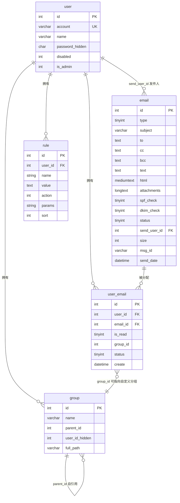
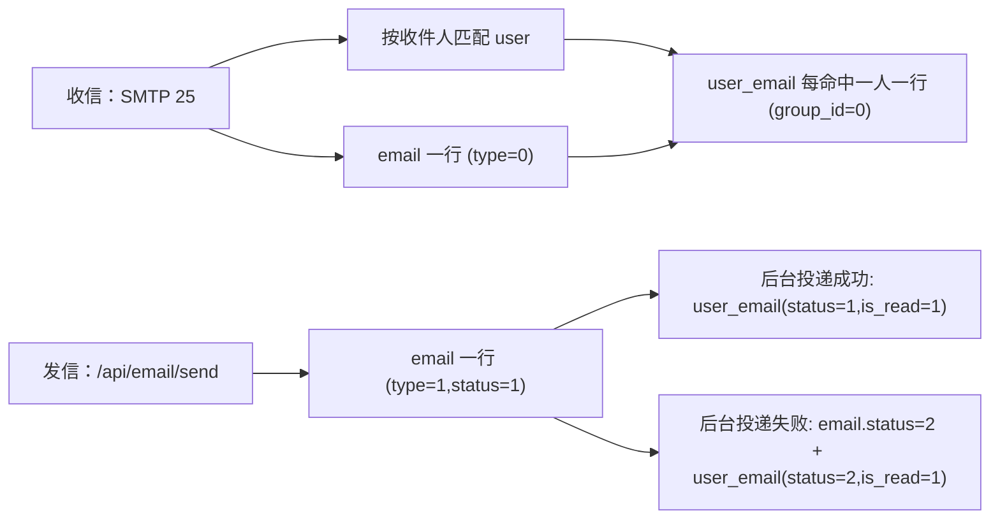
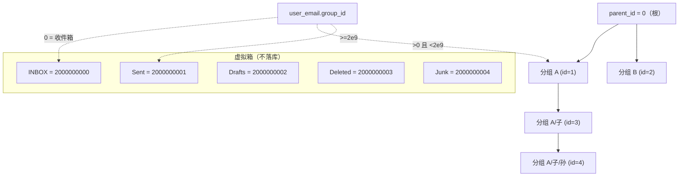

# 03 数据模型

> 文档编号：03
> 项目：PMail
> 状态：当前代码快照
> 证据基线：`master` @ `7e868f5`

本文件描述 PMail 的持久化数据模型：7 张表的字段、约束、对外暴露策略、表间关系与关键枚举常量。字段定义全部取自 `server/models/*.go` 的 xorm tag 与 json tag；表由 `Sync2` 在启动时自动创建/迁移（`server/internal/infra/persistence/database.go`）。接口清单见 [03 接口说明](./02-功能与接口清单.md)，组件划分见 [01 项目架构](./01-项目架构.md)。

## 1. 总览

| 表 | 模型 | 用途 | 对外序列化策略 | 证据 |
| --- | --- | --- | --- | --- |
| `user` | `models.User` | 邮箱账号、密码哈希、禁用位、管理员标记 | `password` 被 `json:"-"` 完全隐藏 | `server/models/User.go:3`-`:14` |
| `email` | `models.Email` | 邮件本体（头、正文、附件、投递状态） | 自定义 `MarshalJSON`，时间字段转字符串、`sql.NullString` 摊平 | `server/models/email.go:9`-`:84` |
| `user_email` | `models.UserEmail` | 用户 ↔ 邮件的多对多关系，承载已读/分组/状态 | 默认字段导出 | `server/models/user_email.go:5`-`:16` |
| `group` | `models.Group` | 用户自定义邮件分组（树形） | `user_id` 被 `json:"-"` 隐藏 | `server/models/group.go:3`-`:9` |
| `rule` | `models.Rule` | 收信规则（条件 JSON + 动作码） | 默认字段导出 | `server/models/rule.go:3`-`:15` |
| `sessions` | `models.Sessions` | scs 会话存储 | 不对外暴露 | `server/models/session.go:3`-`:11` |
| `version` | `models.Version` | 程序版本记录（单行） | 不对外暴露 | `server/models/version.go:3`-`:10` |

支持的数据库：SQLite / MySQL / PostgreSQL（`server/internal/infra/persistence/database.go`）。SQLite 在 `sqliteDSNWithReliabilityOptions` 中做可靠性参数加固并把连接池限制为 1（`server/internal/infra/persistence/database.go`、`:43`-`:45`）。

## 2. 关系图

> 说明：`user_email.group_id` 与 `group.id` **没有数据库外键**，是逻辑关联；且 `group_id = 0` 表示“收件箱”，`group_id >= 2000000000` 表示内置箱（见第 6 节），这两类取值在 `group` 表中没有对应行。管理员的 `email.send_user_id` 也可为 0（系统收信），见第 3.2 节。

## 3. 表结构详情

### 3.1 `user`（`models.User` → 表名 `user`）

| 字段 | Go 类型 | xorm 约束 | JSON 键 | 说明 | 证据 |
| --- | --- | --- | --- | --- | --- |
| `id` | `int` | `unsigned int not null pk autoincr` | `id` | 主键 | `server/models/User.go:4` |
| `account` | `string` | `varchar(20) notnull unique` | `account` | 登录账号（本地部分，不含域名） | `server/models/User.go:5` |
| `name` | `string` | `varchar(10) notnull` | `name` | 显示名 | `server/models/User.go:6` |
| `password` | `string` | `char(32) notnull` | **`-`（不下发）** | 两次 MD5 加盐哈希，见第 7 节 | `server/models/User.go:7` |
| `disabled` | `int` | `unsigned int not null default(0)` | `disabled` | `0` 启用、`1` 禁用 | `server/models/User.go:8` |
| `is_admin` | `int` | `unsigned int not null default(0)` | `is_admin` | `0` 普通、`1` 管理员 | `server/models/User.go:9` |

关键行为：

- 登录查询条件为 `account = ? and password = ? and disabled = 0`（`server/internal/api/auth_handler.go`）；Token 校验同样带 `disabled=0`（`server/internal/api/http/http_middleware.go`）。
- 登录成功后，整个 `models.User` 被 `json.Marshal` 后写入 session 键 `user`（`server/internal/api/auth_handler.go`），拦截器再反序列化出 `ID/Name/Account/IsAdmin`（`server/internal/api/http/http_middleware.go`）。由于 `password` 带 `json:"-"`，session 中**不含**密码哈希。
- 修改密码直接 `Update({"password": encode(pwd)})`（`server/internal/api/settings_handler.go`）；管理员编辑用户走 `ID(id).Cols("name","password","disabled").Update(&user)`（`server/internal/api/http/user_handler.go`）。
- `name` 只有 `varchar(10)`，超长用户名可能被数据库截断或报错，接口层未做长度校验（`server/internal/api/http/user_handler.go` 仅判空）。
- 历史数据修复：当 `user_email` 为空时，把唯一非管理员账号提权为管理员，并把旧邮件挂到该账号（`server/internal/infra/persistence/database.go`）。

### 3.2 `email`（`models.Email` → 表名 `email`）

| 字段 | Go 类型 | xorm 约束 | 说明 | 证据 |
| --- | --- | --- | --- | --- |
| `id` | `int` | `id pk unsigned int autoincr notnull` | 主键 | `server/models/email.go:10` |
| `type` | `int8` | `tinyint(4) notnull default(0)` | `0` 收到的邮件、`1` 发送的邮件 | `server/models/email.go:11` |
| `subject` | `string` | `varchar(1000) notnull default('')` | 标题 | `server/models/email.go:12` |
| `reply_to` | `string` | `text` | 回复地址，存 JSON 数组字符串 | `server/models/email.go:13` |
| `from_name` | `string` | `varchar(50) notnull default('')` | 发件人显示名 | `server/models/email.go:14` |
| `from_address` | `string` | `varchar(100) notnull default('')` | 发件人地址 | `server/models/email.go:15` |
| `to` | `string` | `text` | 收件人，JSON 数组字符串 `[{Name,EmailAddress}]` | `server/models/email.go:16` |
| `bcc` | `string` | `text` | 密送，同上 | `server/models/email.go:17` |
| `cc` | `string` | `text` | 抄送，同上 | `server/models/email.go:18` |
| `text` | `sql.NullString` | `text` | 纯文本正文，可 NULL | `server/models/email.go:19` |
| `html` | `sql.NullString` | `mediumtext` | HTML 正文，可 NULL | `server/models/email.go:20` |
| `sender` | `string` | `text` | SMTP 信封发送者，JSON 字符串 | `server/models/email.go:21` |
| `attachments` | `string` | `longtext` | 附件 JSON 数组，元素含 `Filename/ContentType/Content/ContentID` | `server/models/email.go:22`、`:40`-`:45`；`server/dto/parsemail/email.go:48`-`:53` |
| `spf_check` | `int8` | `tinyint(1)` | SPF 是否通过（`1` 通过） | `server/models/email.go:23` |
| `dkim_check` | `int8` | `tinyint(1)` | DKIM 是否通过（`1` 通过） | `server/models/email.go:24` |
| `status` | `int8` | `tinyint(4) notnull default(0)` | `0` 未发送、`1` 已发送、`2` 发送失败 | `server/models/email.go:25` |
| `cron_send_time` | `time.Time` | （无额外约束） | 定时发送时间；JSON 键被改写为 `send_time` | `server/models/email.go:26`、`:65` |
| `update_time` | `time.Time` | `updated` | 自动更新时间 | `server/models/email.go:27` |
| `send_user_id` | `int` | `unsigned int notnull default(0)` | 发件人用户 ID（收信时为 0 或命中的本地用户） | `server/models/email.go:28` |
| `size` | `int` | `unsigned int notnull default(1000)` | 邮件大小；注意默认值是 **1000** 而非 0 | `server/models/email.go:29` |
| `error` | `sql.NullString` | `text` | 投递错误信息，可 NULL | `server/models/email.go:30` |
| `send_date` | `time.Time` | （无额外约束） | 投递时间 | `server/models/email.go:31` |
| `create_time` | `time.Time` | `created` | 自动创建时间 | `server/models/email.go:32` |
| `msg_id` | `string` | `varchar(255) notnull default('')` | RFC 风格 Message-ID，创建时生成一次 | `server/models/email.go:33` |

`MarshalJSON` 的序列化改写（`server/models/email.go:47`-`:84`）：

| 字段 | 输出形态 | 证据 |
| --- | --- | --- |
| `cron_send_time` | 改名为 `send_time`，格式 `2006-01-02 15:04:05` | `server/models/email.go:65`、`:75` |
| `send_date` / `update_time` / `create_time` | 同样格式化字符串 | `server/models/email.go:66`-`:68`、`:76`-`:78` |
| `text` / `html` / `error` | `Nullable` 摊平成字符串（NULL 输出 `""`） | `server/models/email.go:79`-`:81` |
| `attachments` | 从 JSON 字符串解析为数组 `[{Filename,ContentType,Index}]`，并附加下标；**不含附件内容** | `server/models/email.go:50`-`:61`、`:72` |

`msg_id` 生成规则：`{16 字节随机数的 hex}.{纳秒时间戳}@{config.Domain}`（`server/dto/parsemail/email.go:95`-`:99`）。Web 发信与 SMTP 收信都显式赋值 `msg_id`（`server/internal/api/email_send_handler.go`、`server/internal/app/email_receive.go`）。

### 3.3 `user_email`（`models.UserEmail` → 表名 `user_email`）

| 字段 | Go 类型 | xorm 约束 | 说明 | 证据 |
| --- | --- | --- | --- | --- |
| `id` | `int` | `id int unsigned not null pk autoincr` | 主键；**IMAP 中作为 UID 使用** | `server/models/user_email.go:6`；`server/internal/app/email_query.go` |
| `user_id` | `int` | `int not null`，普通索引 + 复合索引 `idx_eid` | 用户 ID | `server/models/user_email.go:7` |
| `email_id` | `int` | `not null`，普通索引 + 复合索引 `idx_eid` | 邮件 ID | `server/models/user_email.go:8` |
| `is_read` | `int8` | `tinyint(1)` | 是否已读 | `server/models/user_email.go:9` |
| `group_id` | `int` | `int notnull default(0)` | 分组 ID；`0` = 收件箱，`>= 2e9` = 内置箱，`>0 且 <2e9` = 自定义分组 | `server/models/user_email.go:10` |
| `status` | `int8` | `tinyint(4) notnull default(0)` | 见第 6 节状态枚举 | `server/models/user_email.go:11` |
| `create` | `time.Time` | `create datetime created` + 索引 `idx_create_time` | 创建时间 | `server/models/user_email.go:12` |

要点：

- 表**没有** `(user_id, email_id)` 唯一约束。同一用户重复收到同一封邮件，或 `rule` 的 MOVE 动作重复执行，可能产生重复关系行（`server/internal/app/rule_service.go` 只做 `has` 判重，无唯一索引兜底）。
- 删除语义分两级：`forcedDel=false` 只把 `status` 改为 3（已删除）并把 `group_id` 归零；`forcedDel=true` 删除关系行，并在该邮件无任何关系行时删除 `email` 行（`server/internal/app/email_delete.go`）。
- 发送邮件时，成功/失败各插入一条关系行，`is_read` 恒为 1（`server/internal/api/email_send_handler.go`）。

### 3.4 `group`（`models.Group` → 表名 `group`）

| 字段 | Go 类型 | xorm 约束 | JSON 键 | 说明 | 证据 |
| --- | --- | --- | --- | --- | --- |
| `id` | `int` | `int unsigned not null pk autoincr` | `id` | 主键 | `server/models/group.go:4` |
| `name` | `string` | `varchar(10) notnull default('')` | `name` | 分组名（同级 + 同用户下未建唯一约束） | `server/models/group.go:5` |
| `parent_id` | `int` | `int unsigned notnull default(0)` | `parent_id` | 父分组 ID，`0` 为根 | `server/models/group.go:6` |
| `user_id` | `int` | `int unsigned notnull default(0)` | **`-`（不下发）** | 所属用户 | `server/models/group.go:7` |
| `full_path` | `string` | tag 键拼写为 **`xrom:"full_path ..."`**（不是 `xorm`） | `full_path` | 完整路径如 `a/b/c` | `server/models/group.go:8` |

要点：

- `full_path` 的 tag 前缀拼错成 `xrom`，xorm 不会识别该列定义，实际列类型/长度取决于数据库推断；`full_path` 的写入由 `getLayerName` 递归拼接（`server/internal/app/group_service.go`）。
- 建分组先按 `(name, user_id)` 查重，已存在则**直接复用既有分组**而不新建（`server/internal/app/group_service.go`）。
- 删除分组会递归删除所有子分组（`getAllChildId`），并把相关 `user_email.group_id` 归零（`server/internal/app/group_service.go`、`:103`-`:115`）。
- `group` 表只存**自定义**分组；收件箱/发件箱/草稿箱/已删除/广告箱是虚拟箱，用常量表示（第 6 节），不落库。

### 3.5 `rule`（`models.Rule` → 表名 `rule`）

| 字段 | Go 类型 | xorm 约束 | 说明 | 证据 |
| --- | --- | --- | --- | --- |
| `id` | `int` | `int unsigned not null pk autoincr` | 主键 | `server/models/rule.go:4` |
| `user_id` | `int` | `notnull default(0)` | 规则所有者，所有读写都带该条件 | `server/models/rule.go:5` |
| `name` | `string` | `notnull default('')` | 规则名 | `server/models/rule.go:6` |
| `value` | `string` | `text` | 条件 JSON 数组 `[{field,type,rule}]` | `server/models/rule.go:7` |
| `action` | `int` | `notnull default(0)` | `1` 已读、`2` 转发、`3` 删除、`4` 移动 | `server/models/rule.go:8`；`server/dto/rule.go:11`-`:16` |
| `params` | `string` | `notnull default('')` | 动作参数：转发地址或目标分组 ID | `server/models/rule.go:9` |
| `sort` | `int` | `notnull default(0)` | 排序，“越大约优先”；读取时 `Decr("sort")` 降序 | `server/models/rule.go:10`、`server/internal/app/rule_service.go` |

- 条件字段白名单：`From`、`Subject`、`To`、`Cc`、`Text`、`Html`、`Content`（`server/internal/api/http/rule_handler.go`）。
- 匹配类型：`regex`、`contains`、`eq`（`server/internal/app/rule_service.go`）。
- `insert`/`update` 用原生 SQL，且 `update` 带 `user_id` 条件防越权（`server/internal/api/http/rule_handler.go`、`:70`）；`delete` 同样带 `user_id`（`server/internal/api/http/rule_handler.go`）。

### 3.6 `sessions`（`models.Sessions` → 表名 `sessions`）

| 字段 | Go 类型 | xorm 约束 | 说明 | 证据 |
| --- | --- | --- | --- | --- |
| `token` | `string` | `char(43) not null pk` | scs 会话 token（base64，43 字符） | `server/models/session.go:4` |
| `data` | `string` | `blob` | 序列化后的会话数据 | `server/models/session.go:5` |
| `expiry` | `int` | `timestamp index` | 过期时间 | `server/models/session.go:6` |

会话生命周期 7 天（`server/internal/infra/session/session.go`），存储按数据库类型选择 `mysqlstore`/`sqlite3store`/`postgresstore`（`server/internal/infra/session/session.go`）。

### 3.7 `version`（`models.Version` → 表名 `version`）

| 字段 | Go 类型 | xorm 约束 | 说明 | 证据 |
| --- | --- | --- | --- | --- |
| `id` | `int` | `int unsigned not null pk autoincr` | 主键 | `server/models/version.go:4` |
| `info` | `string` | `varchar(255) notnull` | 程序版本字符串 | `server/models/version.go:5` |

启动时若 `info` 与当前编译版本不一致则写入/更新（`server/internal/infra/persistence/database.go`）。

## 4. 用户与邮件的三重关联

- 一封邮件对应多个收件用户，靠 `user_email` 拆出每人独立的已读/分组/状态。
- 管理员可通过 `auth.HasAuth` 越权访问任意邮件（`server/internal/app/auth_service.go`），非管理员必须有 `user_email` 记录（`server/internal/app/email_detail.go`）。
- 邮件的“是否已读”不落在 `email` 表，而在 `user_email.is_read`；列表查询用 `e.*, ue.is_read` 拼接（`server/internal/app/email_query.go`）。

## 5. 分组树模型

- 树形结构通过 `parent_id` 自引用实现，`full_path` 冗余保存完整路径用于 IMAP 分组名（`server/internal/app/group_service.go`、`:174`-`:184`）。
- 递归深度由 `getAllChildId`、`buildChildren`、`getLayerName` 三个递归函数决定，未做环检测：若把某分组的 `parent_id` 人为改成自身或子孙，会无限递归（建分组接口未校验 `parent_id` 合法性，`server/internal/app/group_service.go`）。
- 默认箱判定集中在两处需保持一致：`IsDefaultBox`（`server/internal/app/group_service.go`）与 `GroupCodeToName`（`server/models/group.go:27`-`:33`），前者用字符串、后者用常量，**新增箱需同时改两处**。

## 6. 关键枚举与常量

### 6.1 内置箱常量（`models/group.go`）

| 常量 | 值 | 名称字符串（IMAP） | 用户可见文案（i18n） | 证据 |
| --- | --- | --- | --- | --- |
| `INBOX` | `2000000000` | `INBOX` | `inbox` 收件箱 | `server/models/group.go:12`、`:20`；`server/internal/app/translation.go` |
| `Sent` | `2000000001` | `Sent Messages` | `outbox` 发件箱 | `server/models/group.go:13`、`:21`；`server/internal/app/translation.go` |
| `Drafts` | `2000000002` | `Drafts` | `sketch` 草稿箱 | `server/models/group.go:14`、`:22`；`server/internal/app/translation.go` |
| `Deleted` | `2000000003` | `Deleted Messages` | `deleted` 已删除 | `server/models/group.go:15`、`:23`；`server/internal/app/translation.go` |
| `Junk` | `2000000004` | `Junk` | `junk` 广告箱 | `server/models/group.go:16`、`:24`；`server/internal/app/translation.go` |

两个映射表互为反向：`GroupNameToCode`（名称 → 码，`server/models/group.go:19`-`:25`）与 `GroupCodeToName`（码 → 名称，`server/models/group.go:27`-`:33`）。`user_email.group_id` 实际存自定义分组 ID（`>0 且 <2e9`）；内置箱在查询时用**状态**表达而非 `group_id`（见 6.2 与 `server/internal/app/email_query.go`）。

### 6.2 邮件状态常量（`consts/consts.go` + `models.UserEmail`）

| 常量 | 值 | 含义 | 适用表 | 证据 |
| --- | --- | --- | --- | --- |
| `EmailStatusWait` | `0` | 未发送 / 收件箱（已收到） | `email.status`、`user_email.status` | `server/consts/consts.go:10`；`server/models/user_email.go:11` |
| `EmailStatusSent` | `1` | 已发送 | 同上 | `server/consts/consts.go:13` |
| `EmailStatusFail` | `2` | 发送失败 | 同上 | `server/consts/consts.go:16` |
| `EmailStatusDel` | `3` | 已在回收站（软删除） | `user_email.status` | `server/consts/consts.go:19` |
| `EmailStatusDrafts` | `4` | 草稿 | `user_email.status` | `server/consts/consts.go:22` |
| `EmailStatusJunk` | `5` | 骚扰/广告邮件 | `user_email.status` | `server/consts/consts.go:25` |
| `EmailStatusDeliveryPending` | `6` | 出站审计投递中（结果未定） | `email.status`（收信侧写入） | `server/consts/consts.go:28`；`server/internal/app/email_receive.go` |

> `email.status` 的列注释只有 `0/1/2` 三值（`server/models/email.go:25`），而 `consts` 里还有一个 `6`；`6` 只出现在收信审计落库路径，属于“注释与常量不同步”的现状。

### 6.3 邮件类型（`consts/consts.go`）

| 常量 | 值 | 含义 | 证据 |
| --- | --- | --- | --- |
| `EmailTypeReceive` | `0` | 收到的邮件 | `server/consts/consts.go:7` |
| `EmailTypeSend` | `1` | 发送的邮件 | `server/consts/consts.go:5` |

### 6.4 规则动作（`dto/rule.go`）

| 常量 | 值 | 含义 | 落库效果 | 证据 |
| --- | --- | --- | --- | --- |
| `READ` | `1` | 标记已读 | `user_email.is_read = 1` | `server/dto/rule.go:12`；`server/internal/app/rule_service.go` |
| `FORWARD` | `2` | 转发到 `params` 地址 | 域内直接建 `user_email`；域外走 send | `server/dto/rule.go:13`；`server/internal/app/rule_service.go` |
| `DELETE` | `3` | 标记删除 | `user_email.status = 3` | `server/dto/rule.go:14`；`server/internal/app/rule_service.go` |
| `MOVE` | `4` | 移动到 `params` 指定的分组 | 写 `user_email.group_id`（不改 `email.type`），与移动接口行为不一致 | `server/dto/rule.go:15`；`server/internal/app/rule_service.go` |

### 6.5 前端检索标签（`dto/tag.go`）

`SearchTag{type,status,group_id}` 由后端序列化为字符串下发，前端原样回传（`server/dto/tag.go:5`-`:14`）。默认/不限值为 `-1`；`group_id` 额外支持 `0`（收件箱）与内置箱常量。

## 7. 密码与凭证（只写演算法，不含任何真实值）

| 项 | 演算法 | 证据 |
| --- | --- | --- |
| 密码存储 | `md5(md5(password + "pmail") + "pmail2023")`，32 位小写 hex 存 `char(32)` | `server/pkg/password/encode.go:9`-`:12`、`:14`-`:18`；`server/models/User.go:7` |
| 请求 Token | `{account}:{md5(user.Password + 时间戳)}:{时间戳}`；时间戳相差 `>= 5` 秒即过期 | `server/internal/api/http/http_middleware.go` |
| 会话 | scs 会话 Cookie，`sessions` 表，7 天有效 | `server/internal/infra/session/session.go` |

> 上述均为公开代码中的固定盐值常量，本文仅描述结构；任何真实账号、密码、Token、DKIM 私钥、证书私钥都未写入手册。

## 8. 主要不一致与风险（仅记录现状，不修改代码）

| # | 现象 | 证据 |
| --- | --- | --- |
| 1 | `Group.FullPath` 的 tag 写成 `xrom:`，xorm 不解析该列定义，跨库建表行为可能不一致 | `server/models/group.go:8` |
| 2 | `Email.Status` 的 xorm 注释只描述 `0/1/2`，但常量还有 `6`（投递中），`6` 会在收信审计路径出现 | `server/models/email.go:25`；`server/consts/consts.go:28` |
| 3 | `user_email` 缺 `(user_id, email_id)` 唯一约束，规则转发与重复投递可能产生重复关系行 | `server/models/user_email.go:5`-`:13`；`server/internal/app/rule_service.go` |
| 4 | `email.size` 默认值是 `1000`，未显式赋值的插入会写入 1000 而非 0 | `server/models/email.go:29` |
| 5 | 内置箱同时用“常量码”“名称字符串”两套表示，且 `user_email.group_id >= 2e9` 也与 `status` 混用；`Move2DefaultBox` 对内置箱改的是 `status` 而非 `group_id`，而 `DelGroup` 又把 `group_id` 归零，语义易混淆 | `server/models/group.go:11`-`:33`；`server/internal/app/group_service.go`；`server/internal/app/group_service.go` |
| 6 | 规则 MOVE 动作更新的是 `user_email.group_id`，而移动接口对内置箱走 `status`，两条路径同一语义不同落点 | `server/internal/app/rule_service.go`；`server/internal/app/group_service.go` |
| 7 | `group(name,user_id)`、`group(parent_id)` 均无唯一约束与循环保护；`user.name` 只有 `varchar(10)`，接口层未校验长度 | `server/models/group.go:5`-`:6`；`server/models/User.go:6` |
| 8 | `attachments` 以 JSON 字符串整块存 `email` 表（`longtext`），附件内容与正文同库，大附件会放大单行体积 | `server/models/email.go:22`；`server/models/email.go:40`-`:45` |
| 9 | `FindUE` 查询 `user_email` 时只按 `user_id`+`status` 过滤，未带 `group_id`，同一用户同一状态下的多分组邮件会被一起取回，分组隔离口径与 `list` 服务不一致 | `server/internal/app/email_detail.go`；`server/internal/app/email_query.go` |

## 9. 相关文档

- [01 项目架构](./01-项目架构.md)：组件与启动顺序
- [03 接口说明](./02-功能与接口清单.md)：接口、鉴权、错误码
- [架构全景图](../10-架构/01-架构全景图.md)：系统上下文

## 10. 证据索引

| 主题 | 路径:行号 |
| --- | --- |
| 建表同步（`Sync2` 7 张表） | `server/internal/infra/persistence/database.go` |
| 历史数据修复 | `server/internal/infra/persistence/database.go` |
| 数据库类型与连接池 | `server/internal/infra/persistence/database.go` |
| `user` 模型 | `server/models/User.go:3`-`:14` |
| `email` 模型与序列化 | `server/models/email.go:9`-`:84` |
| `user_email` 模型 | `server/models/user_email.go:5`-`:16` |
| `group` 模型与内置箱常量 | `server/models/group.go:3`-`:37` |
| `rule` 模型 | `server/models/rule.go:3`-`:15` |
| `sessions` / `version` 模型 | `server/models/session.go:3`-`:11`、`server/models/version.go:3`-`:10` |
| 邮件状态/类型常量 | `server/consts/consts.go:3`-`:29` |
| 规则动作枚举 | `server/dto/rule.go:8`-`:32` |
| 检索标签 | `server/dto/tag.go:5`-`:14` |
| 附件结构 | `server/dto/parsemail/email.go:48`-`:53` |
| 邮件列表 SQL（联表与内置箱条件） | `server/internal/infra/persistence/email_query.go` |
| 分组树与删除级联 | `server/internal/app/group_service.go`、`:118`-`:188`、`:318`-`:363` |
| 软删除/硬删除 | `server/internal/app/email_delete.go` |
| 权限判定 | `server/internal/app/auth_service.go`、`server/internal/app/email_detail.go` |
| 密码与会话 | `server/pkg/password/encode.go:9`-`:18`、`server/internal/infra/session/session.go`、`server/internal/api/http/http_middleware.go` |
| 收信落库 | `server/internal/app/email_receive.go` |
| 发信落库 | `server/internal/api/email_send_handler.go` |
| 规则执行 | `server/internal/app/rule_service.go` |
