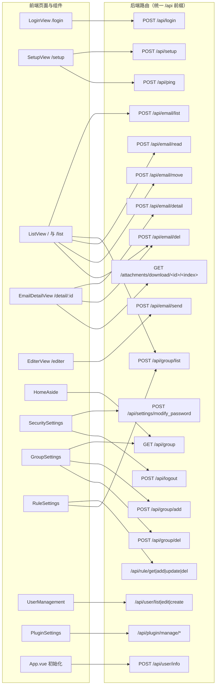

# 04 前端应用

> 文档编号：04
> 项目：PMail
> 状态：当前代码快照
> 证据基线：`develop` @ `3a0a916`（前端升级后工作区）

本文件描述 `web/desktop/` 目录下的 Vue 3 单页应用：技术栈、路由与页面、组件职责、状态管理、请求封装、国际化，以及页面与后端接口的对应关系。构建产物如何进入 Go 二进制、如何部署见 [07 构建与部署](./05-构建与部署.md)；后端接口的鉴权与错误码细节见 [03 接口说明](./02-功能与接口清单.md)；前端相关的实现风险汇总见 [09 已知限制与风险](./07-已知限制与风险.md)。

## 1. 技术栈与工程配置

| 项 | 取值 | 证据 |
| --- | --- | --- |
| 框架 | Vue `3.5.45`，Composition API + `<script setup lang="ts">` | `web/desktop/package.json:11-21` |
| 语言 | TypeScript `6.0.3`，`vue-tsc --noEmit` 类型检查 | `web/desktop/package.json:22-36`、`web/desktop/tsconfig.json` |
| 构建工具 | Vite `8.3.8`，插件 `@vitejs/plugin-vue` 6.0.10 | `web/desktop/package.json`、`web/desktop/vite.config.ts` |
| UI 组件库 | Arco Design Vue `2.59.0`，通过 `unplugin-vue-components` + `ArcoResolver` 按需引入组件、样式与图标 | `web/desktop/package.json`、`web/desktop/vite.config.ts:9-20` |
| 路由 | vue-router `5.5.0`，`createWebHistory`（history 模式） | `web/desktop/src/router/index.ts:1,42` |
| 状态管理 | Pinia `4.1.0` + `@vue/devtools-api` 8.2.1 | `web/desktop/package.json`、`web/desktop/src/main.ts:2,13` |
| HTTP | axios `1.21.1` | `web/desktop/package.json`、`web/desktop/src/utils/axios.ts` |
| 富文本编辑器 | `@wangeditor-next/editor` 6.5.1 + `@wangeditor-next/editor-for-vue` 6.5.1 | `web/desktop/package.json`、`web/desktop/src/views/EditerView.vue` |
| 图标 | `@arco-design/web-vue/es/icon` | `web/desktop/src/components/HomeAside.vue`、`src/views/ListView.vue` |
| 包管理 | bun 1.4.4，唯一锁文件 `web/desktop/bun.lock` | `web/desktop/package.json`、`web/desktop/bun.lock` |
| Lint | ESLint 10 flat config + `@vue/eslint-config-typescript` | `web/desktop/eslint.config.js` |

工程约定：

* 入口 HTML 为 `web/desktop/index.html`，挂载点 `#app`，入口脚本 `/src/main.ts`。
* 应用入口 `web/desktop/src/main.ts` 注册 router、Pinia，并引入 Arco 基础样式、Message/Notification/Modal 样式与本地 `assets/main.css`。
* 路径别名 `@` → `web/desktop/src`（`web/desktop/vite.config.ts:24-28`）。
* 开发脚本：`bun run dev`、`bun run typecheck`、`bun run lint`、`bun run build`。
* 开发服务器代理：`/api` 与 `/attachments` 转发到 `VITE_PROXY_TARGET`，未配置时默认 `http://127.0.0.1/`（`web/desktop/vite.config.ts:8-10,30-36`）。
* `axios` 的 `baseURL` 取自 `import.meta.env.VITE_APP_URL`（`web/desktop/src/utils/axios.ts`），未注入时为空串，即请求同源。

## 2. 页面与路由表

前端使用 **history 路由**；服务端通过 `server/internal/api/http/http_spa.go` 对非 API、非附件、非静态文件路径回退 `index.html`，刷新 `/list`、`/detail/1`、`/setup` 等地址可直接打开。API 与缺失静态资源仍返回 404。

| 路径 | 路由名 | 视图组件 | 说明 |
| --- | --- | --- | --- |
| `/` | `home` | `ListView.vue` | 首页即邮件列表 |
| `/list` | `list` | `ListView.vue` | 切换分组后跳转至此 |
| `/editer` | `editer` | `EditerView.vue` | 写信页 |
| `/login` | `login` | `LoginView.vue` | 登录页，隐藏外框 |
| `/setup` | `setup` | `SetupView.vue` | 首次引导配置，隐藏外框 |
| `/detail/:id` | `detail` | `EmailDetailView.vue` | 邮件详情，`id` 取自路由参数 |

路由层的两个横切行为：

1. **未登录/未初始化自动跳转**：HTTP 响应体 `errorNo === 403` 时跳 `/login`，`errorNo === 402` 时跳 `/setup`，两者都会把当前路径写入 `query.redirect`（`web/desktop/src/utils/axios.ts`；服务端错误码定义 `server/dto/response/response.go:9-10`）。
2. **登录/引导页隐藏外框**：`App.vue` 根据当前路由名决定是否渲染 `HomeHeader`、`HomeAside` 与移动端抽屉。

## 3. 页面职责

### 3.1 邮件列表 `ListView.vue`

* 数据来源：`POST /api/email/list`，固定 `page_size: 15`；分页时带 `current_page`。
* 分组过滤：当前分组以字符串 tag 表示，默认 `{"type":0,"status":-1}`，切换分组时通过 `useGroupStore` 的 `watch` 重新拉取。
* 批量操作：全选/反选、标记已读（`/api/email/read`）、移动（`/api/email/move`）、删除（`/api/email/del`）；删除时 `forcedDel` 由 tag 中 `status === 3` 决定。
* 行内状态图标：未读圆点、`dangerous` 安全提示、`error` 投递错误提示。
* 点击行跳详情：`router.push('/detail/' + row.id)`。

### 3.2 邮件详情 `EmailDetailView.vue`

* 拉取详情：`POST /api/email/detail`，`id` 来自 `route.params.id`。
* 正文渲染：`html` 为空串时显示纯文本，否则用 `v-html` 渲染 HTML；HTML 由后端 `parsemail` 清洗。
* 附件下载：直接拼 `'/attachments/download/{id}/{index}'` 的 `<a href>`，不经过 axios。
* 删除：读当前分组 tag 决定 `forcedDel`。

### 3.3 写信 `EditerView.vue`

* 初始化时从全局状态取当前账号、可选域名列表、昵称。
* 校验：发件人只填前缀（不含 `@`）、收件人/抄送/密送用 `/.+@.+\..+/` 正则粗校验、标题必填。
* 提交：`POST /api/email/send`，`from.email = 前缀 + "@" + pickDomain`，正文同时提交 `text` 与 `html`，附件以 DataURL 形式随请求提交。
* 发送成功后跳到发件箱：设置 `groupStore.tag = '{"type":1,"status":-1}'` 并 `router.replace({ name: 'list' })`。
* 富文本语言跟随前端语言：`zhCn` → `zh-CN`，其余 → `en`。

### 3.4 登录 `LoginView.vue`

* 纯前端必填校验，提交 `POST /api/login`。
* 成功后把返回值合并进全局状态 `userInfos`（`account`/`name`/`is_admin`/`domains`），再跳 `/`。
* 回车提交。

### 3.5 引导配置 `SetupView.vue`

6 步向导，全部通过 `POST /api/setup` 的 `action`/`step` 组合驱动：

| 步骤 | 前端动作 | 接口参数（action/step） |
| --- | --- | --- |
| 0 欢迎 | 直接进入下一步 | — |
| 1 数据库 | 读取已存配置 | `get`/`database` |
| 2 管理员密码 | 提交账号密码 | `set`/`password` |
| 3 域名 | 提交 SMTP/Web 域名与多域名 | `set`/`domain`（`multi_domain` 用逗号拼接） |
| 4 DNS | 读取期望 DNS 记录 | `get`/`dns` |
| 5 SSL | 读取/提交证书方案 | `get`/`ssl`、`set`/`ssl`、`getParams`/`ssl` |

特殊逻辑：

* **等待服务重启**：SSL 提交后用裸 axios 轮询 `POST /api/ping`，成功即跳转到 `http(s)://{web_domain}`。
* **DNS-01 挑战编码**：前端把「自动 + DNS 挑战」编码成 `ssl_type = "2"`，读取时将 `"2"` 还原为 `"0"` + `challenge=dns`。

## 4. 组件职责

| 组件 | 职责 | 关键接口 |
| --- | --- | --- |
| `HomeHeader.vue` | 移动端顶栏（汉堡按钮 + 品牌），并承载设置弹窗的 5 个标签页；`userInfos.is_admin` 为真才显示「用户管理」 | 无（读全局状态） |
| `HomeAside.vue` | 左侧导航：品牌、搜索框、分组菜单、设置入口；分组从 `/api/group` 拉取扁平化后渲染；移动端复用同一组件进 `a-drawer` | `GET /api/group` |
| `SecuritySettings.vue` | 修改密码、退出登录 | `POST /api/settings/modify_password`、`POST /api/logout` |
| `GroupSettings.vue` | 分组树与新增/删除弹窗 | `GET /api/group`、`POST /api/group/add`、`POST /api/group/del` |
| `RuleSettings.vue` | 收信规则列表与新增/编辑/删除，规则动作 1 标记已读 / 2 转发 / 3 删除 / 4 移动 | `/api/rule/get`、`/api/rule/add`、`/api/rule/update`、`/api/rule/del`、`GET /api/group/list` |
| `UserManagement.vue` | 用户分页列表、编辑、新建（仅管理员可见） | `/api/user/list`、`/api/user/edit`、`/api/user/create` |
| `PluginSettings.vue` | 管理员可见的插件表格（状态、授权、调用计数）、审批弹窗与上传入口 | `GET /api/plugin/manage/list`、`POST /api/plugin/manage/{approve,enable,disable,reject,reload,upload}` |

`App.vue` 是唯一常驻壳层：`a-config-provider` + 头部 + 侧栏 + `RouterView`（带 `page-fade` 过渡），并在 `onMounted` 时初始化系统主题与用户信息。

## 5. 状态管理（Pinia）

| Store | 状态 | 说明 |
| --- | --- | --- |
| `useGlobalStatusStore` | `userInfos`、`mobileDrawerVisible`、`settingsDrawerVisible`；getter `isLogin` 以 `userInfos` 非空判定 | `init()` 调 `POST /api/user/info`，成功则合并进 `userInfos` |
| `useGroupStore` | `tag`（分组过滤条件字符串）、`name`（分组显示名） | `tag` 为空串时各页面兜底为 `{"type":0,"status":-1}` |

状态落点约定：

* 当前分组统一由 `useGroupStore.tag` 承载，`ListView` 与 `EmailDetailView` 都读它决定「删除是普通删除还是强删除」。
* 登录态不持久化到 localStorage；刷新页面依赖服务端 session cookie，再由 `App.vue` 重新拉 `/api/user/info` 恢复。

## 6. 请求封装与鉴权头

`web/desktop/src/utils/axios.ts` 是唯一封装的 HTTP 客户端：

| 行为 | 实现 |
| --- | --- |
| baseURL | `import.meta.env.VITE_APP_URL`（未配置时同源） |
| 超时 | 60 秒 |
| 默认头 | `Content-Type: application/json;charset=UTF-8;`、`Lang: <当前语言>` |
| 请求拦截 | 仅 POST 时 `JSON.stringify(data)` |
| 响应拦截 | 解包为 `response.data`；`errorNo` 403→`/login`、402→`/setup` |
| 类型 | `http.get<T>()` / `http.post<T>()` 返回 `Promise<ApiResponse<T>>` |

鉴权方式（与后端对齐，证据 `server/internal/api/http/http_middleware.go`）：

* 主路径是服务端 session cookie：登录控制器把用户 JSON 写入 session，后续请求由 `app.Sessions.LoadAndSave` 中间件从 cookie 还原。
* 备选是 `Token` 请求头：`{account}:md5(md5(md5(password+"pmail")+"pmail2023")+{Unix 时间戳}):{Unix 时间戳}`，有效期 5 秒。前端代码中没有任何位置设置该头，浏览器端实际只走 cookie。
* `Lang` 头影响后端错误文案：后端取 `Lang`，为空时按 `en` 处理；前端只会传 `en` 或 `zhCn`。

## 7. 国际化（i18n）

* 实现方式是模块级静态字典，不是 vue-i18n：`i18n.ts` 默认导出 `lang` 对象，另含 `zhCN` 字典。
* 语言判定只发生在模块加载时：浏览器首选语言以 `zh` 开头则用中文，否则英文。
* `lang.lang` 字段是后端契约值：`"en"` / `"zhCn"`，同时用于 `Lang` 请求头。
* 没有语言切换 UI，语言在页面加载后不可变。
* Arco 组件内置文案通过 `App.vue` 的 `a-config-provider` 的 locale 切换。
* 列表页与详情页仍有少量硬编码英文提示（如 `'Select emails first'`、`'Marked as read'`、`'Deleted successfully'`），编辑器 placeholder 为英文。

## 8. 页面与后端接口映射

接口清单（前端视角，按页面归并）：

| 页面/组件 | 方法 | 路径 | 请求关键字段 |
| --- | --- | --- | --- |
| 登录 | POST | `/api/login` | `account`、`password` |
| 全局初始化 | POST | `/api/user/info` | `{}` |
| 引导 | POST | `/api/setup` | `action`、`step`、按步骤附加 |
| 引导 | POST | `/api/ping` | `{}`（裸 axios） |
| 列表 | POST | `/api/email/list` | `tag`、`page_size`、`current_page` |
| 列表 | POST | `/api/group/list` | 无 |
| 列表 | POST | `/api/email/read` | `ids` |
| 列表 | POST | `/api/email/move` | `group_id`、`group_name`、`ids` |
| 列表/详情 | POST | `/api/email/del` | `ids`、`forcedDel` |
| 详情 | POST | `/api/email/detail` | `id` |
| 详情 | GET（原生 a 标签） | `/attachments/download/{id}/{index}` | — |
| 写信 | POST | `/api/email/send` | `from`、`to`、`cc`、`bcc`、`subject`、`text`、`html`、`attrs` |
| 侧栏 | GET | `/api/group` | — |
| 安全设置 | POST | `/api/logout`、`/api/settings/modify_password` | `password` |
| 分组设置 | GET/POST | `/api/group`、`/api/group/add`、`/api/group/del` | `name`、`parent_id`、`id` |
| 规则设置 | POST/GET | `/api/rule/get`、`/api/rule/add`、`/api/rule/update`、`/api/rule/del`、`/api/group/list` | `id`、`name`、`sort`、`rules[]`、`action`、`params` |
| 用户管理 | POST | `/api/user/list`、`/api/user/edit`、`/api/user/create` | `current_page`、`page_size`、`account`、`username`、`disabled`、`password` |
| 插件设置 | GET/POST | `/api/plugin/manage/list`、`/api/plugin/manage/approve`、`enable`、`disable`、`reject`、`reload`、`upload` | `pluginId`、`hooks[]`、`capabilities[]`、multipart `file` |

后端路由注册总表见 `server/internal/api/http/http_routes.go`。

## 9. 「证据不足」与待确认项

| 事项 | 现状 | 依据 |
| --- | --- | --- |
| `VITE_APP_URL` 的正式取值 | 仓库无 `.env*` 提交；本地可用 `.env.local` 的 `VITE_PROXY_TARGET` 指向测试后端；生产构建中 `VITE_APP_URL` 为空串（同源） | `web/desktop/src/utils/axios.ts`、`web/desktop/vite.config.ts` |
| 前端单测 / E2E 覆盖 | 仓库内无前端测试文件；本轮执行 `typecheck`、`lint`、`build` 与浏览器逐页冒烟 | `web/desktop/package.json` |
| 移动端断点行为 | 已用 375px iframe 验证：侧栏隐藏、汉堡按钮显示、`a-drawer` 可打开；未在真实移动设备上验收 | `web/desktop/src/App.vue`、`HomeHeader.vue` |
| Setup 全流程 | 已验证欢迎页与数据库步骤渲染；完整 6 步需要未初始化实例，本轮未在独立实例上完成 | `web/desktop/src/views/SetupView.vue` |
