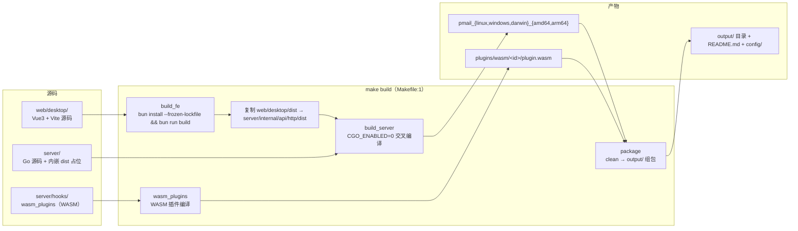
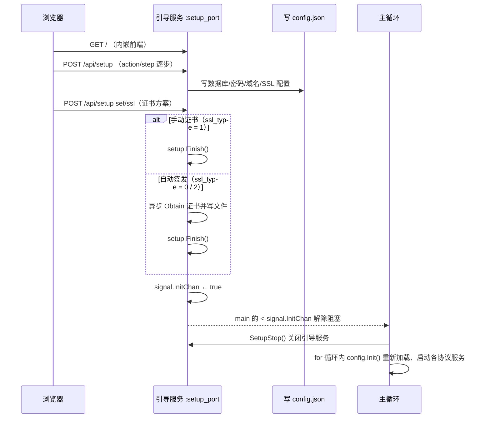
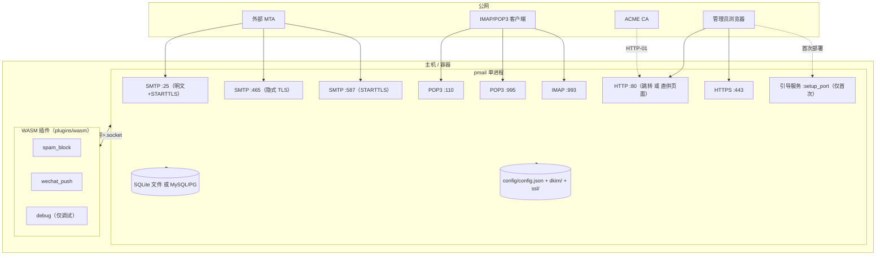

# 05 构建与部署

> 文档编号：05
> 项目：PMail
> 状态：当前代码快照（含「证据不足」标注）
> 证据基线：`master` @ `7e868f5`

本文件描述 PMail 从源码到可运行产物的完整路径：本地一键 `make build`、Docker 镜像、运行时目录结构与配置文件字段、进程启动顺序与监听端口。前端代码结构见 [06 前端应用](./04-前端应用.md)；组件职责与启动顺序的另一视角见 [01 项目架构](./01-项目架构.md)；端口与命令速查见 [10 调试手册](./08-调试手册.md)。

## 1. 总体构建链路



关键设计：**前端产物在编译期被嵌入 Go 二进制**。`server/internal/api/http/http_routes.go` 用 `//go:embed dist/*` 把 `server/internal/api/http/dist/` 整个目录打进二进制，`http_server.go:26-30` 再用 `fs.Sub(local, "dist")` + `http.FileServer` 对外提供。因此：

* 运行时**不需要**单独的静态资源目录或 Nginx。
* `server/internal/api/http/dist/` 由构建流程临时生成，源码仓库中不存在该目录（`.gitignore` 忽略了 `dist`），也未被 `//go:embed` 的占位文件补齐——**直接 `go build` 会因 embed 目录缺失而失败**，必须先把前端产物复制进去。

### 1.1 本地后端启动

在仓库根目录执行：

```bash
make build_fe  # 生成并复制内嵌前端资源，首次构建必需
make run       # config/config.json
# 或 make run_dev，读取 config/config.dev.json
```

等价的后端命令（从 `server/` 执行）：

```bash
PMail_ROOT="$PWD/" go run ./cmd/pmail
PMail_ROOT="$PWD/" go run ./cmd/pmail dev
```

GoLand 使用 Package 运行方式，Package path 为 `github.com/Jinnrry/pmail/cmd/pmail`，Working directory 为仓库的 `server/`，设置环境变量 `PMail_ROOT` 为该目录绝对路径。Program arguments 为空时读取普通配置，填 `dev` 时读取开发配置。修改配置后需要重启进程。其他源码位置见 [01 项目架构](./01-项目架构.md#11-源码目录与依赖边界)。

## 2. 一键 `make build`

`Makefile:1` 定义：`build: build_fe build_server wasm_plugins package`，即 4 个目标顺序执行。

| 序号 | 目标 | 动作 | 证据 |
| --- | --- | --- | --- |
| 1 | `build_fe` | `cd web/desktop && bun install --frozen-lockfile && bun run build`；随后 `rm -rf server/internal/api/http/dist` 并 `cp -rf ../web/desktop/dist internal/api` | `Makefile:7-10` |
| 2 | `build_server` | 4 次 `go build`，`CGO_ENABLED=0`，`-ldflags "-s -w -X main.goVersion=... -X main.gitHash=... -X main.buildTime=..."` | `Makefile:12-16` |
| 3 | `wasm_plugins` | 用 `GOOS=wasip1 GOARCH=wasm -buildmode=c-shared` 编译 `server/hooks/wasm_plugins/cmd/{spam_block,wechat_push,debug}` 到 `server/hooks/wasm_plugins/output/{p}/plugin.wasm`，并复制各自 `manifest.json` | `Makefile` |
| 4 | `package` | 先 `clean`（`rm -rf output`），再建 `output/`、`output/config/`、`output/plugins/wasm/`，拷入 dkim、ssl、config.json、WASM 插件与 README | `Makefile` |

### 2.1 主程序产物清单（`build_server`）

| 文件名 | GOOS | GOARCH | 证据 |
| --- | --- | --- | --- |
| `pmail_linux_amd64` | linux | amd64 | `Makefile:13` |
| `pmail_windows_amd64.exe` | windows | amd64 | `Makefile:14` |
| `pmail_mac_amd64` | darwin | amd64 | `Makefile:15` |
| `pmail_mac_arm64` | darwin | arm64 | `Makefile:16` |

注意：`make build` 的**本地产物只有 4 个**（linux/windows amd64 + darwin amd64/arm64），没有 linux/arm64。

### 2.2 WASM 插件产物（`wasm_plugins`）

`make wasm_plugins` 在 `server/hooks/wasm_plugins` 内构建三个命令：

```text
output/
├── spam_block/{manifest.json,plugin.wasm}
├── wechat_push/{manifest.json,plugin.wasm}
└── debug/{manifest.json,plugin.wasm}
```

- 构建参数：`CGO_ENABLED=0 GOOS=wasip1 GOARCH=wasm go build -buildmode=c-shared`。
- `package` 只把 `spam_block`、`wechat_push` 复制到 `output/plugins/wasm/`；`debug` 仅调试用。
- 主程序扫描 `plugins/wasm/{id}/`，审批启用后由 wazero 加载；旧进程插件与 Unix socket 机制已移除。

### 2.3 `package` 目标的组包结果

```
output/
├── pmail_linux_amd64
├── pmail_windows_amd64.exe
├── pmail_mac_amd64
├── pmail_mac_arm64
├── README.md
├── config/
│   ├── config.json
│   ├── dkim/
│   └── ssl/
└── plugins/
    └── wasm/
        ├── spam_block/
        │   ├── manifest.json
        │   └── plugin.wasm
        └── wechat_push/
            ├── manifest.json
            └── plugin.wasm
```

以上结构来自 `Makefile`（`mkdir output/config`、`mkdir output/plugins`、`cp -r deploy/config/dkim`、`cp -r deploy/config/ssl`、`cp deploy/config/config.json`、`cp -r server/hooks/wasm_plugins/output/{spam_block,wechat_push} output/plugins/wasm/`、`cp README.md`）。

> **安全提示**：`deploy/config/dkim/` 与 `deploy/config/ssl/` 下**内含示例证书文件**（仓库自带的开发测试用私钥/证书），`package` 目标会把它们原样打进发布包。部署时必须替换为自己的证书与 DKIM 私钥，并轮换/作废仓库中的示例密钥。仓库内 `deploy/config/dkim/README.md` 与 `deploy/config/ssl/README.md` 也只有一句提示：「这里存储的秘钥仅开发测试使用，线上环境请重新生成！」

> 注意：仓库中**不存在** `config_mysql.json` 的组包逻辑。`deploy/config/config_mysql.json` 只是一个可选模板，`make build` 不会把它拷进 `output/`（`Makefile:36` 只拷 `config.json`）。测试目标会先把 `deploy/config/` 的样例复制到 `server/config/`，运行期产生的配置与数据仍留在 `server/config/` 且不入库。

## 3. 其他构建入口

### 3.1 `make` 的其他目标

| 目标 | 作用 | 证据 |
| --- | --- | --- |
| `clean` | `rm -rf output` | `Makefile:3-4` |
| `wasm_plugins` | 只编译 WASM 插件 | `Makefile` |
| `test_fixtures` | 把 `deploy/config/` 的样例复制到 `server/config/`，供本地测试使用 | `Makefile:42-44` |
| `test` | 设置 `setup_port=17888`、`PMail_ROOT`，跑 `go test -v -p 1 ./...`（串行） | `Makefile:46-47` |
| `test_e2e` | 带 `e2e` 构建标签跑真实服务测试 | `Makefile:49-50` |
| `test_mysql` / `test_postgres` | 带 tag 的数据库集成测试 | `Makefile:52-56` |

`test` 目标依赖 `PMail_ROOT` 环境变量（`Makefile:47`），该环境变量会覆盖程序默认的根路径推导（`server/internal/config/config.go:55-68`）。测试开始前会由 `test_fixtures` 把 `deploy/config/` 下的样例配置、SSL 与 DKIM 文件复制到 `server/config/`；运行期生成的配置与数据库仍留在 `server/config/`，且已被 `.gitignore` 排除。真实服务测试集中在 `server/test/e2e`；`server/cmd/pmail/main_test.go` 因直接调用 `main()` 仍留在入口包，但同样带 `//go:build e2e`，只在 `make test_e2e` 下编译。

### 3.3 Dockerfile（本地构建镜像）

两阶段构建（`Dockerfile:1-37`）：

| 阶段 | 基础镜像 | 动作 | 证据 |
| --- | --- | --- | --- |
| `febuild` | `node:24-alpine` | `COPY web/desktop .` 后安装 bun 1.4.4，执行 `bun install --frozen-lockfile && bun run build` | `Dockerfile:1-7` |
| `serverbuild` | `golang:1.27.3-alpine` | `COPY . .`，把前端 `dist` 拷进 `server/internal/api/`，编译主程序与 WASM 插件 | `Dockerfile` |
| 运行镜像 | `alpine` | `apk add tzdata` 并设时区 `Asia/Shanghai`，拷入 `pmail` 与 `plugins/` | `Dockerfile:20-33` |

* `WORKDIR /work`，`CMD /work/pmail`（`Dockerfile:22,37`），所以运行期根路径为 `/work/`，对应 `/work/config/`、`/work/plugins/`。
* `EXPOSE 25 80 110 443 465 587 995 993`（`Dockerfile:35`）。
* `serverbuild` 阶段使用 `apk add git` 以执行 `git show -s --format=%H`（`Dockerfile:14-15`）。
* **没有任何 `VOLUME` 声明**，数据持久化必须由使用者显式 `-v` 挂载（见第 6 节）。

### 3.4 DockerfileGithubAction

结构与 `Dockerfile` 类似，但**只拷 `server` 目录、不做前端构建**（`DockerfileGithubAction:6`），其设计前提是宿主机上已由前置步骤 `make build_fe` 生成 `server/internal/api/http/dist` 后再作为构建上下文。同样 `EXPOSE 25 80 110 443 465 587 995 993`、时区 `Asia/Shanghai`、`CMD /work/pmail`（`DockerfileGithubAction:18-31`）。

> 仓库**没有** `.dockerignore`，`COPY . .`（`Dockerfile:12`）会把 `.git`、`web/desktop/node_modules` 等全部带入构建上下文，镜像构建会明显变慢（证据：根目录无 `.dockerignore` 文件）。

## 5. 端口清单

端口全部来自源码中的监听地址（非推测）：

| 服务 | 端口 | 加密 | 证据 | 备注 |
| --- | --- | --- | --- | --- |
| SMTP 明文 | 25 | 明文 + STARTTLS，`AllowInsecureAuth=false` | `server/internal/api/smtp/smtp_server.go` | 收信主入口 |
| SMTP 隐式 TLS | 465 | TLS | `server/internal/api/smtp/smtp_server.go` | |
| SMTP STARTTLS | 587 | 明文接入后升级 TLS | `server/internal/api/smtp/smtp_server.go` | 代码注释：587 使用 STARTTLS 而非隐式 TLS |
| Web 管理后台 HTTP | 80（`httpPort` 可改） | 视 `httpsEnabled` | `server/internal/api/http/http_routes.go` | `httpsEnabled != 2` 时仅做 301 跳 HTTPS（`server/internal/api/http/http_routes.go`）；`= 2` 时直接提供页面与 API |
| Web 管理后台 HTTPS | 443（`httpsPort` 可改） | TLS | `server/internal/api/http/http_routes.go` | `httpsEnabled != 2` 时才启动 |
| POP3 明文 | 110 | 明文 | `server/internal/api/pop3/listener.go` | |
| POP3 隐式 TLS | 995 | TLS | `server/internal/api/pop3/listener.go` | |
| IMAP 隐式 TLS | 993 | TLS | `server/internal/api/imap/imap_server.go` | 代码注释「不加密的代码就懒得写了」，**无 143 端口** |
| 引导服务 | `-p` 参数，默认 80；也可用环境变量 `setup_port` 覆盖 | 明文 | `server/internal/api/http/http_setup.go` | 仅 `isInit=false` 时启动 |

端口硬编码说明：SMTP/POP3/IMAP 端口在源码中写死，配置文件只能改 HTTP/HTTPS 端口（`server/internal/config/config.go:37-38`）。Docker `EXPOSE` 与 README 开放端口建议均为上述 8 个（`Dockerfile:35`、`README.md` 部署段落）。

## 6. Docker 运行与卷挂载

README 给出的启动命令（`README.md` 的「How to run」段落）：

```
docker run -p 25:25 -p 80:80 -p 443:443 -p 110:110 -p 465:465 -p 587:587 -p 995:995 -p 993:993 \
  -v $(pwd)/config:/work/config ghcr.io/jinnrry/pmail:latest
```

| 容器路径 | 用途 | 是否必须持久化 | 证据 |
| --- | --- | --- | --- |
| `/work/config/` | `config.json`、SQLite 数据文件（默认 `./config/pmail.db`）、`dkim/`、`ssl/` | **必须**，否则容器重建即丢失配置与数据 | `server/internal/config/config.go:141`、`deploy/config/config.json:1`、`server/internal/bootstrap/bootstrap.go` |
| `/work/plugins/wasm/` | WASM 插件（镜像内已内置） | 一般不必 | `Dockerfile`、`server/internal/infra/plugin/wasm.go` |

> 容器内没有设置任何 `VOLUME`，只挂 `config` 即可满足常见需求；如果希望自定义插件，需额外挂载 `/work/plugins/wasm`（判断依据：`server/internal/infra/plugin/plugin_manager.go` 扫描 `plugins/wasm`）。

首次部署（未初始化）的两种方式：

1. **引导页**：直接运行二进制/容器，访问 `http://<IP>:<setup 端口>` 走 `/setup` 向导，完成后程序自动切换为正式服务（第 7 节）。
2. **配置文件预置**：准备 `config/config.json` 并置 `isInit: true`，启动后跳过引导（`server/internal/config/config.go:158-160`、`server/internal/bootstrap/bootstrap.go`）。

## 7. 启动顺序与运行目录

### 7.1 目录结构（运行时）

```
<运行目录>/            # 默认为可执行文件所在目录（server/internal/config/config.go:69-87）
├── pmail*             # 或 pmail_linux_amd64 等
├── plugins/wasm/      # WASM 插件（plugin.wasm + manifest.json）
└── config/
    ├── config.json    # 主配置（server/internal/config/config.go:141）
    ├── pmail.db       # SQLite 数据文件（名称由 dbDSN 决定，示例见 deploy/config/config.json:1）
    ├── dkim/          # DKIM 私钥（内含示例文件，部署需替换并轮换）
    └── ssl/           # 证书与私钥（内含示例文件，部署需替换并轮换）
```

根路径推导规则：若设置了环境变量 `PMail_ROOT` 则以其为准；否则取可执行文件真实路径（`EvalSymlinks` 后）的父目录（`server/internal/config/config.go:55-88`）。所有相对路径配置项都会被拼上该根路径（`server/internal/config/config.go:264-274`）。

`dirInit()` 只在未初始化时创建 `config/`、`config/dkim/`、`config/ssl/` 三个目录，权限 `0744`（`server/internal/bootstrap/bootstrap.go`）。

### 7.2 启动时序

`main()` → `config.Init()` → 打印版本横幅 → `bootstrap.Run()`（绑定依赖后启动定时任务及核心服务）（`server/cmd/pmail/main.go:17-37`）。

首次部署（`config.IsInit == false`）：



证据：`server/internal/bootstrap/bootstrap.go`（`go httpserver.SetupStart()` → `<-signal.InitChan` → `SetupStop()`）、`server/internal/app/setup_service.go`（`Finish()` 写 `isInit=true` 后向 `InitChan` 发信号）。**两条 `Finish()` 触发路径**：

* 手动证书：`server/internal/api/http/http_setup.go`，`ssl_type == SSLTypeUser`（`"1"`）时在响应返回后立即调用；
* 自动签发：`server/internal/infra/certificate/certificate.go`，在 `Certificate.Obtain` 成功、证书文件写完后于**异步回调**中调用。该回调由 `async.Process` 的 goroutine 执行且带 `recover`（`server/pkg/async/async.go:41-46`），签发失败时 panic 会被吞掉、`InitChan` 不再被发送，主循环将一直停在 `<-signal.InitChan`（无超时兜底，`server/internal/bootstrap/bootstrap.go`）。

已初始化部署（`IsInit == true`）的主循环每一轮（`server/internal/bootstrap/bootstrap.go`）：

| 阶段 | 动作 | 证据 |
| --- | --- | --- |
| 1 | `config.Init()` 重新读配置；`parsemail.Init()`；`db.Init()`；`session.Init()`；`hooks.Init()` | `server/internal/bootstrap/bootstrap.go` |
| 2 | 拉起 SMTP 三个监听（25/465/587） | `server/internal/bootstrap/bootstrap.go` |
| 3 | 拉起 HTTPS 与 HTTP | `server/internal/bootstrap/bootstrap.go` |
| 4 | `waitHTTPReady()`：轮询 `http://127.0.0.1:<httpPort>/api/ping`，最多 90 次×1s | `server/internal/bootstrap/bootstrap.go` |
| 5 | `ssl.Update(false)`：检查证书，剩余 <30 天或名称不匹配或已过期则续期 | `server/internal/bootstrap/bootstrap.go`、`server/internal/infra/certificate/certificate.go` |
| 6 | 拉起 POP3（110/995）与 IMAP（993） | `server/internal/bootstrap/bootstrap.go` |
| 7 | 记录数据库类型与 HTTP 端口 | `server/internal/bootstrap/bootstrap.go` |
| 8 | `select` 阻塞在 `RestartChan` / `StopChan` 上 | `server/internal/bootstrap/bootstrap.go` |

重启与停止：

* 两个信号通道由程序内部产生：`ssl.Update(needRestart=true)` 续期证书后向 `RestartChan` 发信号（`server/internal/infra/certificate/certificate.go`）；定时任务检测到证书变化也发 `RestartChan`（`server/internal/bootstrap/scheduler.go`）。
* `RestartChan` 分支：依次 `Stop()` 所有服务与插件，`time.Sleep(5s)`，回到 `for` 循环顶部重新初始化（`server/internal/bootstrap/bootstrap.go`）。
* `StopChan` 分支：同样停止全部服务后 `return`，`main` 打印 `Server Stoped` 退出（`server/internal/bootstrap/bootstrap.go`、`server/cmd/pmail/main.go:39`）。
* **全仓库检索表明没有任何代码向 `StopChan` 发送信号，也没有 `signal.Notify` 处理 `SIGINT`/`SIGTERM`**（证据：`server/internal/app/ports.go` 只有三个 channel 声明；`grep` 结果仅 `finish.go:22`、`ssl_update.go:53`、`ssl/ssl.go:325` 三处发送，分别对应 `InitChan` 与 `RestartChan`）。因此外部 `kill` 走的是进程默认终止行为，不会执行优雅停机逻辑。

### 7.3 重启期的端口空窗

`RestartChan` 分支结束后固定 `time.Sleep(5 * time.Second)` 才进入下一轮（`server/internal/bootstrap/bootstrap.go`），期间 25/80/110/443/465/587/993/995 全部处于关闭状态；若此时 `waitHTTPReady()` 也失败，最长还会再等约 90 秒（`server/internal/bootstrap/bootstrap.go`）。对外表现为短暂不可达，邮件客户端通常会重试。

## 8. 配置文件字段说明

配置来源：`config.Init()` 默认读 `<ROOT>/config/config.json`；若启动参数最后一个为 `dev` 则改读 `config/config.dev.json`（`server/internal/config/config.go:130-152`）。字段定义与注释见 `server/internal/config/config.go:24-51`，示例见 `deploy/config/config.json`、`deploy/config/config.dev.json`、`deploy/config/config_mysql.json`。

| 字段 | 类型 | 用途 | 取值与默认行为 | 证据 |
| --- | --- | --- | --- | --- |
| `logLevel` | string | 日志级别 | 空→info；`debug`/`info`/`warn`/`error`；未知值回落 info | `server/internal/config/config.go:25,172-189` |
| `domain` | string | 主收信域名（也用作 SMTP 问候域名、MsgID 域） | 示例值见 `deploy/config/config.json:1` | `server/internal/config/config.go:26`、`server/internal/api/http/email_handler.go` |
| `domains` | string[] | 多域名收信列表 | 为空且 `domain` 非空时自动置为 `[domain]` | `server/internal/config/config.go:27,154-156` |
| `webDomain` | string | 后台访问域名，用于 HTTP→HTTPS 301 跳转 | — | `server/internal/config/config.go:28`、`server/internal/api/http/http_routes.go` |
| `dkimPrivateKeyPath` | string | DKIM 私钥路径 | 相对路径会拼根路径；仓库内为示例文件 | `server/internal/config/config.go:29,264-274`、`deploy/config/config.json:1` |
| `sslType` | string | 证书获取方式 | `0`=ACME HTTP 挑战；`1`=用户上传证书；`2`=ACME DNS 挑战 | `server/internal/config/config.go:30,101-103` |
| `SSLPrivateKeyPath` | string | 私钥路径（证书对） | 相对路径拼根路径 | `server/internal/config/config.go:31,271-273` |
| `SSLPublicKeyPath` | string | 证书（crt）路径 | 相对路径拼根路径 | `server/internal/config/config.go:32,268-270` |
| `dbDSN` | string | 数据库连接串 | SQLite 相对路径会拼根路径 | `server/internal/config/config.go:33,265-267` |
| `dbType` | string | 数据库类型 | `sqlite` / `mysql` / `postgres`；其他值启动即报错 | `server/internal/config/config.go:34,98-105`、`server/internal/infra/persistence/database.go` |
| `httpsEnabled` | int | 后台页面是否启用 HTTPS | `0`默认/`1`启用；`2`不启用（此时 80 端口直接提供页面与 API） | `server/internal/config/config.go:35`、`server/internal/api/http/http_routes.go` |
| `spamFilterLevel` | int | 垃圾邮件过滤级别 | `0`不过滤；`1` SPF 与 DKIM 均失败时过滤；`2` SPF 失败过滤；`3` DKIM 失败过滤 | `server/internal/config/config.go:36`、`server/internal/app/email_send.go` |
| `httpPort` | int | HTTP 端口 | `<=0` 时用 80 | `server/internal/config/config.go:37`、`server/internal/api/http/http_routes.go` |
| `httpsPort` | int | HTTPS 端口 | `<=0` 时用 443 | `server/internal/config/config.go:38`、`server/internal/api/http/http_routes.go` |
| `isInit` | bool | 是否已完成初始化 | 仅当 `domain != ""` 且 `isInit == true` 才置 `IsInit` | `server/internal/config/config.go:45,158-160` |
| `weChatPushAppId` / `weChatPushSecret` / `weChatPushTemplateId` / `weChatPushUserId` | string | 微信推送插件参数 | 示例为空串 | `server/internal/config/config.go:39-42`、`deploy/config/config.dev.json:14-17` |
| `tgBotToken` / `tgChatId` | string | Telegram 推送参数 | 示例为空串 | `server/internal/config/config.go:43-44`、`deploy/config/config.dev.json:18-19` |
| `webPushUrl` / `webPushToken` | string | Web 推送参数 | 示例为空串 | `server/internal/config/config.go:46-47`、`deploy/config/config.dev.json:20-21` |
| `pluginWasmEnabled` | int | 是否启用 WASM 插件能力 | `0` 关闭（默认）；`1` 启用 | `server/internal/config/config.go:48`、`deploy/config/config.dev.json:22` |

配置相关的额外事实：

* 启动日志仅记录数据库类型与 HTTP 端口，不再输出完整配置对象或 SMTP 登录密码（`server/internal/bootstrap/bootstrap.go`；`Config` 结构体的 json tag 见 `server/internal/config/config.go:24-51`）。部署时需保证日志检索权限最小化。
* 配置写回使用 `os.WriteFile(..., 0666)`（`server/internal/config/config.go:226`），权限为所有人可写（受 umask 影响）。
* `Tables`/`TablesInitData` 标记 `json:"-"`，不参与序列化（`server/internal/config/config.go:48-49`）。

## 9. 部署拓扑



部署前置条件（均可在代码/文档中找到依据）：

* 主机需开放 25/80/110/443/465/587/993/995（`Dockerfile:35`、`README.md` 部署段落）。
* WSL/云厂商场景下 80/443 之外的低端口绑定权限需注意；容器内以 root 运行 `CMD /work/pmail`（`Dockerfile:37`），无降权步骤。
* 邮箱域名需配置 MX、SPF、DKIM 公钥记录，才能通过大邮箱服务商的反垃圾校验（`README.md` 特性段落）。
* 证书：使用 `sslType=0/2` 时由程序通过 ACME 自动签发；`sslType=1` 时需放置自己的证书（`server/internal/config/config.go:101-103`）。
* 时区：程序在 `config.Init()` 中把 `time.Local` 固定为 UTC+8（`server/internal/config/config.go:170-171`），镜像也把容器时区设为 `Asia/Shanghai`（`Dockerfile:25-27`）。邮件时间戳按本地时区解释。

## 10. 「证据不足」与待确认项

| 事项 | 现状 | 依据 |
| --- | --- | --- |
| 真实构建是否成功 | 本次文档任务**未执行** `make build`/`go build`（属构建验证，不在文档任务范围），产物清单来自 Makefile 静态阅读 | `Makefile:1-45` |
| `pmail_windows_amd64.exe` 在非 Windows 环境的运行细节 | 未验证；`package` 目标会把 `.exe` 与 Linux 二进制放在同一 `output/` | `Makefile:14,37` |
| Docker 镜像实际体积与启动耗时 | 未实测 | `Dockerfile:20-37` |
| 无 `.dockerignore` 对构建时间的影响幅度 | 未测量 | 根目录文件清单 |

源码分层门禁：`make check_arch` 在前端内嵌资源生成后执行。门禁按五层前缀校验依赖方向：api/app 不得反向依赖 infra，domain 不得引用兼容模型或协议/ORM；内部子包按前缀登记允许边。
