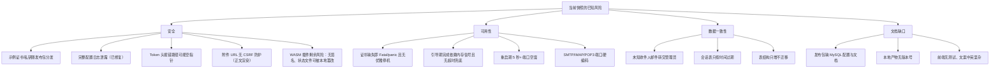

# 07 已知限制与风险

> 文档编号：07
> 项目：PMail
> 状态：当前代码快照（含「证据不足」标注）
> 证据基线：`master` @ `7e868f5`

本文件汇总当前代码快照中**有证据支撑**的限制与风险，按「安全」「可用性」「数据一致性」「文档缺口」四类组织。每条给出证据（`相对路径:行号`）、影响与建议。

> **范围声明**：本次文档任务**未修改任何业务代码、配置文件、README 或其他成员负责的文档**，只新增了 `docs/20-功能/04-前端应用.md`、`05-构建与部署.md`、`07-已知限制与风险.md` 三个文件。文中「建议」均为后续改进方向，不代表已经实施。
>
> **证据口径**：只收录在源码/配置/工作流中可直接读到的行为。「推测」「可能」「疑似」类结论一律放入文末「证据不足项」，不与已证事实混排。

## 0. 风险总览

## 1. 安全

### R-S1 仓库自带示例证书与 DKIM 私钥，并被 `package` 打进发布包

| 项 | 内容 |
| --- | --- |
| 证据 | `deploy/config/ssl/` 与 `deploy/config/dkim/` 下**内含示例证书文件**，两处 `README.md` 均写明「这里存储的秘钥仅开发测试使用，线上环境请重新生成！」（`deploy/config/ssl/README.md`、`deploy/config/dkim/README.md`）；`Makefile:34-35` 在打包时把两个目录原样拷入 `output/config/` |
| 影响 | 若使用者跳过替换步骤直接启动，SSL 与 DKIM 使用的就是公开仓库里的示例私钥；任何拿到仓库的人都能伪造 DKIM 签名或对 TLS 流量做中间人攻击。这是**已公开的密钥材料**，不能视作秘密 |
| 建议 | 发布包内改为只放 `README.md` 与目录占位；启动时检测密钥是否与仓库示例一致并告警；文档明确「首次部署必须替换并轮换」 |

### R-S2 完整配置日志泄露（目录分层迁移时已修复）

| 项 | 内容 |
| --- | --- |
| 现状 | `server/internal/bootstrap/bootstrap.go` 只记录数据库类型与 HTTP 端口；不再序列化完整配置对象。SMTP/POP3 认证日志也不再打印密码或完整用户对象，ACME 日志不再输出挑战 token |
| 历史影响 | 旧版本日志可能含推送凭据与数据库连接串，历史日志应按原有访问控制管理 |
| 约束 | 后续日志不得重新加入密码、Token、私钥或证书内容 |

### R-S3 `Token` 请求头鉴权失败分支存在空指针**理论**风险（未证实可触发）

| 项 | 内容 |
| --- | --- |
| 证据 | `server/internal/api/http/http_routes.go`：`Token` 头非空时执行 `if user.ID >= 0 && err == nil { ... } else { ... err.Error() ... }`，该 `else` 分支在 `err == nil` 时会对 nil 调用 `Error()`。而 `getLoginInfoByToken`（同文件 `:147-169`）只有 `:169` 的 `return user, nil` 会让 `err` 为 nil，其余路径（`:151` 格式错误、`:157` 过期、`:162`/`:166` 账号密码错误）恒返回非空 error |
| 判定 | **理论风险，未证实可触发。** 触发前提是「`err == nil` 且 `user.ID < 0`」，但两条都不成立：① `models.User.ID` 为 `int`，函数只在 `user.ID == 0`（`:161`）时提前返回错误，不存在返回负 ID 的路径；② 成功返回的用户来自数据库查询（`:159-160`），`id` 为自增主键，`Sync2` 建表后恒为正（`server/models/User.go:4`）。故该 `else` 分支在现有代码下实际不可达 |
| 影响 | 当前无线上影响。潜在隐患在于写法把「未登录」和「查询失败」混在一个条件里，后续若改动 `getLoginInfoByToken` 的返回约定（例如新增「返回零值 + nil」的分支），就会立即变成真实崩溃 |
| 建议 | 把 `user.ID >= 0` 修正为 `user.ID > 0`；`else` 分支改用固定文案或先判 `err != nil`。属健壮性改进，**不建议**作为线上缺陷单独立项 |

### R-S4 邮件正文直接 `v-html` 渲染，附件与内联资源走无 CSRF 防护的 GET 链接

| 项 | 内容 |
| --- | --- |
| 证据 | `web/desktop/src/views/EmailDetailView.vue:52`：`

`；附件下载链接直接拼 `'/attachments/download/' + id + '/' + index`（`web/desktop/src/views/EmailDetailView.vue:59`），服务端对应路由 `server/internal/api/http/http_routes.go` |
| 影响 | 邮件正文的清洗只依赖后端 `parsemail` 的 bluemonday 策略（仓库规则 `AGENTS.md` 明确「不绕过邮件 HTML 清洗」）。一旦清洗策略出现遗漏，前端 `v-html` 会把内容直接注入 DOM。附件下载是普通 GET，服务端仅有会话鉴权（`server/internal/app/email_query.go` 调用 `auth.HasAuth`），无法区分「用户主动点击」与「第三方页面诱导加载」，可用于探测用户是否登录（下载行为本身不会泄露内容给第三方，但会形成可观测的侧信道） |
| 建议 | 正文渲染前再加一层前端白名单清洗，或改用 `iframe` + `sandbox`；附件下载改用需 CSRF token 的 POST 或一次性签名链接 |

### R-S5 服务默认以 root 运行且无降权

| 项 | 内容 |
| --- | --- |
| 证据 | `Dockerfile:37`：`CMD /work/pmail`，运行镜像为 `alpine`，无 `USER` 指令；`server/internal/config/config.go:226` 配置文件写出权限 `0666`；`server/internal/bootstrap/bootstrap.go` 目录权限 `0744` |
| 影响 | 容器内进程以 root 运行，邮件协议服务直接绑定 <1024 端口，任何内存破坏类漏洞都能直接获得容器内 root；非容器部署时同理需要 root 才能绑定 25/110/443 等端口。配置与目录权限在宽松 umask 下对同机其他账号可读 |
| 建议 | 提供非 root 运行方案（`setcap` 或端口转发）；收紧 `0666` 为 `0600` |

### R-S6 WASM 插件执行的剩余风险

| 项 | 内容 |
| --- | --- |
| 证据 | `server/internal/config/config.go:48`（能力开关，默认关闭）；`server/internal/infra/plugin/wasm.go`（默认拒绝：不挂载文件；HTTP 仅在 `http` 能力与 `http_allow` 精确主机白名单时注册 `pmail_http_post`）；`server/internal/infra/plugin/plugin_registry.go`（`state.json` 权限 `0600`）；`server/internal/infra/plugin/plugin_manager.go`（默认不授权、manifest 哈希变化回 `pending`） |
| 影响 | 首期没有插件签名与上传审核，能以管理员权限写 `plugins/wasm` 的人可替换插件；`state.json` 与插件目录同属主，本地同权限攻击者可篡改审批结果；wazero 自身漏洞可能突破沙箱；被 `http_allow` 放行的主机可被插件用于外发请求，若白名单包含解析到内网/云元数据地址的域名，存在 SSRF 风险；单实例 128 MiB 限额在并发插件多时仍会累积 |
| 缓解 | 默认关闭能力开关；审批默认全拒绝；不挂载文件；`http_allow` 精确匹配主机、禁止重定向、请求体 ≤1 MiB、响应 ≤`output_bytes`；内存/超时/输出/并发限额；manifest 与 wasm 哈希绑定，变化即回待审批；调用计数与错误可观测 |
| 剩余风险 | 无签名校验、无上传接口审核、无多租户隔离；管理员需自行保证 `http_allow` 中的主机可信；恶意插件仍可消耗 CPU/内存至限额；`SettingsHtml` 直接渲染在管理页，未做 iframe 隔离 |
| 建议 | 生产环境仅允许管理员写插件目录；后续需求补签名与包分发；持续跟随 wazero 安全更新；`SettingsHtml` 后续评估 iframe 隔离 |

## 2. 可用性

### R-A1 证书缺失/非法时，SMTP、POP3、IMAP 启动即 `log.Fatal` 或 `panic`

| 项 | 内容 |
| --- | --- |
| 证据 | SMTP 三个监听在 `tls.LoadX509KeyPair` 失败时 `log.Fatal(err)`（`server/internal/api/smtp/smtp_server.go`）；POP3 在同样位置 `panic(err)`（`server/internal/api/pop3/listener.go`）；IMAP 构造服务时 `panic(err)`（`server/internal/api/imap/imap_server.go` 注释与 `:33`）；HTTPS 监听 `panic`（`server/internal/api/http/http_routes.go`） |
| 影响 | 这些监听都在 `bootstrap.Run()` 中以 `go` 启动（`server/internal/bootstrap/bootstrap.go`），任何一个 goroutine 的 `log.Fatal` 会直接 `os.Exit` 整个进程，`panic` 未被 recover 时同理。表现为「**进程启动后立刻退出**」，且错误信息只出现在日志里，从 Web 上完全看不出原因。`README.md` 也提示即使不用 HTTPS 也必须保证证书路径正确（`README.md` 特性段落） |
| 建议 | 启动期统一做一次证书预检并给出结构化错误；单个协议监听失败降级为「该协议不可用 + 告警」，而不是整个进程退出 |
| 边界 | 本条只覆盖**已初始化后启动**时证书文件缺失/非法。引导期自动签发失败属于另一条路径，见 R-A2 与「证据更正记录」第 1 条 |

### R-A2 引导阶段完成依赖无缓冲信号通道，且无超时兜底

| 项 | 内容 |
| --- | --- |
| 证据 | `server/internal/bootstrap/bootstrap.go`：`<-signal.InitChan` 阻塞等待引导完成，**无超时、无 select 兜底**；发送方有两处——① 手动证书路径 `server/internal/api/http/http_setup.go`（`ssl_type == "1"` 时）；② 自动签发路径 `server/internal/infra/certificate/certificate.go` 在异步 `Certificate.Obtain` 成功并写完证书文件后调用 `setup.Finish()`。`signal.InitChan` 为无缓冲 channel（`server/internal/app/ports.go`），`Finish()` 在 `server/internal/app/setup_service.go` 发送 |
| 影响 | 两条路径都会发送信号，但发送都发生在「证书已就绪」之后。在就绪之前，进程一直停在 `<-signal.InitChan` 上，既不提供邮件服务也不对外报错，Web 侧看不到任何原因。两类可观测风险：① **长时间无服务**：DNS-01 挑战需要等待 DNS 传播，`Certificate.Obtain` 自身的超时窗口长达数十分钟到一小时量级，期间进程处于静默等待；② **静默失败**：异步块内 `Certificate.Obtain` 失败即 `panic(err)`（`server/internal/infra/certificate/certificate.go`），写证书文件失败同样 `panic`（同文件 `:225-228`、`:230-233`、`:234-236`）。该异步块由 `async.Process` 的 goroutine 执行，**有 `recover`**（`server/pkg/async/async.go:41-46`），panic 被吞掉只记录到 `lastError`，因此进程**不会崩溃**，而是永远卡在 `<-signal.InitChan` 上——表现为「容器活着、端口不开、日志里只有一条错误」，这是本风险最实际的形态 |
| 建议 | 给 `<-signal.InitChan` 加超时并用 `config.IsInit` 轮询收敛；异步证书生成失败时向 `InitChan` 发送失败信号或在 `/api/setup` 轮询接口里暴露状态，让引导页能提示「证书签发失败，请改用上传证书或重试」；`async.Process` 的 `lastError` 当前无人读取，建议接入日志/状态上报 |

### R-A3 重启后固定休眠 5 秒，期间所有端口关闭

| 项 | 内容 |
| --- | --- |
| 证据 | `server/internal/bootstrap/bootstrap.go`：`log.Infof("Server Stop Success!")` 后 `time.Sleep(5 * time.Second)` 才回到 `for` 循环顶部；重启触发点见 `server/internal/infra/certificate/certificate.go`、`server/internal/bootstrap/scheduler.go` |
| 影响 | 每次证书续期/证书变化触发重启，都有 ≥5 秒的全协议不可用窗口；若 `waitHTTPReady()` 同时失败，下一轮再叠加最多 90 秒等待（`server/internal/bootstrap/bootstrap.go`）。外部 MTA 投递失败会触发重试，但会带来投递延迟与退信概率上升 |
| 建议 | 把重启缩短为「关闭监听 → 重新初始化 → 立即监听」，去掉固定 sleep；或改为热加载证书而不重启进程 |

### R-A4 SMTP / POP3 / IMAP 端口硬编码，无法通过配置调整

| 项 | 内容 |
| --- | --- |
| 证据 | `:25`（`server/internal/api/smtp/smtp_server.go`）、`:465`（`smtp.go:50`）、`:587`（`smtp.go:21`）；`:995` / `:110`（`server/internal/api/pop3/listener.go`）；`:993`（`server/internal/api/imap/imap_server.go`）。配置结构体只有 `httpPort` / `httpsPort`（`server/internal/config/config.go:37-38`） |
| 影响 | 端口冲突时无法通过配置解决，只能改代码或做端口映射；容器同样需要固定映射 8 个端口 |
| 建议 | 为各协议端口增加配置项并在启动时读取，与 `httpPort`/`httpsPort` 口径一致 |

### R-A5 前端首屏在未登录时会先发一次必败请求

| 项 | 内容 |
| --- | --- |
| 证据 | `web/desktop/src/App.vue:12-14` 在 `onMounted` 无条件调用 `globalStatus.init()`；该 action 直接 `POST /api/user/info`（`web/desktop/src/stores/useGlobalStatusStore.js:18-27`）。未登录时后端拦截器返回 `errorNo=403`（`server/internal/api/http/http_routes.go`），响应拦截器随即跳转 `/login`（`web/desktop/src/utils/axios.js:30-38`） |
| 影响 | 每个未登录访问者都会触发一次 403 并跳登录页，属于预期行为但会掩盖真实错误；若 `/setup` 阶段，则表现为 402 跳转到引导页。功能正确，但用户可感知到一次「闪一下」 |
| 建议 | 在路由守卫里先做会话探测，或在登录/引导页跳过 `init()` |

### R-A6 登录页与引导页之外，页面注册信息依赖单次拉取，刷新与并发标签页无同步

| 项 | 内容 |
| --- | --- |
| 证据 | `userInfos` 只在 `App.vue` 挂载时拉一次（`web/desktop/src/App.vue:12-14`），`web/desktop/src/components/HomeHeader.vue:52-53` 把 `globalStatus.userInfos` 取为局部常量，后续状态变化不触发其重新取值（模板中 `userInfos.is_admin` 只是初始快照的代理）；`PluginSettings`、`GroupSettings` 等组件在 `<script setup>` 顶层直接发请求（`web/desktop/src/components/PluginSettings.vue:32`、`web/desktop/src/components/GroupSettings.vue:63`） |
| 影响 | 多个标签页同时打开时，任一标签页的登录态变化（登出、改密）不会同步到其他标签页，需手动刷新。组件在 setup 顶层发请求会让设置弹窗每次打开都重新拉取，影响面小但请求量放大 |
| 建议 | 关键状态变化后广播（`storage` 事件或 BroadcastChannel）；组件请求移入 `onMounted` 或做缓存 |

## 3. 数据一致性

### R-D1 未知收件人邮件默认转交管理员，丢弃与否由代码常量决定

| 项 | 内容 |
| --- | --- |
| 证据 | `server/internal/app/email_receive.go`：`DropUnknownRecipientEmails = true` 为**代码级开关**，注释写明「此开关只能通过修改代码来更改，不暴露给用户配置」。真正决定丢弃的条件在 `server/internal/app/email_send.go`：只有在「收件人不存在」**且** `spamFilterLevel` 命中对应 SPF/DKIM 失败条件时才丢弃；否则 `audit_persistence.go:171-178` 回落为「投递给所有 `is_admin=1` 的用户」，无管理员时返回错误 |
| 影响 | 当 `spamFilterLevel=0`（仓库默认模板 `deploy/config/config.json:1` 为 0）时，发给任意不存在地址的邮件都会进入管理员邮箱。这既是收信兜底策略，也是垃圾邮件灌入的入口：扫描器探测 `xxx@domain` 即可污染管理员收件箱 |
| 建议 | 把该开关提升为配置项并默认开启丢弃；或在 `spamFilterLevel=0` 时也提供「未知收件人一律拒收」选项；文档中显式说明默认值的行为 |

### R-D2 `sessions` 表只按时间过期，无主动清理与用户级失效

| 项 | 内容 |
| --- | --- |
| 证据 | `server/internal/infra/session/session.go`：`scs.New()` 后 `Lifetime = 7 * 24 * time.Hour`；`server/models/session.go:3-10` 定义 `sessions(token, data, expiry)`；启动时只做 `Sync2`（`server/internal/infra/persistence/database.go`），全仓库未见对过期会话的批量清理逻辑 |
| 影响 | 会话过期数据会持续累积在 `sessions` 表，长期运行后表体积膨胀；管理员禁用某用户后，该用户已存在的会话在 7 天内仍然有效（禁用只在登录时校验 `disabled=0`，`server/internal/api/http/account_handler.go`，以及 Token 校验时校验 `disabled=0`，`server/internal/api/http/http_routes.go`；session 路径本身不复查 `disabled`） |
| 建议 | 增加定时清理过期会话；或在 session 加载路径复查用户 `disabled` 状态 |

### R-D3 启动只做 `Sync2` 表结构同步，删列/改类型/回填不会自动执行

| 项 | 内容 |
| --- | --- |
| 证据 | `server/internal/infra/persistence/database.go`：`syncTables()` 对 `User`/`Email`/`Group`/`Rule`/`Sessions`/`UserEmail`/`Version` 依次 `Sync2`；无迁移版本管理，升级只靠 `fixHistoryData()`（`server/internal/infra/persistence/database.go`）处理单一历史场景 |
| 影响 | 字段重命名、类型收窄、索引调整这类变更在旧库上不会生效，可能出现「代码新、库旧」的静默不一致；`fixHistoryData` 是「一次性」逻辑，重复执行有边界条件 |
| 建议 | 引入版本化迁移（`version` 表已有可用），把 `fixHistoryData` 收敛为编号迁移步骤 |

### R-D4 SQLite 单连接，写并发吞吐受限

| 项 | 内容 |
| --- | --- |
| 证据 | `server/internal/infra/persistence/database.go`：SQLite 路径下 `SetMaxOpenConns(1)`、`SetMaxIdleConns(1)`；MySQL/PostgreSQL 为 `100/10` |
| 影响 | SQLite 部署下所有请求共享一个连接，收信高峰期会出现排队；这是「个人/小规模」定位下的合理取舍，但需要显式记录为限制 |
| 建议 | 文档中标注 SQLite 的规模上限；对并发场景推荐 MySQL/PostgreSQL |

### R-D5 邮件时间处理统一按 UTC+8 本地时区解释

| 项 | 内容 |
| --- | --- |
| 证据 | `server/internal/config/config.go:170-171`：`var cstZone = time.FixedZone("CST", 8*3600); time.Local = cstZone`；容器镜像也把时区设为 `Asia/Shanghai`（`Dockerfile:25-27`） |
| 影响 | 非 UTC+8 时区部署时，日志、`Date` 头解析与数据库时间字段的口径会与运维直觉不一致；跨时区排障容易误判邮件先后顺序 |
| 建议 | 改为可配置时区；或统一存 UTC、展示时再转换 |

## 4. 文档缺口

### R-G1 发布包与仓库缺少 MySQL/PostgreSQL 部署引导

| 项 | 内容 |
| --- | --- |
| 影响 | 想用 MySQL 的使用者若未改配置直接启动，会得到「数据库类型错误」或直接 panic（`server/internal/infra/persistence/database.go`）。`dbType` 取非法值时启动即失败，且错误提示不足以定位到配置文件 |
| 建议 | 在 `docs/` 中补充三种数据库的切换步骤；发布包内附带带注释的配置模板 |

### R-G2 本地 `make build` 产物不带版本号

| 项 | 内容 |
| --- | --- |
| 影响 | 本地构建的二进制启动横幅会显示 `Server Version: TestVersion`，与发布版无法区分，排障时易误判 |
| 建议 | `Makefile` 与 Docker 构建的 ldflags 口径统一 |

### R-G3 前端无自动化测试，中文/英文文案混杂

| 项 | 内容 |
| --- | --- |
| 证据 | `web/desktop/package.json:5-10` 只有 `dev`/`build`/`preview`/`lint` 四个脚本，无测试脚本；`web/desktop/src/views/ListView.vue:179,186,196,207,218,230` 与 `web/desktop/src/views/EmailDetailView.vue:139-145` 的提示文案为硬编码英文；`web/desktop/src/views/EditerView.vue:143` 编辑器 placeholder 为英文；后端错误文案同时存在中英两套（`server/internal/app/translation.go`） |
| 影响 | 前端回归只能靠人工；在中文界面下会突然出现英文提示，影响「中文化」验收 |
| 建议 | 补充 Vitest 组件测试与关键流程 E2E；把硬编码文案全部收敛进 `i18n.js` |

### R-G4 文档与代码在若干细节上不一致（本次已对齐，需后续保持）

| 项 | 内容 |
| --- | --- |
| 影响 | 文档与实现对不上会让部署与排障走弯路 |
| 建议 | 以源码为唯一事实源维护端口/产物矩阵表，变更时同步本文件与 05 |

## 5. 证据不足项（未纳入正式风险）

以下事项只有间接线索或未能静态判定，**不作为结论**，留待实测：

| 事项 | 现状 | 依据 |
| --- | --- | --- |
| R-S3 空指针是否真实可触发 | **已静态判定为理论不可达**（触发需 `err == nil` 且 `user.ID < 0`，两条均不成立），若要彻底闭环需补一条「所有返回路径 err 非空」的单测 | `server/internal/api/http/http_routes.go` |
| 附件下载 `<a href>` 是否携带会话 cookie | 取决于浏览器的 `SameSite` 默认策略与部署的同源关系，未实测 | `web/desktop/src/views/EmailDetailView.vue:59`、`server/internal/api/http/http_routes.go` |
| R-A2 证书签发失败后卡在 `<-signal.InitChan` 的实际表现 | 代码路径已确认（`ssl.go:222` panic 被 `async` recover → `InitChan` 从不到达）；仍需按「`sslType=0` 且 DNS 挑战失败」跑一次真实部署观察日志与端口状态 | `server/internal/infra/certificate/certificate.go`、`server/pkg/async/async.go:41-46`、`server/internal/bootstrap/bootstrap.go` |
| `make build` 在纯净环境是否可通过 | 本次未执行构建（文档任务范围外） | `Makefile:1-45` |
| Docker 镜像实际体积与冷启动耗时 | 未测量 | `Dockerfile:1-37` |

## 6. 证据更正记录

本文件由团队复核后做过证据更正，保留记录以便追溯（不删除历史结论，只标注其状态）。

| 编号 | 原结论 | 复核结论 | 处理 |
| --- | --- | --- | --- |
| 1 | 曾记为「引导期 `Finish` 只对 `sslType=1` 触发，自动签发路径下主循环永久阻塞」 | **原结论有误。** 自动签发路径 `server/internal/infra/certificate/certificate.go` 在证书生成成功后同样调用 `setup.Finish()`；`server/internal/api/http/http_setup.go` 只是「手动证书」的快速完成路径，并非唯一路径。包装该调用的是 `async.Process` 的 goroutine 且带 `recover`（`server/pkg/async/async.go:41-46`），所以签发失败也不会崩进程 | 已改写为 R-A2：保留「`<-signal.InitChan` 无超时兜底」与「签发失败被 recover 后无人感知」这两个有证据的子问题，删除「自动签发不发送 InitChan」的错误表述 |
| 2 | 曾记为「`Token` 鉴权失败分支存在空指针缺陷」 | **降级为理论风险。** 触发需 `err == nil` 且 `user.ID < 0`，而 `getLoginInfoByToken` 仅在 `:169` 返回 nil error，且负 ID 不存在返回路径 | 已在 R-S3 增加「判定」行，明确标注理论风险、不建议单独立项 |

## 7. 维护约定

1. 本文件的每条风险必须有 `路径:行号` 证据；证据随代码变动失效时，应重新核对而不是保留旧行号。
2. 新增/修复风险后，同步更新第 0 节总览图对应的条目。
3. 「证据不足项」一旦被实测，须升级为正式风险或明确删除，不得长期悬挂。
4. 与 [03 接口说明](./02-功能与接口清单.md)、[04 数据模型](./03-数据模型.md)、[06 前端应用](./04-前端应用.md)、[07 构建与部署](./05-构建与部署.md) 出现口径冲突时，以源码证据为准并回改冲突文档。
