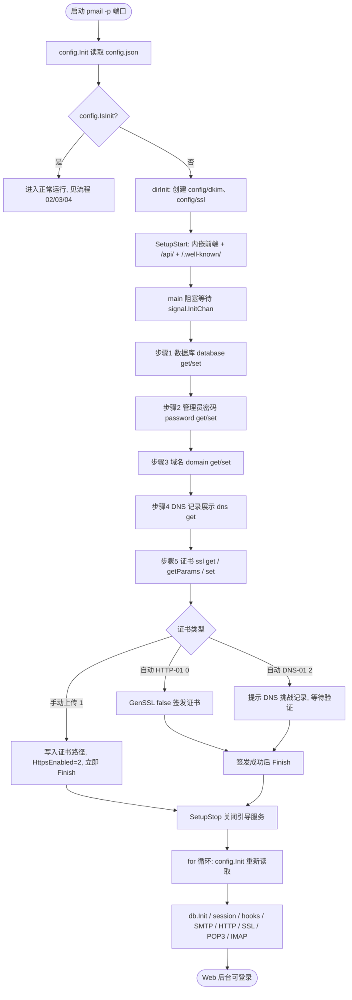
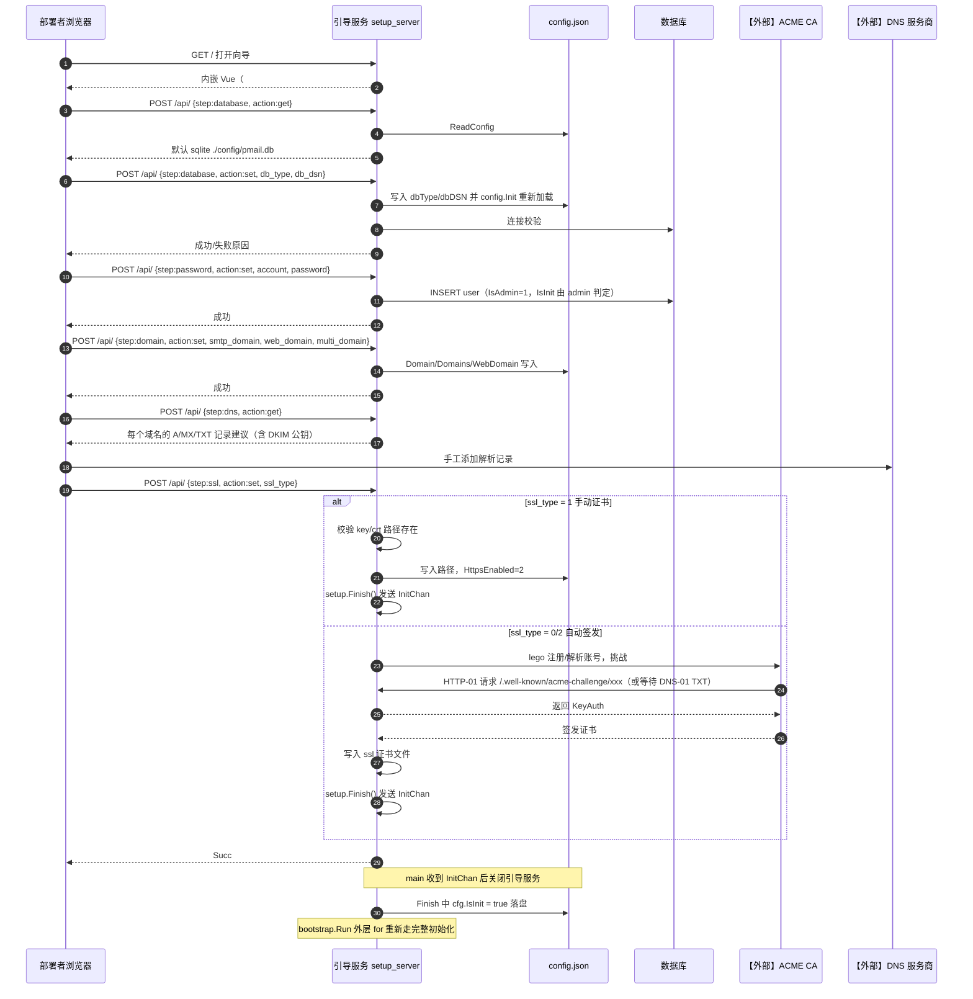
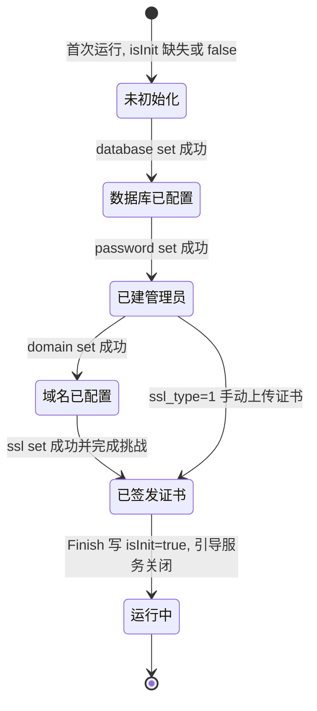

# 01 首次部署引导（v1）

> 文档编号：01
> 文档版本：v1
> 项目：PMail
> 状态：已实现（含外部依赖：ACME CA【外部】）
> 证据基线：`master` @ `7e868f5`

## 1. 目标

回答：一台**全新**服务器从“二进制跑起来”到“Web 后台可登录”之间发生了什么，每一步由谁完成、失败会怎样。

覆盖范围：`config.IsInit == false` 时的引导期服务（`-p` 端口）、`/api/` 向导的 9 个步骤动作、结束条件、与服务重启的关系。不覆盖证书续期（见流程 05）。

## 2. 参与角色与前置条件

| 角色 | 说明 |
| --- | --- |
| 部署者 | 有服务器 root/端口权限，能配置 DNS |
| 引导服务 | `setup_server`，监听 `-p`（默认 80，否则取环境变量 `setup_port`） |
| 向导前端 | 内嵌 Vue 的 `#/setup` 页面（`web/desktop/src/views/SetupView.vue`） |
| 数据库 | SQLite（默认）或外部 MySQL/PostgreSQL |
| 【外部】DNS 服务商 | 需要手动添加 A/MX/TXT 记录 |
| 【外部】ACME CA | HTTP-01 或 DNS-01 挑战的对象 |

前置条件：

1. 域名已解析到本机 IP，25/80/443 等端口对外可达。
2. 运行目录可写（引导期会创建 `config/`、`config/dkim/`、`config/ssl/`，`server/internal/bootstrap/bootstrap.go`）。
3. 首次运行时 `config/config.json` 不存在或 `isInit=false`。

## 3. 流程图

## 4. 时序图

## 5. 状态机

引导阶段没有显式持久化状态字段，状态由 `config.IsInit` 与 `config.json` 内容共同决定：

说明：中间状态**没有独立持久化**，只是 `config.json` 字段被陆续写入；如果向导中途关闭浏览器，重启会进入引导服务但已写入的字段保留。

## 6. 关键异常

| 场景 | 行为 | 证据 |
| --- | --- | --- |
| 引导端口非 80 | 自动证书 HTTP-01 无法通过；引导日志提示使用 `http://ip:port` | `setup_server.go:36-50`；README 已注明 |
| 数据库连接失败 | `SetDatabaseSettings` 收尾处校验连接，失败返回错误文本给前端 | `server/internal/app/setup_database.go` |
| 已存在用户 | `GetAdminPassword` 返回第一个账号名，前端据此提示“已存在” | `db.go:26` |
| 域名必填校验 | smtpDomain 或 webDomain 为空直接报错 | `server/internal/app/setup_domain.go` |
| 手动证书路径不存在 | `os.Stat` 失败后返回错误，不 Finish | `server/internal/api/http/setup_handler.go` |
| 自动签发失败 | `GenSSL` 返回错误，前端显示，不 Finish；可重试 | `setup.go:170-180` |
| DNS-01 未配置记录 | 挑战最长等待 60 分钟超时 | `server/internal/infra/certificate/certificate.go` 的 `AddDNSTimeout(60*time.Minute)` |
| 证书文件缺失但 `isInit=true` | SMTP/POP3/IMAP 在 `LoadX509KeyPair` 处 `log.Fatal`/`panic`，进程退出 | `smtp_server/internal/api/smtp/smtp_listener.go:30-34`、`pop3_server/internal/api/pop3/listener.go:16`、`imap_server/internal/api/imap/imap_server.go:31` |
| 引导服务关闭失败 | `SetupStop` 中 panic | `setup_server.go:64-70` |

## 7. 证据索引

| 结论 | 证据 |
| --- | --- |
| 引导分支与完成信号 | `server/internal/bootstrap/bootstrap.go` |
| 引导期路由 | `server/internal/api/http/http_setup.go` |
| 端口来源 `-p` / `setup_port` | `setup_server.go:32-44` |
| 向导步骤分派 | `server/internal/api/http/setup_handler.go` |
| Finish 写 isInit 并通知 | `server/internal/app/setup_finish.go` |
| DNS 记录建议 | `server/internal/app/setup_dns.go` |
| 证书类型与手动证书处理 | `server/internal/infra/certificate/certificate.go`、`server/internal/api/http/setup_handler.go` |
| ACME 挑战响应 | `server/internal/api/http/setup_handler.go` |

## 8. 实现风险

1. **引导期无鉴权**：`/api/` 在引导期不做任何登录校验，若引导端口对外开放，任何人可在 `isInit=false` 窗口期抢注管理员。建议：只在首次部署时临时开放端口或限制来源 IP。
2. **中间状态不可回退**：向导中途退出后，已写字段保留，重新进入可能出现“管理员已存在但域名未配置”的混合状态，前端需自行处理。
3. **自动证书强依赖 80 端口**：非 80 引导端口会失败，README 已说明，但向导本身没有前置校验。
4. **`GetAdminPassword` 语义是“取第一个账号名”**，并非检查密码是否已设置，用户名与“是否完成密码步骤”在语义上耦合。
5. **证书缺失导致全服务不可用**：`httpsEnabled=2` 时不启用 Web HTTPS 仍要求证书文件存在，是常见部署踩坑点。
