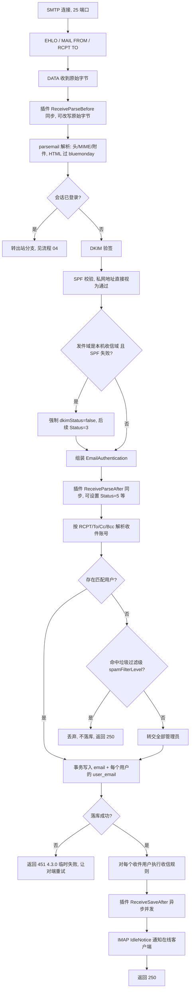
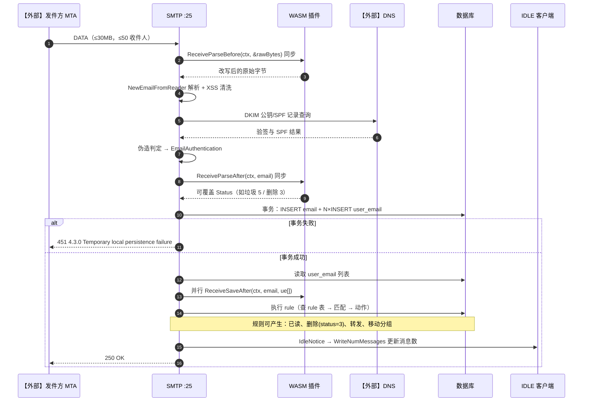
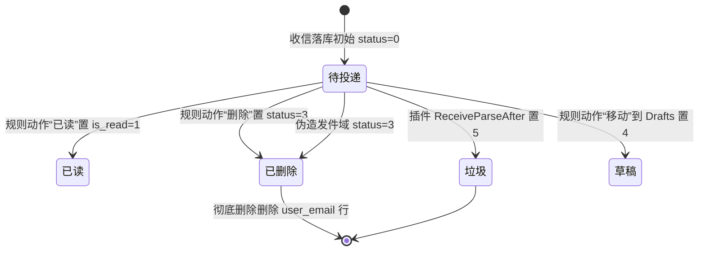

# 02 收信处理（v1）

> 文档编号：02
> 文档版本：v1
> 项目：PMail
> 状态：已实现（含外部依赖：对端 MTA【外部】、DNS【外部】）
> 证据基线：`master` @ `7e868f5`

## 1. 目标

回答：一封外部邮件从 SMTP 连接进入，到“某个用户的邮箱里能看见”之间经过哪些判定，什么情况下会被丢弃、转交管理员或标记为垃圾。

覆盖范围：25 端口未认证收信链路（`Session.Data` 的收件分支）、SPF/DKIM 判定、未知收件人策略、落库、收信规则、IDLE 通知、插件钩子。

## 2. 参与角色与前置条件

| 角色 | 说明 |
| --- | --- |
| 【外部】发件方 MTA | 通过 MX 记录找到本机 25 端口 |
| SMTP 会话 | `smtpserver.Session`，未登录时 `ctx.UserID == 0` |
| WASM 插件 | `plugins/wasm/{id}/` 下的插件，同步/异步回调 |
| 解析器 | `parsemail.NewEmailFromReader`（MIME 解析 + HTML 清洗） |
| 数据库 | `email`、`user_email`、`user`、`rule`、`group` |
| 收信规则 | 按用户顺序执行已读/转发/删除/移动 |

前置条件：DNS 的 MX 指向本机；本机 25 端口可达；`config.Domains` 包含所有收信域名。

## 3. 判定流程

## 4. 时序图

注意时序细节：`ReceiveSaveAfter` 在代码中先于规则执行开始（`read_content.go:146-162` 在 `rule` 调用之后，但钩子是异步并发触发），规则与钩子之间没有严格先后保证。

## 5. 状态机（user_email.status）

收信链路可直接写入的 `user_email.status`：

说明：

- `is_read` 是独立列，不参与 status 迁移。
- 移动到自定义分组写的是 `user_email.group_id`，不改 status。
- 转发不改 status，只在外部队列一侧产生投递动作。

## 6. 关键异常

| 场景 | 行为 | 证据 |
| --- | --- | --- |
| 邮件体读取失败 | 返回错误，SMTP 层报错 | `read_content.go:43-47` |
| 协议 MAIL FROM 与头 From 不一致 | 原计划当垃圾处理，当前代码分支被注释，**实际不拦截** | `read_content.go:66-72` 注释块 |
| DKIM 验签失败 | `dkimStatus=false`，是否丢弃取决于 `spamFilterLevel` 与收件人是否存在 | `dkim.go:86`、`audit_persistence.go:160` |
| 未知收件人 + 命中过滤级 | 直接丢弃，仍返回成功，发送方不会收到退信 | `audit_persistence.go:160-167` |
| 未知收件人 + 未命中过滤级 | 转交全部管理员；无管理员则报错 | `audit_persistence.go:169-176` |
| 收件人全部不存在且无管理员 | 返回错误（对端收到失败） | 同上 |
| 落库失败 | 451 临时错误，对端会重试 | `read_content.go:128-131`、`audit_persistence.go:106-112` |
| WASM 同步钩子超时 | 按 manifest 配置（默认 2s），失败仅记录日志，不中断收信 | `server/internal/infra/plugin/wasm.go` |
| 规则转发失败 | 只记录错误日志，邮件仍保留在本地 | `server/internal/app/rule_service.go` |
| IDLE 通知失败 | 忽略返回值 | `read_content.go:165-167` |

## 7. 证据索引

| 结论 | 证据 |
| --- | --- |
| 收件/发件分支判定 | `server/internal/app/email_receive.go` |
| DKIM + SPF 调用 | `read_content.go:101-110` |
| 伪造判定 | `read_content.go:105-109`、`:122-125` |
| 插件同步钩子 | `read_content.go:52-58`、`:113-120` |
| 落库事务 | `server/internal/app/email_send.go` |
| 收件人解析 | `audit_persistence.go:140-203` |
| 丢弃开关 | `read_content.go:31-35` |
| 收信规则执行 | `read_content.go:133-144`、`server/internal/app/rule_service.go` |
| IDLE 通知 | `server/internal/api/imap/session_idle.go` |
| 端口与容量限制 | `server/internal/api/smtp/server.go` |

## 8. 实现风险

1. **协议 From 与头 From 不一致的分支被注释**（`read_content.go:66-72`），当前不会按垃圾拦截，只依赖 SPF/DKIM 与规则。
2. **未知收件人静默丢弃**：`DropUnknownRecipientEmails` 是代码常量，运维无法通过配置关闭；同时“返回 250 但未落库”会让发送方误以为已投递。
3. **学术性风险：落库后才执行规则与插件**，规则产生的“删除”只是软删除；对端已收到 250，无法回滚。
4. **收件人匹配使用 `LOWER(account)`**，多域名同账号会命中同一用户，符合设计但需注意多域名部署时的邮箱名冲突。
5. **`ReceiveParseAfter` 里插件可任意改写 `Status`**，当前 `spoofed` 判定会强制覆盖为 3（`read_content.go:122-125`），但普通插件设置的 5/3 会直接落库，缺少白名单校验。
6. **附件与正文全部存在 `email` 表中**（`Attachments` 长文本、`HTML` mediumtext），大邮件会显著抬高单行体积。
