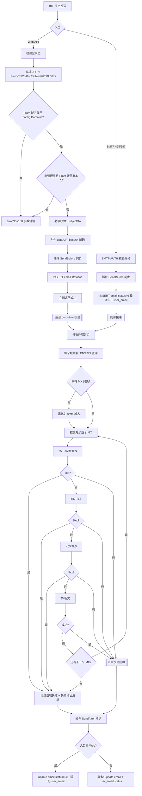
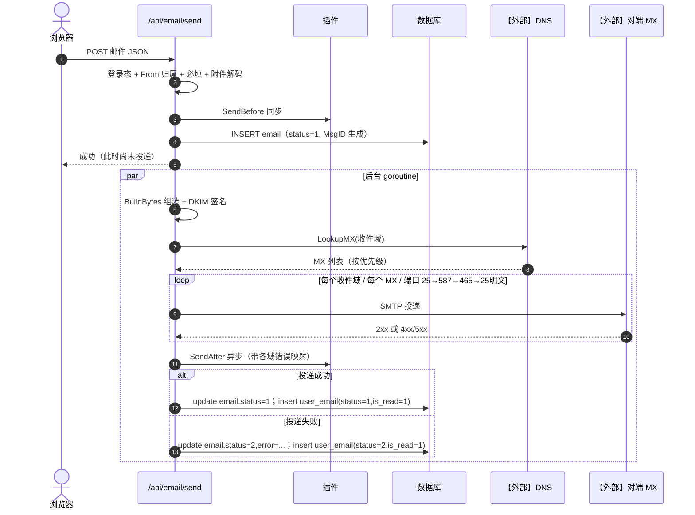
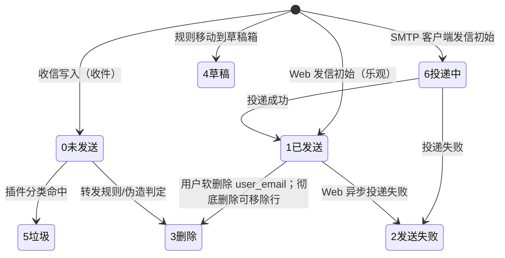

# 03 Web发信与SMTP客户端发信（v1）

> 文档编号：03
> 文档版本：v1
> 项目：PMail
> 状态：已实现（含外部依赖：对端 MX【外部】、DNS【外部】）
> 证据基线：`master` @ `7e868f5`

## 1. 目标

回答：用户点击“发送”后，邮件如何被组装、校验、入库、投递，失败时状态落在哪里；以及 Web 后台发信与邮件客户端（465/587）发信两条链路的差异。

覆盖范围：`/api/email/send` 异步链路、SMTP 已登录会话的 `Data` 分支（同步审计链路）、MX 查询与多端口降级投递、DKIM 签名、状态回写、`SendBefore/SendAfter` 插件钩子。

## 2. 参与角色与前置条件

| 角色 | 说明 |
| --- | --- |
| Web 用户 / 邮件客户端 | 已登录（Web）或已通过 SMTP AUTH（客户端） |
| 发信校验 | 发件域必须属于 `config.Domains`；非管理员必须用本人账号 |
| 组装器 | `parsemail.Email.BuildBytes(ctx, true)`，含 DKIM 签名 |
| 投递器 | `server/pkg/send`：按收件域分组，逐 MX、逐端口尝试 |
| 【外部】对端 MX | 接收目标邮件的主机 |

前置条件：本机有可用 DKIM 私钥（`config/dkim/dkim.priv`）；出站 25 端口未被封禁（否则只能走 587/465）。

## 3. 两条链路对比

| 维度 | Web 发信 `/api/email/send` | SMTP 客户端发信（465/587） |
| --- | --- | --- |
| 入口 | `server/internal/api/email_send_handler.go` | `server/internal/app/email_receive.go` → `deliverOutgoingEmail` |
| 认证 | scs session / Token 头 | SMTP AUTH PLAIN/LOGIN |
| 发件人校验 | 校验域名归属，非管理员必须本人 | 校验 `From` 账号等于登录账号或管理员 |
| 落库时机 | 先插入 `email(status=1)` 并立即返回 200 | 先插入 `email(status=6 投递中)`，投递后回写 |
| 投递同步性 | goroutine 异步 | 同步阻塞到 DATA 结束 |
| 失败处理 | 更新 `email.status=2` + 插入失败态 `user_email` | 更新 `email` 与 `user_email` 为 2（失败）或 1（成功） |
| 审计一致性 | 失败路径 `user_email` 与 `email` 分两次写，无事务 | 单事务同时更新两表（`persistDeliveryResult`） |
| 插件钩子 | `SendBefore` 同步、`SendAfter` 异步 | 相同 |
| 返回给调用方 | 立即返回“成功”，投递结果只能看列表状态 | SMTP 响应码反映投递结果 |

## 4. 流程图

## 5. 时序图

## 6. 状态机（email.status）

说明：

- `email.status` 与 `user_email.status` 在收信场景分别承载“邮件类型/状态”和“用户视角状态”；发信场景两者会同时被更新。
- Web 发信先置 `status=1` 再异步投递，是“乐观展示”的取舍；被审计一致性问题已在第 8 节记录。
- `cron_send_time`（定时发送）字段存在但无调度逻辑。

## 7. 关键异常

| 场景 | 行为 | 证据 |
| --- | --- | --- |
| 未登录 | `errorNo=403` 登录已失效 | `https_server.go:131-136` |
| From 为空 | 补为 `{当前账号}@{Domains[0]}` | `server/internal/api/email_send_handler.go` |
| 标题/收件人为空 | 返回参数错误 | `send.go:88-107` |
| 附件 base64 解码失败 | 返回 `att_err` 文案 | `send.go:148-157` |
| `email` 插入失败 | 返回 `send_fail` | `send.go:200-208` |
| MX 查询失败 | 退化为 `smtp.{domain}`，并记录查询错误 | `pkg/send/send.go:95-134` |
| 5xx 永久错误 | 停止尝试下一个 MX，直接判失败 | `send.go:186-190, 210-215` |
| 全部 MX 尝试失败 | 汇总失败地址返回 | `send.go:196-204` |
| 投递失败回写失败 | SMTP 客户端链路保留 pending 状态并打印 CRITICAL 日志，不返回 451（避免重复投递） | `audit_persistence.go:48-58` |
| Web 异步失败 | 更新 status=2 并插入失败态 `user_email` | `server/internal/api/email_send_handler.go` |
| 插件 `SendBefore` 返回空邮件 | SMTP 链路中 `email == nil` 时直接返回成功，静默丢弃 | `read_content.go:90-92` |

## 8. 证据索引

| 结论 | 证据 |
| --- | --- |
| Web 发信控制器 | `server/internal/api/email_send_handler.go` |
| SMTP 发信分支 | `server/internal/app/email_receive.go` |
| 投递与审计 | `server/internal/app/email_delivery.go` |
| SMTP AUTH | `server/internal/api/smtp/smtp_action.go` |
| MX 分组与降级 | `server/pkg/send/send.go:94-230` |
| 单 MX 端口序列 | `server/pkg/send/send.go:212-270`（`tryDeliverToMX`） |
| DKIM 签名 | `server/dto/parsemail/dkim.go:69-84`、`email.go:602-720` |
| 状态常量 | `server/consts/consts.go:3-28` |

## 9. 实现风险

1. **两条发信链路状态语义不一致**：Web 链路先置 1 再异步改，SMTP 链路用 6 表示未知结果；报表与前端展示需要区分，否则会把“未投递”当成“已发送”。
2. **Web 异步失败回写无事务**：更新 `email` 与插入 `user_email` 是两条独立语句，中间崩溃会出现 `email.status=2` 但无 `user_email` 记录。
3. **Web 发信成功响应早于投递**：前端无法立即得知真实结果，也没有推送机制。
4. **插件可空实现导致静默丢信**：SMTP 链路对 `email == nil` 直接返回成功，调用方无法察觉。
5. **明文 25 端口兜底**：`tryDeliverToMX` 最后一步明文体投递，存在被中间人窃取风险，仅在其它端口失败时使用，建议加配置开关。
6. **MX 降级到 `smtp.{domain}`** 属于约定而非标准，部分域名无此 A 记录时会直接失败。
