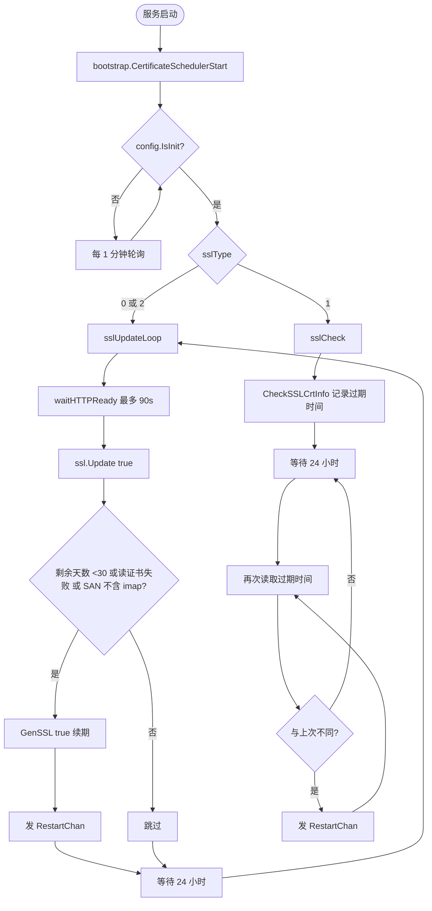
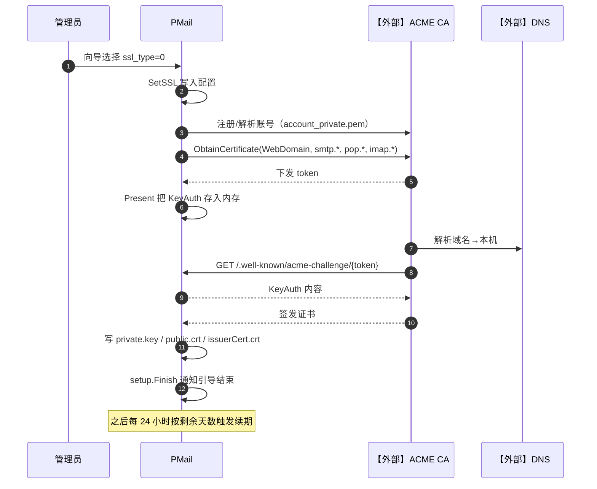
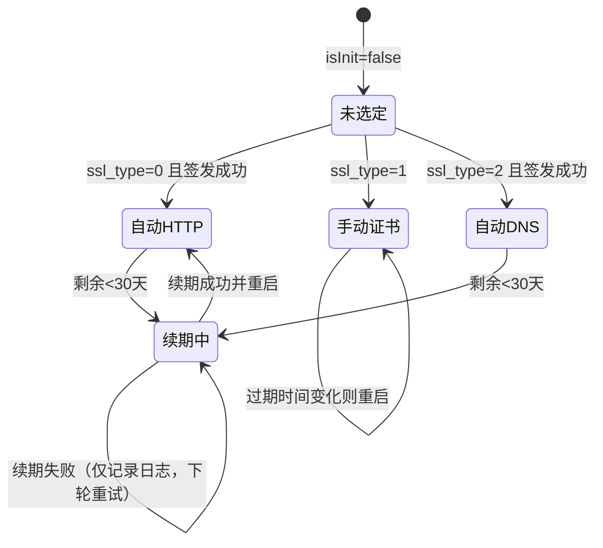

# 05 SSL证书管理与自动续期（v1）

> 文档编号：05
> 文档版本：v1
> 项目：PMail
> 状态：已实现（外部依赖：ACME CA【外部】、DNS 服务商【外部】）
> 证据基线：`master` @ `7e868f5`

## 1. 目标

回答：证书从哪里来、何时续期、续期后为什么整个服务会重启，以及手动证书模式下如何感知证书变更。

覆盖范围：`sslType` 三种模式（0 HTTP-01 自动、1 手动上传、2 DNS-01 自动）、ACME 挑战响应、证书落盘路径、`cron` 的两条检查分支、重启信号与重新加载。

## 2. 参与角色与前置条件

| 角色 | 说明 |
| --- | --- |
| 管理员 | 首次部署时选择证书方式 |
| 【外部】ACME CA | Let's Encrypt 等，通过 lego 客户端交互 |
| 【外部】DNS 服务商 | DNS-01 模式下需添加 TXT 记录 |
| 证书文件 | `config/ssl/private.key`、`config/ssl/public.crt`、`config/ssl/issuerCert.crt`、`config/ssl/account_private.pem` |
| 使用方 | HTTPS 443、SMTP 465/587、POP3 995、IMAP 993 全部依赖同一对证书 |

前置条件：`config.WebDomain` 与 `smtp./pop./imap.{domain}` 均已解析到本机；80 端口可达（HTTP-01）。

## 3. 模式与行为

| `sslType` | 含义 | 首次签发 | 后续维护 |
| --- | --- | --- | --- |
| `0` | 自动，HTTP-01 | 部署向导调用 `GenSSL(false)` | 每 24 小时 `ssl.Update(true)`，剩余 <30 天或验签失败则续期并重启 |
| `1` | 手动上传 | 只校验路径存在，直接完成引导；`HttpsEnabled` 被置 2 | 每 24 小时比对外证书过期时间，变化则重启加载 |
| `2` | 自动，DNS-01 | 部署向导调用 `GenSSL(false)`，需手工加 TXT | 同 `0`，挑战超时 60 分钟 |

证据：`server/internal/config/config.go:101-103`、`server/internal/infra/certificate/certificate.go`、`server/internal/api/http/http_setup.go`。

## 4. 流程图

## 5. 时序图：HTTP-01 自动签发

## 6. 状态机

## 7. 关键异常

| 场景 | 行为 | 证据 |
| --- | --- | --- |
| 证书文件不存在且 `isInit=true` | SMTP 465/587 启动 `log.Fatal`；POP3/IMAP `panic` | `smtp_server/internal/api/smtp/smtp_server.go:42,59,87`、`pop3_server/internal/api/pop3/listener.go:16`、`imap_server/internal/api/imap/imap_server.go:34` |
| 引导端口非 80 | HTTP-01 无法完成，签发失败 | `setup_server.go:36-50` |
| 签发失败 | `Obtain` 返回错误后 `panic`（在异步 goroutine 内） | `ssl.go:216-218` |
| 证书读不出/已过期 | `Update` 视为需要续期 | `ssl.go:273-330` |
| SAN 中没有 `imap` 前缀域名 | 视为不匹配，触发续期 | `ssl.go:290-300` |
| 续期成功后 | 发送 `RestartChan`，全服务重启后重新加载证书 | `ssl_update.go:53` |
| 手动证书替换 | 24 小时内最多感知一次 | `ssl_update.go:37-57` |
| 账户私钥缺失 | 自动生成新的 EC P-256 并写盘，`newAccount=true` 走注册 | `config.go:193-221` |

## 8. 证据索引

| 结论 | 证据 |
| --- | --- |
| 证书类型常量 | `server/internal/config/config.go:101-103` |
| 手动证书与 HttpsEnabled 联动 | `server/internal/infra/certificate/certificate.go` |
| 签发域列表 | `ssl.go:196-207` |
| 落盘路径 | `ssl.go:210-230` |
| 剩余天数检查 | `ssl.go:273-308` |
| 续期入口 | `ssl.go:309-340` |
| 定时任务分支 | `server/internal/bootstrap/scheduler.go` |
| HTTP 挑战内存映射 | `server/internal/infra/certificate/certificate_challenge.go`、`server/internal/api/http/http_setup.go` |

## 9. 实现风险

1. **续期走全服务重启**：重启期间 SMTP/IMAP/POP3 不可用（至少 5 秒 + 重新初始化时间），对在线邮件客户端不友好。
2. **签发失败在 goroutine 内 `panic`**，会导致整个进程崩溃而不是降级。
3. **手动证书模式不主动校验证书域名是否覆盖 `smtp./pop./imap.`**，只校验路径存在，配错后在客户端侧才暴露。
4. **证书缺失 = 进程级故障**，即便是 `httpsEnabled=2`（不启用 Web HTTPS）也必须提供证书，是部署高频踩坑。
5. **DNS-01 挑战依赖人工加 TXT**，超时 60 分钟，超时后只能重试。
6. **账户私钥与证书写在相对路径 `./config/ssl/`**，与 `PMail_ROOT` 的解析规则耦合，改变工作目录会产生“证书找不到”的问题。
