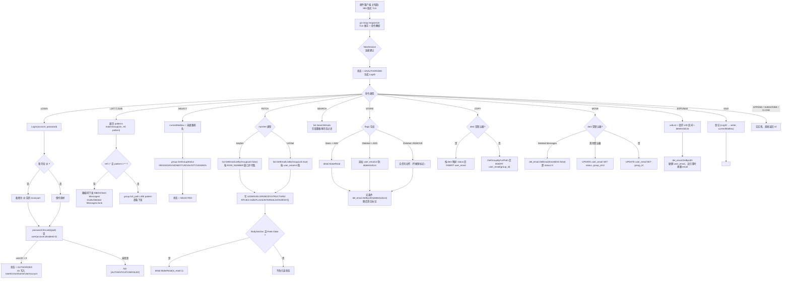
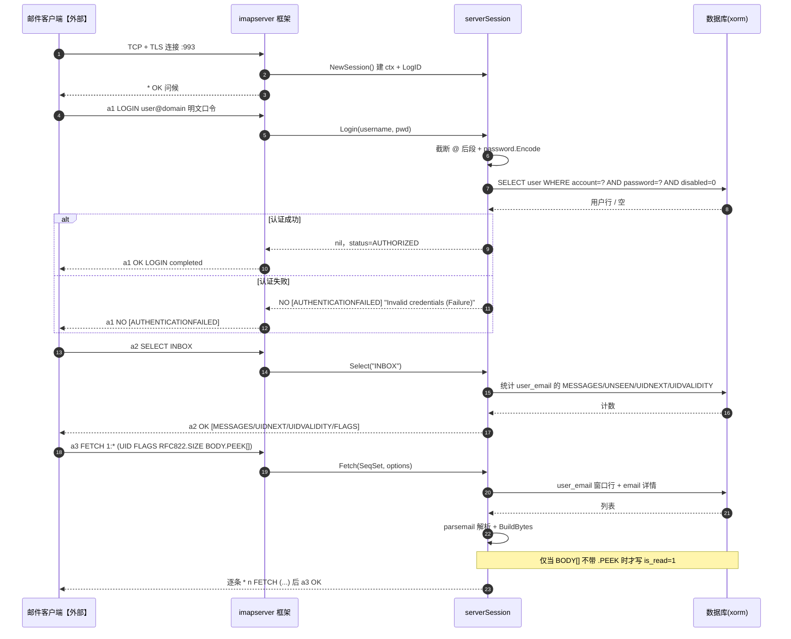
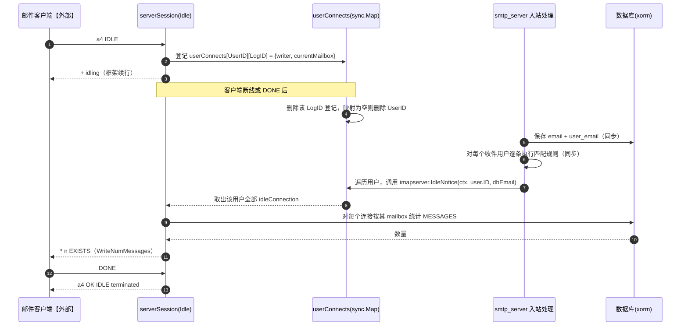
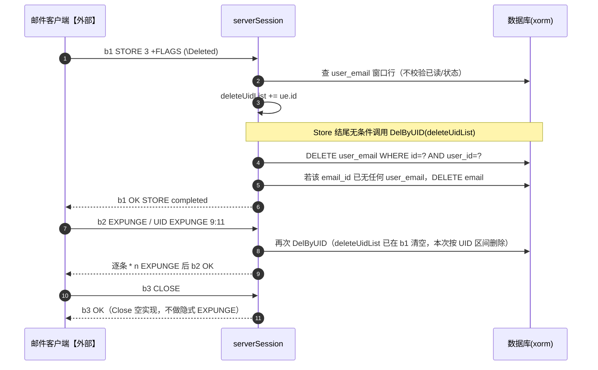
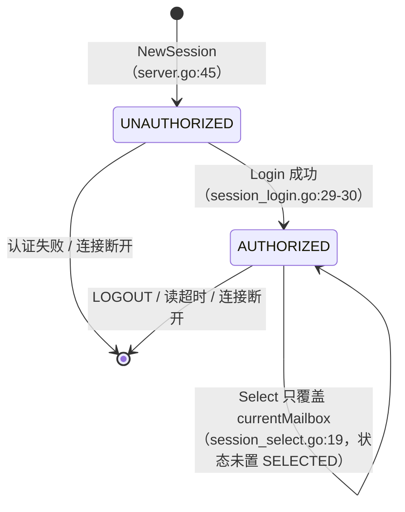
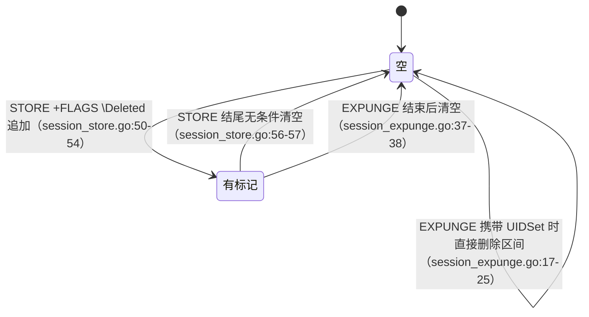

# 06 IMAP服务（v1）

> 文档编号：06
> 文档版本：v1
> 项目：PMail
> 状态：主路径已实现（`Append` / `Subscribe` / `Unsubscribe` / `Close` 为空实现；外部依赖：邮件客户端【外部】、SMTP 入站触发方【外部】）
> 证据基线：`master` @ `7e868f5`

## 1. 目标

回答三个问题：

1. 邮件客户端（Outlook / Foxmail / Thunderbird 等）连上 PMail 的 993 端口后，一条命令如何被路由到哪个 `serverSession` 方法、最终落到哪张表；
2. 邮箱（mailbox）概念如何映射到 PMail 的“内置默认箱 + 用户自定义分组”模型，哪些映射是真实数据、哪些是硬编码；
3. IMAP 的 IDLE 推送由谁触发、在什么条件下会推、推出去的内容是什么。

覆盖范围：`server/internal/api/` 全部会话文件、`server/internal/app/group_service.go`、`server/internal/app/email_query.go`、`server/internal/app/email_service.go` 中被 IMAP 复用的部分，以及 `server/internal/app/email_receive.go` 中的 IDLE 触发点。不覆盖 SMTP 投递细节（见 [02 收信处理](./02-收信处理-v1.md)、[03 Web 发信与 SMTP 客户端发信](./03-Web发信与SMTP客户端发信-v1.md)）。

## 2. 参与角色与前置条件

| 角色 | 说明 |
| --- | --- |
| 邮件客户端【外部】 | 通过 993 隐式 TLS 建立长连接，发 IMAP4rev1 命令 |
| IMAP 框架 | `github.com/emersion/go-imap/v2/imapserver`，负责 TLS 握手、命令解析、tagged/untagged 响应编码、IDLE 的 `+ idling` 续行 |
| 会话对象 | `serverSession`（`server/internal/api/imap/imap_server.go`），每个连接一个，持有 `ctx`（含 `UserID`）、`status`、`currentMailbox`、`connectTime`、`deleteUidList` |
| 数据层 | xorm 直连 `user`、`group`、`user_email`、`email` 四张表；无 Redis、无缓存 |
| 入站触发方【外部】 | SMTP 入站投递完成后，`read_content.go` 调用 `imapserver.IdleNotice` |

前置条件：

- 服务端已初始化（`config.IsInit == true`，即 `config.json` 中 `domain` 非空且 `isInit` 为真，`server/internal/config/config.go:158`）；初始化前 IMAP 服务不会被启动（`server/internal/bootstrap/bootstrap.go`、`:66`）。
- 运行目录 `config/ssl/` 下存在可用的证书与私钥（源码开发时即 `server/config/ssl/`），否则 `newIMAPServer` 直接 `panic`（`server/internal/api/imap/imap_server.go`）。
- 用户 `disabled = 0`，密码按 `password.Encode`（两次 md5 加盐）存储，算法见 [08 Web 与协议鉴权](./08-Web与协议鉴权-v1.md)。

## 3. 端口与能力协商

| 项 | 实现 | 证据 |
| --- | --- | --- |
| 监听端口 | 仅 `:993` 隐式 TLS；**不提供 143 明文端口，也不提供 STARTTLS**（注释原话：“不加密的代码就懒得写了”） | `server/internal/api/imap/imap_server.go` |
| CAPA 能力集 | 只有 `IMAP4rev1`、`IDLE` 两个 | `server/internal/api/imap/imap_server.go` |
| 明文认证 | `InsecureAuth: false` | `server/internal/api/imap/imap_server.go` |
| 调试输出 | `config.logLevel == "debug"` 时把协议原文打到 stdout | `server/internal/api/imap/imap_server.go` |
| 启动时机 | `bootstrap.Run` 中 `go api.StartIMAPS()` | `server/internal/bootstrap/bootstrap.go` |
| 单测 | 用临时端口 `tls.Listen("tcp","127.0.0.1:0",...)` + `imapclient` 做端到端验证 | `server/test/e2e/imap_test.go` |

能力集只声明两个扩展，意味着：没有 `UIDPLUS`、没有 `MOVE`、`IDLE` 之外的扩展一律不出现；`serverSession` 虽然实现了 `Move`/`Create`/`Rename` 等方法，但客户端只有在使用不带扩展的 `COPY`+`STORE \Deleted`+`EXPUNGE` 时才一定可用，是否下发 `MOVE` 取决于客户端是否在未协商扩展的情况下自行尝试。

## 4. 参与命令与实现映射

每个会话方法由框架按命令名直接调用（`serverSession` 实现 `imapserver.Session` 接口）。

| IMAP 命令 | 会话方法 | 入口证据 | 后端服务 |
| --- | --- | --- | --- |
| `CAPABILITY` / `LOGIN` / `LOGOUT` | `Login` / `Logout`(框架内) | `session_login.go:14` | `db` 直查 `user` |
| `LIST` / `LSUB` | `List` | `session_list.go:91` | `db` 直查 `group` |
| `NAMESPACE` | `Namespace` | `session_namespace.go:7` | 常量 `Delim:'/'` |
| `SELECT` / `EXAMINE` | `Select` | `session_select.go:10` | `group.GetGroupStatus` |
| `STATUS` | `Status` | `session_status.go:9` | `group.GetGroupStatus` |
| `FETCH` | `Fetch` | `session_fetch.go:113` | `list.GetEmailListByGroup` + `parsemail` |
| `SEARCH` | `Search` | `session_search.go:14` | `list.SearchEmails` |
| `STORE` | `Store` | `session_store.go:14` | `detail.MakeRead` / `del_email.DelByUID` |
| `COPY` | `Copy` | `session_copy.go:15` | `group` / 直插 `user_email` |
| `MOVE` | `Move` | `session_move.go:13` | `group.Move2DefaultBox` / `group.MoveMailToGroup` |
| `CREATE` | `Create` | `session_create.go:9` | `group.CreateGroup` |
| `RENAME` | `Rename` | `session_rename.go:9` | `group.Rename` |
| `DELETE` | `Delete` | `session_delete.go:9` | `group.DelGroup` |
| `EXPUNGE` / `UID EXPUNGE` | `Expunge` | `session_expunge.go:11` | `del_email.DelByUID` |
| `IDLE` | `Idle` | `session_idle.go:25` | 内存 `sync.Map` |
| `NOOP` / `CHECK` | `Poll` | `session_poll.go:10` | 直查 `user_email` |
| `APPEND` | `Append` | `server.go:68-71` | **空实现，只打 `Append Not Implemented` 日志并返回 `nil,nil`** |
| `SUBSCRIBE` / `UNSUBSCRIBE` | 同名方法 | `server.go:60-66` | **空实现，直接返回 nil** |
| `UNSELECT` | `Unselect` | `server.go:73-76` | 只清 `currentMailbox` |
| `CLOSE` / `FLUSH` | `Close` | `server.go:56-58` | **空实现，不执行隐式 EXPUNGE** |

## 5. 邮箱模型：内置五箱 + 用户分组

### 5.1 内置默认箱（硬编码）

`group.IsDefaultBox` 把五个名字视为“默认箱”（`server/internal/app/group_service.go`），并对应到 `models.GroupNameToCode` 魔数（`server/models/group.go:11-25`）：

| 邮箱名 | 魔数常量 | 值 | 数据筛选条件（`user_email`） | 证据 |
| --- | --- | --- | --- | --- |
| `INBOX` | `models.INBOX` | 2000000000 | `status = 0` | `group.go:284-289` |
| `Sent Messages` | `models.Sent` | 2000000001 | `status = 1` | `group.go:290-295` |
| `Drafts` | `models.Drafts` | 2000000002 | `status = 4` | `group.go:296-301` |
| `Deleted Messages` | `models.Deleted` | 2000000003 | `status = 3` | `group.go:302-307` |
| `Junk` | `models.Junk` | 2000000004 | `status = 5` | `group.go:308-313` |

这些名字只存在于代码与协议层：`group` 表里**没有**这五行的记录，`user_email.group_id = 0` 才表示“未归档到自定义分组”；默认箱完全靠 `status` 字段区分。`UIDVALIDITY` 取上述魔数（`server/internal/app/group_service.go`、`:224`）。

`LIST` 对默认箱的返回是写死的五条记录（`server/internal/api/imap/imap_session_mailbox.go`），常量、属性与邮件内容无关；`List` 在 `ref == "" && len(patterns) == 0` 时会额外下发一条 `[PMail]`（`NoSelect|HasChildren`）的装饰项（`session_list.go:94-100`）。

### 5.2 用户自定义分组

- 存储：`group` 表，字段 `id / name / parent_id / user_id / full_path`（`server/models/group.go:3-9`）；层级最多两级以上也没限制，但 `Create` 只按 `/` 逐级创建（`session_create.go:10-22`）。
- 命名：对客户端暴露的 `Mailbox` 由 `getLayerName(..., allPath=true)` 递归拼接父名，如 `一级菜单/二级菜单`（`session_list.go:79-89`）。
- `LIST` 通配：`*` 直接查当前用户全部组；其它模式把 `/*` 替换为 `/%` 后走 `full_path LIKE`（`session_list.go:49-51`）——**没有实现通配符解析**，`%`、`?` 及 IMAP 规定的 `*` 同义匹配只在“整串 `/*`”这一种写法下生效，其余模式按字面量匹配。
- 未实现：`STATUS`/`SELECT` 对陌生邮箱不报错，而是返回全 0（`server/internal/app/group_service.go`）。

## 6. 流程图

## 7. 时序图

### 7.1 同步请求响应：登录 → 选箱 → 拉取 → 已读

### 7.2 异步推送：IDLE 与入站新邮件

### 7.3 响应形态：删除链路

## 8. 状态机

会话状态只在登录成功处被赋值一次（`session_login.go:30`）；常量 `SELECTED`（`server/internal/api/imap/imap_server.go`）与 `LOGOUT`（`:32`）只有声明、全仓库无任何赋值点（对 `imapserver` 包内 `s.status = ` 的检索结果只有这一处）。因此状态机只画有代码证据的迁移：

注意：由于 `status` 不会变成 `SELECTED`，`currentMailbox` 为空串时 `Fetch`/`Store` 等会按“默认箱之外的未知分组”处理并返回空（见 §9 异常表）。

`deleteUidList` 的生命周期（会话内字段，非协议状态）：

## 9. 关键异常

| 场景 | 实际行为 | 证据 |
| --- | --- | --- |
| 证书/私钥读取失败 | 进程 `panic`，IMAP 端口不启动 | `imap_server.go:31-34` |
| 密码错误 / 账号禁用 | `NO [AUTHENTICATIONFAILED] Invalid credentials (Failure)` | `session_login.go:41-45` |
| 数据库报错（非 NoRows） | 只写日志，仍继续按“用户不存在”返回认证失败 | `session_login.go:25-27` |
| `SELECT ""` | `BAD mailbox not found` | `session_select.go:11-16` |
| `SELECT`/`STATUS` 未知名 | 不报错，四个统计量全 0 | `server/internal/app/group_service.go` |
| `FETCH` 早于 `SELECT` | `currentMailbox` 为空串，按未知分组查到空列表，返回 0 条而非 `BAD No mailbox selected` | `session_fetch.go:113-135`、`server/internal/app/email_query.go` |
| `FETCH` 请求 `BODY[]`（无 `.PEEK`） | 服务端把 `is_read` 置 1，并**同时**返回内容（客户端未 PUT 也会已读） | `session_fetch.go:273-277` |
| `STORE +FLAGS (\Deleted)` | 立即硬删 `user_email`，而非只打标记 | `session_store.go:50-57` |
| `STORE -FLAGS (\Deleted)` | 什么都不做，客户端无法撤销删除标记 | `session_store.go:16-18`、`:44-54` |
| `STORE FLAGS`（绝对设置） | 直接 `return nil` | `session_store.go:16-18` |
| `COPY` 源消息不存在 | `NO Email Not Found` | `session_copy.go:38-43` |
| `COPY`/`MOVE` 目标分组不存在 | `NO Group not found` | `session_copy.go:106-111`、`session_move.go:72-77` |
| `RENAME` 默认箱 | `NO This mailbox does not support rename.` | `session_rename.go:10-15` |
| `CREATE` 名称重复 | `CreateGroup` 直接返回已有分组，不报错（幂等语义） | `server/internal/app/group_service.go` |
| `APPEND` | 记录 `Append Not Implemented` 后返回 `nil,nil`；客户端会收到“成功”但其实没有邮件 | `server.go:68-71` |
| `CLOSE` | 空实现，不执行隐式 EXPUNGE | `server.go:56-58` |
| 推送时用户无 IDLE 连接 | `IdleNotice` 静默返回 nil | `session_idle.go:63-68` |
| `Expunge` 未带 UID 且无 `\Deleted` 标记 | 直接返回 nil（无 untagged EXPUNGE 响应） | `session_expunge.go:12-14` |
| `DelByUID` 找不到目标行 | `Warn` 后 `return nil`，且**不 Commit** 直接返回 | `server/internal/app/email_service.go` |

## 10. 证据索引

| 主题 | 文件:行号 |
| --- | --- |
| 993 隐式 TLS、CAPA 能力、InsecureAuth | `server/internal/api/imap/imap_server.go` |
| 会话结构、状态常量、空实现（Append/Subscribe/Close） | `server/internal/api/imap/imap_server.go` |
| 登录与 `@` 后缀截断 | `server/internal/api/imap/imap_session.go` |
| LIST 硬编码五箱、通配匹配、层级名拼接 | `server/internal/api/imap/imap_session_mailbox.go` |
| CREATE 逐级建组 | `server/internal/api/imap/imap_session.go` |
| RENAME（默认箱拒绝、只改末级名） | `server/internal/api/imap/imap_session.go` |
| DELETE 分组（连带子分组） | `server/internal/api/imap/imap_session.go`、`server/internal/app/group_service.go` |
| SELECT 与 status/flags 构造 | `server/internal/api/imap/imap_session.go` |
| STATUS 四类统计 | `server/internal/api/imap/imap_session.go` |
| FETCH 的 ENVELOPE/BODYSTRUCTURE/头字段 | `server/internal/api/imap/imap_session_message.go` |
| SEARCH 委派与 ESEARCH min/max | `server/internal/api/imap/imap_session_message.go`、`server/internal/app/email_search.go` |
| STORE 的已读与 \Deleted 处理 | `server/internal/api/imap/imap_session.go` |
| Move 默认箱/自定义分组分支 | `server/internal/api/imap/imap_session_mailbox.go` |
| Copy 复制语义（新插一行 `user_email`） | `server/internal/api/imap/imap_session_mailbox.go` |
| EXPUNGE 与 `DeleteByUID` | `server/internal/api/imap/imap_session_mailbox.go`、`server/internal/app/email_service.go` |
| IDLE 登记/注销与 `IdleNotice` | `server/internal/api/imap/imap_session_idle.go` |
| POLL（NOOP）实现 | `server/internal/api/imap/imap_session.go` |
| NAMESPACE | `server/internal/api/imap/imap_session.go` |
| IDLE 触发点（SMTP 入站） | `server/internal/app/email_receive.go` |
| 默认箱判定与魔数 | `server/internal/app/group_service.go`、`server/models/group.go:11-33` |
| 默认箱统计 SQL | `server/internal/app/group_service.go` |
| 默认箱移动语义 | `server/internal/app/group_service.go` |
| IMAP 列表 SQL（窗口序号 `ROW_NUMBER()`）与 MySQL 8 依赖 | `server/internal/app/email_query.go` |
| 端到端用例（CAPA/LOGIN/LIST/CREATE/RENAME/DELETE/SELECT/STATUS/FETCH/STORE/EXPUNGE/SEARCH/MOVE/COPY/IDLE） | `server/test/e2e/imap_test.go` |

## 11. 实现风险

1. **`STORE +FLAGS (\Deleted)` 立即硬删，删除不可撤销**：`session_store.go:50-57` 在 Store 结尾无条件调用 `DelByUID`，客户端“标记删除→EXPUNGE”的标准两步流程实际变成一步；`-FLAGS \Deleted` 与 `FLAGS` 绝对设置都被忽略，且 `CLOSE` 不触发隐式 EXPUNGE（`server.go:56-58`）。后果是用户在 IMAP 里点删除即永久丢失——注意与软删路径的区别：只有 `status=3` 的邮件（Web/收信规则的“删除”）才还能在 `Deleted Messages` 里被 `COPY`/`MOVE` 救回，走 IMAP `\Deleted` 的邮件连恢复入口都没有。同时客户端先 `\Deleted` 后 `EXPUNGE` 时会发现“EXPUNGE 已无事可做”，部分客户端会因此报错或反复重试。
2. **序号（SeqSet）与 UID 两套寻址语义不一致**：SeqSet 走 `ROW_NUMBER() OVER (ORDER BY id)` 的窗口序号（`server/internal/app/email_query.go`），UID 走 `user_email.id`（`:187-224`）；窗口序号在每次删除后整体左移，客户端缓存的消息序号会立刻失效。而且默认箱的序号 SQL 额外带 `group_id=0`（`list.go:258`），自定义分组走 `serial_number in (...)`（`list.go:286-290`），同一条 `FETCH 1:*` 在不同箱里的含义不同。
3. **`MOVE` 用 `email_id` 而不是 `user_email.id` 更新分组**（`server/internal/app/group_service.go`）：同一封邮件若通过 `COPY` 产生了多行 `user_email`，`MOVE` 会把这些行一起改掉，违背 IMAP 单条消息移动的语义；`COPY` 到自定义分组时返回的 `UIDValidity` 用的是分组 `id`（`session_copy.go:125`），复制后目标箱的 `UIDNEXT`/序号是凭空生成的。
4. **IDLE 推送不可靠且语义不精确**：唯一的推送来源是 SMTP 入站保存之后的同步调用（`read_content.go:166`），Web 端发信、收到 `COPY`/`MOVE` 引起的数量变化都不会推；推送内容是对每个连接按其 mailbox 重新统计后发 `EXISTS`（`session_idle.go:79-92`），不做 `EXPUNGE` 通知，也不区分“新邮件”与“数量变化”。另一个并发问题是 `IdleNotice` 拷贝出 writer 列表后就释放了 `connects.mu`，随后**在无锁状态下**对 writer 逐个 `WriteNumMessages`（`session_idle.go:71-81`）；而 go-imap 的 `UpdateWriter` 并不保证跨 goroutine 安全，与客户端 `DONE` 前后的读循环并发写同一 TCP 连接存在竞态。
5. **`APPEND`/`SUBSCRIBE`/`CLOSE`/`Expunge` 的空实现在协议层“假成功”**：`Append` 返回 `nil,nil`（`server.go:68-71`）会让客户端把草稿写信箱当成成功（Web 端草稿另有 `/api/email/send` 路径）；`Close` 不做隐式 EXPUNGE 会让依赖 CLOSE 语义的客户端行为错位；`Expunge` 在无标记时直接返回（`session_expunge.go:12-14`）不产生 untagged 响应。
6. **`DelByUID` 无事务提交，且有未 Commit 的提前返回**：`del_email.go:63-101` 用 `NewSession()` 但只 `defer session.Close()`，正常路径末尾 `session.Commit()`，而找不到目标行时直接 `return nil`（`:69-72`）不提交前序删除，属于“部分成功、部分静默丢弃”；同一事务里对 `email` 的删除无引用计数锁，高并发删除同一 `email_id` 可能重复删或留下孤儿 `email`。
7. **依赖 MySQL 8 窗口函数与硬编码分库无关 SQL**：`ROW_NUMBER() OVER` 需要 MySQL 8.0+（`server/internal/app/email_query.go` 等），SQLite/PostgreSQL 可按模式工作，但 `group.DelGroup` 里的 `delete ... where id in (...)`、`MoveMailToGroup` 的 `email_id in (...)` 都是字符串拼接（`server/internal/app/group_service.go`、`:124`），空列表时会拼出 `in ()` 语法错误；`CREATE` 时 `group.name` 字段只有 `varchar(10)`（`server/models/group.go:5`），超过 10 字节的分组名会被数据库截断，导致 `LIST` 名称与 `GetGroupByName` 名称不一致。
8. **`FETCH` 头字段与 ENVELOPE 数据源不一致**：`Message-ID` 在 ENVELOPE 里优先取 `email.msg_id`（`session_fetch.go:91-97`），但在 `BODY[HEADER.FIELDS (MESSAGE-ID)]` 分支固定输出 `<{email.Id}@{domain}>`（`session_fetch.go:331-332`）；`Date` 用 `CreateTime.Format(time.RFC1123Z)`（`:295`），`In-Reply-To`/`References` 明确不返回（`:338-339`）。客户端做会话串接（threading）时会出现“同一封邮件两个 Message-ID”的问题。
