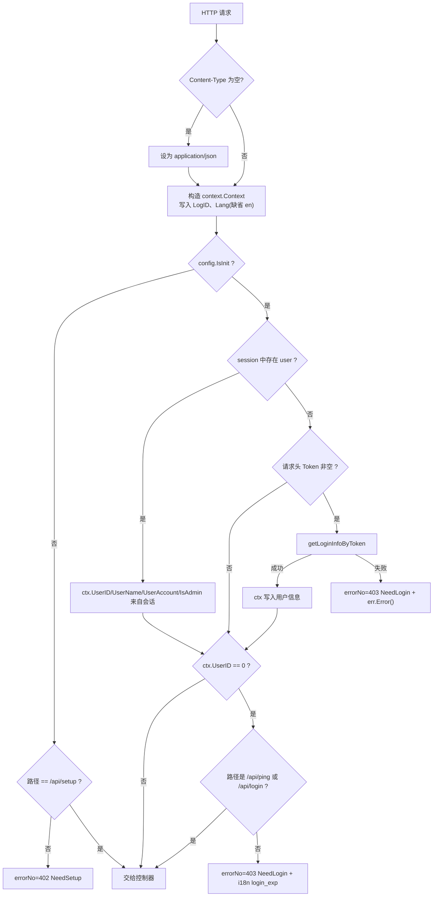
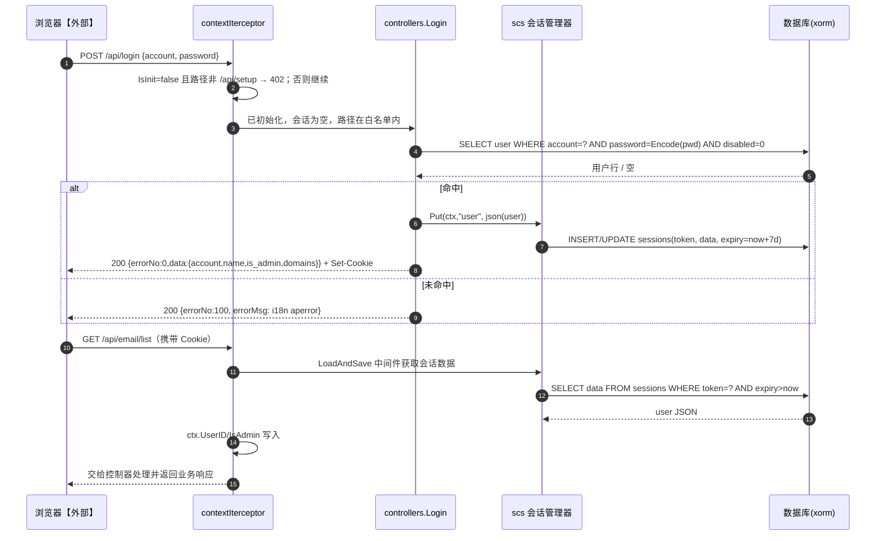
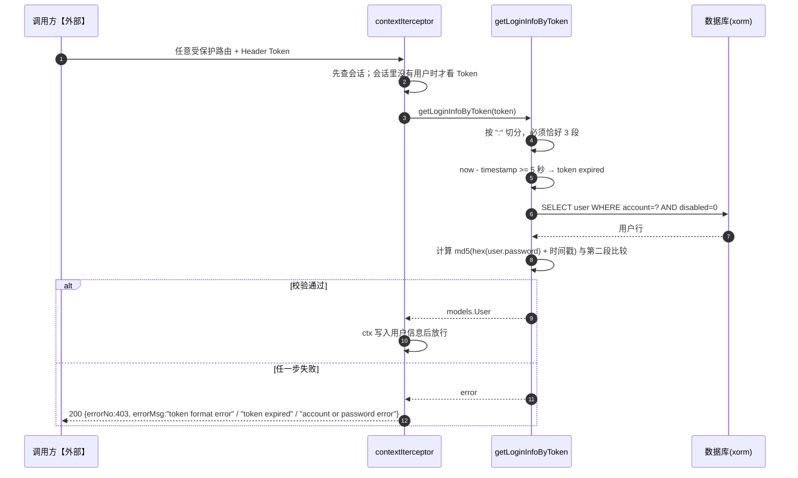
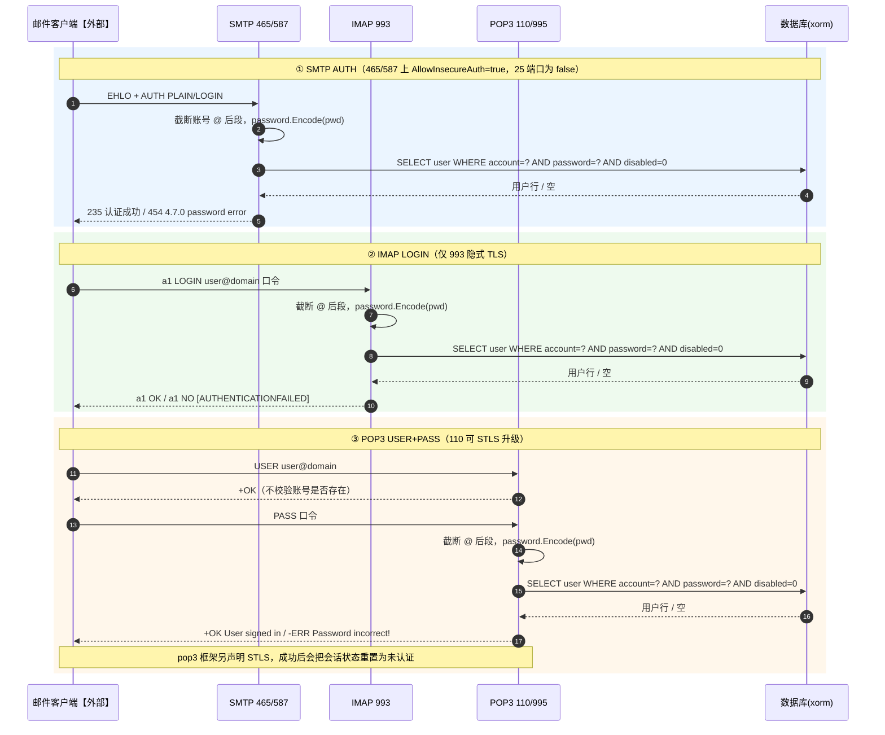
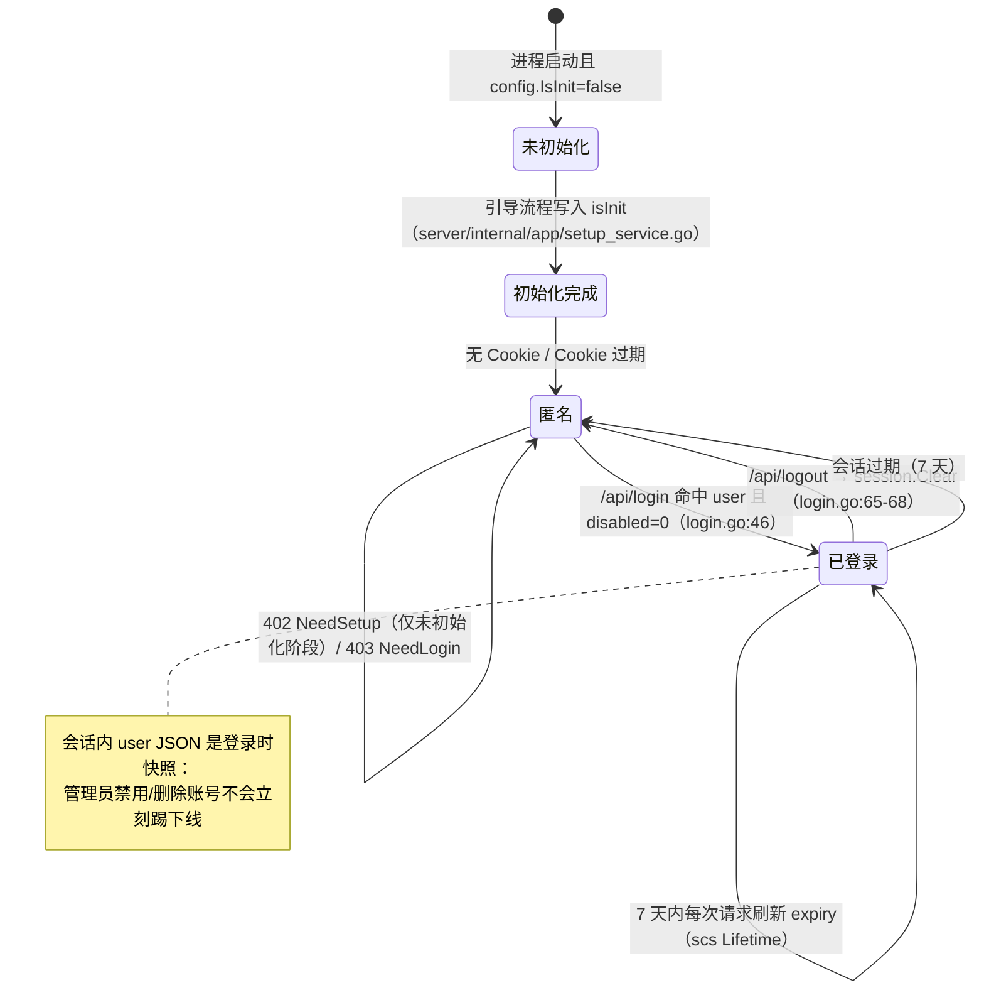
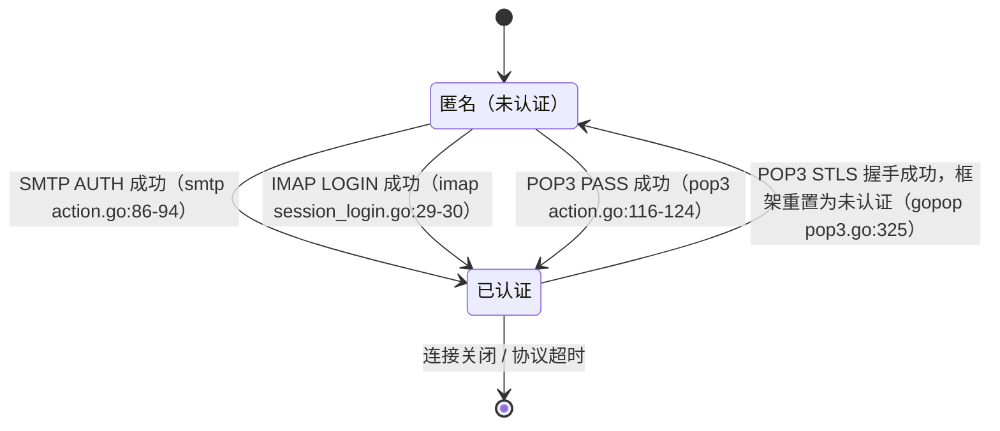

# 08 Web与协议鉴权（v1）

> 文档编号：08
> 文档版本：v1
> 项目：PMail
> 状态：已实现（含外部依赖：ACME CA【外部】仅与首次部署/证书相关，不在本文链路内）
> 证据基线：`master` @ `7e868f5`

## 1. 目标

回答：PMail 有几种“登录”方式，各自凭什么凭证、凭证多久失效、失败时报什么错误码；Web 后台的一条请求如何从 Cookie 变成 `ctx.UserID`；SMTP/IMAP/POP3 三个邮件协议的认证与 Web 登录共享了哪一层的密码校验，以及权限在哪里被二次判断。

覆盖范围：`server/pkg/password`、`server/models/User.go`、`server/models/session.go`、`server/internal/infra/session/session.go`、`server/internal/api/http/routes.go`（`contextIterceptor`、`getLoginInfoByToken`）、`server/internal/api/http/account_handler.go`、`server/internal/api/http/account_handler.go`、`server/internal/api/http/setup.go`、`server/dto/response/response.go`、`server/internal/app/auth_service.go`、三个协议服务的登录实现，以及前端 `web/desktop/src/utils/axios.js`、`web/desktop/src/router/index.js`、`web/desktop/src/views/LoginView.vue`。

不覆盖：SMTP/IMAP/POP3 各自命令的业务细节（见 [02 收信处理](./02-收信处理-v1.md)、[06 IMAP 服务](./06-IMAP服务-v1.md)、[07 POP3 服务](./07-POP3服务-v1.md)）；DKIM/SPF 验签（属于收信链路）。

## 2. 参与角色与前置条件

| 角色 | 说明 |
| --- | --- |
| 浏览器用户【外部】 | 使用 Web 后台；会话态靠 scs Cookie，不靠前端本地存储 |
| 邮件客户端【外部】 | 用 SMTP / IMAP / POP3 的账号口令认证 |
| 密码校验 | 唯一的哈希入口 `password.Encode`，两侧共用 |
| 会话存储 | `alexedwards/scs/v2`，Store 按数据库类型选择，生命周期 7 天 |
| 授权判断 | 路由级（中间件拦截）+ 控制器级（`ctx.IsAdmin`、`auth.HasAuth`） |

前置条件：

- 已初始化：`config.IsInit` 由 `config.Init` 依据 `domain != "" && isInit == true` 计算（`server/internal/config/config.go:158-160`）。未初始化时整个 Web 进程只提供 `/api/setup`。
- 数据库可用：会话与用户都落库；SQLite 下连接池为 1（`server/internal/infra/persistence/database.go`），所有会话读写与邮件请求串行在同一连接上。

## 3. 口令存储

唯一实现（`server/pkg/password/encode.go:9-12`）：

```
Encode(pwd) = md5( hex(md5(pwd + "pmail")) + "pmail2023" )
```

即“两次 md5 + 固定盐”。盐是硬编码常量，不是每用户随机盐，也不含迭代/内存开销参数；`user.password` 以 32 位 hex 存储（`server/models/User.go:7`）。本文只描述算法，**不记录任何用户名/密码/示例值**；`deploy/config/ssl/`、`deploy/config/dkim/` 内的示例私钥同样不在此引用。

使用该函数的全部位置：

| 场景 | 代码 | 作用 |
| --- | --- | --- |
| Web 登录 | `server/internal/api/http/account_handler.go` | 用 `WHERE account=? AND password=? AND disabled=0` 比对 |
| 建用户 | `server/internal/api/http/account_handler.go` | 写入哈希 |
| 改用户（管理员） | `server/internal/api/http/account_handler.go` | 重写哈希 |
| 改自己密码 | `server/internal/api/http/setup.go` | 重写哈希 |
| SMTP AUTH | `server/internal/api/smtp/action.go` | 比对 |
| IMAP LOGIN | `server/internal/api/imap/session.go` | 比对 |
| POP3 USER/PASS | `server/internal/api/pop3/action.go` | 比对 |
| Web Token 头 | `server/internal/api/http/routes.go` | 对 `user.password` 再 md5 一次 |

## 4. 四种认证方式对照

| 维度 | Web Session（主路径） | Web Token 头（兼容） | SMTP AUTH | IMAP / POP3 |
| --- | --- | --- | --- | --- |
| 入口 | `POST /api/login` → `session.Put("user")` | 任意受保护路由的 `Token` 请求头 | 465/587 显式 TLS 会话的 `AUTH PLAIN` / `AUTH LOGIN` | IMAP `LOGIN`；POP3 `USER`+`PASS` |
| 凭证 | scs Cookie（服务端存储，DB 表 `sessions`） | `{account}:{hex}:{unix秒}` | 账号 + 明文口令（SASL） | 账号 + 明文口令 |
| 校验 | `password.Encode(pwd)` 比对 `user.password` | `md5(hex(user.password)+时间戳)` 比对 | `password.Encode(pwd)` 比对 | `password.Encode(pwd)` 比对 |
| 有效期 | 7 天（`session.Lifetime`） | **5 秒**（`now - ts >= 5` 即拒绝） | 会话级 | 会话级 |
| 账号 `@` 后缀 | 不截断，必须是原始 `account` | 不截断，按 `account` 查 | **截断** `@` 后段 | IMAP/POP3 均**截断** |
| 失败响应 | `errorNo=100` + i18n 文案 | `errorNo=403` + 具体原因 | `454 4.7.0` + 原始错误文本（go-smtp 把 SASL 错误直译为 454，不是 535） | IMAP `NO [AUTHENTICATIONFAILED]`；POP3 `-ERR Password incorrect!` |
| 是否校验 `disabled=0` | 是 | 是 | 是 | 是 |
| 证据 | `login.go:26-63`、`session/init.go:16-21` | `https_server.go:114-127`、`:147-170` | `smtp_server/internal/api/smtp/action.go:46-99`、`:96`；go-smtp `conn.go:793-795` | `imap_server/internal/api/imap/session.go`；`pop3_server/internal/api/smtp/action.go:79-101` |

补充：SMTP 25 端口 `AllowInsecureAuth=false`（`server/internal/api/smtp/server.go`），465/587 两个实例为 `true`（`smtp.go:28`、`:57`）——注释写的是 “force TLS for auth”，但实际取值相反，即 465/587 上**允许**在未加密（尚未 STARTTLS）的会话里发 AUTH。IMAP 只有 993 隐式 TLS（`imap_server/internal/api/imap/server.go:28`），`InsecureAuth:false`。

## 5. 会话存储

| 项 | 实现 | 证据 |
| --- | --- | --- |
| 管理器 | `scs.New()` 单例 `session.Instance` | `server/internal/infra/session/session.go` |
| 生命周期 | `7 * 24 * time.Hour` | `server/internal/infra/session/session.go` |
| 存储介质 | MySQL → `mysqlstore`；SQLite → `sqlite3store`；PostgreSQL → `postgresstore`；其它 `panic` | `server/internal/infra/session/session.go` |
| 表结构 | `sessions(token char(43) PK, data blob, expiry timestamp)`（模型声明；实际建表由各 store 决定） | `server/models/session.go:3-10` |
| 挂载点 | `http.Server.Handler = session.Instance.LoadAndSave(mux)` | `server/internal/api/http/routes.go` |
| 写入 | `Login` 成功时 `session.Instance.Put(req.Context(), "user", json(user))` | `server/internal/api/http/account_handler.go` |
| 读取 | 中间件 `session.Instance.Get(ctx, "user")` → `json.Unmarshal` 到 `models.User` | `server/internal/api/http/routes.go` |
| 清除 | `/api/logout` → `session.Instance.Clear` | `server/internal/api/http/account_handler.go` |

注意存储的是 `models.User` 的 JSON（`Password` 字段带 `json:"-"`，见 `server/models/User.go:7`），因此**会话里没有密码**；但 `disabled`、`is_admin` 都是登录那一刻的快照。

## 6. 鉴权中间件行为

`contextIterceptor`（`server/internal/api/http/routes.go`）对每个挂载的路由执行：



错误码常量（`server/dto/response/response.go:8-14`）：`NeedSetup = 402`、`NeedLogin = 403`、`NoAccessPrivileges = 405`、`ParamsError = 100`、`ServerError = 500`。响应体固定为 `{errorNo, errorMsg, data}`（`response.go:16-38`），**HTTP 状态码始终是 200**，前端只看 `errorNo`。

路由注册（`server/internal/api/http/routes.go`）：除 `/`（静态资源）、`/.well-known/`（ACME）、`/api/ping` 外，其余全部包在 `contextIterceptor` 内。`http.ServeMux` **不区分 HTTP method**，所有路径对任意 method 生效。前端发起 `router.replace({path:'/login'})` 的导航在服务端不存在——前端是 hash 路由（`web/desktop/src/router/index.js:10`），`/login` 只是前端视图。

## 7. 时序图

### 7.1 Web 登录与后续请求（同步请求 → 响应）



### 7.2 Token 头兼容路径（同步请求 → 响应）



### 7.3 三种邮件协议认证对照（同一张图）



## 8. 状态机

### 8.1 Web 会话



### 8.2 协议会话



三个协议都没有“认证失败 N 次锁定”的机制，也没有 PER-IP 的连接/认证限速（对 `AuthFailureLimit`、失败计数相关标识的检索无结果）。

## 9. 授权（认证之后）

| 层次 | 实现 | 说明 | 证据 |
| --- | --- | --- | --- |
| 路由级 | `contextIterceptor` 白名单只有 `/api/ping`、`/api/login` | 其余全部要求有用户 | `https_server.go:129-134` |
| 未初始化 | 只放行 `/api/setup` | 用 402 让前端跳 `/setup` | `https_server.go:135-138` |
| 管理员 | `ctx.IsAdmin`：`/api/user/create`、`/api/user/list`、`/api/user/edit` 返回 405 | 405 是 `errorNo`，不是 HTTP 状态码 | `server/internal/api/http/account_handler.go`、`:69-72`、`:124-127` |
| 资源归属 | `auth.HasAuth`：管理员直接放行，否则必须存在 `user_email(email_id, user_id)` 行 | 附件读取等场景使用 | `server/internal/app/auth_service.go` |
| 发件人归属 | 非管理员发信时 `From` 账号必须等于本人 | 否则 `errorNo=100` | `server/internal/api/http/email_handler.go` |
| 敏感字段 | `models.User.Password` 带 `json:"-"` | 用户列表/编辑响应不含哈希 | `server/models/User.go:7` |

## 10. 关键异常

| 场景 | 实际行为 | 证据 |
| --- | --- | --- |
| 未初始化访问任意 API（除 `/api/setup`） | `errorNo=402`，前端跳 `/setup` | `https_server.go:135-138`；`web/desktop/src/utils/axios.js:40-47` |
| 未登录访问受保护 API | `errorNo=403`，文案为 i18n `login_exp`（中："登录已失效"，英："Login has expired."） | `https_server.go:129-133`；`server/internal/app/translation.go`、`:30` |
| Token 格式非法 / 过期 / 校验失败 | `errorNo=403`，`errorMsg` 直接回传内部错误字符串 | `https_server.go:149-167`、`:122-125` |
| Token 时间戳在未来 | `now - ts` 为负，**小于 5**，不会命中过期分支，只受 md5 比对约束 | `https_server.go:156-158` |
| 账号或密码错误（Web） | `errorNo=100` + i18n `aperror`（不是 403，不会跳登录页） | `server/internal/api/http/account_handler.go` |
| 会话 Cookie 有效但用户已被禁用 | 仍可访问受保护 API（会话里是旧快照） | `https_server.go:101-111` |
| 非管理员调用管理员接口 | `errorNo=405` | `server/internal/api/http/account_handler.go` |
| 修改密码后旧会话 | 不失效：改密码只更新 `user.password`，不清理 `sessions` | `server/internal/api/http/setup.go` |
| `/api/ping` 与 `/.well-known/` 的鉴权 | `ping` 在中间件白名单内；`/.well-known/` **不经过** `contextIterceptor` | `http_server.go:32-33`、`https_server.go:129-134` |
| 前端 HTTP 层收到 403 响应体 | 跳 `/login` 并带 `redirect` 参数；但 SSR 侧 403 是 200 状态码，只能靠 `errorNo` 识别 | `web/desktop/src/utils/axios.js:28-48` |
| 前端 HTTP 层收到真实 HTTP 403 | 同样跳 `/login` | `web/desktop/src/utils/axios.js:60-67` |

## 11. 证据索引

| 主题 | 文件:行号 |
| --- | --- |
| 两次 md5 加盐 | `server/pkg/password/encode.go:9-18` |
| 用户模型与 `json:"-"` | `server/models/User.go:3-10` |
| `sessions` 表模型 | `server/models/session.go:3-10` |
| scs 初始化、7 天寿命、Store 选择 | `server/internal/infra/session/session.go` |
| `contextIterceptor` 全文 | `server/internal/api/http/routes.go` |
| Token 格式与 5 秒时效 | `server/internal/api/http/routes.go` |
| 会话读写挂载 | `server/internal/api/http/routes.go` |
| 路由与白名单 | `server/internal/api/http/routes.go` |
| 引导期服务 | `server/internal/api/http/setup.go` |
| 登录 / 登出 | `server/internal/api/http/account_handler.go` |
| 用户增改与管理员判断 | `server/internal/api/http/account_handler.go`、`:49-60`、`:68-72`、`:122-181` |
| 改密码 | `server/internal/api/http/setup.go` |
| 错误码常量与响应封装 | `server/dto/response/response.go:8-38` |
| 资源归属判断 | `server/internal/app/auth_service.go` |
| 发件人归属校验 | `server/internal/api/http/email_handler.go` |
| SMTP 认证 | `server/internal/api/smtp/action.go`、`server/internal/api/smtp/server.go`、`:57`、`:85` |
| IMAP 认证 | `server/internal/api/imap/session.go`、`server/internal/api/imap/server.go` |
| POP3 认证 | `server/internal/api/pop3/action.go` |
| `IsInit` 计算 | `server/internal/config/config.go:158-160` |
| 前端响应拦截（403 → /login，402 → /setup） | `web/desktop/src/utils/axios.js:28-98` |
| 前端 hash 路由与 `Lang` 头 | `web/desktop/src/router/index.js:9-43`、`web/desktop/src/utils/axios.js:7-14` |
| 登录页只 POST 账号口令 | `web/desktop/src/views/LoginView.vue:61-83` |

## 12. 实现风险

1. **前端实际不使用 `Token` 头机制**：`web/desktop/src/utils/axios.js` 只在请求拦截器里处理 POST body 序列化（`:17-25`），从不设置 `Token` 头；`LoginView.vue` 也只用账号口令换会话（`:67`）。也就是说 `getLoginInfoByToken`（`https_server.go:147-170`）目前只服务于仓库外调用方，却仍是一条完整的口令-派生凭证通道，且 5 秒窗口完全依赖调用方与服务器时钟一致。
2. **Token 把“密码哈希”当成长期共享密钥**：Token 第二段是 `md5(user.password + 时间戳)`（`https_server.go:164`），而 `user.password` 本身是固定盐的 md5（见 §3）。只要能拿到一次握手用的明文 Token（例如落进了代理日志、抓包或调用方日志），就等于拿到了该用户密码哈希的派生值；由于时间戳是明文且服务端只判 `now - ts < 5`，在 5 秒窗口内可重放。服务端还会把 `err.Error()` 原文（`token format error` / `token expired` / `account or password error`）回给调用方（`https_server.go:122-125`），“格式错/过期/凭据错”可被调用方区分。
3. **会话是登录时快照，撤销不即时**：中间件从会话里反序列化 `models.User` 并直接信任其中的 `is_admin`/`disabled`（`https_server.go:101-111`）。管理员对用户执行“禁用”“取消管理员”后，对方在最长 7 天内（`session/init.go:18`）仍保持原权限；修改密码同样不会使已存在的会话失效（`server/internal/api/http/setup.go`），也没有会话列表/踢人接口。
4. **口令哈希方案强度不足且无法平滑升级**：固定双盐 md5（`pkg/password/password.go:10`）没有任何 work factor，`user.password` 仅 `char(32)`（`models/user.go:7`）；由于 SMTP/IMAP/POP3 都要用同一函数做“明文口令 → 比对”，任何换成 bcrypt/argon2 的改造都必须同时改四条认证链路，实际上被锁死在弱哈希上。
5. **口令明文进入调试日志**：SMTP `log.WithContext(...).Debugf("Auth %s %s", username, pwd)`（`smtp_server/internal/api/smtp/action.go:69`）与失败分支（`:96`）、POP3 的 `PASS`（`pop3_`server/internal/api/smtp/action.go`）与 APOP 摘要（`:136`、`:143`）在 `logLevel=debug` 下都会打印明文口令或口令摘要；IMAP 侧只记 `Login successful` / `user not found`（`imap_server/internal/api/imap/session.go`、`:40`），未泄露口令。这与仓库规范“禁止打印密码、Token”直接冲突。
6. **错误码语义与 HTTP 语义混用**：`contextIterceptor` 用 `errorNo=403` 表达“未登录”（`https_server.go:131`）而 HTTP 状态码恒为 200；前端同时处理 `errorNo===403` 与 `error.response.status===403`（`axios.js:30`、`:60`），两套逻辑并存。加上 `errorNo=402` 本义是 “Payment Required”，`405` 本义是 “Method Not Allowed”，却在业务里表示“未初始化/无权限”，任何新增调用方都容易误判。
7. **无任何认证限速与失败锁定**：`/api/login`（`server/internal/api/http/account_handler.go`）、SMTP AUTH、IMAP LOGIN、POP3 PASS 都没有失败计数、延迟或 IP 维度限流；配合弱哈希，一旦服务暴露在公网即可被离线/在线爆破。POP3 更宽松：`USER` 阶段永远 `+OK`（`pop3_server/internal/api/smtp/action.go:94-95`），没有任何早期拒绝。
8. **`disabled` 语义在全链路一致但撤销链路缺失**：Web 登录 / Token / SMTP / IMAP / POP3 都要求 `disabled=0` 才放行，这一点是一致的；问题在于 `EditUser` 改 `disabled` 后不清理该用户已有会话（`server/internal/api/http/account_handler.go`），`Info` 还会把 `is_admin` 回给前端（`server/internal/api/http/account_handler.go`）用于界面渲染，属于“展示层跟随快照、服务端不跟随”的组合。另外 `email.Send` 对非管理员只校验 `From` 账号等于本人（`server/internal/api/http/email_handler.go`），管理员身份在这条链路上完全绕过该限制。
9. **SMTP 认证失败返回临时性错误码 454**：`AuthPlain` 失败时返回普通 `errors.New("password error")`（`smtp_server/internal/api/smtp/action.go:97`），go-smtp 在 SASL 阶段把任何错误统一写成 `454 4.7.0`（go-smtp `conn.go:793-795`）。454 在 RFC 5321 里是**临时性**失败，客户端（含 PMail 自己 `pkg/send` 的重试逻辑）会认为“稍后重试即可”，导致密码错误的账号被反复重投/重试，而不是立即被判定为永久失败；正确语义应为 535 永久失败。
10. **465/587 允许未加密会话发送 AUTH**：`smtp.go:28`、`:57` 把 `AllowInsecureAuth` 置为 `true`，两处注释都写着 “force TLS for auth”，与实际取值相反。587 是 STARTTLS 端口，客户端在 STARTTLS 之前即可发 `AUTH PLAIN`，口令以 base64（等同明文）过网。
