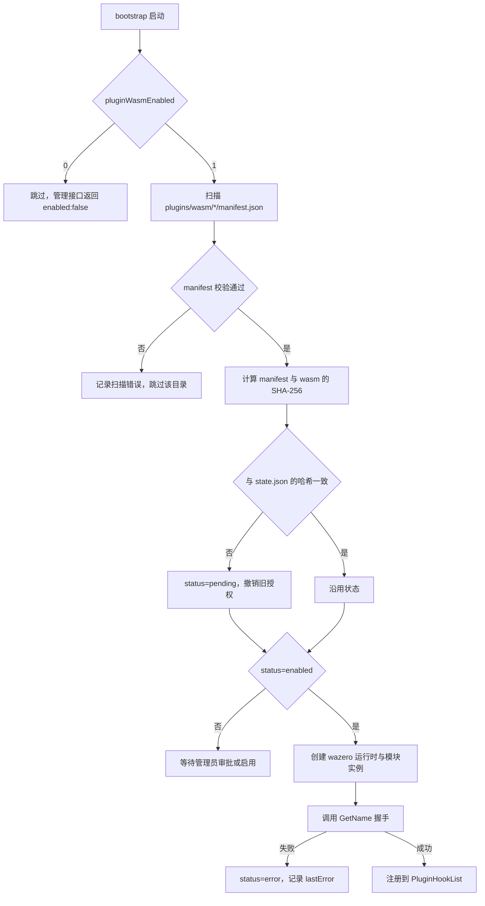
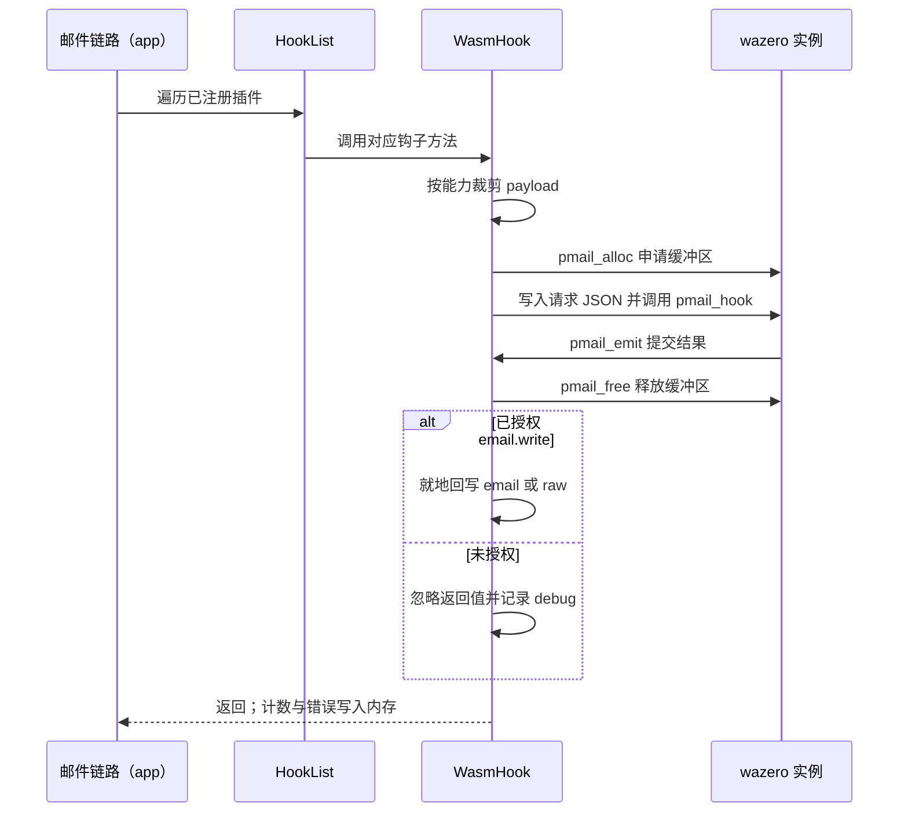
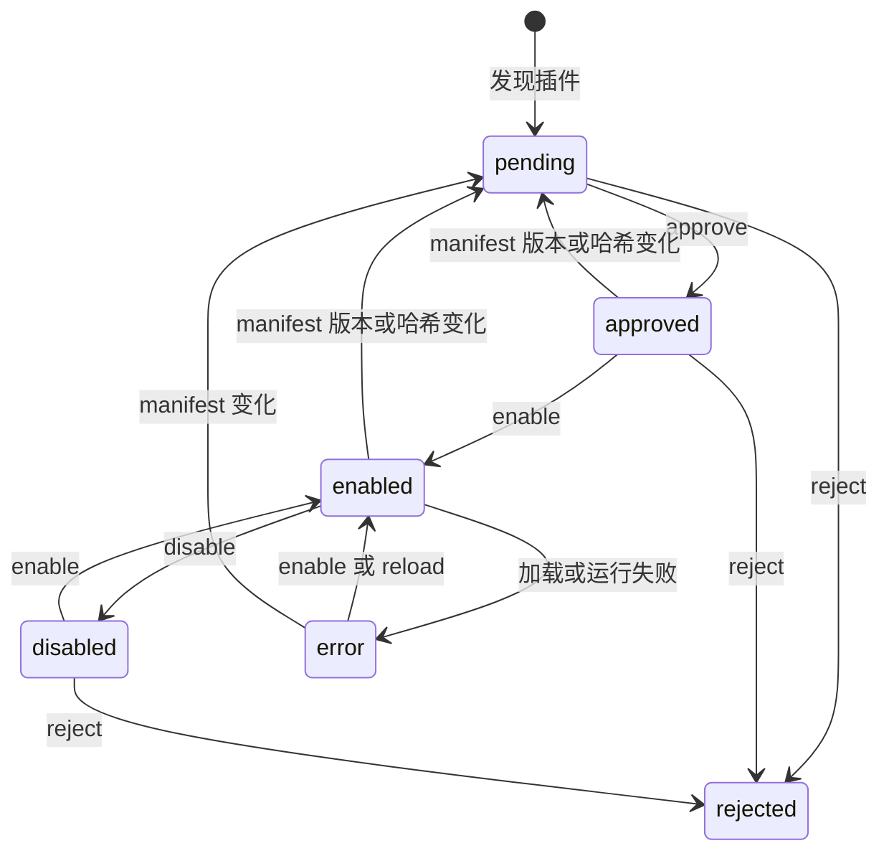
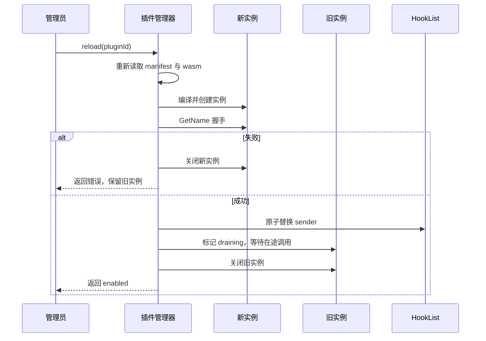

# 09 插件运行时（v1）

> 文档编号：09
> 文档版本：v1
> 项目：PMail
> 状态：已实现
> 证据基线：`master` @ `7e868f5`

本文件描述 WASM 插件的装载、审批、钩子调用与重载；旧进程插件与 Unix socket 机制已移除。

## 1. 装载流程

约束：单个插件失败不阻塞主程序启动；扫描与装载错误写入日志和 `lastError`。`PluginWasmInit` 必须在 `infra.PluginInit` 之后执行，确保 `PluginHookList` 已初始化。

## 2. 钩子调用

失败路径：超时、陷阱、非 0 返回码、非法 JSON、超过 `output_bytes` 都按 fail-open 处理，本次调用失败并计入 `errorCount`，邮件继续处理。超时后实例被关闭，下一次调用重新创建。

网络能力：仅在审批 `http` 后注册 `pmail_http_get` / `pmail_http_post`，目标主机必须精确命中 manifest 的 `http_allow`，不跟随重定向；请求体 ≤1 MiB，响应 ≤`out_cap`。

## 3. 审批状态机

授权项必须存在于 manifest；`approve` 只接受子集。`reject` 清空授权。

## 4. 重载

重载后状态文件更新为新的版本与哈希；授权项沿用，但若新 manifest 删除了已授权的钩子或能力，重载失败并保留旧实例。

## 5. 与收信流程的关系

- 钩子调用顺序不变：`ReceiveParseBefore → 解析 → ReceiveParseAfter → 落库 → ReceiveSaveAfter`，见 [02 收信处理](./02-收信处理-v1.md)。
- `ReceiveParseAfter` 之后的 `spoofed` 强制置 3 仍然优先，WASM 回写不能绕过。
- 异步钩子 `SendAfter`、`ReceiveSaveAfter` 的返回值被忽略，失败只记日志。
- 插件不可用时 fail-open，不得阻塞 SMTP 会话。

## 6. 证据索引

| 内容 | 位置 |
| --- | --- |
| 配置字段 | `server/internal/config/config.go` |
| 启动与关闭装配 | `server/internal/bootstrap/bootstrap.go` |
| 管理端口绑定 | `server/internal/bootstrap/dependencies.go` |
| manifest 校验与执行器 | `server/internal/infra/plugin/wasm.go` |
| 状态文件与原子写 | `server/internal/infra/plugin/plugin_registry.go` |
| 审批与生命周期 | `server/internal/infra/plugin/plugin_manager.go` |
| 管理接口 | `server/internal/api/http/plugin_handler.go` |
| 路由注册 | `server/internal/api/http/http_routes.go` |
| ABI 常量 | `server/hooks/wasmabi/abi.go` |
