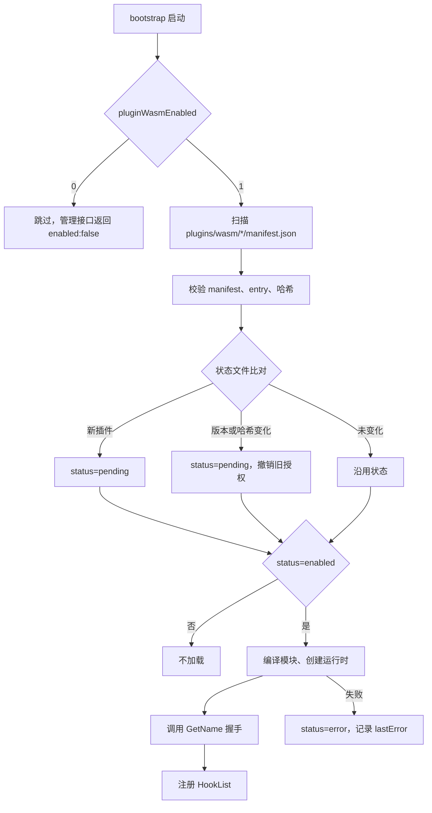
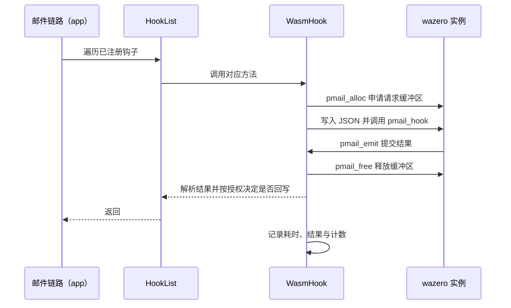
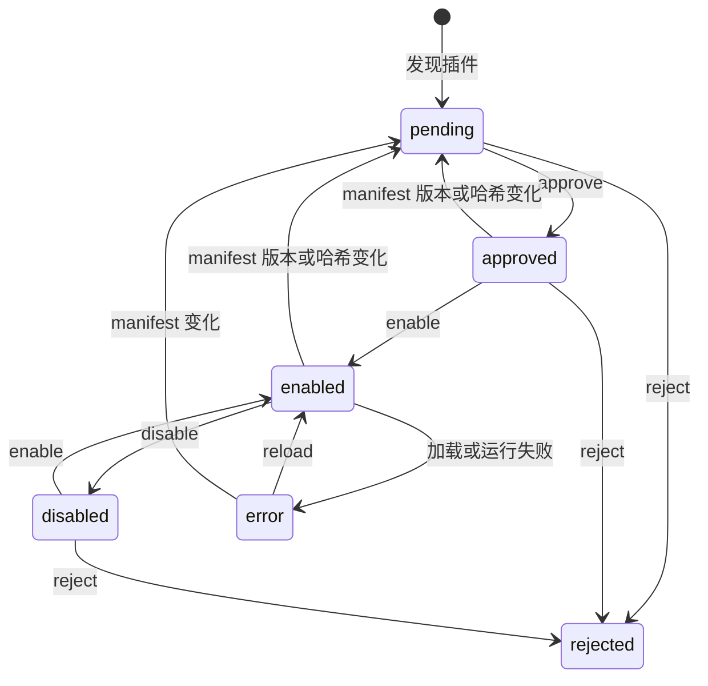

# 0001 WASM插件机制 — 实施方案

> 文档编号：0001-实施方案
> 项目：PMail
> 需求清单：[0001-WASM插件机制-需求清单.md](./0001-WASM插件机制-需求清单.md)
> 方案评估：[0001-WASM插件机制-方案评估.md](./0001-WASM插件机制-方案评估.md)
> 方案验收：[0001-WASM插件机制-方案验收.md](./0001-WASM插件机制-方案验收.md)
> 状态：已实现，本机部分验收通过；剩余项见方案验收
> 证据基线：`master` @ `7e868f5`
> 分支：master ｜ 日期：2026-11-11

本文件定义参数与字段契约、链路与生效点、实现细节、改动清单、边界与观测点。验收数字写入方案验收（实现后补）。

## 1. 参数与字段契约

### 1.1 配置字段

| 字段 | 类型 | 默认 | 说明 |
| --- | --- | --- | --- |
| `pluginWasmEnabled` | int | `0` | `0` 关闭 WASM 插件能力；`1` 启用。关闭时管理接口返回 `enabled:false`，不扫描目录 |

同步位置：`server/internal/config/config.go`、`deploy/config/config.json`、`deploy/config/config.dev.json`、[05 构建与部署](../../20-功能/05-构建与部署.md)。

### 1.2 目录与包格式

```text
plugins/
└── wasm/
    ├── state.json                 # 审批与运行状态
    ├── spam_block/
    ├── wechat_push/
    └── example.spam-filter/
        ├── manifest.json
        └── plugin.wasm
```

规则：

- 只扫描 `plugins/wasm/*/manifest.json`；目录名必须等于 manifest 的 `id`。
- `entry` 必须是插件目录内的普通文件；拒绝绝对路径、`..` 与符号链接。
- 单文件大小上限 32 MiB。
- 同一 `id` 只允许一个目录；发现冲突时两者都不加载，状态记为 `error`。

### 1.3 manifest 字段

| 字段 | 类型 | 必填 | 约束 | 说明 |
| --- | --- | --- | --- | --- |
| `id` | string | 是 | `^[a-z0-9][a-z0-9._-]{1,63}$`，等于目录名 | 插件唯一标识 |
| `name` | string | 是 | 1–64 字符 | 管理端显示名 |
| `version` | string | 是 | 1–32 字符 | 插件版本，参与审批绑定 |
| `abi` | string | 是 | 必须为 `pmail-hook@1` | ABI 版本 |
| `entry` | string | 否 | 默认 `plugin.wasm` | 模块文件名 |
| `hooks` | string[] | 是 | 7 个钩子的非空子集，去重 | 允许被调用的钩子 |
| `capabilities` | string[] | 否 | `log`、`email.read`、`email.write`、`http` 的子集 | 能力声明 |
| `http_allow` | string[] | 否 | 授予 `http` 时必填，1–16 个 `host` 或 `host:port` | HTTP 精确主机白名单 |
| `config` | object | 否 | ≤16 项，key 为 `[a-z0-9_]{1,32}`，value ≤1024 字符 | 传给插件的配置 |
| `mounts` | object[] | 否 | 首期必须为空 | 文件挂载，首期不开放 |
| `limits.memory_mb` | int | 否 | 1–256，默认 64 | 单实例内存上限 |
| `limits.timeout_ms` | int | 否 | 100–5000，默认 2000 | 同步钩子超时 |
| `limits.async_timeout_ms` | int | 否 | 100–30000，默认 5000 | 异步钩子超时 |
| `limits.output_bytes` | int | 否 | 1024–1048576，默认 262144 | 单次返回上限 |

示例：

```json
{
  "id": "example.spam-filter",
  "name": "示例反垃圾",
  "version": "1.0.0",
  "abi": "pmail-hook@1",
  "entry": "plugin.wasm",
  "hooks": ["ReceiveParseAfter"],
  "capabilities": ["log", "email.read"],
  "mounts": [],
  "limits": {
    "memory_mb": 64,
    "timeout_ms": 2000,
    "async_timeout_ms": 5000,
    "output_bytes": 262144
  }
}
```

### 1.4 ABI v1

模块导出：

| 导出 | 签名 | 说明 |
| --- | --- | --- |
| `pmail_alloc` | `(size i32) -> i32` | 申请线性内存，返回指针；`0` 表示失败 |
| `pmail_free` | `(ptr i32, size i32)` | 释放调用方申请的内存 |
| `pmail_hook` | `(hook_id i32, req_ptr i32, req_len i32) -> i32` | 执行钩子；`0` 成功，非 `0` 为错误码 |

宿主导入（模块名 `env`）：

| 导入 | 签名 | 授权条件 | 说明 |
| --- | --- | --- | --- |
| `pmail_emit` | `(ptr i32, len i32) -> i32` | 无 | 提交 JSON 结果；超过 `output_bytes` 返回非 `0` |
| `pmail_log` | `(level i32, ptr i32, len i32)` | `log` | `0` debug、`1` info、`2` warn、`3` error；宿主按日志级别输出 |
| `pmail_http_post` | `(url_ptr, url_len, body_ptr, body_len, out_ptr, out_cap i32) -> i32` | `http` | POST JSON 到 `http_allow` 内主机；返回响应长度，负数表示错误：`-1` 参数/白名单、`-2` 网络、`-3` 超出 `out_cap`、`-4` 非 2xx |
| `pmail_http_get` | `(url_ptr, url_len, out_ptr, out_cap i32) -> i32` | `http` | GET `http_allow` 内主机；返回与错误码同 `pmail_http_post` |

钩子编号：

| ID | 钩子 | 同步性 |
| --- | --- | --- |
| 1 | `SendBefore` | 同步 |
| 2 | `SendAfter` | 异步 |
| 3 | `ReceiveParseBefore` | 同步 |
| 4 | `ReceiveParseAfter` | 同步 |
| 5 | `ReceiveSaveAfter` | 异步 |
| 6 | `GetName` | 同步 |
| 7 | `SettingsHtml` | 同步 |

请求 JSON 的公共字段：

| 字段 | 类型 | 说明 |
| --- | --- | --- |
| `abi` | string | 固定 `pmail-hook@1` |
| `hook` | string | 钩子名 |
| `serverVersion` | string | 主程序版本 |

按钩子追加：

| 钩子 | 追加字段 |
| --- | --- |
| `SendBefore` | `email` |
| `SendAfter` | `email`、`errors`（`map[string]string`） |
| `ReceiveParseBefore` | `raw`（base64；未授权 `email.read` 时省略） |
| `ReceiveParseAfter` | `email` |
| `ReceiveSaveAfter` | `email`、`userEmail` |
| `GetName` | 无 |
| `SettingsHtml` | `url`、`requestData` |

返回 JSON：

| 钩子 | 返回 | 生效条件 |
| --- | --- | --- |
| `SendBefore`、`ReceiveParseAfter` | `{"email":{...}}`（字段补丁） | 已授权 `email.write` |
| `ReceiveParseBefore` | `{"raw":"<base64>"}` | 已授权 `email.write` |
| `GetName` | `{"name":"..."}` | 始终生效；空值退回 manifest 的 `name` |
| `SettingsHtml` | `{"html":"..."}` | 已授权钩子 `SettingsHtml` |
| 异步钩子 | 忽略 | — |

约束：

- 请求与返回均为 UTF-8 JSON；未知字段忽略，缺失返回视为无操作。
- 宿主先校验长度再解码；解码失败按钩子错误处理。
- 未授权 `email.read` 时，`email` 只包含信封元数据（发件人、收件人、主题、时间），不含正文、附件与原始报文。
- 未授权 `email.write` 时，返回的 `email`/`raw` 被忽略，并记录一条 debug 日志。
- `GetName` 由宿主在启用与重载时调用，不受 `hooks` 授权限制；`SettingsHtml` 必须出现在 `hooks` 中才会被调用。
- `GetName` 名称中的空格会被移除，与历史进程插件行为一致（旧机制已移除）。
- 单次请求 JSON 上限 16 MiB；`ReceiveParseBefore` 的 `raw` 在 base64 前上限 8 MiB，超过时不调用该钩子，记 `error` 并继续收信。
- `pmail_emit` 可被多次调用，最后一次成功提交生效；超过 `output_bytes` 的提交返回非 `0`。
- `pmail_log` 单条消息上限 4 KiB，超出截断；日志内容按级别输出，禁止写入邮件正文。
- 同步钩子返回的 `email` 是**补丁**：只回写 JSON 中出现的字段，未出现的字段保持原值；附件、`MessageId`、`MsgID`、`Size`、`Authentication` 不会被覆盖。
- `pmail_http_post` 只允许 `http/https`、URL ≤2048 字符、body ≤1 MiB，目标主机必须与 `http_allow` 精确匹配；不跟随重定向，响应写入调用方提供的缓冲区，长度不得超过 `out_cap`。
- 实例化后若模块导出 `_initialize`（Go `-buildmode=c-shared` 的 WASI reactor），宿主先调用它初始化运行时，再注册钩子。
- 编译探针必须确认 `pmail_alloc`、`pmail_free`、`pmail_hook` 三个导出存在，缺失即拒绝启用。

`pmail_hook` 返回码：

| 返回码 | 含义 | 宿主处理 |
| --- | --- | --- |
| `0` | 成功 | 读取 `pmail_emit` 结果 |
| `1` | 参数非法 | 本次调用失败 |
| `2` | 不支持的钩子编号 | 本次调用失败 |
| `3` | 模块内部错误 | 本次调用失败 |
| 其他/陷阱 | 异常 | 本次调用失败；连续失败达阈值时置 `error` |

### 1.5 审批状态文件

路径：`plugins/wasm/state.json`，权限 `0600`。

```json
{
  "version": 1,
  "plugins": {
    "example.spam-filter": {
      "status": "enabled",
      "version": "1.0.0",
      "abi": "pmail-hook@1",
      "manifestSha256": "e3b0c44298fc1c149afbf4c8996fb92427ae41e4649b934ca495991b7852b855",
      "wasmSha256": "9f86d081884c7d659a2feaa0c55ad015a3bf4f1b2b0b822cd15d6c15b0f00a08",
      "grantedHooks": ["ReceiveParseAfter"],
      "grantedCapabilities": ["log"],
      "approvedAt": "2026-11-11T15:30:00+08:00",
      "lastUsedAt": "2026-11-11T15:31:02+08:00",
      "callCount": 10,
      "errorCount": 1,
      "lastError": "timeout"
    }
  }
}
```

状态枚举：

| 状态 | 含义 |
| --- | --- |
| `pending` | 已发现，待审批 |
| `approved` | 已授权，未启用 |
| `enabled` | 已启用，实例在运行 |
| `disabled` | 已停用，授权保留 |
| `rejected` | 已拒绝，授权清空 |
| `error` | 加载或运行失败，`lastError` 记录原因 |

写入规则：同目录临时文件 + `fsync` + `rename`；Windows 下 `rename` 覆盖失败时先删除目标再重命名，并在文档与日志中标注非原子窗口。内存中保存副本，读写均加锁。

### 1.6 管理接口

通用约定：

- 全部路由挂在 `httpServerContextIterceptor` 之后，校验 `ctx.IsAdmin`；非管理员返回 `errorNo=405`。
- 响应统一使用 `response.NewSuccessResponse` / `response.NewErrorResponse`，HTTP 状态码始终 `200`。
- 服务使用 `http.ServeMux` 且不区分 method，handler 内部必须显式判断 `req.Method`；方法不符返回 `errorNo=100`。
- 接口实现后路由总数由 28 变为 34，必须同步 [02 功能清单](../../20-功能/02-功能与接口清单.md) 与 [03 接口说明](../../20-功能/02-功能与接口清单.md)。

| 方法 | 路径 | 请求体 | 成功响应 `data` |
| --- | --- | --- | --- |
| GET | `/api/plugin/manage/list` | 无 | `{"enabled":true,"plugins":[...]}` |
| POST | `/api/plugin/manage/approve` | `{"pluginId":"...","hooks":["..."],"capabilities":["..."]}` | `{"pluginId":"...","status":"approved","grantedHooks":[...],"grantedCapabilities":[...]}` |
| POST | `/api/plugin/manage/enable` | `{"pluginId":"..."}` | `{"pluginId":"...","status":"enabled"}` |
| POST | `/api/plugin/manage/disable` | `{"pluginId":"..."}` | `{"pluginId":"...","status":"disabled"}` |
| POST | `/api/plugin/manage/reject` | `{"pluginId":"..."}` | `{"pluginId":"...","status":"rejected"}` |
| POST | `/api/plugin/manage/reload` | `{"pluginId":"..."}` | `{"pluginId":"...","status":"enabled"}` |
| POST | `/api/plugin/manage/upload` | `multipart/form-data` 字段 `file`（zip，≤32MB） | `{plugin}`，状态 `pending` |

`plugins` 数组元素字段：

| 字段 | 类型 | 说明 |
| --- | --- | --- |
| `id` | string | manifest `id` |
| `name` | string | manifest `name` |
| `type` | string | 固定 `wasm` |
| `version` | string | manifest `version` |
| `abi` | string | manifest `abi` |
| `status` | string | 状态枚举 |
| `hooks` | string[] | manifest 声明的钩子 |
| `capabilities` | string[] | manifest 声明的能力 |
| `grantedHooks` | string[] | 已授权钩子 |
| `grantedCapabilities` | string[] | 已授权能力 |
| `lastError` | string | 最近错误 |
| `callCount` | number | 调用次数 |
| `errorCount` | number | 错误次数 |
| `lastUsedAt` | string | 最近调用时间，RFC 3339 |

错误映射：

| 场景 | errorNo | errorMsg |
| --- | --- | --- |
| 非管理员 | 405 | `no access privileges` |
| 方法不符、JSON 解析失败、`pluginId` 为空 | 100 | 具体原因 |
| 插件不存在、状态不允许当前操作、授权项不在 manifest 内 | 100 | 具体原因 |
| 编译、实例化、重载失败 | 500 | 错误摘要，不含文件内容 |

### 1.7 生效点

| 生效点 | 位置 | 作用 |
| --- | --- | --- |
| 配置读入 | `server/internal/config/config.go` | 决定是否初始化管理器 |
| 启动装配 | `server/internal/bootstrap/bootstrap.go` | 在 `infra.PluginInit` 之后初始化管理器 |
| 依赖绑定 | `server/internal/bootstrap/dependencies.go` | 绑定 app 端口到 infra 实现 |
| 钩子注册 | `server/internal/infra/plugin/plugin_registry.go` | 复用 `PluginRegisterHook` / `PluginRemoveHook` |
| 钩子调用 | 收信/发信链路现有调用点 | 不需要改动 |

## 2. 链路与生效点

### 2.1 启动装载



约束：

- 单个插件失败不阻塞主程序启动，只把该插件置为 `error`。
- 必须在 `infra.PluginInit(serverVersion)` 之后初始化，否则 `PluginHookList` 为空，注册会 panic。
- 关闭顺序：停止 WASM 管理器并关闭实例。

### 2.2 钩子调用



失败路径：

- 超时：ctx 到期后运行时中断执行，实例标记为不可用并关闭，下次调用重建实例；本次调用按 fail-open 返回错误（仅记日志）。
- `pmail_hook` 返回非 `0`、返回 JSON 非法、超过 `output_bytes`：本次调用失败，计入 `errorCount`。
- 异步钩子（`SendAfter`、`ReceiveSaveAfter`）的返回被忽略，失败不影响主流程。

### 2.3 审批、启用与重载



重载流程：

1. 用新模块编译并创建实例，调用 `GetName` 握手。
2. 握手成功后原子替换 `HookList` 中的 sender。
3. 等待在途调用结束（超时上限 30s），关闭旧实例。
4. 任一步失败则保留旧实例与旧注册，返回 `errorNo=500`。

### 2.4 功能点图文档

- 本需求实现时新增 `docs/30-流程/09-插件运行时-v1.md`，包含装载、调用、审批、重载四张图；当前尚未创建，不在本轮三件套内。
- 收信钩子的调用顺序不变，[02 收信处理](../../30-流程/02-收信处理-v1.md) 只在实现时补充“执行器可以是进程或 WASM”的说明，不新增版本。

## 3. 实现细节

### 3.1 DTO

新增 `server/dto/plugin/plugin.go`，供 app、infra、api 共用，避免层级反向依赖：

```go
package plugin

type Status string

const (
	StatusPending  Status = "pending"
	StatusApproved Status = "approved"
	StatusEnabled  Status = "enabled"
	StatusDisabled Status = "disabled"
	StatusRejected Status = "rejected"
	StatusError    Status = "error"
)

type Info struct {
	ID                  string   `json:"id"`
	Name                string   `json:"name"`
	Type                string   `json:"type"`
	Version             string   `json:"version"`
	ABI                 string   `json:"abi"`
	Status              Status   `json:"status"`
	Hooks               []string `json:"hooks"`
	Capabilities        []string `json:"capabilities"`
	GrantedHooks        []string `json:"grantedHooks"`
	GrantedCapabilities []string `json:"grantedCapabilities"`
	LastError           string   `json:"lastError"`
	CallCount           int64    `json:"callCount"`
	ErrorCount          int64    `json:"errorCount"`
	LastUsedAt          string   `json:"lastUsedAt"`
}
```

### 3.2 ABI 常量包

新增 `server/hooks/wasmabi/abi.go`，供宿主与插件 SDK 共用：

```go
package wasmabi

const (
	ABI         = "pmail-hook@1"
	HostModule  = "env"
	ExportAlloc = "pmail_alloc"
	ExportFree  = "pmail_free"
	ExportHook  = "pmail_hook"
	ImportEmit  = "pmail_emit"
	ImportLog   = "pmail_log"
)

const (
	HookSendBefore uint32 = iota + 1
	HookSendAfter
	HookReceiveParseBefore
	HookReceiveParseAfter
	HookReceiveSaveAfter
	HookGetName
	HookSettingsHTML
)
```

### 3.3 infra 接口

```go
// server/internal/infra/plugin/plugin_wasm.go

type Mount struct {
	Name     string `json:"name"`
	Path     string `json:"path"`
	ReadOnly bool   `json:"readonly"`
}

type Limits struct {
	MemoryMB       int `json:"memory_mb"`
	TimeoutMS      int `json:"timeout_ms"`
	AsyncTimeoutMS int `json:"async_timeout_ms"`
	OutputBytes    int `json:"output_bytes"`
}

type WasmManifest struct {
	ID           string   `json:"id"`
	Name         string   `json:"name"`
	Version      string   `json:"version"`
	ABI          string   `json:"abi"`
	Entry        string   `json:"entry"`
	Hooks        []string `json:"hooks"`
	Capabilities []string `json:"capabilities"`
	Mounts       []Mount  `json:"mounts"`
	Limits       Limits   `json:"limits"`
}

func LoadWasmManifest(dir string) (*WasmManifest, error)
func (m *WasmManifest) Validate() error
func (m *WasmManifest) EntryPath(dir string) (string, error)

type wasmArtifact struct {
	Dir           string
	Manifest      *WasmManifest
	ManifestSHA   string
	WasmSHA       string
	Bytes         []byte
}

func ScanWasmPlugins(root string) ([]*wasmArtifact, error)

type wasmExecutor struct {
	rt       wazero.Runtime
	mod      api.Module
	manifest *WasmManifest
	mu       sync.Mutex
	result   []byte
}

func newWasmExecutor(ctx context.Context, art *wasmArtifact) (*wasmExecutor, error)
func (e *wasmExecutor) Call(ctx context.Context, hookID uint32, req []byte) ([]byte, error)
func (e *wasmExecutor) Close(ctx context.Context) error

type pluginCounters struct {
	callCount  int64
	errorCount int64
	lastUsedAt time.Time
	lastError  string
}

// WasmHook 实现 contract.EmailHook。
type WasmHook struct {
	id       string
	manifest *WasmManifest
	granted  map[string]bool
	exec     *wasmExecutor
	counters *pluginCounters
}

func (h *WasmHook) GetName(ctx *pcontext.Context) string
func (h *WasmHook) SettingsHtml(ctx *pcontext.Context, url, requestData string) string
func (h *WasmHook) SendBefore(ctx *pcontext.Context, email *parsemail.Email)
func (h *WasmHook) SendAfter(ctx *pcontext.Context, email *parsemail.Email, errs map[string]error)
func (h *WasmHook) ReceiveParseBefore(ctx *pcontext.Context, raw *[]byte)
func (h *WasmHook) ReceiveParseAfter(ctx *pcontext.Context, email *parsemail.Email)
func (h *WasmHook) ReceiveSaveAfter(ctx *pcontext.Context, email *parsemail.Email, ue []*models.UserEmail)
```

状态存储：

```go
// server/internal/infra/plugin/plugin_state.go

type PluginState struct {
	Status              plugin.Status `json:"status"`
	Version             string        `json:"version"`
	ABI                 string        `json:"abi"`
	ManifestSHA256      string        `json:"manifestSha256"`
	WasmSHA256          string        `json:"wasmSha256"`
	GrantedHooks        []string      `json:"grantedHooks"`
	GrantedCapabilities []string      `json:"grantedCapabilities"`
	ApprovedAt          string        `json:"approvedAt"`
	LastUsedAt          string        `json:"lastUsedAt"`
	CallCount           int64         `json:"callCount"`
	ErrorCount          int64         `json:"errorCount"`
	LastError           string        `json:"lastError"`
}

func NewPluginStateStore(path string) (*PluginStateStore, error)
func (s *PluginStateStore) Get(id string) (PluginState, bool)
func (s *PluginStateStore) Put(st PluginState) error
func (s *PluginStateStore) Snapshot() []PluginState
```

管理器与包级入口（沿用现有 `PluginInit` 风格）：

```go
// server/internal/infra/plugin/plugin_manager.go

var wasmManager *pluginManager

func PluginWasmInit(serverVersion string)
func PluginWasmStop()
func PluginManageList() []plugin.Info
func PluginManageApprove(ctx *pcontext.Context, id string, hooks, capabilities []string) error
func PluginManageEnable(ctx *pcontext.Context, id string) error
func PluginManageDisable(ctx *pcontext.Context, id string) error
func PluginManageReject(ctx *pcontext.Context, id string) error
func PluginManageReload(ctx *pcontext.Context, id string) error
```

### 3.4 app 端口与用例

```go
// server/internal/app/runtime_ports.go 追加

var PluginList func() []plugin.Info
var PluginApprove func(ctx *pcontext.Context, id string, hooks, capabilities []string) error
var PluginEnable func(ctx *pcontext.Context, id string) error
var PluginDisable func(ctx *pcontext.Context, id string) error
var PluginReject func(ctx *pcontext.Context, id string) error
var PluginReload func(ctx *pcontext.Context, id string) error
```

```go
// server/internal/app/plugin_manage.go

func GetPluginManageList() []plugin.Info
func ApprovePlugin(ctx *pcontext.Context, id string, hooks, capabilities []string) error
func EnablePlugin(ctx *pcontext.Context, id string) error
func DisablePlugin(ctx *pcontext.Context, id string) error
func RejectPlugin(ctx *pcontext.Context, id string) error
func ReloadPlugin(ctx *pcontext.Context, id string) error
```

绑定：

```go
// server/internal/bootstrap/dependencies.go 追加

app.PluginList = infra.PluginManageList
app.PluginApprove = infra.PluginManageApprove
app.PluginEnable = infra.PluginManageEnable
app.PluginDisable = infra.PluginManageDisable
app.PluginReject = infra.PluginManageReject
app.PluginReload = infra.PluginManageReload
```

### 3.5 api 处理函数

```go
// server/internal/api/plugin_manage_handler.go

func HTTPPluginManageList(ctx *pcontext.Context, w http.ResponseWriter, req *http.Request)
func HTTPPluginManageApprove(ctx *pcontext.Context, w http.ResponseWriter, req *http.Request)
func HTTPPluginManageEnable(ctx *pcontext.Context, w http.ResponseWriter, req *http.Request)
func HTTPPluginManageDisable(ctx *pcontext.Context, w http.ResponseWriter, req *http.Request)
func HTTPPluginManageReject(ctx *pcontext.Context, w http.ResponseWriter, req *http.Request)
func HTTPPluginManageReload(ctx *pcontext.Context, w http.ResponseWriter, req *http.Request)
```

内部辅助：

```go
func pluginManageRequireAdmin(ctx *pcontext.Context, w http.ResponseWriter) bool
func pluginManageRequireMethod(req *http.Request, method string) bool
func pluginManageDecode(req *http.Request, dst any) error
```

路由：

```go
// server/internal/api/http/http_routes.go 追加

mux.HandleFunc("/api/plugin/manage/list", httpServerContextIterceptor(HTTPPluginManageList))
mux.HandleFunc("/api/plugin/manage/approve", httpServerContextIterceptor(HTTPPluginManageApprove))
mux.HandleFunc("/api/plugin/manage/enable", httpServerContextIterceptor(HTTPPluginManageEnable))
mux.HandleFunc("/api/plugin/manage/disable", httpServerContextIterceptor(HTTPPluginManageDisable))
mux.HandleFunc("/api/plugin/manage/reject", httpServerContextIterceptor(HTTPPluginManageReject))
mux.HandleFunc("/api/plugin/manage/reload", httpServerContextIterceptor(HTTPPluginManageReload))
mux.HandleFunc("/api/plugin/manage/upload", httpServerContextIterceptor(HTTPPluginManageUpload))
```

### 3.6 启动与关闭

```go
// server/internal/bootstrap/bootstrap.go

infra.PluginInit(serverVersion)          // 现有
if config.Instance.PluginWasmEnabled == 1 {
	infra.PluginWasmInit(serverVersion)  // 必须在 PluginInit 之后
}
```

关闭时先 `infra.PluginWasmStop()`，再 `infra.PluginStop()`。

### 3.7 关键实现约束

- **执行器就地回写**：同步钩子对 `*email`、`*raw` 就地赋值，确保调用点能看到修改；WASM 返回值为字段补丁，附件、MessageId、MsgID、Size 保留。
- **状态优先级**：`ReceiveParseAfter` 之后的 `spoofed` 覆盖保持不变（`server/internal/app/email_receive.go:113-117`）；WASM 回写不能绕过。
- **`Authentication` 字段**：调用点在每次钩子前重置该字段（`server/internal/app/email_receive.go:108-111`），插件修改不会保留；SDK 文档需说明。
- **平台路径**：根目录使用 `config.ROOT_PATH` 拼接，不依赖进程 cwd。
- **符号链接**：扫描与 entry 校验使用 `os.Lstat`，拒绝符号链接。
- **实例隔离**：每个插件独立 `wazero.Runtime`，保证 `memory_mb` 限额按插件生效；首期并发固定 1，单实例 + 互斥锁。
- **WASI 初始化**：创建运行时后必须执行 `wasi_snapshot_preview1.Instantiate(ctx, rt)`，否则 TinyGo/Rust 的 `wasip1` 模块因缺少导入无法实例化；不配置文件系统，WASI 只提供时钟、随机数等最小系统调用。实例化后若存在 `_initialize` 导出则先调用（Go `c-shared` reactor 需要）。
- **HTTP 能力**：仅审批 `http` 后注册 `pmail_http_get` / `pmail_http_post`；目标主机必须精确命中 `http_allow`，禁重定向，请求体 ≤1 MiB，响应 ≤`out_cap`，非 2xx 返回 `-4`。
- **宿主模块**：用 `NewHostModuleBuilder("env")` 注册 `pmail_emit` 与 `pmail_log`；未授权 `log` 时不注册 `pmail_log`，模块调用即失败。
- **超时重建**：超时后关闭该实例并标记不可用，下次调用重建；不重试当前请求。
- **计数落盘**：`callCount`、`errorCount`、`lastUsedAt` 先在内存累加，状态变更或每 30s 落盘一次，不按每次调用写盘。
- **名称冲突**：注册前用 `PluginGetHook(id)` 检查同名插件，冲突时拒绝启用并返回 `errorNo=100`。
- **列表范围**：管理列表只返回 WASM 插件；`/api/plugin/list` 返回已注册的 WASM 插件名。
- **设置页**：插件注册后，现有 `/api/plugin/settings/{id}` 路由自动可用，前提是授权了 `SettingsHtml`。
- **`SettingsHtml` 信任级**：HTML 直接返回管理页；仅管理员可见，后续可评估 iframe 隔离，本需求不改变契约。

## 4. 改动清单

| 文件 | 类型 | 内容 |
| --- | --- | --- |
| `server/dto/plugin/plugin.go` | 新增 | 插件状态与列表 DTO |
| `server/hooks/wasmabi/abi.go` | 新增 | ABI 版本、导出/导入名、钩子编号 |
| `server/internal/infra/plugin/plugin_wasm_runtime.go` | 新增 | manifest 校验、模块编译、执行器、`WasmHook`、`_initialize`、受控 HTTP、字段补丁回写 |
| `server/hooks/wasm_plugins/` | 新增 | 共享 WASM 插件模块：`pluginabi` + `cmd/{spam_block,wechat_push,debug}` + manifests + mock |
| `Makefile` | 修改 | 新增 `wasm_plugins` 构建目标，`package` 输出 `spam_block`、`wechat_push` 到 `output/plugins/wasm/` |
| `server/internal/infra/plugin/plugin_state.go` | 新增 | 状态文件读写与原子替换 |
| `server/internal/infra/plugin/plugin_manager.go` | 新增 | 扫描、审批、启用/停用/重载、注册表接入 |
| `server/internal/app/plugin_manage.go` | 新增 | 插件管理用例 |
| `server/internal/app/runtime_ports.go` | 修改 | 追加 6 个端口变量 |
| `server/internal/api/plugin_manage_handler.go` | 新增 | 6 个管理接口 handler |
| `web/desktop/src/components/PluginSettings.vue` | 修改 | 扩展功能页签内的 WASM 插件表格、审批弹窗与操作按钮 |
| `web/desktop/src/i18n/i18n.js` | 修改 | 中英文审批与状态文案 |
| `server/internal/api/http/http_routes.go` | 修改 | 注册 6 条路由 |
| `server/internal/bootstrap/bootstrap.go` | 修改 | 启动与关闭装配 |
| `server/internal/bootstrap/dependencies.go` | 修改 | 绑定 app 端口 |
| `server/internal/config/config.go` | 修改 | 新增 `pluginWasmEnabled` |
| `deploy/config/config.json`、`deploy/config/config.dev.json` | 修改 | 新增字段样例 |
| `go.mod`、`go.sum` | 修改 | 引入 `github.com/tetratelabs/wazero v1.12.0` |
| `docs/30-流程/09-插件运行时-v1.md` | 新增（实现时） | 装载、调用、审批、重载四张图 |
| `docs/20-功能/02-功能与接口清单.md`、`02-功能与接口清单.md` | 修改（实现时） | 路由数 28 → 34，补 6 条接口 |
| `docs/20-功能/05-构建与部署.md` | 修改（实现时） | 配置字段表新增 `pluginWasmEnabled` |
| `docs/40-需求/0001/0001-WASM插件机制-前端对接文档.md` | 新增（后续） | 审批页对接契约 |

不改：`server/models/`、`server/internal/domain/` 与 `server/hooks/contract/hook.go` 的 `EmailHook` 接口。

### 4.1 实现偏差（相对本文件初稿）

| 项 | 初稿 | 实际实现 | 原因 |
| --- | --- | --- | --- |
| wazero 版本 | 方案评估探针 v1.12.0 | **v1.12.0** | 与探针一致；Go 1.27.3 满足其 Go 1.25 要求 |
| 执行器文件名 | `plugin_wasm.go` | `plugin_wasm_runtime.go` | `_wasm` 后缀会被 Go 当作 GOOS 构建约束，导致文件不参与编译 |
| 同步回写范围 | 覆盖整个 email | 字段补丁：只回写 JSON 中出现的字段 | 防止插件只改 `Status` 时把主题/正文/附件清空 |
| 网络能力 | 首期不开放 | 新增 `http` 能力 + `http_allow` 精确白名单 + `pmail_http_post` | 内置 WASM 反垃圾需要访问模型 API |
| Go 插件初始化 | 未考虑 | 实例化后调用 `_initialize` | Go `-buildmode=c-shared` 的 WASI reactor 需要初始化运行时 |
| 状态落盘 | 直接 `Put` | `Upsert` 在锁内基于最新状态修改字段 | 避免计数落盘与状态变更互相覆盖 |
| 测试模块 | TinyGo 构建 fixture | 测试内手工编码最小 WASM 模块 | 本机无 TinyGo / wat2wasm；手工模块可覆盖 ABI、超时与能力拒绝 |
| 内置插件范围 | 仅 `spam_block` | `spam_block`、`wechat_push`、`debug` 三个 WASM 版，共用 `wasm_plugins` 模块 | 需求要求全部内置插件 WASM 化 |
| 前端审批页 | 不在本轮 | 已在设置弹窗「插件设置」页签实现表格与审批弹窗；浏览器联调待补 | 需求清单明确包含审批 UI |

## 5. 边界

- 不新增数据库表，不交付 SQL 迁移；审批状态使用 `plugins/wasm/state.json`。
- 不提供插件上传、在线安装、签名校验与仓库分发。
- 不开放文件挂载；网络仅通过 `http` 能力与 `http_allow` 精确白名单开放；manifest 含非空 `mounts` 直接拒绝启用。
- 首期并发固定 1，不做实例池与多并发。
- 旧进程插件机制与内置进程插件已移除；内置插件全部为 WASM。
- Windows 下 WASM 插件可运行。
- 管理页面：已在设置弹窗「插件设置」页签交付审批表格与弹窗；未做浏览器联调，独立页面不在首期。
- 不做 MCP 与 AI Agent。
- `SettingsHtml` 直接渲染在管理页，不做 HTML 沙箱。

## 6. 观测点

| 观测项 | 位置 | 内容 |
| --- | --- | --- |
| 启动装载 | 启动日志 | 插件 ID、版本、状态、失败原因 |
| 钩子调用 | 调用日志 | `plugin_id`、`abi`、`hook`、`duration_ms`、`result`、`LogID` |
| 错误 | 调用日志与 `state.json` | `errorCount`、`lastError`；不记录邮件正文 |
| 审批变更 | 管理接口日志 | 操作者、插件 ID、授权项、变更前后状态 |
| 运行状态 | `GET /api/plugin/manage/list` | 状态、授权项、调用与错误计数 |

日志统一使用 `log.WithContext(ctx)`；禁止打印邮件正文、附件内容、Token 与密钥。

## 7. 待办

1. 方案验收：已产出并执行本机验证，部分通过；未覆盖项见[方案验收](./0001-WASM插件机制-方案验收.md)第 7 节。
2. 前端：对接文档已产出（[前端对接文档](./0001-WASM插件机制-前端对接文档.md)），审批页面已接入扩展功能页签；浏览器联调待补。
3. 流程文档：已创建 [09 插件运行时](../../30-流程/09-插件运行时-v1.md)。
4. 恶意插件用例集：内存超限、超大输出、畸形 JSON、未授权导入调用、文件/网络访问、重载故障注入。
5. 插件上传与签名：后续需求。
6. 文件挂载：需要先实现 jailed `fs.FS`；HTTP 已支持精确白名单，后续补 DNS rebinding 与私网地址校验。
7. 旧进程插件机制已移除，无后续维护项。
8. 多实例部署时的状态共享：届时评估状态文件迁移到数据库表。
9. 完整服务回归：Windows 实机、SMTP 收信 `spoofed` 优先级、发信链路。
10. WASM 内置插件：`spam_block` 模型服务、`wechat_push` 公众号凭据、`debug` 仅调试；本地可用 `mock_model.py` 验证。

## 8. 验收结论

本机部分验收通过；完整结论与未完成项见[方案验收](./0001-WASM插件机制-方案验收.md)。
