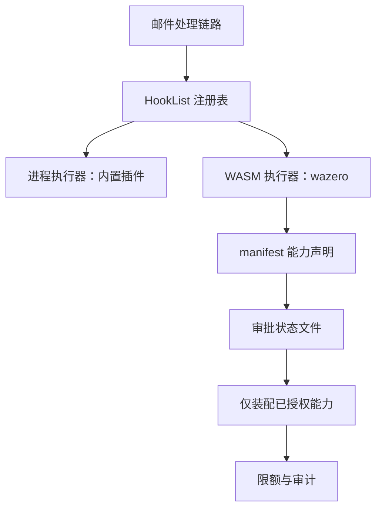

# 0001 WASM插件机制 — 方案评估

> 文档编号：0001-方案评估
> 项目：PMail
> 需求清单：[0001-WASM插件机制-需求清单.md](./0001-WASM插件机制-需求清单.md)
> 实施方案：[0001-WASM插件机制-实施方案.md](./0001-WASM插件机制-实施方案.md)
> 方案验收：[0001-WASM插件机制-方案验收.md](./0001-WASM插件机制-方案验收.md)
> 状态：已实现，本机部分验收通过；剩余项见方案验收
> 证据基线：`master` @ `7e868f5`
> 分支：master ｜ 日期：2026-11-11

> 实现更新（2026-11-11）：旧进程插件机制已移除，最终只有 WASM 执行器；本文第 4 节的双执行器设计保留为历史方案记录。

本文件只回答“为什么这样选、有哪些约束与风险”。字段契约、函数签名与改动清单写入[实施方案](./0001-WASM插件机制-实施方案.md)，实测数字写入[方案验收](./0001-WASM插件机制-方案验收.md)（当前为待执行计划）。

## 1. 要解决的问题

PMail 现有插件是独立进程 + HTTP over Unix socket，主程序与插件同 OS 用户运行。它解决了崩溃隔离与进程替换，但没有解决**最小权限**：第三方插件一旦加载，即可读写主机文件、任意出网。要开放第三方插件，必须先有执行边界与审批机制。

| # | 问题 | 现状证据 | 本需求是否解决 |
| --- | --- | --- | --- |
| 1 | 插件无能力声明与校验，权限等同主程序用户 | 无对应代码；`server/internal/infra/plugin/manager.go:250-338` 直接拉起进程 | 是 |
| 2 | 没有插件 ABI 版本，主程序与插件错配只能运行期暴露 | `HookDTO.ServerVersion` 仅定义未赋值（`server/hooks/contract/hook.go`） | 是，WASM 侧强制 `abi` 校验 |
| 3 | 插件启停无审批入口，仅靠文件目录 | `server/internal/api/http/plugin_handler.go:13-20` 只返回名称列表 | 是，新增管理端审批接口与页面 |
| 4 | 插件升级需重启，关闭时直接 `Kill` | `server/internal/infra/plugin/manager.go:340-345` | 是，WASM 插件支持重载与在途排空 |
| 5 | Windows 无法使用插件 | 插件侧 `net.Listen("unix")`（`server/hooks/contract/hook.go`-211`） | 是，WASM 执行器跨平台 |
| 6 | 内置进程插件无健康检查与自动重启 | `server/internal/infra/plugin/manager.go:295-318` 仅摘除 | 否，另行立项 |

## 2. 约束事实（含实测证据）

### 2.1 现有插件契约

| 项 | 事实 | 证据 |
| --- | --- | --- |
| 钩子 | 7 个：5 个邮件钩子 + `GetName` + `SettingsHtml` | `server/hooks/contract/hook.go:20-35` |
| 同步语义 | Before 系列同步并可回写；After 系列异步 | `server/internal/infra/plugin/manager.go:80-188` |
| 注册表 | `map[string]EmailHook` + `RWMutex`，遍历取快照 | `server/internal/infra/plugin/manager.go:24-39` |
| 超时 | 插件侧 5s，主程序侧 10s | `server/hooks/contract/hook.go`-205`、`server/internal/infra/plugin/manager.go:232-233` |
| 启动探测 | 轮询 socket 5 次、每次 1s | `server/internal/infra/plugin/manager.go:308-318` |
| 平台 | 仅 Unix socket | `server/hooks/contract/hook.go`-211` |

红线：`ReceiveParseAfter` 在写库前执行，`spoofed` 强制置 3 的既有优先级不能被新执行器绕过（`AGENTS.md`、[02 功能清单 § 6](../../20-功能/02-功能与接口清单.md)）。

补充事实：进程执行器把插件返回的 DTO 反序列化后赋给**局部指针**（`server/internal/infra/plugin/manager.go:117-118`、`:160-161`、`:184-185`），调用点实际收不到回写；WASM 执行器按就地回写实现（详见[实施方案 § 3.7](./0001-WASM插件机制-实施方案.md)）。实现阶段已随旧机制一并移除进程执行器。

### 2.2 构建约束

- 主程序与插件均要求 `CGO_ENABLED=0` 静态构建（`Makefile:15-18`、`Makefile:21-30`）。
- 目标平台 linux/amd64、windows/amd64、darwin/amd64、darwin/arm64。
- 单二进制交付，不引入外部运行时（Node、JVM、Python 均不可作为前置依赖）。

### 2.3 wazero 探针（2026-11-11，仓库外临时目录）

在 `/tmp/pmail-wazero-probe` 建立临时模块，引入 `github.com/tetratelabs/wazero@v1.12.0`，实际执行结果：

| 验证项 | 结果 |
| --- | --- |
| 运行时创建 + 最小 WASM 模块编译、实例化、调用导出函数 | 输出 `wazero load+call ok` |
| `CGO_ENABLED=0 GOOS=linux GOARCH=amd64` 构建 | 成功，产物约 3.7 MB |
| `CGO_ENABLED=0 GOOS=windows GOARCH=amd64` 构建 | 成功，产物约 3.8 MB |
| `CGO_ENABLED=0 GOOS=darwin GOARCH=arm64` 构建 | 成功，产物约 3.7 MB |
| 内存上限 | `RuntimeConfig.WithMemoryLimitPages(uint32)` 可用，64 MiB = 1024 页 |
| 超时中断 | `RuntimeConfig.WithCloseOnContextDone(true)` 可用，ctx 取消/超时会终止执行 |
| 文件系统默认策略 | 未配置路径返回 `ENOSYS`（默认拒绝） |
| 文件系统隔离 | `FSConfig.WithDirMount` 文档明确 guest 可用 `../` 逃逸；`os.DirFS` 未做 chroot（Go issue #42322） |
| 核心特性 | 默认 `CoreFeaturesV2`，含 SIMD；threads、异常、尾调用为 experimental，需显式开启 |
| Component Model | 未提供运行入口，只有 `wasi_snapshot_preview1` 包；插件必须编译到 `wasip1` |
| 网络 | `experimental/sock` 存在，需显式配置；默认不提供 socket |

结论：

1. wazero 满足“纯 Go、无 cgo、四平台构建、可中断、可限内存”。
2. **首期不做文件挂载**。wazero 的目录挂载不提供 chroot 级隔离，直接使用会破坏“默认拒绝”的授权承诺；后续若需要，必须自定义 `fs.FS` 做路径校验（拒绝 `..`、绝对路径、符号链接）后再挂载。
3. 首期不启用 experimental socket；HTTP 只在 `http` 能力被审批后，通过宿主 `pmail_http_post` 与 `http_allow` 精确主机白名单开放（实现阶段为 WASM 反垃圾插件加入）。

> 实现校正：探针与实现均使用 **wazero v1.12.0**；项目 Go 版本为 1.27.3，满足其 Go 1.25 要求。本次使用的 `WithMemoryLimitPages`、`WithCloseOnContextDone`、`FSConfig`、`wasi_snapshot_preview1` 在 v1.12.0 均存在。

### 2.4 兼容约束

- 新执行器必须实现现有 `framework.EmailHook`，不能改 7 个方法的语义。
- `HookDTO` 只能加字段，不能改已有字段语义。
- 同步钩子的回写行为、异步钩子的并发语义与进程插件保持一致。
- 管理接口必须走登录拦截器并校验管理员身份（参考 `server/internal/api/http/account_handler.go:34`）。

## 3. 候选方案对比与排除理由

| 方案 | 热替换 | 隔离 | 与 `CGO_ENABLED=0` 四平台构建 | 结论与原因 |
| --- | --- | --- | --- | --- |
| 子进程 + HTTP/JSON（现状） | 需补重启与排空 | 强 | 兼容 | **保留**，承载内置与受信插件 |
| 子进程 + gRPC（go-plugin 一类） | 可 | 强 | 兼容 | **不首期**；需更换插件启动协议，收益主要是握手与多路复用，优先级低于本需求 |
| Go `plugin` 包（`.so`） | 不可真正替换，加载后无法卸载 | 无，panic 崩宿主 | 仅 Linux/macOS，Go 版本与依赖必须完全一致 | **排除** |
| cgo 动态库 | 理论可换 | 弱 | 破坏静态构建 | **排除** |
| WASM（wazero） | 可，新实例替换旧实例 | 强，默认无文件/网络 | 兼容，已验证 | **选定** |
| WASM（wasmtime-go 等 cgo 绑定） | 可 | 强 | 破坏静态交叉编译 | **排除**；功能更全但构建冲突 |
| 内嵌 JS（goja/sobek） | 可 | 无沙箱、同进程内存 | 兼容 | **不选**；ES5.1 为主、无 npm、无法隔离恶意插件 |
| 内嵌脚本（Starlark/Lua/CEL） | 可 | 中 | 兼容 | **不选**；适合规则表达式，不适合承载 7 个邮件钩子 |
| Node 子进程 | 可 | 强 | 依赖外部运行时 | **排除为默认**；与单二进制定位冲突 |
| 独立容器 / 外部服务 | 可（部署层） | 强 | 解耦 | **非目标**；属于部署形态，不是内置插件机制 |

筛选后只剩两条现实路径：继续强化进程模型，或在进程模型之外新增 WASM 执行器。前者的权限问题无法在单进程用户下解决，因此选择后者；实现阶段进一步移除进程执行器，内置插件全部迁移到 WASM。

## 4. 采用的方案与理由

### 4.1 双执行器



- **进程执行器已移除**：实现阶段内置插件全部迁移到 WASM，旧进程插件与 Unix socket 机制已删除。
- **WASM 执行器只服务第三方插件**：manifest 声明所需钩子与能力，管理员审批后才装配。
- **统一注册表**：两类执行器都实现 `framework.EmailHook`，收信与发信代码不需要感知形态。

### 4.2 为什么选 wazero

| 理由 | 说明 |
| --- | --- |
| 构建兼容 | 纯 Go、无 cgo，已验证可通过本项目现有四平台静态构建 |
| 平台补齐 | 不依赖 Unix socket，Windows 可直接运行 WASM 插件 |
| 可热替换 | 同一模块可实例化多个实例，替换时新建实例、排空旧实例后关闭 |
| 默认拒绝 | 未注册的导入不可调用；未挂载路径返回 `ENOSYS`；网络默认不可用 |
| 可限额 | 内存页上限与 ctx 超时中断均由运行时提供 |

不选 wasmtime-go 的唯一原因是 cgo；如果未来必须使用 Component Model，再单独评估，不在本需求内承诺。

### 4.3 为什么用审批状态文件而不是数据库表

| 方案 | 优点 | 缺点 | 结论 |
| --- | --- | --- | --- |
| 插件目录内的 `state.json` | 无需建表与迁移；随插件目录一起备份/删除；单实例部署足够 | 并发写需原子替换；多实例部署不共享 | **首期采用** |
| 数据库表 | 多实例共享、可查询 | 需要新模型、建表与迁移；插件状态与邮件数据耦合 | 后续按部署形态再评估 |

审批状态文件只保存“授予了哪些钩子与能力、是否启用、版本与哈希、错误信息、调用计数”，不保存邮件内容。

### 4.4 安全边界

| 边界 | 首期决定 |
| --- | --- |
| 文件系统 | 不挂载任何目录；manifest 含非空 `mounts` 直接拒绝启用 |
| 网络 | 默认不提供网络导入；授权 `http` 后仅通过宿主 `pmail_http_post` 访问 `http_allow` 中的主机 |
| 能力粒度 | `log`、`email.read`、`email.write`、`http` 四项 |
| 限额 | 内存 64 MiB、同步钩子 2s、异步钩子 5s、单次输出 256 KiB、并发 1 |
| 审批 | 默认全部不授权；逐项勾选；manifest 版本或哈希变化后回到待审批 |
| 安装 | 只扫描本地目录，不提供上传接口，不做签名校验（后续需求） |

### 4.5 明确不做

- 不做插件上传、在线安装、签名与仓库分发。
- 不做文件挂载与通用网络；仅保留受控 HTTP（`http` 能力 + `http_allow` 精确白名单，不跟随重定向）。
- ~~不迁移内置进程插件~~：实现阶段已全部迁移。
- 进程插件机制已移除，不再维护其健康检查、自动重启与 Windows 传输。
- 不做 MCP 与 AI Agent（方向见[技术演进路径图](../../10-架构/02-技术演进路径图.md)）。
- 不新增数据库表；不引入 SQL 迁移。

## 5. 风险与观察项

| 风险 | 影响 | 缓解 | 观察信号 |
| --- | --- | --- | --- |
| 审批状态文件被本地篡改 | 绕过管理端授权 | 文件权限 0600；状态与 manifest 哈希绑定；启用时重新校验 | 哈希不匹配、状态与 manifest 版本不一致 |
| 插件借 manifest 升版扩权 | 静默获得新能力 | 版本或哈希变化即回到待审批，不沿用旧授权 | 管理端出现待审批条目 |
| wazero 运行时漏洞 | 沙箱逃逸 | 跟随升级；只启用默认特性；限额与审计 | 上游安全公告 |
| 超时/内存/输出限额被绕过 | 拖垮主进程 | 运行时级内存上限；ctx 强制中断；输出长度在宿主侧校验 | 超时日志、实例重建次数 |
| 同步钩子回写破坏收信状态 | 邮件状态错误 | 保留 `spoofed` 优先级；`email.write` 未授权时忽略回写；回归测试 | 状态分布异常、钩子错误率 |
| 并发实例放大内存 | 内存占用成倍增长 | 首期并发固定 1；manifest 限额上限校验 | 进程 RSS、实例数 |
| 管理接口越权 | 非管理员审批插件 | 复用 `ctx.IsAdmin` 校验；写操作全部审计 | 非管理员调用记录 |
| ABI 不稳定 | 插件频繁失效 | ABI 版本号与主程序解耦；只增不改；安装探针拒绝不兼容版本 | 安装失败率 |
| HTTP 白名单被滥用 | 插件向被放行主机外发请求，或域名解析到内网 | 精确主机白名单、禁重定向、请求/响应上限；管理员审核 `http_allow` | 异常出站请求、白名单变更 |

## 6. 复现方式

### 6.1 当前代码证据

```bash
grep -n "type EmailHook\|ServerVersion\|net.Listen(\"unix\"" server/hooks/contract/hook.go
grep -n "func PluginInit\|func PluginStop\|PluginRegisterHook\|PluginRemoveHook" server/internal/infra/plugin/manager.go
grep -n "CGO_ENABLED=0" Makefile
```

### 6.2 wazero 探针

```bash
mkdir -p /tmp/pmail-wazero-probe
go -C /tmp/pmail-wazero-probe mod init probe
go -C /tmp/pmail-wazero-probe get github.com/tetratelabs/wazero@latest   # v1.12.0

# main.go：创建 Runtime（WithMemoryLimitPages(1024)、WithCloseOnContextDone(true)），
# 编译并实例化一个导出 ping 的最小 WASM 模块，调用 ping 后打印结果。
go -C /tmp/pmail-wazero-probe run .                                      # wazero load+call ok

cd /tmp/pmail-wazero-probe
CGO_ENABLED=0 GOOS=linux GOARCH=amd64 go build -o /tmp/probe-linux .
CGO_ENABLED=0 GOOS=windows GOARCH=amd64 go build -o /tmp/probe-windows.exe .
CGO_ENABLED=0 GOOS=darwin GOARCH=arm64 go build -o /tmp/probe-darwin .
```

### 6.3 运行时能力取证

```bash
go -C /tmp/pmail-wazero-probe doc github.com/tetratelabs/wazero.RuntimeConfig
go -C /tmp/pmail-wazero-probe doc github.com/tetratelabs/wazero.FSConfig
go -C /tmp/pmail-wazero-probe doc github.com/tetratelabs/wazero/imports/wasi_snapshot_preview1
```

探针只在 `/tmp` 下进行，未修改仓库依赖与构建产物。
