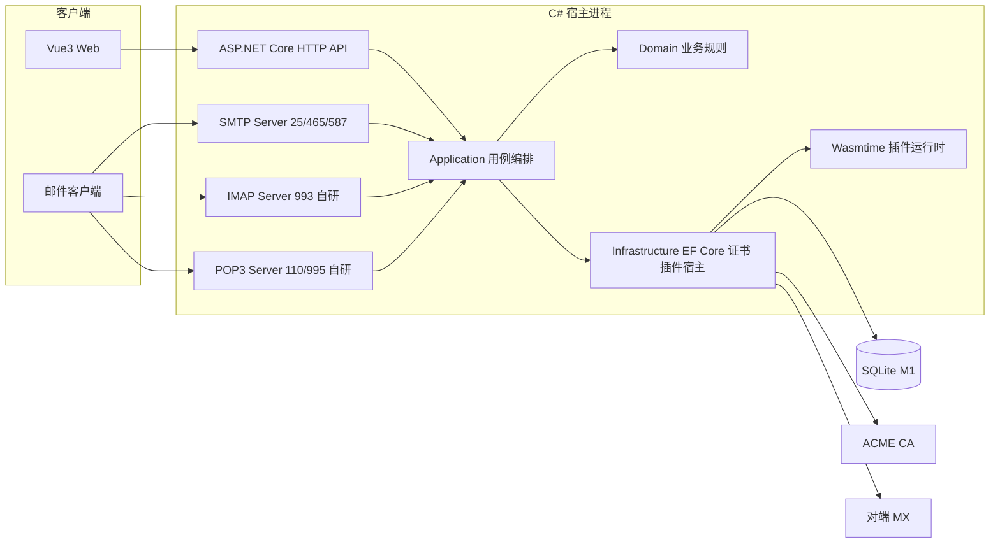

# 0001 新项目CSharp重构 — 方案评估

> 文档编号：0001-方案评估
> 项目：新项目（C#，产品名待定；评估基于 PMail）
> 状态：设计稿，待评审
> 证据基线：`develop` 工作区（含未提交的五层重构；提交基线 `7e868f5`）
> 需求清单：`0001-新项目CSharp重构-需求清单.md`（待产出）
> 实施方案：`0001-新项目CSharp重构-实施方案.md`（待产出）
> 方案验收：`0001-新项目CSharp重构-方案验收.md`（待产出）
> 前端对接文档：`0001-新项目CSharp重构-前端对接文档.md`（待产出）
> 分支：`develop`（未建需求分支）｜ 日期：2026-11-11 ｜ 状态：设计稿，待评审

## 1. 要解决的问题

用 C#/.NET 重新实现一套自建域名邮箱服务器，替代「在 PMail 仓库内把 Go 逐文件翻译成 C#」的路径。驱动因素是技术栈统一与接入 .NET 生态，不是 PMail 现有实现存在无法修复的缺陷。

| 项 | 内容 |
| --- | --- |
| 要达成的目标 | 技术栈统一到 .NET；获得 ASP.NET Core、EF Core、MimeKit、Wasmtime 等生态能力；长期维护由单一语言承担 |
| 明确不做的 | 不迁移 PMail 既有用户数据；不替换 PMail 线上实例；不在 PMail 仓库内做原地重写 |
| 必须保留的 | 复用 PMail 的 Vue3 前端（19 个文件、4,324 行），因此新服务端必须兼容其 HTTP 契约 |
| 交付形态 | Docker 优先，linux/amd64 与 linux/arm64 |

本文件只回答「为什么这样选、有哪些约束与风险」。参数契约、字段与改动清单写入实施方案，实测数字写入方案验收。

## 2. 约束事实（实测）

本节数字全部来自当前工作区，取证命令见第 8 节。工作区存在 160 项未提交变更（`git diff --stat HEAD` 显示 140 个文件、14,202 行删除），`server/internal/`、`docs/`、`scripts/` 尚未被跟踪；本评估以工作区代码为准，不以 `master` 历史版本为准。

### 2.1 仓库规模

| 指标 | 数值 |
| --- | --- |
| Go 文件数 | 170 |
| Go 含测试行数 | 18,851 |
| Go 非测试行数 | 12,946 |
| 测试文件数 | 34 |
| `Test*` 函数数 | 118 |
| 前端源码 | 19 个文件、4,324 行（Vue3 + JS） |

分层行数（含测试）：

| 层 | 行数 | 职责 |
| --- | --- | --- |
| `server/internal/api` | 5,843 | HTTP 路由、中间件、SMTP/IMAP/POP3 接入、内嵌 `dist/` |
| `server/internal/infra` | 2,905 | 数据库、会话、证书、插件宿主 |
| `server/internal/app` | 2,515 | 用例编排、事务边界 |
| `server/dto` | 2,281 | 邮件解析、公开 DTO |
| `server/pkg` | 2,162 | SMTP 客户端 fork、投递、UTF-7、上下文等工具 |
| `server/cmd` | 1,130 | 主入口与端到端测试 |
| `server/hooks` | 995 | 插件框架与内置插件 |
| `server/internal/bootstrap` | 282 | 依赖装配、启动、定时任务、重启 |
| `server/config` | 274 | 配置结构体与样例 |
| `server/internal/domain` | 247 | 纯业务规则 |
| `server/models` | 188 | 数据模型 |
| `server/consts` | 29 | 常量 |

### 2.2 关键依赖体量

换语言时，这些行数就是「必须自己补上」的分母。行数为对应模块非测试源码实测值。

| 能力 | 现依赖 | 非测试行数 | 备注 |
| --- | --- | --- | --- |
| IMAP 服务端 | `emersion/go-imap/v2` 的 `imapserver` | 5,282 | 整个模块 13,704 行；本项目另实现会话逻辑 2,054 行 |
| SMTP 服务端 | `emersion/go-smtp` | 3,209 | 25/465/587 三个监听共用一套会话 |
| POP3 服务端 | `Jinnrry/gopop` | 419 | 作者自维护 fork；本项目命令回调 341 行 |
| ACME | `go-acme/lego/v4` 核心 | 12,509 | `providers/` 下 388 个文件未被使用；DNS-01 是手工 TXT |
| ORM | `xorm.io/xorm` | 24,428 | 启动时 `Sync2` 自动建表/加列 |
| HTML 清洗 | `microcosm-cc/bluemonday` | 4,897 | 策略在 `server/dto/parsemail/email.go:107-176` |
| MIME 解析 | `emersion/go-message` | 2,819 | 另有自写 encoded-word 解码 426 行 |
| DKIM | `emersion/go-msgauth` | 2,677 | RSA 与 Ed25519 签名/验签 |
| 出站投递 | 自建 `server/pkg/smtp` 与 `server/pkg/send` | 948 | 基于标准库 `net/smtp` fork，支持 SMTPS、自定义 HELO、MX 优先级故障转移 |
| 规则正则 | `dlclark/regexp2` | 外部 | 回溯语义，用于用户规则匹配 |
| SPF | `mileusna/spf` | 外部 | .NET 无成熟对等库 |

### 2.3 前端 HTTP 契约（复用前提）

复用 Vue3 的前提是服务端行为与现有契约一致，否则前端会直接失效。

| 契约 | 现状 | 证据 |
| --- | --- | --- |
| 响应包裹 | `{errorNo, errorMsg, data}`，HTTP 状态恒 200，业务码在 body | `server/dto/response/response.go:8-20` |
| 未登录跳转 | body `errorNo=403` → 前端跳 `/login` | `fe/src/utils/axios.js:30-47` |
| 未初始化跳转 | body `errorNo=402` → 前端跳 `/setup` | `fe/src/utils/axios.js:40-47` |
| 无权限 | body `errorNo=405` | `server/dto/response/response.go:11` |
| 语言 | 请求头 `Lang` 驱动错误文案 | `fe/src/utils/axios.js:12` |
| 会话 | 浏览器自动携带 cookie（scs），前端代码中无 `Token`、`Cookie`、`withCredentials` | `server/internal/api/http/http_middleware.go:99-112` |
| 路由规模 | 运行态 28 条；引导期 9 个步骤动作 | `docs/20-功能/02-功能与接口清单.md:14-30` |
| 外部 API Token | `{account}:md5(md5(md5(password+"pmail")+"pmail2023")+timestamp):{timestamp}`，硬编码盐 | `server/internal/api/http/http_middleware.go:142` |

前端不使用 Token 方案，因此新项目没有兼容负担，也不应继承该方案。

### 2.4 插件能力面

插件不是简单的字符串回调，宿主必须提供网络、配置、邮件变更与静态资源四类能力。

| 项 | 现状 | 证据 |
| --- | --- | --- |
| 钩子点 | 7 个：`SendBefore`、`SendAfter`、`ReceiveParseBefore`、`ReceiveParseAfter`、`ReceiveSaveAfter`、`GetName`、`SettingsHtml` | `server/hooks/framework/framework.go:20-35` |
| 传输 | HTTP over Unix socket，JSON 序列化 | `server/hooks/framework/framework.go:201-216`、`server/internal/infra/plugin/plugin_host.go:231-245` |
| 进程模型 | 主程序扫描 `./plugins` 拉起独立进程，退出时从 `HookList` 移除 | `server/internal/infra/plugin/plugin_host.go:250-338` |
| `wechat_push` | 出站 HTTPS（微信接口）、读取主配置、读写插件配置、设置页 HTML | `server/hooks/wechat_push/wechat_push.go:52`、`:119`、`:183-195` |
| `spam_block` | 出站 HTTP、插件配置读写、改写邮件状态、静态资源、离线训练管线 | `server/hooks/spam_block/spam_block.go:102`、`:189-218` |
| 已知缺陷 | 插件进程退出后 `HookList` 曾残留死句柄，后续修复为显式移除 | `server/internal/infra/plugin/plugin_host.go:289-306` |

### 2.5 工具链现状

| 工具 | 版本 | 说明 |
| --- | --- | --- |
| Go | 1.27.3 | 现有项目可构建 |
| .NET SDK | 11.0.100-rc.3 | 仅 RC，无 LTS；新项目需另装 .NET 10 SDK |
| Node.js | 26.13.0 | 前端复用不受影响 |
| Docker | 29.9.2 | 目标交付形态 |

### 2.6 外部生态证据（2026-11-11）

| 事实 | 证据 |
| --- | --- |
| `Wasmtime` NuGet 50.0.1，2026-11-06 发布，含 `net10.0` 目标，nupkg 49.5 MB | nuget.org 注册接口 |
| `Extism.Sdk` 1.10.0，2025-12-01 发布，累计 20 个版本 | nuget.org 注册接口 |
| `Jint` 4.17.0，累计 128 个版本 | nuget.org 平铺接口 |
| .NET 10 为 LTS，支持至 2028-11-14；.NET 8/9 于 2026-11-10 结束支持；.NET 11 为 STS | Microsoft 支持策略页 |
| .NET 没有在维护的 IMAP 服务端库；社区仅剩已废弃的 LumiSoft.Net 且不支持 IDLE | Stack Overflow、Reddit 讨论 |
| `wasmtime-dotnet` 对 Component Model/WASI p3 的跟进滞后 | GitHub 仓库 issue 区长期存在跟进请求（未记录具体编号，列为 M0 复核项） |
| JMAP 协议为 RFC 8620/8621，客户端支持面需实测 | RFC 文档、第三方综述 |
| `SmtpServer` 11.1.0 存在，`Nager.SmtpServerCore` 为社区续作；维护活跃度未取得可信证据 | NuGet、GitHub |

`.NET 无 IMAP 服务端库` 是本次评估最关键的事实：它决定 M2 必须是自研协议栈，而不是「换个库」。

## 3. 候选方案对比

| 维度 | A 保持 Go | B 混合架构 | C 新起 C# 项目 |
| --- | --- | --- | --- |
| 是否达成动机 | 否 | 部分：只统一业务层 | 是 |
| 新增工作量 | 0 | 1.5–3 人月 | 6.3–11.1 人月 |
| 协议层归属 | Go | 仍为 Go | 全部 C# |
| 运维形态 | 单进程单语言 | 双进程双语言双发布链 | 单进程单语言 |
| 与未提交重构的关系 | 直接落地 | 需先落地再划边界 | 互不影响 |
| 结论 | 排除 | 排除 | 采用 |

**A 保持 Go（排除）**：迁移成本为零，但完全无法达成「技术栈统一到 .NET」这一动机。若真实诉求只是减少维护负担，应在 Go 内换库、补测试，而不是换语言。

**B 混合架构（排除）**：C# 承接管理 API 与业务/数据层，Go 保留 SMTP/IMAP/POP3、投递、证书与插件宿主。它只统一了业务层，协议边缘仍在 Go；同时引入双进程、双语言、双发布链，与「单一技术栈」的动机部分背离。除非明确要求保留 Go 协议栈，否则不采用。

**C 新起 C# 项目（采用）**：迁移成本最高，但唯一完整达成动机，且规避了原地重写的三项隐性成本：

| 原地重写的成本 | 新项目为何规避 |
| --- | --- |
| 插件 HTTP+JSON 线格式必须逐字段复刻，否则现有插件失效 | 新项目自定义插件契约，WASM 模块按新 ABI 重写 |
| `Sync2` 的启动自动建表/加列语义与 EF Migrations 不等价，老库升级路径会断 | 新项目无历史库，迁移从第一天起 |
| 当前工作区 DDD 重构未提交（160 项变更、14,202 行删除），重写会作废 | PMail 保持原样，两条线互不影响 |

代价是 IMAP 必须自研，这是 C 方案唯一的硬长尾，处理方式见第 5 节 R-01。

## 4. 采用方案

### 4.1 技术选型

| 领域 | 选型 | 依据与状态 |
| --- | --- | --- |
| 运行时与框架 | .NET 10 LTS + ASP.NET Core | 支持至 2028-11-14；本机需安装 LTS SDK，现有 11.0.100-rc.3 不作基线 |
| SMTP 服务端 | `SmtpServer`（备选 `Nager.SmtpServerCore`） | 待 M0 实测 STARTTLS、AUTH PLAIN/LOGIN、自定义存储回调 |
| MIME 解析 | MimeKit | 覆盖 RFC 2047/2231，替掉自写 encoded-word 与字符集处理 |
| DKIM | MimeKit.Cryptography | RSA/Ed25519 签名与验签 |
| 出站投递 | MailKit `SmtpClient` | 覆盖 SMTPS、STARTTLS、认证；MX 优先级排序与故障转移需自行实现 |
| HTML 清洗 | Ganss.HtmlSanitizer | bluemonday 的 relaxed/strict 策略需逐条重译 |
| 规则正则 | .NET Regex + `matchTimeout` | 与 `regexp2` 同为回溯语义；必须设超时防 ReDoS |
| 数据访问 | EF Core + Microsoft.Data.Sqlite（M1） | 三方言推迟；Migrations 从首版建立 |
| ACME | Certes（或外挂 ACME 客户端进程） | 维护活跃度待核实；DNS-01 沿用「呈现 TXT 记录给用户」模式 |
| 插件运行时 | Wasmtime 50.x 直连 | core module + 自定义宿主函数；不押注 Component Model |
| 前端 | 复用 PMail Vue3 | 必须兼容第 2.3 节契约 |
| 部署 | Docker（linux/amd64、linux/arm64） | 裸二进制仅保留 linux 双架构 |
| 命名 | 目录 lowercase-hyphen，项目与命名空间 PascalCase | 例：`src/pmail-api/PMail.Api.csproj` |
| 认证 | ASP.NET Core cookie 会话 + 现代口令哈希 | 不继承 MD5 Token 方案 |

### 4.2 方案架构示意



图 1 只表达容器边界与依赖方向，不替代 `docs/30-流程/` 中按功能点维护的流程图与时序图。

### 4.3 关键设计约束

| 编号 | 约束 | 来源 |
| --- | --- | --- |
| K-01 | HTTP 契约兼容：`{errorNo,errorMsg,data}`、HTTP 恒 200、402/403 跳转、`Lang` 头、cookie 会话 | N-02 复用 Vue3 |
| K-02 | 插件 WASM-only、Wasmtime 直连、细粒度权限、默认 fail-open | W-01、W-02、W-04、W-05 |
| K-03 | 协议顺序：Web 优先 → IMAP → POP3 → JMAP | N-01 |
| K-04 | M1 只 SQLite，三方言后续 | N-04 |
| K-05 | Docker 优先，裸二进制仅 linux 双架构 | N-05 |
| K-06 | 不继承：MD5 Token、`Sync2` 自动加列、外部进程插件、插件任意 HTML 注入、六平台裸单文件、进程内重启 | 评估结论 |
| K-07 | IMAP 验收基线为 PMail 已实现的 18 个会话方法，4 个空实现不纳入 | N-08 |

### 4.4 路线图与工作量

| 里程碑 | 内容 | 粗估 |
| --- | --- | --- |
| M0 | 决策定案、文档五件套、四项外部能力实测 | 1–2 周 |
| M1 | SMTP 收信、出站投递、Web 管理、规则、多用户、SQLite、复用 Vue3 | 1.5–2.5 人月 |
| M2a | IMAP4rev1 自研，以 PMail 已实现的 18 个会话方法为基线 | 2–4 人月 |
| M2b | WASM 插件运行时与两个内置插件重写 | 1–1.5 人月（4.5–6.5 周） |
| M3 | POP3 服务端 | 0.3–0.6 人月 |
| M4 | JMAP（RFC 8620/8621） | 1–1.5 人月 |
| 运维面 | ACME、发布链、可观测（可穿插） | 0.5–1 人月 |
| 合计 | 不含 M0 | 6.3–11.1 人月 |

以上为粗估，未实测。M2 拆分为 a/b 的原因是两个子项各自达到独立里程碑规模；M2b 依赖 M2a 期间稳定下来的钩子调用点。M1 结束时即有可用产品（Web 收发信），不必等 IMAP。

### 4.5 插件方案要点（WASM）

运行时为 Wasmtime 直连，插件产物为 core module，能力通过宿主函数授予。完整契约写入实施方案，本节只固定评估层面的取舍。

| 方向 | 函数 | 签名 |
| --- | --- | --- |
| 导出 | `pmail_abi_version` | `() -> i32` |
| 导出 | `pmail_alloc` | `(i32) -> i32` |
| 导出 | `pmail_free` | `(i32, i32) -> ()` |
| 导出 | `hook_<name>` | `(i32, i32) -> i64`，高 32 位为结果指针、低 32 位为长度 |
| 导入 | `pmail_host.call` | `(i32, i32, i32, i32) -> i64`，JSON 进、JSON 出 |
| 导入 | `pmail_host.log` | `(i32, i32, i32) -> ()` |

权限清单示例（默认拒绝，未声明即无权）：

```json
{
  "name": "wechat_push",
  "version": "1.0.0",
  "apiVersion": 1,
  "entry": "plugin.wasm",
  "hooks": ["ReceiveSaveAfter"],
  "failurePolicy": "open",
  "permissions": {
    "http": { "allow": ["https://api.weixin.qq.com/*"], "denyPrivate": true, "maxResponseBytes": 1048576 },
    "email": { "read": ["subject", "from", "text", "html"], "write": [] },
    "kv": { "maxBytes": 65536 },
    "asset": { "read": true },
    "limits": { "fuelPerCall": 50000000, "memoryBytes": 67108864, "wallClockMs": 2000 }
  }
}
```

| 插件语言 | 产物形态 | 与当前 ABI 的匹配度 | 承诺级别 |
| --- | --- | --- | --- |
| Rust | core module | 完全匹配 | M2 主推 |
| TinyGo | core module | 匹配；`net/http` 不可用，必须走宿主函数 | M2 第二顺位 |
| JS 编译为 WASM（Javy/QuickJS） | core module（Javy ABI） | 基本匹配；导出命名与签名需一次实测 | M2 做 spike 后承诺 |
| C# 编译为 WASM（componentize-dotnet） | WASM component | 不匹配：产出 Component Model 组件，`wasmtime-dotnet` 跟进滞后 | M3 再验证，M2 不承诺 |

其余插件层约束：

| 项 | 结论 |
| --- | --- |
| 失败策略 | 默认 fail-open（超时或崩溃则跳过并记录）；插件清单可声明 fail-closed |
| 资源限制 | 每次调用设 fuel、内存上限与墙钟超时；实例池预热，trap 后重建 |
| 熔断 | 状态机 `Loaded / Disabled / Failed`，连续失败 N 次熔断并对外暴露状态 |
| 设置页 | iframe + `sandbox` + 独立 CSP；禁止把插件返回的 HTML 直接拼进管理页 |
| 内置插件 | `wechat_push`、`spam_block` 重写为 Rust 模块并嵌入主程序，走同一运行时 |

## 5. 风险与观察项

| 编号 | 风险 | 触发条件 | 影响 | 缓解 | 归属 |
| --- | --- | --- | --- | --- | --- |
| R-01 | IMAP 自研无参考实现 | .NET 无在维护的 IMAP 服务端库 | 协议细节与客户端兼容长期返工，是唯一硬长尾 | M2a 单独立项独立预算；先交付最小能力集（SELECT/FETCH/STORE/IDLE/UID 系列）；建立 RFC 3501/9051 一致性脚本，逐条比对 PMail 已实现的 18 个会话方法 | M2a |
| R-02 | 客户端互操作差异 | Gmail、Outlook、Apple Mail、Foxmail 对扩展命令、IDLE 掉线重连、`CHECK` 语义的处理不同 | 「能登录但收不到信」类问题难以在服务端单侧自测发现 | 固定四客户端手工验收矩阵；IDLE 断线重连、并发 `SELECT`、大附件 `FETCH` 单独用例 | M2a |
| R-03 | SMTP 服务端库维护状态未知 | `SmtpServer` 的发布节奏与 issue 响应未取证 | TLS/认证缺陷只能等上游或自行打补丁 | M0 实测 STARTTLS、AUTH PLAIN/LOGIN、自定义存储回调与最近提交时间；不达标则自研 SMTP 会话层（PMail 收信分支本身是自写量级，不是不可替代的黑盒） | M0 |
| R-04 | WASM 原生库与镜像体积 | `wasmtime-dotnet` 附带约 49.5 MB nupkg 的原生库，且需按 RID 提供 | 镜像膨胀；linux/arm64 若缺包则 K-05 无法兑现 | M0 实测 linux/amd64 与 linux/arm64 的发布产物能否加载并执行最小模块；把镜像体积上限写进 CI | M0 |
| R-05 | WASM 插件生态冷启动 | Rust/TinyGo 的编写门槛高于 JS | 用户写不出插件，插件能力名存实亡 | M2b 只承诺 Rust 与 TinyGo 两条主路径；JS→WASM 先做 spike 再决定是否承诺；随运行时提供模板工程与示例插件 | M2b |
| R-06 | 前端契约漂移 | 改 `errorNo` 语义、`Lang` 头、cookie 会话或响应包裹 | 19 个前端文件需同步改，且难以发现遗漏 | K-01 冻结契约；每个路由加 HTTP 层契约测试（状态码恒 200、错误码取值、响应字段集合），入 CI | M1 |
| R-07 | 迁移语义差 | 沿用「启动自动加列」的直觉 | 升级后缺列导致运行期错误 | 结构变更只交付 SQL；启动时校验 schema 版本号，不一致直接拒绝启动并提示待执行脚本 | M1 |
| R-08 | SQLite 并发退化 | 连接池大于 1、长事务或跨线程共享上下文 | `database is locked`，收信偶发失败 | WAL + `busy_timeout` + 单写者串行；并发压测作为 M1 退出条件 | M1 |
| R-09 | HTML 清洗策略不等价 | bluemonday 策略平移时漏掉标签或属性规则 | XSS 回归 | 以 `server/dto/parsemail/email_xss_test.go` 的语料作为对照集，逐条对齐 Ganss.HtmlSanitizer 配置 | M1 |
| R-10 | 认证口径破坏性变更 | 外部脚本依赖现有的 MD5 Token | 自动化脚本失效 | 明示为破坏性变更；外部令牌单独立项（建议 PAT + 哈希存储 + 可撤销），不在 M1 夹带 | M1 之后 |
| R-11 | 出站投递编排缺失 | MailKit 只负责单台 SMTP 通信，不含 MX 查询与故障转移 | 投递成功率下降，审计记录缺失 | 自行实现 MX 优先级排序、逐台失败转移、最终结果回写；对照 PMail 行为建集成测试 | M1 |
| R-12 | ACME 依赖 | Certes 维护活跃度待核实；DNS-01 仍需人工发布 TXT | 证书续期中断即全站不可用 | M0 核实；保留外挂 `lego`/`acme.sh` 的降级路径；续期失败必须告警而不是静默 | M0 |
| R-13 | 估时误差 | 单人心智负担、协议长尾、外部库返工 | 实际工期可能超出估算 40% | 按「可上线」切分里程碑，M1 结束即具备可用产品；每阶段结束复评后续估算 | 全程 |
| R-14 | 依赖许可证 | 各 NuGet 包许可未逐项核对 | 分发受限 | M0 汇总依赖许可清单并归档 | M0 |

R-01 与 R-03 是仅有的两条可能推翻技术选型的风险。两者的判定点都在 M0：若 `SmtpServer` 不满足要求，SMTP 会话层改为自研（工作量增加，方案不变）；若 IMAP 自研在 M2a 首月无法通过四客户端矩阵，则需重新评估「是否保留 IMAP」这一范围假设，而不是继续追加工期。

## 6. 决策登记

### 6.1 已确认

| 编号 | 决策项 | 结论 | 来源 |
| --- | --- | --- | --- |
| N-01 | 协议范围与顺序 | 先 Web，再自研 IMAP4rev1，再自写 POP3，最后 JMAP | 用户确认 |
| N-02 | 前端 | 复用 PMail 的 Vue3 | 用户确认 |
| N-03 | 文档口径 | 独立新项目，继承本仓库文档约定 | 用户确认 |
| N-04 | 数据库 | M1 只支持 SQLite，三方言后续 | 用户确认 |
| N-05 | 交付形态 | Docker 优先，裸二进制仅 linux 双架构 | 用户确认 |
| N-07 | 运行时与命名 | .NET 10 LTS；目录 lowercase-hyphen，项目与命名空间 PascalCase | 用户确认 |
| N-08 | 能力基线 | 以 PMail 现有能力为基线 | 用户确认 |
| W-01 | 插件机制 | WASM 完全取代 Jint | 用户确认 |
| W-02 | 运行时接入方式 | Wasmtime 直连，不引入 Extism 等中间层 | 用户确认 |
| W-03 | 插件语言 | Rust、TinyGo、JS→WASM、C#→WASM（实验） | 用户确认 |
| W-04 | 失败策略 | 默认 fail-open，按插件可配置 fail-closed | 用户确认 |
| W-05 | 权限粒度 | 细粒度，按 http/email/kv/asset/limits 分组 | 用户确认 |

### 6.2 已被取代

| 编号 | 原决策 | 取代者 | 说明 |
| --- | --- | --- | --- |
| N-06 | 插件用 JS（Jint）优先，宿主接口可扩展 | W-01 | 用户在看到 WASM 方案后改选 WASM-only；本节保留记录，避免后续实现回退到 Jint |
| N-06b | 插件在 M2 实现，M1 只留扩展点 | W-01、4.4 节 | 时点不变（M2b），实现机制改为 WASM |

### 6.3 本次评估提出、仍待确认

| 编号 | 待确认项 | 当前处理 | 影响 |
| --- | --- | --- | --- |
| D-01 | 产品名与仓库名 | 文档暂称「新项目（C#）」 | 影响命名空间、镜像名、文档 H1 与目录名 |
| D-02 | 需求号 `0001` | 占位编号；若接入任务平台需替换为真实需求号 | 影响五件套文件名与索引 |
| D-03 | 数据库迁移执行方式 | 建议：应用启动时校验版本，脚本由运维显式执行 | 影响升级流程与回滚方式 |
| D-04 | 外部 API 令牌方案 | 建议：PAT + 哈希存储 + 可撤销，替代 MD5 Token | 影响脚本与第三方集成 |
| D-05 | MySQL/PostgreSQL 支持时点 | 建议：M4 之后再评估 | 影响 EF Core Provider 抽象与测试矩阵 |
| D-06 | 前端仓库归属 | 建议：复制进新仓 `web/desktop/`，与后端同仓发布 | 影响发布链与契约测试位置 |

## 7. 未确认与待验证

### 7.1 待产出文档

本需求按五件套交付，当前只完成方案评估：

| 文档类型 | 文件 | 状态 |
| --- | --- | --- |
| 需求清单 | `0001-新项目CSharp重构-需求清单.md` | 待产出 |
| 方案评估 | `0001-新项目CSharp重构-方案评估.md` | 本文 |
| 实施方案 | `0001-新项目CSharp重构-实施方案.md` | 待产出 |
| 方案验收 | `0001-新项目CSharp重构-方案验收.md` | 待产出 |
| 前端对接文档 | `0001-新项目CSharp重构-前端对接文档.md` | 待产出 |

必须说明：四份缺失文档会让 `requirement-docs` 校验脚本报错，这是当前进度如实反映，不是文档缺陷。校验结果见 8.3 节。

### 7.2 M0 验证清单

以下各项均未实测，结论会直接改写 4.1 节的选型或 4.4 节的估算：

| 编号 | 验证项 | 通过标准 |
| --- | --- | --- |
| V-01 | 安装 .NET 10 LTS SDK | `dotnet --list-sdks` 出现 10.x，且现有 11.0.100-rc.3 不参与构建 |
| V-02 | `SmtpServer` 能力与维护状态 | 完成 STARTTLS、AUTH PLAIN/LOGIN、自定义存储回调的最小收发闭环；近 12 个月有提交或发布 |
| V-03 | `wasmtime-dotnet` RID 矩阵 | linux/amd64 与 linux/arm64 均能加载并执行最小模块；记录镜像体积增量 |
| V-04 | Wasmtime fuel 与超时 | 死循环模块在设定 fuel 或墙钟上限内被终止，宿主进程存活 |
| V-05 | JS→WASM 产物与 ABI | Javy 或 QuickJS 产物能按 4.5 节签名导出并完成一次调用 |
| V-06 | `Certes` 维护状态与 DNS-01 | 能完成一次测试域名的 HTTP-01 签发；明确 DNS-01 的人工步骤 |
| V-07 | MailKit 出站 | 对测试 MX 完成投递，并验证多 MX 优先级与失败转移的编排点 |
| V-08 | HTML 清洗对照 | XSS 语料全部被清洗，且邮件排版未被过度破坏 |

### 7.3 其他未完成项

- 未做任何 C# 代码实现，本文所有工作量均为估算，无实测支撑。
- 未对本机磁盘、内存与 CI 资源做容量评估。
- 未确认新项目是否需要在 M1 提供邮件迁移导入（当前按「不迁移数据」处理）。

## 8. 复现方式

### 8.1 仓库规模与依赖体量

```bash
cd /Users/johana/Codes/github/PMail

# 全仓与去测试的 Go 行数
find server -name '*.go' | xargs wc -l | tail -1
find server -name '*.go' ! -name '*_test.go' | xargs wc -l | tail -1

# 测试文件数与 Test 函数数
find server -name '*_test.go' | wc -l
grep -rh '^func Test' server --include='*_test.go' | wc -l

# 各层行数（去测试）
for d in internal/api internal/app internal/domain internal/infra internal/bootstrap hooks; do
  printf '%-22s ' "$d"
  find "server/$d" -name '*.go' ! -name '*_test.go' | xargs wc -l | tail -1
done

# 前端文件数与行数
find fe/src -type f \( -name '*.vue' -o -name '*.js' \) | wc -l
find fe/src -type f \( -name '*.vue' -o -name '*.js' \) | xargs wc -l | tail -1

# 第三方依赖体量：先取模块目录，再统计目标子包
dir=$(cd server && go list -m -f '{{.Dir}}' github.com/emersion/go-imap/v2)
find "$dir/imapserver" -name '*.go' ! -name '*_test.go' | xargs wc -l | tail -1
```

### 8.2 外部事实核对

```bash
# NuGet 版本列表
curl -s https://api.nuget.org/v3-flatcontainer/wasmtime/index.json
curl -s https://api.nuget.org/v3-flatcontainer/certes/index.json
curl -s https://api.nuget.org/v3-flatcontainer/smtpserver/index.json

# 包体量与新目标框架
curl -s https://api.nuget.org/v3-flatcontainer/wasmtime/50.0.1/wasmtime.nuspec
curl -sI https://api.nuget.org/v3-flatcontainer/wasmtime/50.0.1/wasmtime.50.0.1.nupkg | grep -i content-length
```

### 8.3 文档校验

```bash
# 全仓文档规范
node ~/.agents/skills/project-docs-bootstrap/scripts/check-docs.mjs \
  --root . --docs docs --flow-dir 流程 --require-status --require-evidence

# 需求五件套
node ~/.agents/skills/requirement-docs/scripts/check-docs.mjs \
  --docs /Users/johana/Codes/github/PMail/docs/需求 --issue 0001
```

本次实测结果：

```text
$ node ~/.agents/skills/project-docs-bootstrap/scripts/check-docs.mjs \
    --root . --docs docs --flow-dir 流程 --require-status --require-evidence
FAIL docs/技术演进路径图.md: 文件名缺少两位编号或 .md 后缀
Docs check: 21 files, 1 failure(s)

$ node ~/.agents/skills/requirement-docs/scripts/check-docs.mjs \
    --docs /Users/johana/Codes/github/PMail/docs/需求 --issue 0001
方案评估  0001/0001-新项目CSharp重构-方案评估.md  495 行
校验失败:
- 缺少文档类型「需求清单」（docs/40-需求/0001/0001-{中文名称}-需求清单.md）
- 缺少文档类型「实施方案」（docs/40-需求/0001/0001-{中文名称}-实施方案.md）
- 缺少文档类型「方案验收」（docs/40-需求/0001/0001-{中文名称}-方案验收.md）
- 缺少文档类型「前端对接文档」（docs/40-需求/0001/0001-{中文名称}-前端对接文档.md）
- 0001-新项目CSharp重构-方案评估.md  头部缺少「需求清单」链接
- docs/README.md  索引缺少「0001-新项目CSharp重构-需求清单.md」链接
- docs/README.md  索引缺少「0001-新项目CSharp重构-实施方案.md」链接
- docs/README.md  索引缺少「0001-新项目CSharp重构-方案验收.md」链接
- docs/README.md  索引缺少「0001-新项目CSharp重构-前端对接文档.md」链接
```

第一条命令的唯一 FAIL 是项目级固定文件名 `技术演进路径图.md` 的已知豁免（见 `docs/README.md` § 9.1）。第二条命令的 9 条 FAIL 全部由 7.1 节四份待产出文档引起，补齐后应归零。

## 9. 参考来源

### 9.1 仓库内证据

| 主题 | 位置 |
| --- | --- |
| 插件契约与传输方式 | `server/hooks/framework/framework.go:20-35`、`server/hooks/framework/framework.go:201-216` |
| 插件宿主与死句柄清理 | `server/internal/infra/plugin/plugin_host.go:231-338` |
| 数据库引擎与自动建表 | `server/internal/infra/persistence/database.go:90-119` |
| DNS-01 仅呈现 TXT | `server/internal/infra/certificate/certificate_challenge.go:91-103` |
| 响应包裹与业务码 | `server/dto/response/response.go:8-20` |
| 前端契约消费 | `fe/src/utils/axios.js:12`、`fe/src/utils/axios.js:30-47` |
| Token 口径 | `server/internal/api/http/http_middleware.go:142` |
| XSS 语料 | `server/dto/parsemail/email_xss_test.go` |

### 9.2 外部资料

- [.NET 支持策略](https://dotnet.microsoft.com/platform/support/policy/dotnet-core)
- [Wasmtime NuGet](https://www.nuget.org/packages/Wasmtime)
- [wasmtime-dotnet 仓库](https://github.com/dotnet/wasmtime-dotnet)
- [MailKit](https://www.nuget.org/packages/MailKit)
- [MimeKit](https://www.nuget.org/packages/MimeKit)
- [Ganss.HtmlSanitizer](https://www.nuget.org/packages/Ganss.HtmlSanitizer)
- [Certes](https://www.nuget.org/packages/Certes)
- [SmtpServer](https://www.nuget.org/packages/SmtpServer)
- [RFC 3501 IMAP4rev1](https://datatracker.ietf.org/doc/html/rfc3501)
- [RFC 9051 IMAP4rev2](https://datatracker.ietf.org/doc/html/rfc9051)
- [RFC 8620 JMAP](https://datatracker.ietf.org/doc/html/rfc8620)
- [RFC 8621 JMAP Mail](https://datatracker.ietf.org/doc/html/rfc8621)
