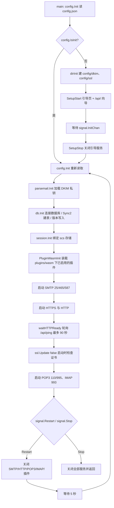
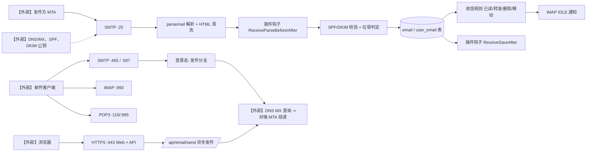

# 01 项目架构

> 文档编号：01
> 项目：PMail
> 状态：当前代码快照
> 证据基线：`master` @ `7e868f5`

本文件回答“PMail 由哪些组件组成、进程如何启动、请求如何在组件之间流动”。系统级的角色边界、部署拓扑与端到端链路见 [架构全景图](../架构全景图.md)；本文件专注于组件职责、启动顺序、服务与端口、数据表、扩展点。功能接口明细见 [03 接口说明](./03-接口说明.md)，数据表字段见 [04 数据模型](./04-数据模型.md)。

## 1. 项目定位

PMail 是面向个人/小规模使用的自建域名邮箱服务器：单个 Go 二进制内含 SMTP/IMAP/POP3 收信服务、Web 管理界面（前端静态资源通过 `//go:embed` 打包进二进制）以及 Web 管理 API。

- 单文件运行，前端资源内嵌：`server/internal/api/http_middleware.go` 的 `//go:embed dist/*`
- 数据库支持 SQLite / MySQL / PostgreSQL：`server/internal/infra/database.go`、`server/config/config.go:98`
- 插件以 WASM 沙箱挂载：`plugins/wasm/{id}/plugin.wasm` + `manifest.json`，由 `server/internal/infra/plugin_wasm_runtime.go` 加载

### 1.1 源码目录与依赖边界

```text
server/                         Go 模块根目录
├── cmd/pmail/                  主入口与端到端测试
├── internal/
│   ├── api/                    HTTP 路由、handler、中间件与 SMTP/IMAP/POP3 接入
│   ├── app/                    收发、查询、删除、分组、规则与设置用例，消费方端口
│   ├── domain/                 纯业务规则、邮件归属、删除仓储接口、规则匹配
│   ├── infra/                  xorm 查询与事务、会话、证书、DKIM/SPF、WASM 插件适配
│   └── bootstrap/              接口绑定、初始化、调度、监听器启动与重启关闭
├── hooks/                      WASM 插件契约、ABI 与内置插件
├── dto/                        公开邮件解析、DTO 与响应契约
├── models/                     插件兼容的持久化模型
├── config/                     配置包、运行配置与本地证书
├── consts/                     公开状态常量
└── pkg/                        共享工具与插件依赖
```

每层一个 Go 包，不再按业务领域建立重复的子包。业务语义由 `email_receive.go`、`account_queries.go` 等文件与类型名表达。主入口调用 `bootstrap.Run`；`bootstrap.BindDependencies` 绑定持久化、证书、插件、投递结果和邮箱通知等能力。

| 层 | 允许的内部依赖 |
| --- | --- |
| api | app、domain |
| app | domain |
| domain | 无 |
| infra | app、domain |
| bootstrap | api、app、domain、infra |

领域匹配与邮件策略不依赖 ORM、HTTP/SMTP 库、配置或插件 DTO。应用层通过类型明确的消费方端口调用基础设施；删除仓储接口位于 domain，删除事务由 app 开始、提交或回滚。SMTP 初始审计与最终审计仍使用原有 SQLite 重试和原子写入机制。

`hooks/contract`、`hooks/wasmabi`、`models`、`dto/parsemail`、`config`、`pkg` 是公开导入路径。原 `server/utils/` 已更名为 `server/pkg/`。应用端口沿用部分公开 DTO 与模型以兼容插件和既有协议数据形状，领域规则不依赖这些兼容类型。运行配置、数据库、证书和运行时 `plugins/wasm/` 目录保持原位置。前端资源生成到 `internal/api/dist/`。

仓库根目录执行 `make check_arch` 检查五个顶层包及依赖方向；执行 `make run` / `make run_dev` 分别读取普通 / 开发配置。

## 2. 技术栈

| 层 | 技术 | 证据 |
| --- | --- | --- |
| 后端语言 | Go（模块名 `github.com/Jinnrry/pmail`） | `server/go.mod` |
| HTTP 路由 | 标准库 `net/http` + `http.ServeMux`（**不区分 HTTP method**） | `server/internal/api/http_routes.go` |
| Session | `alexedwards/scs/v2`，按数据库类型选 store，生命周期 7 天 | `server/internal/infra/session_store.go` |
| ORM | `xorm.io/xorm`，启动时 `Sync2` 自动建表/迁移 | `server/internal/infra/database.go` |
| SMTP | `emersion/go-smtp`，25/465/587 三个实例 | `server/internal/api/smtp_listener.go` |
| IMAP | `emersion/go-imap/v2`，仅 993 隐式 TLS | `server/internal/api/imap_listener.go` |
| POP3 | `Jinnrry/gopop`，110/995 两个实例 | `server/internal/api/pop3_listener.go` |
| 邮件 MIME 解析 | `emersion/go-message`、`go-message/mail` | `server/dto/parsemail/email.go:245` |
| HTML 清洗 | `microcosm-cc/bluemonday`（relaxed + strict 两套策略） | `server/dto/parsemail/email.go:107` |
| 发件 SPF | `mileusna/spf` | `server/internal/app/email_receive.go` |
| 证书 | `go-acme/lego/v4`，HTTP-01 / DNS-01 两种挑战 | `server/internal/infra/certificate.go` |
| 前端 | Vue 3 + Arco Design Vue + Pinia + vue-router（history 模式）+ Vite | `web/desktop/package.json` |

## 3. 组件与服务清单

| 组件 | 入口 | 监听 | 职责 |
| --- | --- | --- | --- |
| 主程序 | `server/cmd/pmail/main.go:17` | — | 读取配置、启动定时任务、进入 `bootstrap.Run` |
| 引导设置服务 | `server/internal/api/http_setup.go` | `-p`（默认 80，env `setup_port`） | 首次部署向导 `/api/`，完成后关闭 |
| HTTP | `server/internal/api/http_routes.go` | `httpPort`（默认 80） | `httpsEnabled != 2` 时仅做 301 跳转到 https；否则提供完整路由 |
| HTTPS | `server/internal/api/http_middleware.go` | `httpsPort`（默认 443） | Web 管理界面 + 管理 API |
| SMTP | `server/internal/api/smtp_listener.go` | 25 | 收信，未认证连接走收件分支 |
| SMTPS | `server/internal/api/smtp_listener.go` | 465 | 隐式 TLS，客户端发信 |
| SMTP STARTTLS | `server/internal/api/smtp_listener.go` | 587 | 明文接入后 STARTTLS，客户端发信 |
| IMAP | `server/internal/api/imap_listener.go` | 993 | 仅隐式 TLS；默认不加密端口未实现 |
| POP3 | `server/internal/api/pop3_listener.go` | 110 | 明文 POP3 |
| POP3S | `server/internal/api/pop3_listener.go` | 995 | 隐式 TLS |
| 定时任务 | `server/internal/bootstrap/scheduler.go` | — | 证书自动续期或变更检测 |
| WASM 插件执行器 | `server/internal/infra/plugin_wasm_runtime.go` | 内嵌 wazero | 钩子调用、审批、限额与热重载 |

## 4. 启动顺序

依据 `server/internal/bootstrap/bootstrap.go`：



补充事实：

- 定时任务由 `bootstrap.Run` 在绑定依赖后以 goroutine 启动，若配置未初始化会每分钟轮询直到 `config.IsInit` 为真（`server/internal/bootstrap/scheduler.go`）。
- 配置为自动证书（`sslType` 为 `0` 或 `2`）时走“每 24 小时检查一次剩余天数、<30 天则续期并重启”的循环；否则走“比对过期时间，变化即重启”的检测（`ssl_update.go:28`）。
- 重启通过 `signal.RestartChan` 触发，`bootstrap.Run` 在外层 `for` 循环中重新执行整个初始化流程。

## 5. 收发邮件主链路（组件视角）



## 6. 数据表概览

启动时由 `server/internal/infra/database.go` 的 `syncTables()` 自动同步 7 张表：

| 表 | 模型 | 用途 |
| --- | --- | --- |
| `user` | `models.User` | 账号、密码（两次 md5 加盐）、禁用位、管理员标记 |
| `email` | `models.Email` | 邮件正文与头信息、类型、状态、投递错误 |
| `user_email` | `models.UserEmail` | 用户与邮件的多对多关系，承载已读/分组/状态 |
| `group` | `models.Group` | 自定义分组（树形 `parent_id`），内置邮箱用常量区分 |
| `rule` | `models.Rule` | 收信规则，`value` 为 JSON 条件、`action` 为动作码 |
| `sessions` | `models.Sessions` | scs 会话存储 |
| `version` | `models.Version` | 程序版本记录 |

历史数据修复：`fixHistoryData()`（`server/internal/infra/database.go`）在 `user_email` 为空时，把唯一非管理员账号提权为管理员，并把旧邮件全部挂到该账号。

## 7. 扩展点：插件

- 插件以 WASM 沙箱运行：`plugins/wasm/{id}/plugin.wasm` + `manifest.json`，由 wazero 加载（`server/internal/infra/plugin_wasm_runtime.go`）。旧进程插件与 Unix socket 机制已移除。
- 钩子契约见 `server/hooks/contract/hook.go` 的 `EmailHook` 接口：`SendBefore`、`SendAfter`、`ReceiveParseBefore`、`ReceiveParseAfter`、`ReceiveSaveAfter`、`GetName`、`SettingsHtml`。
- 同步钩子按契约允许修改邮件，WASM 执行器按字段补丁就地回写（附件、MessageId、MsgID、Size 保留）；异步钩子在独立 goroutine 中执行，失败仅记录日志。
- manifest 声明钩子与能力，管理员审批后才装配；能力为 `log`、`email.read`、`email.write`、`http`。`http` 仅在 `http_allow` 精确主机白名单内可用，且不跟随重定向；不挂载文件，内存/超时/输出/并发均有上限。
- 仓库内置三个 WASM 插件，统一放在 `server/hooks/wasm_plugins`：`spam_block`（反垃圾）、`wechat_push`（微信推送）、`debug`（调试），构建目标 `make wasm_plugins`。
- 审批状态保存在 `plugins/wasm/state.json`（`server/internal/infra/plugin_state.go`），管理接口见 `server/internal/api/plugin_manage_handler.go`；manifest 版本或哈希变化会回到待审批。
- 启停/重载通过 `server/internal/infra/plugin_registry.go` 的 `HookList` 注册表，收发邮件遍历时取快照，并发读写加锁。

## 8. 安全相关设计（现状）

| 项 | 实现 |
| --- | --- |
| 密码存储 | `md5(md5(password+"pmail")+"pmail2023")`（`server/pkg/password/encode.go:9`） |
| Web 鉴权 | scs session Cookie；另有 `Token` 头算法，时间戳与服务器相差 <5 秒才有效（`server/internal/api/http_middleware.go`） |
| 未登录响应 | `NeedSetup=402`、`NeedLogin=403`（`server/dto/response/response.go:8`） |
| 邮件越权 | 非管理员访问邮件需存在对应 `user_email` 记录（`server/internal/app/auth_service.go`） |
| HTML 清洗 | 收信解析时统一过 bluemonday，拦截 `javascript:`、`data:`、`expression(` |
| 发件域名限制 | Web 发信接口校验 `From` 域名属于 `config.Domains`，非管理员必须使用本人账号（`server/internal/api/email_send_handler.go`） |

更完整的问题清单与建议见 [09 已知限制与风险](./09-已知限制与风险.md)。

## 9. 相关文档

- [架构全景图](../架构全景图.md)：系统上下文、部署拓扑、运行时链路
- [02 功能清单](./02-功能清单.md)：协议命令、HTTP 接口、任务与插件的完整清单
- [03 接口说明](./03-接口说明.md)、[04 数据模型](./04-数据模型.md)
- [08 领域术语表](./08-领域术语表.md)
