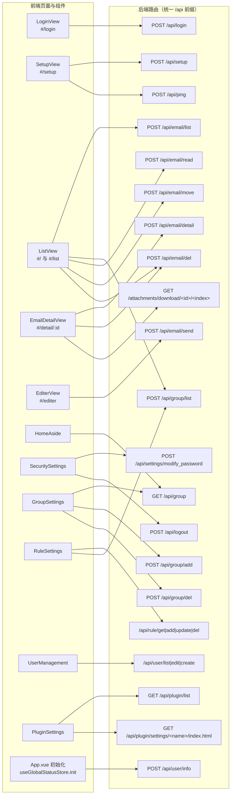

# 06 前端应用

> 文档编号：06
> 项目：PMail
> 状态：当前代码快照（含「证据不足」标注）
> 证据基线：`master` @ `7e868f5`

本文件描述 `web/desktop/` 目录下的 Vue 3 单页应用：技术栈、路由与页面、组件职责、状态管理、请求封装、国际化，以及页面与后端接口的对应关系。构建产物如何进入 Go 二进制、如何部署见 [07 构建与部署](./07-构建与部署.md)；后端接口的鉴权与错误码细节见 [03 接口说明](./03-接口说明.md)；前端相关的实现风险汇总见 [09 已知限制与风险](./09-已知限制与风险.md)。

## 1. 技术栈与工程配置

| 项 | 取值 | 证据 |
| --- | --- | --- |
| 框架 | Vue `^3.3.2`，Composition API + `<script setup>` | `web/desktop/package.json:18` |
| 构建工具 | Vite `^4.3.5`，插件 `@vitejs/plugin-vue` | `web/desktop/package.json:23,28` |
| UI 组件库 | Element Plus `^2.3.6`，通过 `unplugin-vue-components` + `ElementPlusResolver` 按需自动引入 | `web/desktop/package.json:16,26-27`、`web/desktop/vite.config.js:10-18` |
| 路由 | vue-router `^4.2.0`，`createWebHashHistory`（hash 模式） | `web/desktop/package.json:20`、`web/desktop/src/router/index.js:10` |
| 状态管理 | Pinia `^2.0.36` | `web/desktop/package.json:17`、`web/desktop/src/main.js:12` |
| HTTP | axios `^1.4.0` | `web/desktop/package.json:15` |
| 富文本编辑器 | `@wangeditor/editor` + `@wangeditor/editor-for-vue` | `web/desktop/package.json:13-14` |
| 图标 | `@element-plus/icons-vue`、`vue-icons-plus` | `web/desktop/package.json:12,19` |
| 类型检查/规范 | `vue-tsc`、`eslint` + `eslint-plugin-vue`（只声明依赖，未接入构建） | `web/desktop/package.json:9,24-25,29` |

工程约定：

* 入口 HTML 为 `web/desktop/index.html`，挂载点 `#app`，标题固定 `PMail`（`web/desktop/index.html:7,10`）。
* 应用入口 `web/desktop/src/main.js:10-14` 依次注册 router、Pinia、Element Plus，并引入 `element-plus/dist/index.css` 与本地 `assets/main.css`。
* 路径别名 `@` → `web/desktop/src`（`web/desktop/vite.config.js:20-22`）。
* 演示脚本说明见 `web/desktop/README.md`：`yarn` 安装、`yarn dev` 开发、`yarn build` 产出（`web/desktop/README.md`）。
* 开发服务器代理：`/api` 与 `/attachments` 均转发到 `http://127.0.0.1/`（即本地 80 端口的后端），并开启 `cors: true`（`web/desktop/vite.config.js:24-30`）。
* 仓库内**没有** `.env*` 文件，但 `axios` 的 `baseURL` 取自 `import.meta.env.VITE_APP_URL`（`web/desktop/src/utils/axios.js:8`），未注入时为空串，即请求同源（`web/desktop/vite.config.js` 无 `envDir` 覆盖）。

## 2. 页面与路由表

路由全部为前端 hash 路由，服务端只通过 `http.FileServer` 提供静态资源、不参与路由（`web/desktop/src/router/index.js:11-42`；服务端证据 `server/internal/api/http_routes.go`）。

| hash 路径 | 路由名 | 视图组件 | 说明 | 证据 |
| --- | --- | --- | --- | --- |
| `#/` | `home` | `ListView.vue` | 首页即邮件列表 | `web/desktop/src/router/index.js:12-16` |
| `#/list` | `list` | `ListView.vue` | 切换分组后跳转至此 | `web/desktop/src/router/index.js:17-21`、`web/desktop/src/components/HomeAside.vue:77-84` |
| `#/editer` | `editer` | `EditerView.vue` | 写信页 | `web/desktop/src/router/index.js:22-26` |
| `#/login` | `login` | `LoginView.vue` | 登录页，隐藏外框 | `web/desktop/src/router/index.js:27-31` |
| `#/setup` | `setup` | `SetupView.vue` | 首次引导配置，隐藏外框 | `web/desktop/src/router/index.js:32-36` |
| `#/detail/:id` | `detail` | `EmailDetailView.vue` | 邮件详情，`id` 取自路由参数 | `web/desktop/src/router/index.js:37-41`、`web/desktop/src/views/EmailDetailView.vue:79` |

路由层的两个横切行为：

1. **未登录/未初始化自动跳转**：HTTP 响应体 `errorNo === 403` 时跳 `#/login`，`errorNo === 402` 时跳 `#/setup`，两者都会把当前路径写入 `query.redirect`（`web/desktop/src/utils/axios.js:28-47`；服务端错误码定义 `server/dto/response/response.go:9-10`）。`redirect` 参数在登录页并未被读取使用（`web/desktop/src/views/LoginView.vue:66-78` 登录成功后固定跳 `/`）。
2. **登录/引导页隐藏外框**：`App.vue` 根据当前路由名决定是否渲染 `HomeHeader`、`HomeAside` 与移动端抽屉（`web/desktop/src/App.vue:27-42`）。

## 3. 页面职责

### 3.1 邮件列表 `ListView.vue`

* 数据来源：`POST /api/email/list`，固定 `page_size: 15`（`web/desktop/src/views/ListView.vue:131-135`）；分页时再带 `current_page`（`web/desktop/src/views/ListView.vue:242-247`）。
* 分组过滤：当前分组以字符串 tag 表示，默认 `{"type":0,"status":-1}`，切换分组时通过 `useGroupStore` 的 `watch` 重新拉取（`web/desktop/src/views/ListView.vue:118-129`）。
* 批量操作：全选/反选、标记已读（`/api/email/read`）、移动（`/api/email/move`）、删除（`/api/email/del`）；删除时 `forcedDel` 由 tag 中 `status === 3`（已删除箱）决定（`web/desktop/src/views/ListView.vue:183-236`）。
* 行内状态图标：未读圆点、`dangerous` 安全提示、`error` 投递错误提示（`web/desktop/src/views/ListView.vue:47-70`）。
* 点击行跳详情：`router.push("/detail/" + row.id)`（`web/desktop/src/views/ListView.vue:148-150`）。

### 3.2 邮件详情 `EmailDetailView.vue`

* 拉取详情：`POST /api/email/detail`，`id` 来自 `parseInt(route.params.id)`（`web/desktop/src/views/EmailDetailView.vue:90-102`）。
* 正文渲染：`html` 为空串时显示纯文本，否则用 `v-html` 直接渲染 HTML（`web/desktop/src/views/EmailDetailView.vue:47-52`）。
* 附件下载：直接拼 `'/attachments/下载路径'` 的 `<a href>`，**不经过 axios**，因此不携带任何自定义头（`web/desktop/src/views/EmailDetailView.vue:59`；服务端路由 `server/internal/api/http_routes.go`）。
* 删除：与列表页一致，读当前分组 tag 决定 `forcedDel`（`web/desktop/src/views/EmailDetailView.vue:111-149`）。

### 3.3 写信 `EditerView.vue`

* 初始化时从全局状态取当前账号、可选域名列表、昵称（`web/desktop/src/views/EditerView.vue:1-14,164-179`）。
* 校验：发件人只填前缀（不含 `@`）、收件人/抄送/密送用 `/.+@.+\..+/` 正则粗校验、标题必填（`web/desktop/src/views/EditerView.vue:181-240`）。
* 提交：`POST /api/email/send`，`from.email = 前缀 + "@" + pickDomain`，正文同时提交 `text`（编辑器纯文本）与 `html`，附件以 DataURL 形式随请求提交（`web/desktop/src/views/EditerView.vue:262-270`）。
* 发送成功后跳到发件箱：设置 `groupStore.tag = '{"type":1,"status":-1}'` 并 `router.replace({name:'list'})`（`web/desktop/src/views/EditerView.vue:271-277`）。
* 富文本语言跟随前端语言：`zhCn` → `zh-CN`，其余 → `en`（`web/desktop/src/views/EditerView.vue:131-135`）。

### 3.4 登录 `LoginView.vue`

* 纯前端必填校验（`web/desktop/src/views/LoginView.vue:58-64`），提交 `POST /api/login`（`web/desktop/src/views/LoginView.vue:61-78`）。
* 成功后把返回值合并进全局状态 `userInfos`（`account`/`name`/`is_admin`/`domains`），再跳 `/`（`web/desktop/src/views/LoginView.vue:66-78`；服务端返回字段 `server/internal/api/auth_handler.go`）。
* 回车提交（`web/desktop/src/views/LoginView.vue:14`）。

### 3.5 引导配置 `SetupView.vue`

6 步向导（`web/desktop/src/views/SetupView.vue:3-10`），全部通过 `POST /api/setup` 的 `action`/`step` 组合驱动（`web/desktop/src/views/SetupView.vue:288-475`）：

| 步骤 | 前端动作 | 接口参数（action/step） | 证据 |
| --- | --- | --- | --- |
| 0 欢迎 | 直接进入下一步 | — | `web/desktop/src/views/SetupView.vue:259-264` |
| 1 数据库 | 读取已存配置 | `get`/`database` | `web/desktop/src/views/SetupView.vue:322-330` |
| 2 管理员密码 | 提交账号密码 | `set`/`password` | `web/desktop/src/views/SetupView.vue:288-299` |
| 3 域名 | 提交 SMTP/Web 域名与多域名 | `set`/`domain`（`multi_domain` 用逗号拼接） | `web/desktop/src/views/SetupView.vue:449-462` |
| 4 DNS | 读取期望 DNS 记录 | `get`/`dns` | `web/desktop/src/views/SetupView.vue:368-376` |
| 5 SSL | 读取/提交证书方案 | `get`/`ssl`、`set`/`ssl`、`getParams`/`ssl` | `web/desktop/src/views/SetupView.vue:379-410`、`web/desktop/src/views/SetupView.vue:466-475` |

两处特殊逻辑：

* **等待服务重启**：SSL 提交后用**裸 axios**（非封装实例）轮询 `POST /api/ping`，成功即跳转到 `http(s)://{web_domain}`（`web/desktop/src/views/SetupView.vue:428-444`）。
* **DNS-01 挑战编码**：前端把「自动 + DNS 挑战」编码成 `ssl_type = "2"`，读取时将 `"2"` 还原为 `"0"` + `challenge=dns`（`web/desktop/src/views/SetupView.vue:385-390`、`web/desktop/src/views/SetupView.vue:400-403`）。

## 4. 组件职责

| 组件 | 职责 | 关键接口 | 证据 |
| --- | --- | --- | --- |
| `HomeHeader.vue` | 移动端顶栏（汉堡按钮 + 品牌），并承载**设置弹窗**的 5 个标签页；`userInfos.is_admin` 为真才显示「用户管理」 | 无（读全局状态） | `web/desktop/src/components/HomeHeader.vue:1-38` |
| `HomeAside.vue` | 左侧导航：品牌、搜索框、分组菜单、设置入口；分组从 `/api/group` 拉取扁平化后渲染；移动端复用同一组件进抽屉 | `GET /api/group` | `web/desktop/src/components/HomeAside.vue:1-100` |
| `SecuritySettings.vue` | 修改密码、退出登录 | `POST /api/settings/modify_password`、`POST /api/logout` | `web/desktop/src/components/SecuritySettings.vue:25-49` |
| `GroupSettings.vue` | 分组树的新增/删除（输入框失焦即提交） | `GET /api/group`、`POST /api/group/add`、`POST /api/group/del` | `web/desktop/src/components/GroupSettings.vue:12-125` |
| `RuleSettings.vue` | 收信规则列表与新增/编辑/删除，规则动作 1 标记已读 / 2 转发 / 3 删除 / 4 移动 | `/api/rule/get`、`/api/rule/add`、`/api/rule/update`、`/api/rule/del`、`GET /api/group/list` | `web/desktop/src/components/RuleSettings.vue:119-124,128-215` |
| `UserManagement.vue` | 用户分页列表、编辑、新建（仅管理员可见） | `/api/user/list`、`/api/user/edit`、`/api/user/create` | `web/desktop/src/components/UserManagement.vue:22-178` |
| `PluginSettings.vue` | 管理员可见的 WASM 插件表格（状态、授权、调用计数）与审批弹窗；下方保留进程插件 iframe 设置页 | `GET /api/plugin/manage/list`、`POST /api/plugin/manage/{approve,enable,disable,reject,reload}`、`GET /api/plugin/list` | `web/desktop/src/components/PluginSettings.vue` |

`App.vue` 是唯一的常驻壳层：头部 + 侧栏 + `RouterView`（带 `page-fade` 过渡），并在 `onMounted` 时调用一次 `globalStatus.init()` 拉取用户信息（`web/desktop/src/App.vue:12-14,43-47`）。

## 5. 状态管理（Pinia）

| Store | 状态 | 说明 | 证据 |
| --- | --- | --- | --- |
| `useGlobalStatusStore` | `userInfos`、`mobileDrawerVisible`、`settingsDrawerVisible`；getter `isLogin` 以 `userInfos` 非空判定 | `init()` 调 `POST /api/user/info`，成功则合并进 `userInfos` | `web/desktop/src/stores/useGlobalStatusStore.js:4-28` |
| `useGroupStore` | `tag`（分组过滤条件字符串）、`name`（分组显示名） | `tag` 为空串时各页面兜底为 `{"type":0,"status":-1}` | `web/desktop/src/stores/group.js:5-9`、`web/desktop/src/views/ListView.vue:117-122` |

状态落点约定：

* 当前分组（收件箱/发件箱/垃圾箱等）统一由 `useGroupStore.tag` 承载，`ListView` 与 `EmailDetailView` 都读它来决定「删除是普通删除还是强删除」（`web/desktop/src/views/ListView.vue:227`、`web/desktop/src/views/EmailDetailView.vue:111-125`）。
* 登录态**不持久化**到 localStorage；刷新页面依赖服务端 session cookie，再由 `App.vue` 重新拉 `/api/user/info` 恢复（`web/desktop/src/stores/useGlobalStatusStore.js:18-27`、`web/desktop/src/App.vue:12-14`）。

## 6. 请求封装与鉴权头

`web/desktop/src/utils/axios.js` 是唯一封装的 HTTP 客户端：

| 行为 | 实现 | 证据 |
| --- | --- | --- |
| baseURL | `import.meta.env.VITE_APP_URL`（未配置时同源） | `web/desktop/src/utils/axios.js:8` |
| 超时 | 60 秒 | `web/desktop/src/utils/axios.js:9` |
| 默认头 | `Content-Type: application/json;charset=UTF-8;`、`Lang: <当前语言>` | `web/desktop/src/utils/axios.js:10-13` |
| 请求拦截 | 仅 POST 时 `JSON.stringify(data)` | `web/desktop/src/utils/axios.js:17-25` |
| 响应拦截 | 解包为 `response.data`；`errorNo` 403→`/login`、402→`/setup` | `web/desktop/src/utils/axios.js:28-48` |
| 错误分支 | 按 HTTP 状态码给出提示文案，403 跳登录 | `web/desktop/src/utils/axios.js:49-99` |

鉴权方式（与后端对齐，证据 `server/internal/api/http_middleware.go`）：

* **主路径是服务端 session cookie**：登录控制器把用户 JSON 写入 session（`server/internal/api/auth_handler.go`），后续请求由 `session.Instance.LoadAndSave` 中间件从 cookie 还原（`server/internal/api/http_routes.go`）。
* **备选是 `Token` 请求头**：`{account}:md5(md5(md5(password+"pmail")+"pmail2023")+{Unix 时间戳}):{Unix 时间戳}`，有效期 5 秒（`server/internal/api/http_middleware.go`）。**前端代码中没有任何位置设置该头**（全量检索 `web/desktop/src` 只有 `Content-Type` 与 `Lang` 两个自定义头，`web/desktop/src/utils/axios.js:10-13`），故浏览器端实际只走 cookie。
* **`Lang` 头影响后端错误文案**：后端取 `Lang`，为空时按 `en` 处理（`server/internal/api/http_middleware.go`），文案表见 `server/internal/app/translation.go`。前端只会传 `en` 或 `zhCn`（见下节）。

## 7. 国际化（i18n）

* 实现方式是**模块级静态字典**，不是 vue-i18n：`i18n.js` 默认导出 `lang` 对象，另含 `zhCN` 字典（`web/desktop/src/i18n/i18n.js:1-130`、`web/desktop/src/i18n/i18n.js:133-262`）。
* 语言判定只发生在模块加载时：浏览器首选语言以 `zh` 开头则用中文，否则英文（`web/desktop/src/i18n/i18n.js:264-267`）。
* `lang.lang` 字段是后端契约值：`"en"` / `"zhCn"`，同时用于 `Lang` 请求头（`web/desktop/src/i18n/i18n.js:11,143`、`web/desktop/src/utils/axios.js:12`）。
* 没有语言切换 UI，语言在页面加载后不可变；`HomeAside`、`App.vue` 等处直接 `import lang` 使用（`web/desktop/src/components/HomeAside.vue:45`）。
* 文案覆盖不完整：列表页与详情页的若干提示为硬编码英文（如 `'Select emails first'`、`'Marked as read'`、`'Deleted successfully'`，`web/desktop/src/views/ListView.vue:179,186,196,207,218,230`、`web/desktop/src/views/EmailDetailView.vue:133-148`），`EditerView` 编辑器 placeholder 为英文（`web/desktop/src/views/EditerView.vue:143`）。

## 8. 页面与后端接口映射

下图按「页面/组件 → 后端路由」列出实际调用（仅收纳 `web/desktop/src` 中可检索到的调用点）：

接口清单（前端视角，按页面归并）：

| 页面/组件 | 方法（前端调用方式） | 路径 | 请求关键字段 | 证据 |
| --- | --- | --- | --- | --- |
| 登录 | POST | `/api/login` | `account`、`password` | `web/desktop/src/views/LoginView.vue:25` |
| 全局初始化 | POST | `/api/user/info` | `{}` | `web/desktop/src/stores/useGlobalStatusStore.js:20` |
| 引导 | POST | `/api/setup` | `action`、`step`、按步骤附加 | `web/desktop/src/views/SetupView.vue:288-475` |
| 引导 | POST | `/api/ping` | `{}`（裸 axios） | `web/desktop/src/views/SetupView.vue:428` |
| 列表 | POST | `/api/email/list` | `tag`、`page_size`、`current_page` | `web/desktop/src/views/ListView.vue:131,242-246` |
| 列表 | POST | `/api/group/list` | 无 | `web/desktop/src/views/ListView.vue:138` |
| 列表 | POST | `/api/email/read` | `ids` | `web/desktop/src/views/ListView.vue:183` |
| 列表 | POST | `/api/email/move` | `group_id`、`group_name`、`ids` | `web/desktop/src/views/ListView.vue:204` |
| 列表/详情 | POST | `/api/email/del` | `ids`、`forcedDel` | `web/desktop/src/views/ListView.vue:227`、`web/desktop/src/views/EmailDetailView.vue:139` |
| 详情 | POST | `/api/email/detail` | `id` | `web/desktop/src/views/EmailDetailView.vue:90` |
| 详情 | GET（原生 a 标签） | `/attachments/download/{id}/{index}` | — | `web/desktop/src/views/EmailDetailView.vue:59` |
| 写信 | POST | `/api/email/send` | `from`、`to`、`cc`、`bcc`、`subject`、`text`、`html`、`attrs` | `web/desktop/src/views/EditerView.vue:262-270` |
| 侧栏 | GET | `/api/group` | — | `web/desktop/src/components/HomeAside.vue:61` |
| 安全设置 | POST | `/api/logout`、`/api/settings/modify_password` | `password` | `web/desktop/src/components/SecuritySettings.vue:57,72` |
| 分组设置 | GET/POST | `/api/group`、`/api/group/add`、`/api/group/del` | `name`、`parent_id`、`id` | `web/desktop/src/components/GroupSettings.vue:63,69,116,121` |
| 规则设置 | POST/GET | `/api/rule/get`、`/api/rule/add`、`/api/rule/update`、`/api/rule/del`、`/api/group/list` | `id`、`name`、`sort`、`rules[]`、`action`、`params` | `web/desktop/src/components/RuleSettings.vue:132,144,166,195-202` |
| 用户管理 | POST | `/api/user/list`、`/api/user/edit`、`/api/user/create` | `current_page`、`page_size`、`account`、`username`、`disabled`、`password` | `web/desktop/src/components/UserManagement.vue:107,147,166` |
| 插件设置 | GET/POST | `/api/plugin/list`、`/api/plugin/settings/{name}/index.html`、`/api/plugin/manage/list`、`/api/plugin/manage/approve`、`/api/plugin/manage/enable`、`/api/plugin/manage/disable`、`/api/plugin/manage/reject`、`/api/plugin/manage/reload` | `pluginId`、`hooks[]`、`capabilities[]` | `web/desktop/src/components/PluginSettings.vue` |

后端路由注册总表见 `server/internal/api/http_routes.go`。

## 9. 「证据不足」与待确认项

以下事项本次只做了静态阅读，未运行前端、未抓包验证，标注为证据不足：

| 事项 | 现状 | 依据 |
| --- | --- | --- |
| `VITE_APP_URL` 的正式取值 | 仓库无 `.env*`，`Makefile` 与 CI 也未注入；生产构建中该值为空串（同源） | `web/desktop/src/utils/axios.js:8`、`Makefile:7-10`、`.github/workflows/release.yml:50-51` |
| 前端单测 / E2E 覆盖 | 仓库内无前端测试文件与测试脚本 | `web/desktop/package.json:5-10`（仅 dev/build/preview/lint） |
| `vue-tsc` 是否被使用 | 仅出现在 devDependencies，脚本中无 `type-check` | `web/desktop/package.json:9,29` |
| 移动端断点行为 | 仅从 CSS 媒体查询推断（`max-width: 768px`），未实测 | `web/desktop/src/App.vue:96-106`、`web/desktop/src/components/HomeHeader.vue:120-157` |
