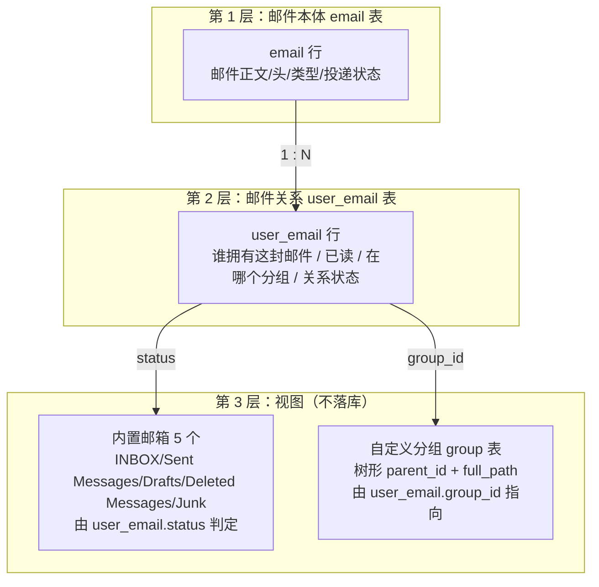
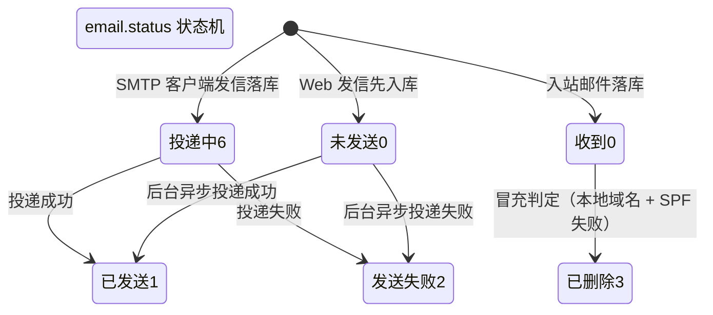

# 08 领域术语表

> 文档编号：08
> 项目：PMail
> 状态：当前代码快照
> 证据基线：`master` @ `7e868f5`

本文件统一 PMail 文档、代码、数据与协议中的领域术语，重点解决三类问题：**同一个词在不同层含义不同**（如「分组」）、**同一件事有多种叫法**（如「邮箱 / 文件夹 / 分组 / 标签」）、**代码字段与业务语义错位**（如两张表的 `status`）。

术语全部从 `server/models/`、`server/consts/`、`server/internal/app/`、`server/dto/` 与已生成的 [01](./01-项目架构.md)～[07](./03-接口说明.md)、[流程文档](../流程/) 中抽取，**不新增未实现的语义**。

> **范围声明**：本文只统一文档语义，**本次未修改任何代码、字段或对外契约**。文末「现状问题」列出建议，均属后续改进方向。
>
> **阅读顺序建议**：先读第 2 节的「三层模型」（邮箱 / 分组 / 邮件），再读第 3～5 节的具体术语。

## 1. 术语使用总则

1. **中文文档用主术语**：正文一律用「邮箱」「分组」「邮件关系」「已删除」，不要混用「文件夹」「标签」「关联记录」。
2. **写代码用代码名**：引用字段、常量、路由时给原名（`user_email.status`、`models.Junk`、`/api/email/move`），不要意译。
3. **区分口径**：讨论「状态」时必须写明是 `email.status` 还是 `user_email.status`；讨论「删除」必须写明是软删还是硬删。
4. **协议词与界面词分离**：IMAP/POP3 说的 `mailbox`、`Junk`、`Deleted Messages` 是**协议名**；Web 后台界面说「收件箱」「广告箱」「已删除」是**界面名**。二者由 [§ 4.2](#42-五类内置邮箱的四种叫法) 的映射表对应，不可直接互换。

## 2. 三层模型：先分清「邮箱」「分组」「邮件」

这是最容易混淆的一组概念。PMail 中「用户看到的一个信箱」由三层共同表达：

一句话口径：

- **邮件（Email）**是"内容"，**邮件关系（UserEmail）**是"某用户对这封邮件持有的一份副本与状态"，**邮箱/分组**是"用户查看这些副本的视角"。
- 内置邮箱**不落库**，由 `user_email.status` 推导；自定义分组**落库**，由 `user_email.group_id` 指向。
- 一封邮件可以被多个用户各持有一份关系（群发/规则转发），但正文只存一行 `email`。

## 3. 主术语表

### 3.1 账号与身份

| 主术语 | 英文 / 代码映射 | 定义 | 允许别名 | 避免用法 |
| --- | --- | --- | --- | --- |
| 邮箱账号 | `user.account`（`varchar(20) unique`）；登录路由 `/api/login` | 登录名，不带域名后缀的本地部分；邮件地址由 `account + "@" + domain` 拼出 | 账号、登录名、local part | 「用户名」（`user.name` 是显示名，不是登录名）、「邮箱地址」 |
| 显示名 | `user.name`（`varchar(10)`） | 后台展示的名字 | 昵称 | 「账号」「用户名」 |
| 管理员 | `user.is_admin = 1` | 可管理用户、读取他人邮件（`auth.HasAuth` 对管理员直接放行） | 超级管理员 | 「root」（指进程用户，不是业务角色） |
| 禁用 | `user.disabled = 1` | 禁止登录；四种认证均校验 `disabled=0` | 停用 | 「删除用户」（代码无删除用户路径） |
| 登录口令 | `user.password`（`char(32)`，`json:"-"`） | `md5(md5(pwd+"pmail")+"pmail2023")` 的 32 位 hex；接口永不返回 | 密码、口令 | 「Token」（见 § 3.3） |
| 会话 | `sessions` 表 + scs Cookie | Web 后台登录态，7 天有效 | session、登录态 | 「Token」（Token 是另一种凭证） |
| Token 头 | 请求头 `Token`，格式 `{account}:{hex}:{unix秒}` | 兼容用的无状态鉴权，**5 秒**时效；前端不使用 | 令牌头 | 「会话」「session」 |

### 3.2 邮件本体与关系

| 主术语 | 英文 / 代码映射 | 定义 | 允许别名 | 避免用法 |
| --- | --- | --- | --- | --- |
| 邮件 | `email` 表，`models.Email` | 一封邮件的正文与头信息，全局唯一一行 | 信件、msg | 「邮件记录」（歧义，可能指 `user_email`） |
| 邮件关系 | `user_email` 表，`models.UserEmail` | 「某用户持有某封邮件」的一份副本状态：已读、分组、关系状态 | 关联记录、ue 行 | 「邮件」（关系不是邮件本体） |
| 邮件类型 | `email.type`；`EmailTypeReceive=0` / `EmailTypeSend=1` | 这封邮件是收到的还是发出的 | 收发类型 | 「方向」（非代码字段） |
| 已读 | `user_email.is_read`（0/1） | 按用户维度记录的已读标记，**不在 `email` 表** | 读状态 | 「邮件已读」（应说明是哪个用户） |
| 附件 | `email.attachments`（JSON 字符串，`longtext`） | 附件元数据 + base64 内容整块存在邮件行内 | attachment | 「附件表」（不存在附件表） |
| 内联图片 | `/attachments/` 路由，按 `Content-ID` 取 | 正文 HTML 中 `cid:` 引用的图片 | cid 图片、内嵌图片 | 「附件」（走的是不同路由且不落下载统计） |
| 附件下载 | `/attachments/download/` 路由 | 用户主动下载附件 | 下载 | 「内联图片」 |
| Message-ID | `email.msg_id` | RFC 标准消息标识，创建时生成一次，群发共用 | msg_id | 「email.id」（自增主键，不是 Message-ID） |

### 3.3 状态（务必区分两张表）

`email.status` 与 `user_email.status` **名字相同、语义不同、取值表不同**，这是本仓库最容易出错的术语。

| 主术语 | 承载字段 | 语义 | 取值与常量 |
| --- | --- | --- | --- |
| 投递状态 | `email.status` | 这封邮件**作为一个整体**是否发出去了 | `0` 未发送/收到 `EmailStatusWait`、`1` 已发送 `EmailStatusSent`、`2` 发送失败 `EmailStatusFail`、`6` 投递中 `EmailStatusDeliveryPending` |
| 关系状态 | `user_email.status` | **某个用户**把这条关系放在哪个内置邮箱里 | `0` 收件箱、`1` 发件箱、`2` 发送失败、`3` 已删除、`4` 草稿、`5` 广告箱 |

正确说法示例：

- ✅「邮件 `email.status=2`，投递失败，`email.error` 有原因」——描述发信结果。
- ✅「用户 A 的 `user_email.status=5`，他把这封邮件归到了广告箱」——描述用户视角。
- ❌「邮件状态是 5」，不说明哪张表——**歧义表述，禁止**。

补充事实：

- `email.status=3` 在收信链路中**确实会被写入**（本地域名被冒充且 SPF 失败时强制置 3，`server/internal/app/email_receive.go`），但 `email.status` 的 xorm 注释只写了 `0/1/2`，属于「注释与实现不同步」的现状（详见 [04 数据模型](./04-数据模型.md) 第 6、8 节）。
- `user_email.status` 的值与 `consts` 常量共用一套数字，因此有时会看到「`user_email.status` 用了 `EmailStatus*` 常量」的写法——**数字可复用，语义不可混用**。

### 3.4 邮箱、分组与目录

详细对照见 [§ 4.1](#41-分组--邮箱--文件夹)。这里的要点：

| 主术语 | 英文 / 代码映射 | 定义 | 避免用法 |
| --- | --- | --- | --- |
| 内置邮箱 | `models.INBOX` 等 5 个常量（2000000000～2000000004） | 系统预置、不可增删的信箱，**不落 `group` 表** | 「系统分组」（会暗示它在 `group` 表里） |
| 自定义分组 | `group` 表（`id/name/parent_id/user_id/full_path`） | 用户自建的树形目录，落库，按用户隔离 | 「文件夹」（代码里没有 folder 概念） |
| 邮箱名 | `GroupCodeToName` / `GroupNameToCode` 的映射值 | 对 IMAP 客户端暴露的名字：`INBOX`、`Sent Messages`、`Drafts`、`Deleted Messages`、`Junk` | 「中文名」（中文名只用于 Web 界面） |
| 完整路径 | `group.full_path` | 自定义分组的父级拼路径，如 `一级菜单/二级菜单` | 「分组名」（分组名只是末级） |
| 分层创建 | `session_create.go` 按 `/` 逐级建组 | IMAP `CREATE a/b` 会自动建 `a` 和 `a/b` | 「扁平分组」 |

### 3.5 收信与发信

| 主术语 | 英文 / 代码映射 | 定义 | 允许别名 | 避免用法 |
| --- | --- | --- | --- | --- |
| 收信 | `EmailTypeReceive=0`，SMTP :25 的未认证分支 | 接收外部 MTA 投递的邮件 | 入站、inbound | 「收邮件」（与"从服务器取信"混淆） |
| 发信 | `EmailTypeSend=1`，SMTP 465/587 的认证分支 + `/api/email/send` | 把邮件投递给对端 MX | 出站、outbound | 「转发」（转发是规则动作之一） |
| Web 发信 | `/api/email/send` | 先入库立即返回、后台异步投递 | 网页发信 | 「同步发信」 |
| SMTP 客户端发信 | 465/587 登录后 `DATA` | 同步投递并带审计回写 | 客户端发信 | 「Web 发送」 |
| 投递审计 | `server/internal/app/email_delivery.go` | 出站落库与状态回写的统一记录 | 审计 | 「日志」（审计写的是数据库） |
| MX 故障转移 | `server/pkg/send/send.go` 的端口回退链 | 对端投递失败时按 `STARTTLS:25 → 587 → 465 → 明文:25` 依次重试 | 端口回退 | 「负载均衡」 |
| 收信规则 | `rule` 表，`dto.Rule` | 按条件匹配入站邮件并执行动作 | 过滤规则、规则 | 「反垃圾规则」（反垃圾靠 SPF/DKIM 与插件） |
| 规则动作 | `dto.READ/FORWARD/DELETE/MOVE`（1/2/3/4） | 已读 / 转发 / 删除 / 移动到分组 | action | 「规则类型」 |

### 3.6 安全校验与反垃圾（三个不同层次，勿混为一谈）

这是第二组高频混淆点。「垃圾邮件」在 PMail 里有**三种互不相同的机制**：

| 主术语 | 代码映射 | 作用点 | 结果 | 与其它机制的关系 |
| --- | --- | --- | --- | --- |
| SPF 校验 | `email.spf_check`；`smtp_server/read_content.go` 的 `spfCheck`；`mileusna/spf` | 收信时校验发件 IP 是否被发件域授权 | `1` 通过 / `0` 失败，写入 `email.spf_check` | 只**记录**结果，单凭它不会改变邮件去向 |
| DKIM 验签 | `email.dkim_check`；`parsemail.Check` | 收信时验证签名 | `1` 通过 / `0` 失败，若被判为冒充则强制 `0` | 同上，单凭它不会改变去向 |
| 冒充判定 | `spoofed`，`read_content.go` 的局部变量 | 发件域属于本机 `config.domains` 且 SPF 失败 | 该邮件 `email.status` 强制置 **3**，并覆盖插件给出的分类 | 优先级**高于**插件分类 |
| 列表危险标记 | 响应字段 `dangerous`（`server/internal/api/email_list_handler.go`） | Web 列表展示 | `!spfPassed && !dkimPassed` 时为 `true` | 纯展示，**不影响存储** |
| 反垃圾级别 | 配置 `spamFilterLevel`（`0`～`3`） | **仅**在「收件人不存在」分支 | 决定丢弃还是转交管理员 | 见下方说明 |
| 广告箱状态 | `user_email.status = 5`（`EmailStatusJunk`） | 用户视角的归档 | 邮件进入「广告箱」视图 | 可由插件、规则、IMAP `COPY` 写入 |
| 反垃圾插件 | `server/hooks/spam_block` | 收信解析后异步/同步钩子 | 命中垃圾置 `status=5`，命中敲诈置 `status=3` | 会被上面的冒充判定覆盖 |

`spamFilterLevel` 的准确含义（**这是极易被误读的一项**）：

| 取值 | 实际行为（证据：`server/internal/app/email_delivery.go`） |
| --- | --- |
| `0` | 不过滤：未知收件人的邮件一律转交管理员 |
| `1` | 收件人不存在 **且** SPF、DKIM 均失败 → 丢弃；否则转交管理员 |
| `2` | 收件人不存在 **且** SPF 失败 → 丢弃；否则转交管理员 |
| `3` | 收件人不存在 **且** DKIM 失败 → 丢弃；否则转交管理员 |

> 关键约束：`spamFilterLevel` **只对"收件人不存在"的邮件生效**，并且还必须配合代码常量 `DropUnknownRecipientEmails = true`（`read_content.go:31-35`，不暴露给配置）。它**不会**过滤发给真实用户的垃圾邮件。把 `user_email.status=5`（广告箱）说成「被 spamFilterLevel 判定为垃圾」是**错误**的。

### 3.7 协议与客户端

| 主术语 | 英文 / 代码映射 | 定义 | 避免用法 |
| --- | --- | --- | --- |
| 隐式 TLS | 993 / 995 / 465 端口 | 连接建立即 TLS 握手，无需再协商 | 「STARTTLS」（那是 587 的方式） |
| STARTTLS | 587 端口 | 先明文连接，再用命令升级为 TLS | 「隐式 TLS」 |
| IDLE | IMAP `IDLE` 命令，`session_idle.go` | 客户端长连接等待服务端推送新邮件 | 「轮询」（Web 前端才轮询） |
| UID / 序号 | IMAP `UID FETCH` / `FETCH` | UID 是 `user_email.id`；序号是窗口内的行号 | 「消息 ID」（那是 Message-ID） |
| 软删除 | `del_email.DelEmail(ids, false)` | 只把 `user_email.status` 置 3，`email` 行保留 | 「删除」（不说明时优先用「软删除」） |
| 硬删除 | `del_email.DelByUID` / `DelEmail(ids, true)` | 删 `user_email` 行，无引用时连 `email` 行一起删 | 「彻底删除」以外的叫法 |
| 回收站 | 内置邮箱 `Deleted Messages`（状态 3） | 软删除后的邮件所在视图 | 「垃圾箱」（与「广告箱」易混，见 § 4.3） |

### 3.8 部署与运维

| 主术语 | 英文 / 代码映射 | 定义 | 避免用法 |
| --- | --- | --- | --- |
| 引导期 | `config.IsInit = false`，`setup_server.go` | 首次部署向导阶段，仅监听 `/api/` 与静态页 | 「安装期」（易与 Docker 构建混淆） |
| 运行态 | `config.IsInit = true` | 正常服务阶段，路由 28 条 | 「生产态」 |
| 运行目录 | `PMail_ROOT` 解析出的目录 | 含 `config/`、`plugins/`，由程序启动时定位 | 「工作目录」（不等于 shell pwd） |
| 插件 | `plugins/wasm/{id}/plugin.wasm` + `manifest.json` | 由 wazero 加载的沙箱执行器 | 「模块」「中间件」 |
| 钩子 | `contract.EmailHook` 的 7 个方法 | 插件与核心交互的接入点 | 「事件」（无事件总线） |
| WASM 插件 | `plugins/wasm/{id}/plugin.wasm` + `manifest.json` | 由 wazero 加载、按能力审批的第三方插件 | 「沙箱插件」 |
| 插件 ABI | `pmail-hook@1` | 宿主与 WASM 插件的函数、内存与 JSON 约定 | 「接口版本」 |
| 插件能力 | `capabilities` / `grantedCapabilities` | 可授予 `log`、`email.read`、`email.write`、`http`；`http` 需配合 `http_allow` 白名单 | 「权限」 |
| 证书模式 | `sslType`（`0` 自动 HTTP-01 / `1` 手动 / `2` 自动 DNS-01） | 证书获取与续期方式 | 「httpsEnabled」（那是开关，不是模式） |

## 4. 易混术语对照

### 4.1 分组 / 邮箱 / 文件夹

| 说法 | 是否代码概念 | 准确含义 | 结论 |
| --- | --- | --- | --- |
| 分组（group） | ✅ `group` 表 | 用户自建的**树形**目录，落库 | 主术语 |
| 邮箱（mailbox） | ✅ 协议概念 | IMAP/POP3 视角的「一个信箱」，既包含内置邮箱也包含自定义分组 | 协议文档用「邮箱」 |
| 文件夹（folder） | ❌ | 代码中不存在；`GroupNameToCode` 用的是 mailbox 语汇 | **禁止在项目文档中使用** |
| 标签（tag） | ⚠️ 局部 | `dto.SearchTag` 是**检索条件结构体**，不是分类标签 | 不要用它指代分组 |
| 内置邮箱 / 系统箱 | ✅ 常量 | 5 个不可增删的信箱 | 主术语 |
| 自定义分组 | ✅ `group` 表 | 用户可见、可改名、可嵌套 | 主术语 |

### 4.2 五类内置邮箱的四种叫法

同一封信箱在四层里有四个名字，**写文档时必须对齐**：

| 层 | 收件箱 | 发件箱 | 草稿箱 | 已删除 | 广告箱 |
| --- | --- | --- | --- | --- | --- |
| 代码常量（`models/group.go`） | `INBOX` | `Sent` | `Drafts` | `Deleted` | `Junk` |
| 常量值 | `2000000000` | `2000000001` | `2000000002` | `2000000003` | `2000000004` |
| IMAP / POP3 邮箱名 | `INBOX` | `Sent Messages` | `Drafts` | `Deleted Messages` | `Junk` |
| Web 界面（i18n key） | `inbox` 收件箱 | `outbox` 发件箱 | `sketch` 草稿箱 | `deleted` 已删除 | `junk` 广告箱 |
| 判定的 `user_email.status` | `0` | `1` | `4` | `3` | `5` |

证据：`server/models/group.go:11-33`；`server/internal/app/translation.go`；`server/internal/app/group_service.go` 的 `GetGroupStatus`。注意英文版界面对 `sketch` 的文案是 `Sketch`（即草稿），这是既有 i18n 文案，**不要"顺手更正"为 Drafts**，它属于界面契约。

### 4.3 「已删除」与「广告箱」不要混称「垃圾箱 / 垃圾邮件」

- **已删除**（`Deleted Messages` / `deleted` / 状态 3）：用户主动删除后进回收站。别名「垃圾箱」在中文口语里常被使用，但会与「广告箱」混淆，**文档中统一用「已删除」**。
- **广告箱**（`Junk` / `junk` / 状态 5）：被判为骚扰/广告的邮件。**不要**写成「垃圾邮件箱」以外的「垃圾箱」。
- **「垃圾邮件」**这个词在三处含义不同：① `spamFilterLevel` 的「丢弃未知收件人邮件」；② `spam_block` 插件的分类结果；③ 用户的「广告箱」视图。写文档时必须指明是哪一种（见 § 3.6）。

### 4.4 Email 与 UserEmail 的区别

| 维度 | 邮件 `email` | 邮件关系 `user_email` |
| --- | --- | --- |
| 粒度 | 每封邮件**一行**，全局唯一 | **每个用户每个"副本"一行** |
| 主要字段 | 标题、发件人、收件人、正文、附件、SPF/DKIM 结果、类型、投递状态 | `user_id`、`email_id`、`is_read`、`group_id`、关系状态 |
| 谁会写 | 收信链路、发信链路 | 收信落库、规则、移动、删除、IMAP/POP3 操作 |
| 删除影响 | 只在**没有任何** `user_email` 引用时才被删 | 删除它就是"某个用户删掉了自己那份" |
| 典型误用 | 「删除该用户的所有邮件」误删 `email` 行 | 「邮件已发送」却说成 `user_email.status` |

判断归属的正确问法：**「这是问邮件本身的状态，还是问某个用户看到的状态？」**

## 5. 内部 / 对外状态口径

### 5.1 对内（数据库）与对外（接口 / 协议）

| 场景 | 对外表现 | 对内落点 | 说明 |
| --- | --- | --- | --- |
| 广告箱 | IMAP `Junk`、Web `junk` | `user_email.status = 5` | 对外是邮箱名，对内是状态值 |
| 已删除 | IMAP `Deleted Messages`、Web `deleted` | `user_email.status = 3` | 同上 |
| 用户自定义分组 | IMAP `a/b` 路径、Web 侧栏名 | `user_email.group_id = group.id` | 对内是外键 |
| 发信投递失败 | 列表 `error` 字段有文案 | `email.status = 2` + `email.error` | 列表接口的 `error` 来自 `email.error` |
| 危险邮件提示 | 列表 `dangerous: true` | **不落库**，实时由 SPF/DKIM 结果计算 | 刷新即变，不能当持久标记 |
| 未登录 | `errorNo = 403`（`NeedLogin`） | 无 | 注意：这是业务码，**不是** HTTP 403 |
| 未初始化 | `errorNo = 402`（`NeedSetup`） | `config.IsInit = false` | 同上，`HTTP 状态码始终 200` |

> 重要：`errorNo` 是**响应体字段**，不是 HTTP 状态码。`response.Response{errorNo, errorMsg, data}` 的 HTTP 状态恒为 200。文档里写「返回 403」时必须注明是 `errorNo=403`。

### 5.2 错误码对照

| `errorNo` | 常量 | 含义 |
| --- | --- | --- |
| `0` | （默认成功） | 成功 |
| `100` | `ParamsError` | 参数错误（也有地方用作账号密码错误，见 [03 接口说明](./03-接口说明.md)） |
| `402` | `NeedSetup` | 需要先完成首次部署 |
| `403` | `NeedLogin` | 未登录或登录过期 |
| `405` | `NoAccessPrivileges` | 已登录但无权限 |
| `500` | `ServerError` | 服务端错误 |

## 6. 代码与数据映射

### 6.1 术语 → 代码位置

| 术语 | 模型 / 常量 | 服务 / 控制器 | 路由 / 协议入口 |
| --- | --- | --- | --- |
| 邮箱账号 | `user.account` | `server/internal/api/auth_handler.go` | `/api/login`；IMAP `LOGIN`；POP3 `USER`/`PASS`；SMTP `AUTH` |
| 邮件 | `models.Email` | `server/internal/app/email_detail.go`、`server/internal/app/email_query.go` | `/api/email/list`、`/api/email/detail` |
| 邮件关系 | `models.UserEmail` | `server/internal/app/email_query.go`、`server/internal/app/rule_service.go` | — |
| 内置邮箱 | `models.INBOX/Sent/Drafts/Deleted/Junk` | `app.GetGroupStatus` | IMAP `LIST`/`SELECT`/`COPY`/`MOVE` |
| 自定义分组 | `models.Group` | `server/internal/app/group_service.go` | `/api/group*`；IMAP `CREATE`/`RENAME` |
| 收信规则 | `models.Rule`、`dto.Rule` | `app.RuleDoRule` | `/api/rule*` |
| 软删除 | — | `app.EmailDeleteDelEmail(…, false)` | `/api/email/del`；POP3 `DELE`+`QUIT` |
| 硬删除 | — | `app.EmailDeleteDelByUID` | IMAP `STORE \Deleted`/`EXPUNGE` |
| 复用权限 | `auth.HasAuth` | `server/internal/app/auth_service.go` | 所有详情类接口 |

### 6.2 常量一览（写文档时直接引用，不要手抄数字）

| 常量组 | 文件 | 值域 |
| --- | --- | --- |
| 内置箱码 | `server/models/group.go:11-17` | `2000000000`～`2000000004` |
| 邮件类型 | `server/consts/consts.go:3-7` | `0` 收 / `1` 发 |
| 邮件状态 | `server/consts/consts.go:9-28` | `0`～`6` |
| 规则动作 | `server/dto/rule.go:8-15` | `1`～`4` |
| 响应错误码 | `server/dto/response/response.go:8-14` | `402/403/405/100/500` |

## 7. 现状问题与建议（本次不改代码）

| # | 术语层面的问题 | 证据 | 建议 |
| --- | --- | --- | --- |
| 1 | `email.status` 与 `user_email.status` 同名不同义，且共用一套数字常量 | `server/models/email.go:25`、`server/models/user_email.go:11` | 文档层始终带表名限定；长期可考虑拆成两组常量（需迁移） |
| 2 | `email.status=3`（冒充判定）不在列注释 `0/1/2` 范围内 | `server/models/email.go:25`；`read_content.go:105-125` | 更新列注释或在常量注释里注明误用 |
| 3 | 内置箱既用 `status` 也用 `group_id` 表达，`MOVE`/`COPY`/规则三处落点不一致 | `server/internal/app/group_service.go` 的 `Move2DefaultBox`；`server/internal/app/rule_service.go` 的 MOVE | 以本文 § 4.2 为唯一口径；代码层差异见 [04 数据模型](./04-数据模型.md) 第 8 节 |
| 4 | `spamFilterLevel` 的名字容易被理解为「全局反垃圾等级」，实际只作用于「未知收件人」分支 | `audit_persistence.go:140-177`；`read_content.go:31-35` | 文档统一表述为「未知收件人丢弃级别」；配置注释补充前置条件 |
| 5 | i18n 英文把草稿箱译为 `Sketch`，与 IMAP 的 `Drafts` 不一致 | `server/internal/app/translation.go`；`server/models/group.go:22` | 界面文案与协议名**分属两层**，不要在文档里认为它们应该一致；若要改文案需单独评估前端契约 |
| 6 | 「垃圾箱」一词同时被用来指「已删除」和「广告箱」 | 本文 § 4.3 | 文档统一：**已删除** / **广告箱** |
| 7 | 列表响应 `dangerous` 是实时计算、不落库，容易被误解为持久标记 | `server/dto/parsemail/email.go:67`；`server/internal/api/email_list_handler.go` | 文档明确它是展示层派生字段 |

## 8. 维护约定

- 新增内置邮箱：必须同步改 `models/group.go` 的两张映射表、`i18n` 的界面名、本文 § 4.2 的对照表，以及 [04 数据模型](./04-数据模型.md) 第 6 节。
- 新增邮件状态：先更新 `consts/consts.go` 注释，再更新本文 § 3.3 与 [04 数据模型](./04-数据模型.md) 第 6 节。
- 新增配置字段：同步 [07 构建与部署](./07-构建与部署.md) 的配置字段表；若涉及反垃圾语义，必须更新本文 § 3.6。
- 术语变更属于**文档内修正**，不需要给术语表加版本号；只有当「邮箱/分组/状态」这类模型本身改变时，才需要同步更新本文并重跑文档校验。

## 9. 相关文档

- [01 项目架构](./01-项目架构.md)：组件与启动顺序
- [02 功能清单](./02-功能清单.md)：接口、命令、任务的完整清单
- [03 接口说明](./03-接口说明.md)：路由、字段、错误码
- [04 数据模型](./04-数据模型.md)：表结构、常量、关系图
- [06 前端应用](./06-前端应用.md)：页面文案与接口映射
- [07-POP3服务（v1）](../流程/07-POP3服务-v1.md)：软删/硬删的跨端对照
- [06-IMAP服务（v1）](../流程/06-IMAP服务-v1.md)：内置邮箱的协议视图
- [架构全景图](../架构全景图.md)：系统边界

## 10. 证据索引

| 主题 | 文件:行号 |
| --- | --- |
| 内置箱常量与双向映射 | `server/models/group.go:11-33` |
| 邮件类型/状态常量 | `server/consts/consts.go:3-29` |
| `email` 模型（含 `status` 注释） | `server/models/email.go:9-34` |
| `user_email` 模型 | `server/models/user_email.go:5-16` |
| `user` 模型（`account`/`name`/`password`/`is_admin`/`disabled`） | `server/models/User.go:3-10` |
| 规则动作常量 | `server/dto/rule.go:8-15` |
| 检索标签结构 | `server/dto/tag.go:5-14` |
| 界面文案（中/英 i18n） | `server/internal/app/translation.go` |
| 响应错误码 | `server/dto/response/response.go:8-14` |
| SPF/DKIM 校验与冒充判定 | `server/internal/app/email_receive.go` |
| SPF 实现 | `server/internal/infra/mail_spf.go` |
| `dangerous` 派生逻辑 | `server/dto/parsemail/email.go:59-67` |
| `spamFilterLevel` 生效分支 | `server/internal/app/email_delivery.go` |
| `DropUnknownRecipientEmails` 开关 | `server/internal/app/email_receive.go` |
| 广告箱状态写入（插件） | `server/hooks/spam_block/spam_block.go` |
| 规则 MOVE 落库 | `server/internal/app/rule_service.go` |
| 内置箱移动落库 | `server/internal/app/group_service.go` |
| 软删除 / 硬删除 | `server/internal/app/email_delete.go` |
| 邮件权限判定 | `server/internal/app/auth_service.go` |
| IMAP 内置邮箱 LIST | `server/internal/api/imap_session_list.go` |
