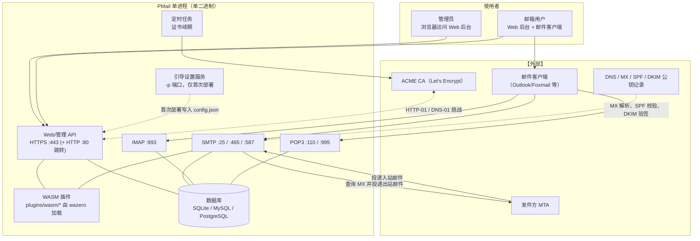
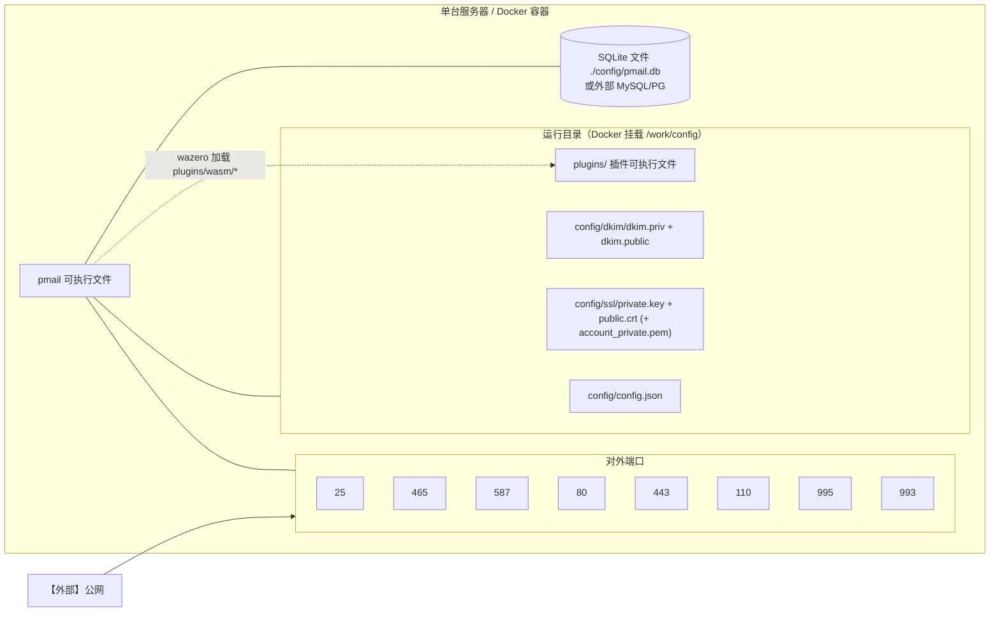
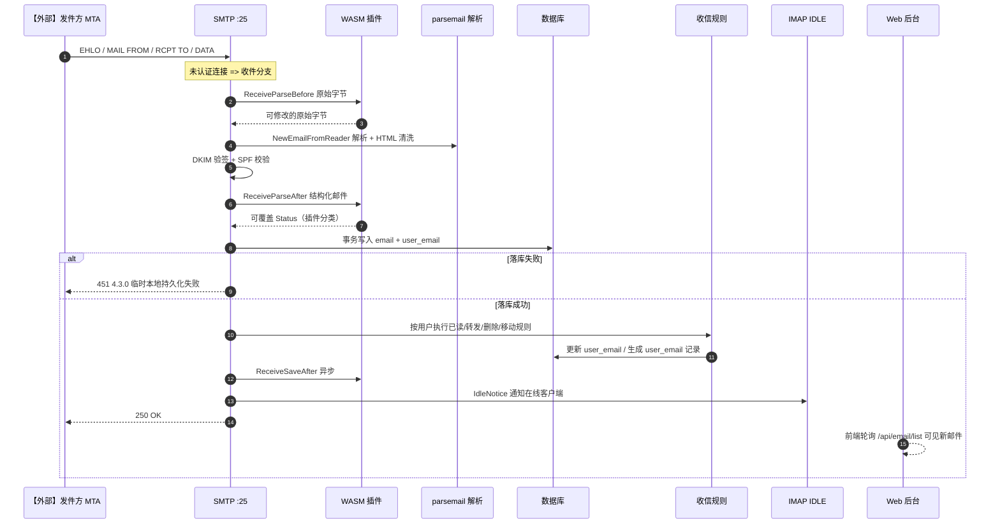
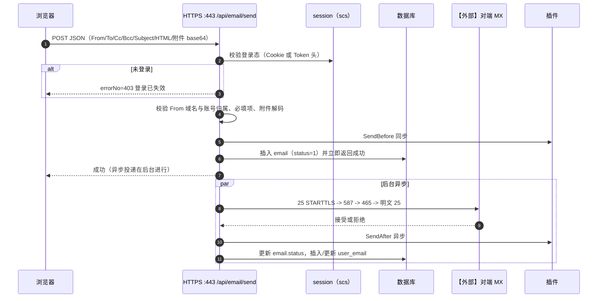

# 架构全景图

> 文档编号：AC（架构全景，固定文件名）
> 项目：PMail
> 状态：当前代码快照
> 证据基线：`master` @ `7e868f5`

本文件只回答“系统由谁组成、跑在哪里、一次请求如何流动”，是项目级、单功能的系统视图。组件职责、启动顺序、数据表与扩展点见 [01 项目架构](./功能/01-项目架构.md)；单个业务的判断分支与异常见 `docs/流程/` 下的各流程文档。

## 1. 系统上下文

边界说明：

- **内核对面板**：邮件协议服务（SMTP/IMAP/POP3）与管理 API 共享同一个进程、同一份数据库连接池和同一份配置。
- **客户端边界**：Web 后台由内嵌在前端 bundle 里的 Vue 应用提供（`//go:embed dist/*`）；不支持无 JS 环境。
- **外部系统**：DNS、MX 对端、ACME CA 均标 `【外部】`，仓库内无实现。
- **数据面**：仓库没有 Redis/消息队列，所有异步都靠 goroutine（`pkg/async`）实现。

## 2. 部署拓扑

证据：

- 端口清单与 Docker 端口映射：`Makefile:1`（构建链）、根 `README_CN.md:68` 的 `docker run -p 25:25 -p 80:80 -p 443:443 -p 110:110 -p 465:465 -p 587:587 -p 995:995 -p 993:993 -v $(pwd)/config:/work/config`。
- 运行目录约定：`server/internal/bootstrap/bootstrap.go` 的 `dirInit()` 只创建 `./config`、`./config/dkim`、`./config/ssl`；插件目录固定为相对路径 `./plugins/wasm`（`server/internal/infra/plugin_manager.go`）。
- SQLite 默认 DSN 指向 `./config/pmail.db`（`server/internal/app/setup_database.go`）。

权限与挂载要点：

| 项 | 说明 |
| --- | --- |
| 端口权限 | 25/80/110/443/465 属于 <1024 特权端口，非 root 运行时需 `setcap` 或端口转发；`docs/功能/10-调试手册.md` 记录测试需要 sudo |
| 持久化 | 只需挂载 `config/`（含数据库文件、DKIM、证书）与 `plugins/` |
| 证书文件 | 即便 `httpsEnabled=2` 不启用 Web HTTPS，SMTP/POP3/IMAP 仍需证书，缺失会导致这些服务启动失败（`log.Fatal` / `panic`） |

## 3. 运行时链路

### 3.1 一次入站邮件投递

### 3.2 一次管理变更（Web 发信）

说明：

- Web 发信是**先入库、后异步投递**：接口返回时邮件尚未真正发出。
- 相比 Web 发信，经 SMTP 客户端（465/587）发信走的是同步链路并带审计：先以 `status=6`（投递中）入库，投递后在同一事务里同时更新 `email` 与 `user_email`，见 `server/internal/app/email_delivery.go`。
- 两条链路的差异是当前实现中的事实不一致点，已记入 [09 已知限制与风险](./功能/09-已知限制与风险.md)。

## 4. 与功能文档的分工

| 视图 | 回答的问题 | 位置 |
| --- | --- | --- |
| 架构全景图（本文件） | 系统由谁组成、跑在哪里、一次请求怎么流动 | `docs/架构全景图.md` |
| 项目架构 | 组件职责、启动顺序、服务端口、数据表、扩展点 | [功能/01-项目架构.md](./功能/01-项目架构.md) |
| 业务流程 | 单个功能的分支、异常、状态迁移 | `docs/流程/` |
| 功能清单 | 有哪些接口/命令/任务，状态如何 | [功能/02-功能清单.md](./功能/02-功能清单.md) |
