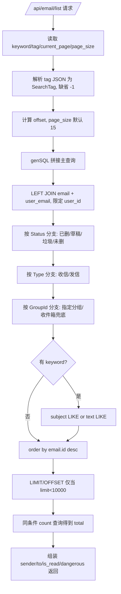
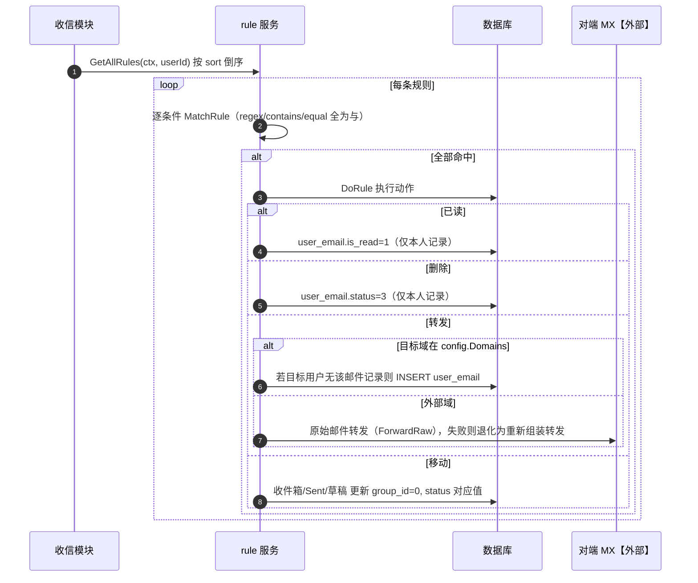
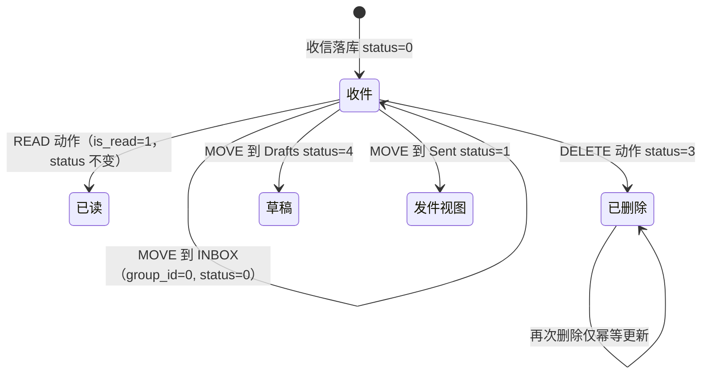

# 04 邮件列表检索与收信规则（v1）

> 文档编号：04
> 文档版本：v1
> 项目：PMail
> 状态：已实现
> 证据基线：`master` @ `7e868f5`

## 1. 目标

回答两个问题：

1. Web 后台“看到某封邮件”背后查询了哪些表、条件如何组合（列表、未读、分页、搜索）。
2. 收信规则如何存储、如何匹配、命中后做了什么，与分组/邮箱文件夹的关系。

覆盖范围：`/api/email/list`、内置邮箱常量映射、`genSQL` 的条件拼装、规则 CRUD、规则匹配器与四种动作、分组移动与删除。

## 2. 参与角色与前置条件

| 角色 | 说明 |
| --- | --- |
| 当前用户 | `ctx.UserID` 来自 session 或 Token |
| 内置邮箱 | `INBOX / Sent Messages / Drafts / Deleted Messages / Junk`，用 2000000000+ 常量编码 |
| 自定义分组 | `group` 表，树形 `parent_id`，按用户隔离 |
| 规则 | `rule` 表，`value` 为条件 JSON，`action` 为动作码 |

## 3. 视图语义（内置邮箱 ↔ 数据条件）

| 视图 | 前端 Tag | 数据条件 |
| --- | --- | --- |
| 收件箱 | `Type=0,Status=-1,GroupId=0` | `ue.status=0` 且 `group_id IN (0, INBOX)` 且 `type=0` |
| 发件箱 | `Type=1,Status=-1,GroupId=-1` | `ue.status != 3` 且 `(type=1 或 group_id=Sent)` |
| 草稿箱 | `Type=0,Status=4` | `ue.status=4` 或 `group_id=Drafts` |
| 广告箱 | `Type=-1,Status=5` | `ue.status=5` 或 `group_id=Junk` |
| 已删除 | `Type=-1,Status=3` | `ue.status=3` 或 `group_id=Deleted` |
| 自定义分组 | `GroupId={group.id}` | `ue.group_id=?` |

证据：`server/dto/tag.go:5-9`、`server/internal/api/group_handler.go`、`server/internal/app/email_query.go`。

## 4. 流程图：列表检索

## 5. 时序图：规则命中处理

## 6. 状态机（规则 → user_email）

说明：规则的 READ/DELETE 只作用于 `rule.user_id` 对应记录，多收件人场景下不会影响其他用户的邮箱视图。

## 7. 规则字段与匹配器

| 条件字段 | 取值来源 | 说明 |
| --- | --- | --- |
| `From` | `email.From.EmailAddress` | 精确的地址字符串 |
| `To` / `Cc` / `Bcc` | 逗号拼接地址 | |
| `Subject` | 标题 | |
| `Text` / `Html` | 正文 | |
| `Content` | HTML + Text 拼接 | 最常用于“包含关键词” |
| `Sender` | `Sender.EmailAddress` | |

匹配类型（`server/internal/app/rule/match/`）：`regex`（regexp2，支持 PCRE 语法）、`contains`（子串）、`equal`（严格相等）。多条条件为**逻辑与**（`server/internal/app/rule_service.go`）。

动作码（`server/dto/rule.go:11-16`）：`1=READ`、`2=FORWARD`、`3=DELETE`、`4=MOVE`；`Params` 对 FORWARD 是目标地址，对 MOVE 是目标内置邮箱编号（`INBOX/Sent/Drafts`）。

规则按 `sort` 倒序执行（`rule.go:26`），同一邮件可被多条规则依次处理。

## 8. 关键异常

| 场景 | 行为 | 证据 |
| --- | --- | --- |
| tag JSON 解析失败 | 使用默认 `-1/-1/-1`，不报错 | `server/internal/api/email_list_handler.go` |
| `limit >= 10000` | 不追加分页子句，返回全量 | `server/internal/app/email_query.go` |
| 规则字段非法 | 返回参数错误（白名单校验） | `server/internal/api/rule_handler.go` |
| 转发地址非法 | 返回“无效的邮箱地址” | `server/internal/api/rule_handler.go` |
| 转发到自身 | 报错“loop forwarding to self” | `server/internal/app/rule_service.go` |
| 本地转发目标不存在/已禁用 | 报错，邮件仍留在原用户 | `rule.go:134-136` |
| 原始邮件转发失败 | 回退到重新组装转发 | `rule.go:112-119` |
| 正则编译失败 | 进程 panic（`regexp2.MustCompile`） | `server/internal/domain/rule_regex_match.go` |
| 删除分组 | 递归删除子分组并把其下邮件 `group_id` 归 0 | `server/internal/app/group_service.go` |
| 移动到已删除 | 复用软删除逻辑（`DelEmail(..., false)`） | `group.go:318-325` |

## 9. 证据索引

| 结论 | 证据 |
| --- | --- |
| 列表 SQL 拼装 | `server/internal/app/email_query.go` |
| 内置邮箱常量 | `server/models/group.go:17-37` |
| 视图 Tag 定义 | `server/internal/api/group_handler.go` |
| 规则读取与排序 | `server/internal/app/rule_service.go` |
| 规则匹配 | `rule.go:40-63`、`match/base.go:29-46` |
| 规则动作 | `rule.go:65-220` |
| 规则 CRUD | `server/internal/api/rule_handler.go` |
| 分组移动/删除 | `server/internal/app/group_service.go`、`318-360` |

## 10. 实现风险

1. **正则规则可由用户写入任意表达式**，`MustCompile` 失败会 panic 整个进程；缺少对复杂度的限制（如超时/嵌套上限），存在正则 DoS 风险。
2. **`limit >= 10000` 时退化为全量查询**，大邮箱下可能触发内存与响应时间问题。
3. **搜索仅覆盖 `subject` 与 `text`**，HTML 正文与发件人不参与关键词搜索，与用户预期不一致。
4. **列表 SQL 使用字符串拼接拼装 `IN` 列表**（`array.Join`），参数均为数值 ID，当前无注入风险，但模式脆弱。
5. **规则执行无事务、无重试**，转发失败只记日志，用户无法从后台得知规则未生效。
6. **`GenSQL` 的 GroupId=-1 分支** 会给所有视图追加 `group_id IN (0, INBOX)` 或 `ue.group_id=?` 约束，改动 status 过滤时容易产生视图交叉（例如垃圾箱里既有 `status=5` 又有 `group_id=Junk`）。
