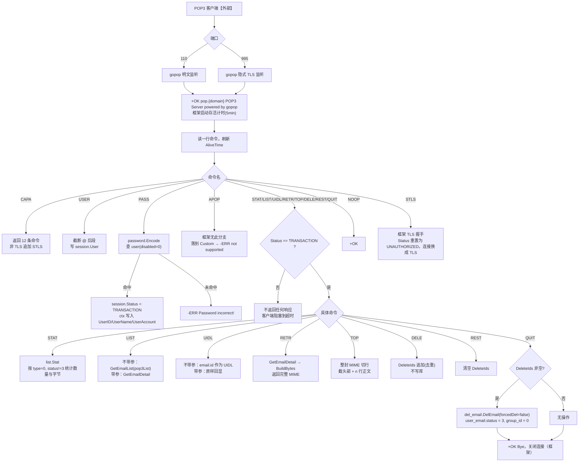
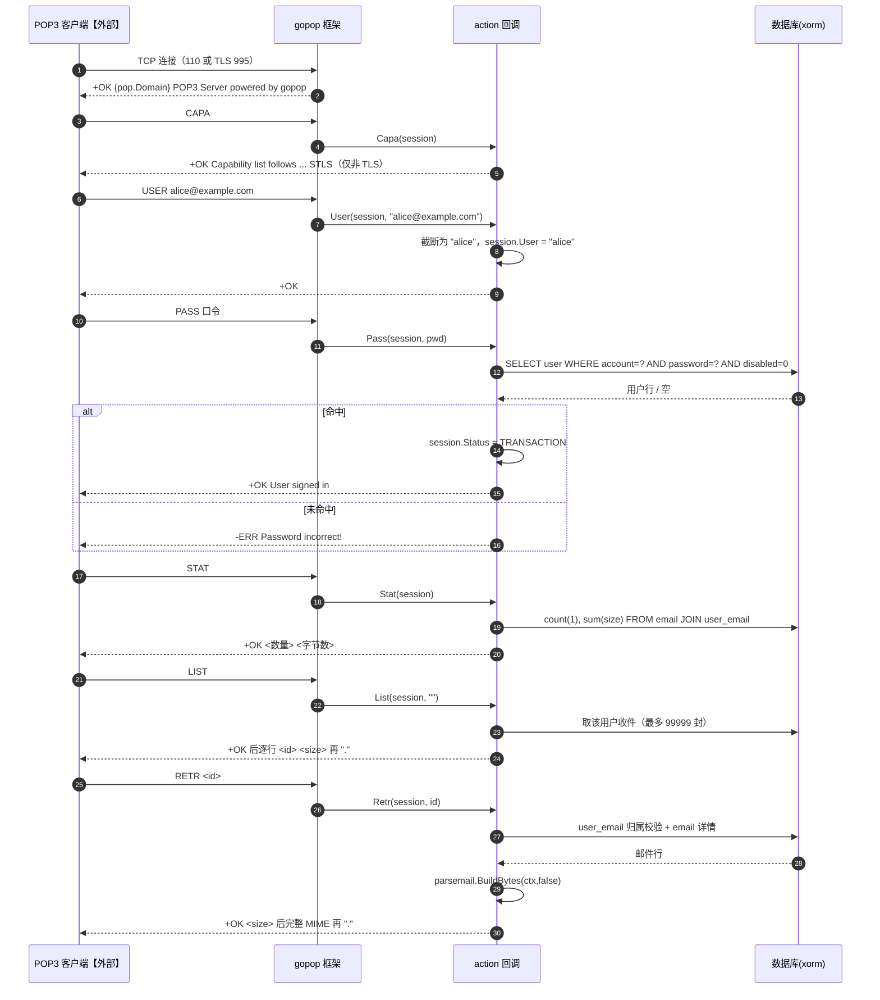
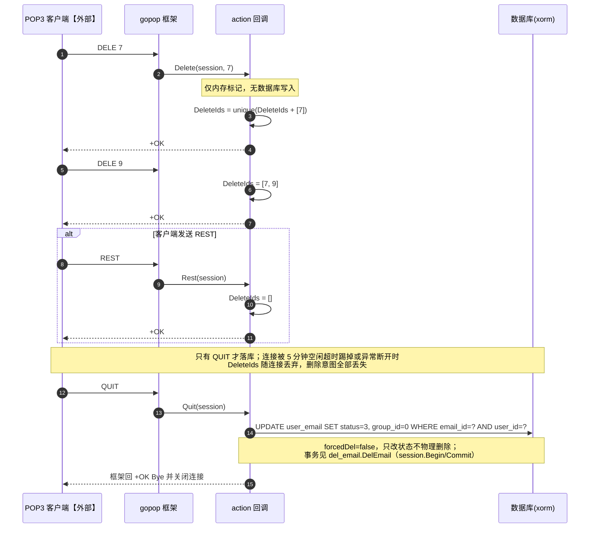
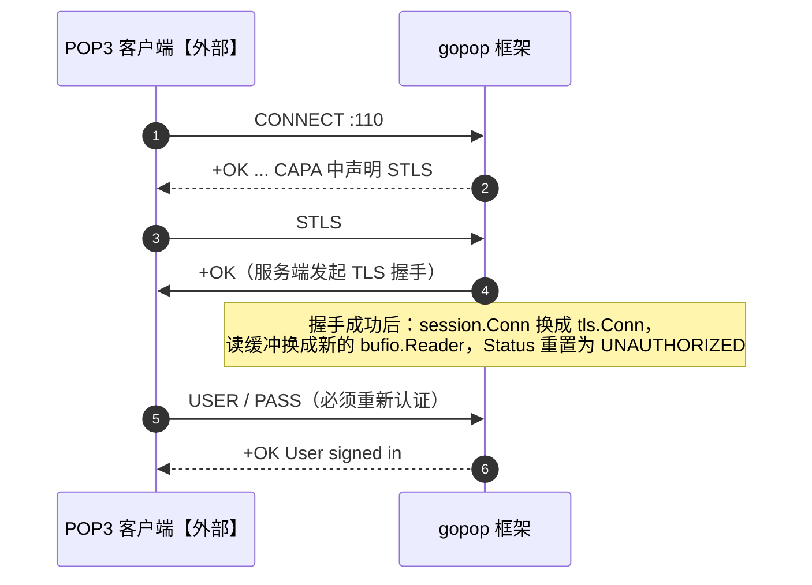
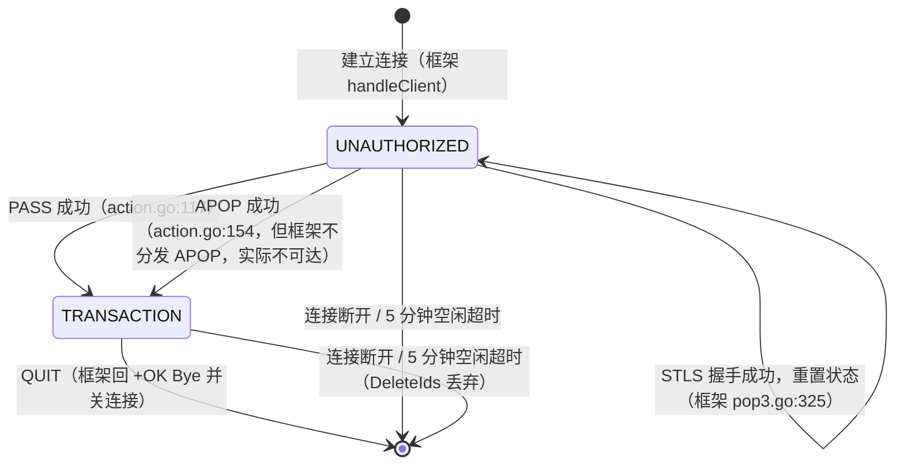
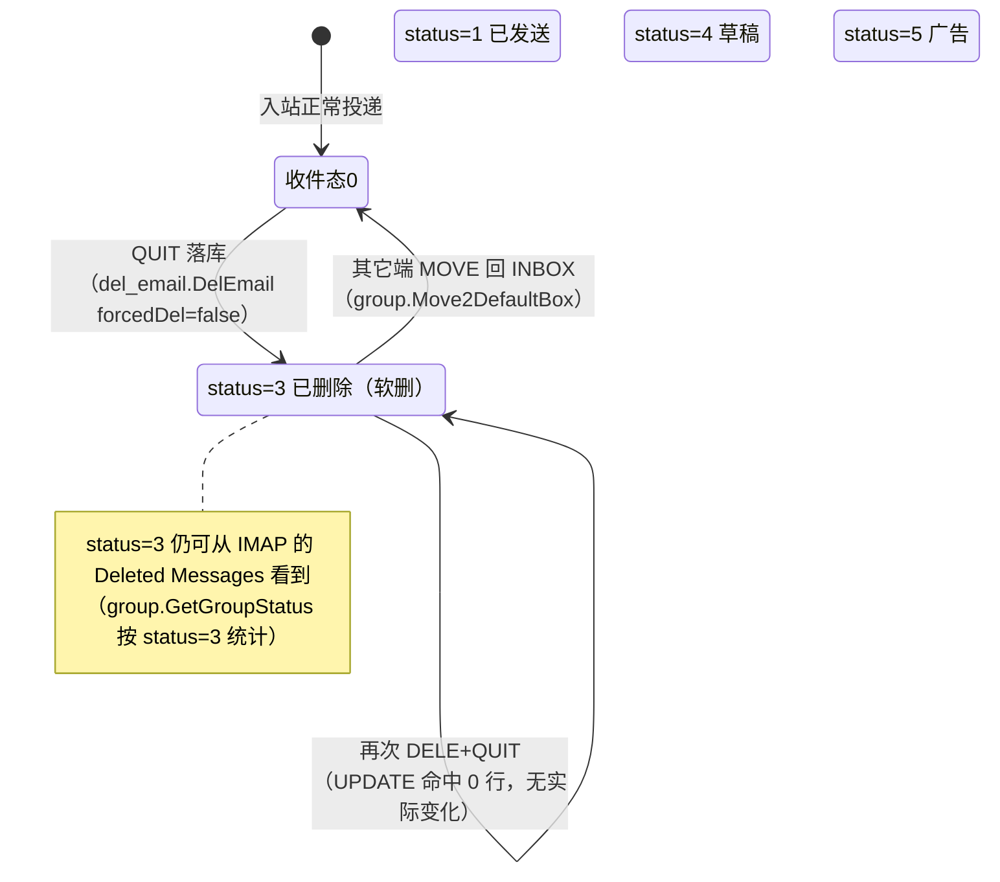

# 07 POP3服务（v1）

> 文档编号：07
> 文档版本：v1
> 项目：PMail
> 状态：主路径已实现（协议框架为外部库 `Jinnrry/gopop`，本仓库只实现 `action` 回调；外部依赖：邮件客户端【外部】）
> 证据基线：`master` @ `7e868f5`

## 1. 目标

回答：POP3 客户端连上 110/995 后，每条命令分别由谁处理、读写哪张表、返回什么；POP3 的“DELE 只打标记、QUIT 才真删”这一标准语义在 PMail 中是否成立；POP3 与 IMAP/Web 共享的邮件状态模型如何互相影响。

覆盖范围：`server/internal/api/`（`pop3server.go`、`action.go`）、`server/internal/app/email_query.go`、`server/internal/app/email_detail.go`、`server/internal/app/email_delete.go` 的复用部分。协议框架 `Jinnrry/gopop` 的源码不在本仓库内，本文对框架行为的描述均标注为“框架”，并给出模块缓存中的可核对位置（模块版本见 `server/go.mod:6`）。

## 2. 参与角色与前置条件

| 角色 | 说明 |
| --- | --- |
| 邮件客户端【外部】 | POP3 客户端，支持 110 明文（可 STLS 升级）或 995 隐式 TLS |
| 协议框架（`Jinnrry/gopop`） | 监听端口、读命令行、按命令名分发到 `Action` 接口、拼协议响应、管理会话连接存活时间 |
| `action` 回调 | `server/internal/api/pop3_action.go`，本仓库唯一的业务实现，实现 `gopop.Action` |
| 数据层 | 复用 `server/internal/app/email_query.go`、`server/internal/app/email_detail.go`、`server/internal/app/email_delete.go`，读写 `user`、`user_email`、`email`、`group` |

前置条件：

- 服务端已初始化（同 IMAP）；`bootstrap.Run` 中 `go api.StartPOP3()` 与 `go api.StartPOP3S()`（`server/internal/bootstrap/bootstrap.go`）。
- 证书/私钥可读：两个启动函数都会 `LoadX509KeyPair`，失败即 `panic`（`server/internal/api/pop3_listener.go`、`:36-38`）——注意 **110 明文端口同样强依赖证书文件存在**。
- 用户 `disabled = 0`。

## 3. 端口与连接参数

| 项 | 实现 | 证据 |
| --- | --- | --- |
| 明文端口 | `:110`，`gopop.NewPop3Server(110, "pop."+Domain, false, tlsConfig, action{})` | `pop3server.go:35-46` |
| 隐式 TLS 端口 | `:995`，第三个参数 `tlsEnabled=true` | `pop3server.go:15-29` |
| 连接存活时间 | `ConnectAliveTime = 5 * time.Minute`（框架每 3 秒检查一次，超时直接关连接） | `pop3server.go:25`、`:45`；框架 `pop3.go:133-144` |
| 问候语 | `+OK {pop.Domain} POP3 Server powered by gopop` | 框架 `pop3.go:151` |
| 单封邮件大小上限 | **无项目级配置**；框架 `Retr` 返回内容一次性拼进响应，未见大小限制 | `action.go:268-280`；框架 `pop3.go:266-282` |
| 并发模型 | 每连接一个 goroutine | 框架 `pop3.go:71`、`:103` |

## 4. CAPA 能力集与命令矩阵

`Capa` 返回固定的 12 条命令，非 TLS 连接额外追加 `STLS`（`action.go:54-74`）：

```
USER PASS TOP APOP STAT UIDL LIST RETR DELE REST NOOP QUIT   [+ STLS（非 TLS 连接）]
```

> 下表「框架分发」列中的 `pop3.go:行号` **全部指模块缓存中的框架源码**，不是本仓库文件；模块路径与版本见 §10 的「框架证据说明」。其余列未带绝对路径的行号（如 `action.go:54-74`）指本仓库 `server/internal/api/`。

| 命令 | `action` 方法 | 框架分发 | 参数 | 后端行为 | 证据 |
| --- | --- | --- | --- | --- | --- |
| `CAPA` | `Capa` | `pop3.go:182` | — | 返回固定命令表；按 `session.InTls` 决定是否含 `STLS` | `action.go:41-75` |
| `USER` | `User` | `pop3.go:195` | `<username>` | 截断 `@` 后段，写入 `session.User`，**不校验是否存在** | `action.go:78-95` |
| `PASS` | `Pass` | `pop3.go:203` | `<password>` | `password.Encode` 后查 `user`，成功则 `session.Status = TRANSACTION` 并写 ctx | `action.go:98-127` |
| `APOP` | `Apop` | **框架无 `APOP` 分支（未实现分发）** | `<name> <digest>` | 方法存在但不被分发；实现为 `digest == md5(user.Password)`（非 RFC 1939 的 `md5(timestamp+password)`） | `action.go:130-165`；框架 `pop3.go:181-348` 的 switch 无 `APOP` 分支 |
| `STAT` | `Stat` | `pop3.go:211` | — | `list.Stat`：`count(1), sum(size)`，条件 `type=0 and status != 3` | `action.go:168-174`、`server/internal/app/email_query.go` |
| `LIST` | `List` | `pop3.go:220` | 可空 `<msg>` | 不带参：`list.GetEmailList(..., pop3List=true, 0, 99999)`；带参：`detail.GetEmailDetail(id)`；size 为 0 时补 9999 | `action.go:218-265` |
| `UIDL` | `Uidl` | `pop3.go:234` | 可空 `<msg>` | 带参原样回显 `msg`；不带参：以 `email.id` 作为 UIDL | `action.go:177-210` |
| `RETR` | `Retr` | `pop3.go:266` | `<msg>` | `GetEmailDetail` → `parsemail.BuildBytes(ctx,false)` 原始 MIME | `action.go:268-280` |
| `TOP` | `Top` | `pop3.go:248` | `<msg> <n>` | 取整封 MIME 后按 `\n` 切行，截到第一个单独 `\r`（头部结束）后 `n` 行 | `action.go:297-322` |
| `DELE` | `Delete` | `pop3.go:283` | `<msg>` | **只把 id 追加到 `session.DeleteIds`（去重），不写库** | `action.go:283-289` |
| `REST` | `Rest` | `pop3.go:297` | — | 清空 `session.DeleteIds` | `action.go:291-295` |
| `NOOP` | `Noop` | `pop3.go:313` | — | 空操作 | `action.go:324-327` |
| `QUIT` | `Quit` | `pop3.go:307` | — | `del_email.DelEmail(ctx, DelIds, forcedDel=false)`，即把 `user_email.status` 改为 3 | `action.go:329-343` |
| `STLS` | 无 | `pop3.go:315` | — | 框架自行 `tls.Server(conn).Handshake()`，成功后**重置** `Status = UNAUTHORIZED` 并把读缓冲换成 TLS 连接 | 框架 `pop3.go:315-329` |
| 其它 | `Custom` | `pop3.go:330` | — | 一律返回 `-ERR not supported cmd request` | `action.go:29-38` |

框架分发的一个前置条件：除 `CAPA`/`USER`/`PASS`/`NOOP`/`STLS`/未知命令外，`STAT`…`QUIT` 都在 `session.Status == TRANSACTION` 时才处理，否则**不写任何响应**（客户端会一直等到 5 分钟连接超时）；`QUIT` 在未认证状态下同样不响应。证据：框架 `pop3.go:211-219`、`:307-312`。

## 5. 流程图



## 6. 时序图

### 6.1 同步请求响应：USER/PASS → 列表 → 取信



### 6.2 异步/延迟执行：DELE 与 QUIT 的删除语义



### 6.3 响应链路：STLS 升级



## 7. 状态机

POP3 的会话状态完全由框架维护，`action` 只负责在认证成功时把状态推到 `TRANSACTION`，`STLS` 成功时回退到 `UNAUTHORIZED`：



邮件侧的状态迁移（`user_email.status`，常量见 `server/consts/consts.go:9-28`）只发生在 `QUIT`：



`DelEmail` 的 UPDATE 以 `email_id + user_id` 定位已有 `user_email` 行（`server/internal/app/email_delete.go`），不对不存在的行做插入，因此“重复删除”只会影响 0 行，不会把 `Sent Messages`/`Drafts`/`Junk` 里的邮件误标成已删除——这也是图中只画 `收件态0 → 删除态3` 的原因。

对客户端可见的“消息集合”并不是 `status` 的迁移，而是 `list.Stat`/`GetEmailList` 的过滤条件变化：`type=0 AND status != 3`（`server/internal/app/email_query.go`）与 `ue.status = 0`（`list.go:66`）。

## 8. 关键异常

| 场景 | 实际行为 | 证据 |
| --- | --- | --- |
| 证书读取失败 | 进程 `panic`，110 与 995 都不启动 | `pop3server.go:16-18`、`:36-38` |
| `USER` 任意用户名 | 永远 `+OK`，不校验存在性，错误延迟到 `PASS` | `action.go:78-95`、`:116-127` |
| `PASS` 账号不存在 / 禁用 | `-ERR Password incorrect!`（框架固定文案） | `action.go:126`；框架 `pop3.go:205-207` |
| `PASS` 之前发 `STAT/LIST/RETR/DELE/QUIT` | 框架不写任何响应，客户端阻塞至 5 分钟超时 | 框架 `pop3.go:211-219`、`:307-312` |
| `APOP` | 框架 switch 无该分支 → 落到 `Custom` → `-ERR not supported cmd request` | `action.go:29-38`；框架 `pop3.go:181-348` |
| `RETR` 不存在/无权限 | `GetEmailDetail` 返回 `Not authorized`，`Retr` 统一转成 `-ERR server error` | `action.go:270-274`、`server/internal/app/email_detail.go` |
| `TOP` 取信失败 | 错误文案被写成 `password error`（复制粘贴遗留） | `action.go:299-303` |
| `LIST <id>` 参数非数字 | `-ERR params error` | `action.go:223-227` |
| `LIST` size 为 0 | 强制补 9999，客户端显示的大小不是真实值 | `action.go:238-240`、`:249-251` |
| `LIST` 邮件超过 99999 封 | 超出部分被截断（`limit=99999`） | `action.go:243` |
| `STAT` 与 `LIST` 口径不一致 | `Stat` 的 SQL 只有 `type=0 and status != 3`，**不含任何 `group_id` 条件**；`List` 走 `GetEmailList(..., pop3List=true)`，`GroupId=-1` 时展开成 `(ue.group_id=0 or ue.group_id=INBOX)`。因此自定义分组里的邮件会**计入 STAT 数量与字节，却不在 LIST/UIDL 里出现**，客户端按 LIST 逐封取信后算出的总数与 STAT 对不上 | `server/internal/app/email_query.go`、`:81-92`、`:45-46` |
| `QUIT` 落库失败 | `del_email.DelEmail` 的 error 被**丢弃**，客户端仍收到 `+OK Bye` | `action.go:334-340`；框架 `pop3.go:309-311` |
| `QUIT` 时 `forcedDel=false` | 只把 `status` 改成 3，邮件仍在库、仍占空间 | `action.go:339`、`server/internal/app/email_delete.go` |
| 连接空闲 5 分钟 | 框架直接关连接，未 `QUIT` 的 `DeleteIds` 全部丢失 | `pop3server.go:25`、`:45`；框架 `pop3.go:133-144` |
| `STLS` 后未重新认证 | 框架把状态重置为 `UNAUTHORIZED`，后续命令静默无响应 | 框架 `pop3.go:325` |
| 收到未知命令 | `-ERR not supported cmd request` | `action.go:37` |

## 9. 与 IMAP / Web 的删除语义对照

三端都能“删除”同一封邮件，但落库动作不同：

| 端 | 动作 | 数据库效果 | 是否可恢复 | 证据 |
| --- | --- | --- | --- | --- |
| POP3 `DELE` + `QUIT` | `del_email.DelEmail(ids, false)` | `user_email.status = 3`，`group_id = 0`（软删） | 可：IMAP `Deleted Messages` 仍能看到，可 `COPY`/`MOVE` 到 `INBOX` | `action.go:339`、`del_email.go:35-41`、`group.go:318-324` |
| IMAP `STORE +FLAGS (\Deleted)` | `del_email.DelByUID` | 删除 `user_email` 行；无引用时连 `email` 一起删（硬删） | 不可 | `server/internal/api/imap_session_store.go`、`del_email.go:63-101` |
| IMAP `EXPUNGE` | `del_email.DelByUID` | 同上（硬删） | 不可 | `server/internal/api/imap_session_expunge.go` |
| Web `/api/email/del` `forcedDel=false` | `del_email.DelEmail(ids, false)` | 软删 `status = 3` | 可 | `server/internal/api/email_delete_handler.go`、`del_email.go:35-41` |
| Web `/api/email/del` `forcedDel=true` | `del_email.DelEmail(ids, true)` | 删 `user_email`，无引用时删 `email` | 不可 | `del_email.go:43-60` |

结论：POP3 与 Web 走同一条软删路径，IMAP 走硬删路径。同一个用户用 IMAP 标记删除一封邮件后，再用 POP3 `RETR` 该序号会得到 `-ERR server error`（`user_email` 行已消失，`GetEmailDetail` 判无权限）。

## 10. 证据索引

> **框架证据说明（必读）**
>
> POP3 的协议框架 `github.com/Jinnrry/gopop` **不属于本仓库**，仓库内没有其源码副本，因此表中与“框架”相关的行号无法直接在本仓库检索到。核对方式统一为两步：
>
> 1. **版本来源**：`server/go.mod:6` 锁定的模块版本为 `github.com/Jinnrry/gopop v0.0.0-20231113115125-fbdf52ae39ea`（与 `server/go.sum:5-6` 一致）。
> 2. **源码路径**：在 Go 模块缓存中按该版本取源码，即 `$GOPATH/pkg/mod/github.com/!jinnrry/gopop@v0.0.0-20231113115125-fbdf52ae39ea/`（默认 `$GOPATH` 为 `~/go`；本文核对时实际位于 `~/.local/pkg/mod/github.com/!jinnrry/gopop@v0.0.0-20231113115125-fbdf52ae39ea/`，注意目录名中的 `!j` 是 Go 对大写首字母的转义）。
>
> 若缓存中不存在该目录，先执行 `go mod download github.com/Jinnrry/gopop`（或 `go mod download`）再核对；升级依赖后行号可能漂移，此时以版本号为准重新定位函数名。
>
> 本文所有引用框架的行号均带「框架」前缀加以区分；未带前缀的行号指向本仓库文件。

| 主题 | 文件:行号 |
| --- | --- |
| 995 隐式 TLS 启动、存活时间 | `server/internal/api/pop3_listener.go` |
| 110 明文启动（同样加载证书） | `server/internal/api/pop3_listener.go` |
| 启动顺序 | `server/internal/bootstrap/bootstrap.go` |
| `Custom` 未支持命令 | `server/internal/api/pop3_action.go` |
| `CAPA` 命令集与 STLS 追加 | `server/internal/api/pop3_action.go` |
| `USER` 截断 `@` | `server/internal/api/pop3_action.go` |
| `PASS` 认证与状态迁移 | `server/internal/api/pop3_action.go` |
| `APOP`（实现存在但框架不分发） | `server/internal/api/pop3_action.go` |
| `STAT` | `server/internal/api/pop3_action.go`、`server/internal/app/email_query.go` |
| `UIDL` | `server/internal/api/pop3_action.go` |
| `LIST` | `server/internal/api/pop3_action.go` |
| `RETR` | `server/internal/api/pop3_action.go` |
| `DELE` / `REST` | `server/internal/api/pop3_action.go` |
| `TOP` | `server/internal/api/pop3_action.go` |
| `NOOP` / `QUIT` | `server/internal/api/pop3_action.go` |
| 软删 / 硬删实现 | `server/internal/app/email_delete.go`、`:63-101` |
| `user_email.status` 语义 | `server/models/user_email.go:11`、`server/consts/consts.go:9-28` |
| POP3 列表 SQL（`pop3List`） | `server/internal/app/email_query.go`、`:39-111` |
| 协议框架版本 | `server/go.mod:6`（`github.com/Jinnrry/gopop v0.0.0-20231113115125-fbdf52ae39ea`） |
| 框架命令分发与响应格式 | 框架源码 `pop3.go:120-351`（模块缓存 `github.com/!jinnrry/gopop@v0.0.0-20231113115125-fbdf52ae39ea`，仓库内无副本） |
| 测试（仅覆盖 `Retr`） | `server/internal/api/pop3_action_test.go` |

## 11. 实现风险

1. **删除语义与 RFC 1939 偏差：`DELE` 不持久、断线即丢，落库后又只是软删**。`DELE` 只改内存 `session.DeleteIds`（`action.go:286-288`），而框架在连接空闲 5 分钟后无条件关连接（`pop3server.go:25`、框架 `pop3.go:133-144`），超过 5 分钟未完成 `QUIT` 的删除全部丢失，客户端却已经显示“已删”；真正落库时又只把 `status` 改成 3（`action.go:339`），邮件继续占空间、继续出现在 IMAP 的 `Deleted Messages` 里，不符合 POP3 客户端“取走即清空服务器”的预期。
2. **`QUIT` 忽略落库错误并返回 `+OK`**：`action.go:334-340` 丢弃 `del_email.DelEmail` 的返回值，框架随后固定回 `+OK Bye`（框架 `pop3.go:309-311`）。数据库故障时客户端会认为邮件已被删除，实际残留，且无任何用户可见失败信号。
3. **`APOP` 声明但不实现，且实现本身也不符合 RFC**：`CAPA` 返回 `APOP`（`action.go:58`），但框架 switch 没有 `APOP` 分支，实际落到 `Custom` 返回 `-ERR not supported cmd request`（`action.go:29-38`）；即便补上分发，`digest == md5(user.Password)` 也不是 RFC 1939 的 `md5(时间戳 + 共享密钥)` 形式，等于把“密码哈希”当成共享密钥。
4. **未认证状态下命令无响应**：框架只在 `Status == TRANSACTION` 时处理 `STAT`/`LIST`/`RETR`/`DELE`/`QUIT` 等，否则既不回 `-ERR` 也不关闭连接（框架 `pop3.go:211-219`、`:307-312`），客户端只能等到 5 分钟空闲超时，表现为“连上后卡死”。
5. **序号模型与 IMAP 不一致，且带隐含截断**：POP3 的“邮件序号”实际是 `email.id`（`action.go:195-206`、`:244-253`），并非 1 起连续的消息序号；`UIDL` / `LIST` 的取数上限为 99999（`action.go:193`、`:243`），超过后静默截断；`LIST` 对 size=0 一律填 9999（`action.go:238-240`）。配合“IMAP 与 Web 的读态/删除都会改变查询结果”，POP3 客户端缓存的序号极易错位。
6. **110 明文端口强依赖证书，且 `STLS` 重置状态**：`Start()` 在明文端口也 `LoadX509KeyPair`，证书缺失时整个 POP3 服务（含 110）panic（`pop3server.go:36-41`）；`STLS` 成功后框架把 `Status` 重置为 `UNAUTHORIZED`（框架 `pop3.go:325`），若客户端以为已认证会卡死。
7. **无失败计数与限流，测试覆盖极薄**：`Pass` 失败没有任何计数/延迟/锁定（`action.go:98-127`），可被离线暴力尝试；`pop3server` 包只有 1 个测试（`action_test.go:15-30`），且该测试不校验任何返回值，协议层行为完全没有回归保护。
8. **框架的存活计时器关错连接**：超时 goroutine 关闭的是闭包捕获的原始 `conn`（框架 `pop3.go:125`、`:138`），而 `STLS` 之后会话读写已切到 `session.Conn`（新的 `tls.Conn`，框架 `pop3.go:326`）；顺序是“先升级 TLS 再超时”时，计时器关闭的是旧 socket，新 TLS 连接不会被断开，`DeleteIds` 反而可能被保留。另外该计时器在连接正常结束后仍以 3 秒周期空转到 `alive + 5min` 才退出，连接数多时是常驻 goroutine 泄漏。
