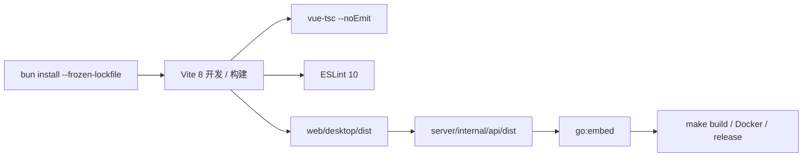
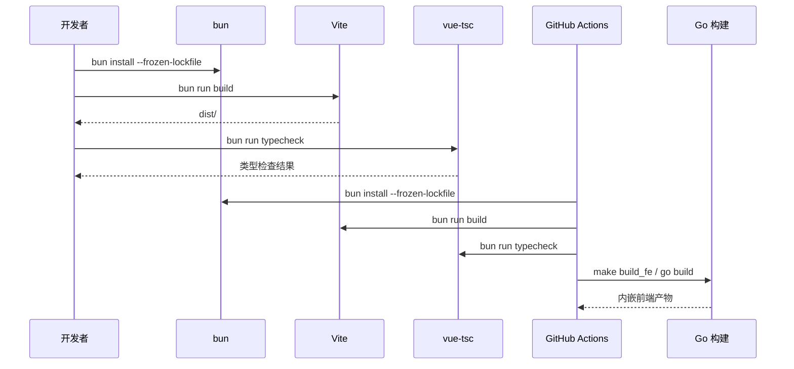

# 0002 前端技术栈升级 — 实施方案

> 需求清单：[0002-前端技术栈升级-需求清单.md](./0002-前端技术栈升级-需求清单.md)
> 方案评估：[0002-前端技术栈升级-方案评估.md](./0002-前端技术栈升级-方案评估.md)
> 方案验收：[0002-前端技术栈升级-方案验收.md](./0002-前端技术栈升级-方案验收.md)
> 前端对接文档：[0002-前端技术栈升级-前端对接文档.md](./0002-前端技术栈升级-前端对接文档.md)
> 文档编号：0002-实施方案
> 项目：PMail
> 状态：已实现，本机逐页验收通过
> 证据基线：`develop` @ `3a0a916`
> 分支：`develop` ｜ 日期：2026-11-11

## 1. 依赖与版本契约

### 1.1 运行时依赖

| 包 | 版本 | 说明 |
| --- | --- | --- |
| `vue` | 3.5.45 | npm `latest`；3.6 仍为 rc |
| `vue-router` | 5.5.0 | 未使用 `unplugin-vue-router`，无 breaking changes |
| `pinia` | 4.1.0 | ESM-only；必须显式安装 `@vue/devtools-api` |
| `@vue/devtools-api` | 8.2.1 | Pinia 4 的必需 peer |
| `axios` | 1.21.1 | 请求封装保持现有拦截器行为 |
| `@arco-design/web-vue` | 2.59.0 | 官方包；组件、图标、Locale、Message/Notification/Modal 均从该包导入 |
| `@wangeditor-next/editor` | 6.5.1 | 富文本内核；按 POC 结果启用 |
| `@wangeditor-next/editor-for-vue` | 6.5.1 | Vue 3 绑定；API 目标兼容现有 `Editor` / `Toolbar` 用法 |

### 1.2 开发依赖

| 包 | 版本 | 说明 |
| --- | --- | --- |
| `vite` | 8.3.8 | Node `^20.19.0` 或 `>=22.12.0` |
| `@vitejs/plugin-vue` | 6.0.10 | Vite 8 对应版本 |
| `typescript` | 6.0.3 | `typescript-eslint` 可用上限为 `<6.1.0` |
| `vue-tsc` | 3.3.14 | `vue-tsc --noEmit` 类型检查 |
| `@vue/tsconfig` | 0.9.1 | 提供 `tsconfig.dom.json` |
| `@types/node` | 24.19.2 | 与 Node 24 对齐 |
| `eslint` | 10.14.0 | flat config |
| `eslint-plugin-vue` | 10.12.1 | 支持 ESLint 10 |
| `@vue/eslint-config-typescript` | 14.9.0 | 组合 Vue + TypeScript flat config；内部使用 `typescript-eslint` 8.72.2 |
| `unplugin-vue-components` | 32.1.0 | 使用 `ArcoResolver` 按需引入组件、样式与图标 |

### 1.3 移除的依赖

`element-plus`、`@element-plus/icons-vue`、`vue-icons-plus`、`@wangeditor/editor`、`@wangeditor/editor-for-vue`、`unplugin-auto-import`、`vue-tsc` 旧版本。

`unplugin-auto-import` 当前只用于 Element Plus 自动导入；现有代码已显式导入 Vue API，Arco 服务（`Message`、`Notification`、`Modal`）采用显式导入以保证类型与样式可控，因此本轮移除，不再引入替代插件。

### 1.4 工具链与构建环境

| 项 | 口径 |
| --- | --- |
| Node | 24 LTS；本地、CI、Docker 统一 |
| bun | 1.4.4；`package.json` 增加 `"packageManager": "bun@1.4.4"` |
| 锁文件 | 只保留 `web/desktop/bun.lock`；删除 `yarn.lock` / `package-lock.json` 残留 |
| CI actions | `actions/checkout@v7`、`actions/setup-node@v7`、`oven-sh/setup-bun@v2`、`actions/setup-go@v7`、`actions/upload-artifact@v7` |
| Docker | 前端阶段使用 `node:24-alpine` 并从 `oven/bun:1.4.4` 复制 bun 二进制 |

## 2. 链路与生效点

本次不改变运行时业务功能点，只改变前端依赖、构建链、类型检查与组件渲染；现有路由、接口路径、Cookie 鉴权与 `Lang` 请求头保持不变。





## 3. TypeScript 工程配置

### 3.1 `web/desktop/tsconfig.json`

```json
{
  "extends": "@vue/tsconfig/tsconfig.dom.json",
  "compilerOptions": {
    "paths": {
      "@/*": ["./src/*"]
    },
    "types": ["vite/client"],
    "allowJs": true,
    "checkJs": false
  },
  "include": [
    "src/**/*.ts",
    "src/**/*.d.ts",
    "src/**/*.vue",
    "vite.config.ts",
    "src/components.d.ts"
  ],
  "exclude": ["node_modules", "dist"]
}
```

`module`、`moduleResolution`、`target`、`strict`、`noEmit`、`verbatimModuleSyntax` 由 `@vue/tsconfig@0.9.1` 的 `tsconfig.dom.json` 继承，不在项目配置中重复声明。`baseUrl` 在 TypeScript 6 已弃用，`paths` 直接相对 `tsconfig.json` 解析，不声明 `baseUrl`。`module: ESNext` 的原因是 Vite 作为 bundler 直接消费 ESM，`vue-tsc` 只做类型检查，不产出 CommonJS；实际浏览器降级由 Vite 的 `build.target` 控制，与 `tsconfig.target` 无关。`tsconfig.dom.json` 设置 `lib: ["ES2022", "DOM", "DOM.Iterable"]`，目标语法仍保持 `ESNext`。

`allowJs: true` 用于迁移期；最后一页迁移完成后改为 `false`，并用 `vue-tsc --noEmit` 做全量检查。`verbatimModuleSyntax: true` 由基础配置继承，所有仅用于类型的导入必须写成 `import type { ... }`。

### 3.2 `web/desktop/src/env.d.ts`

```ts
/// <reference types="vite/client" />

interface ImportMetaEnv {
  readonly VITE_APP_URL: string
}

interface ImportMeta {
  readonly env: ImportMetaEnv
}
```

### 3.3 `package.json` scripts

```json
{
  "scripts": {
    "dev": "vite",
    "build": "vue-tsc --noEmit && vite build",
    "typecheck": "vue-tsc --noEmit",
    "preview": "vite preview",
    "lint": "eslint . --fix"
  }
}
```

### 3.4 `web/desktop/eslint.config.js`

```js
import pluginVue from 'eslint-plugin-vue'
import { defineConfigWithVueTs, vueTsConfigs } from '@vue/eslint-config-typescript'

export default defineConfigWithVueTs(
  {
    ignores: ['dist/**', 'node_modules/**', 'src/components.d.ts']
  },
  pluginVue.configs['flat/recommended'],
  vueTsConfigs.recommended
)
```

## 4. 类型契约

### 4.1 接口响应包裹

后端响应固定为 `errorNo` / `errorMsg` / `data`（`server/dto/response/response.go:16-20`）。前端类型定义在 `web/desktop/src/utils/axios.ts`：

```ts
export interface ApiResponse<T = unknown> {
  errorNo: number
  errorMsg: string
  data: T
}

export interface HttpClient {
  get<T = unknown>(url: string, config?: AxiosRequestConfig): Promise<ApiResponse<T>>
  post<T = unknown>(url: string, data?: unknown, config?: AxiosRequestConfig): Promise<ApiResponse<T>>
}

export const http: HttpClient
```

响应拦截器保持现有行为：`errorNo === 403` 跳转 `/login`，`errorNo === 402` 跳转 `/setup`，失败时 `Promise.reject`。

### 4.2 用户状态

`/api/user/info` 返回 `account`、`name`、`is_admin`、`domains`（`server/internal/api/account_handler.go:116-121`）：

```ts
export interface UserInfo {
  account: string
  name: string
  is_admin: boolean
  domains: string[]
}

interface GlobalStatusState {
  userInfos: Partial<UserInfo>
  mobileDrawerVisible: boolean
  settingsDrawerVisible: boolean
}
```

### 4.3 路由与页面模型

- `router/index.ts` 使用 `RouteRecordRaw[]`，使用 `createWebHistory`；服务端增加非 API 路径回退 `index.html` 的 SPA handler。
- 邮件、分组、规则、插件、用户等页面模型按接口实际字段补齐 interface；不对后端返回做运行时校验，避免引入额外依赖。
- 组件 props / emits 使用 `defineProps<T>()`、`defineEmits<T>()` 泛型写法；禁止 `any`，未知结构用 `unknown` 并在使用点收窄。

## 5. Arco 接入契约

### 5.1 `web/desktop/vite.config.ts`

```ts
import { fileURLToPath, URL } from 'node:url'
import { defineConfig } from 'vite'
import vue from '@vitejs/plugin-vue'
import Components from 'unplugin-vue-components/vite'
import { ArcoResolver } from 'unplugin-vue-components/resolvers'

export default defineConfig({
  plugins: [
    vue(),
    Components({
      resolvers: [
        ArcoResolver({
          importStyle: 'css',
          sideEffect: true,
          resolveIcons: true
        })
      ],
      dts: 'src/components.d.ts'
    })
  ],
  resolve: {
    alias: {
      '@': fileURLToPath(new URL('./src', import.meta.url))
    }
  },
  server: {
    cors: true,
    proxy: {
      '/api': 'http://127.0.0.1/',
      '/attachments': 'http://127.0.0.1/'
    }
  }
})
```

`ArcoResolver` 的 `resolveIcons: true` 会把模板中的 `IconPlus` 等图标解析到 `@arco-design/web-vue/es/icon`；`sideEffect` 默认开启，按组件引入 `es/{component}/style/css.js`。

### 5.2 `web/desktop/src/main.ts`

```ts
import { createApp } from 'vue'
import { createPinia } from 'pinia'
import App from './App.vue'
import { router } from './router'
import '@arco-design/web-vue/es/style/index.css'
import '@arco-design/web-vue/es/message/style/css.js'
import '@arco-design/web-vue/es/notification/style/css.js'
import '@arco-design/web-vue/es/modal/style/css.js'
import './assets/main.css'

const app = createApp(App)
app.use(router)
app.use(createPinia())
app.mount('#app')
```

组件样式由 `ArcoResolver` 按需引入；`Message`、`Notification`、`Modal` 是函数式服务，不经过模板解析，因此显式引入三个样式入口。

### 5.3 Locale 与暗色主题

`App.vue` 外层使用 `a-config-provider`，按现有 `lang.lang` 选择 Arco locale：

```ts
import zhCN from '@arco-design/web-vue/es/locale/lang/zh-cn'
import enUS from '@arco-design/web-vue/es/locale/lang/en-us'

const arcoLocale = computed(() => (lang.lang === 'zhCn' ? zhCN : enUS))
```

新增 `web/desktop/src/utils/theme.ts`：

```ts
export type ArcoTheme = 'light' | 'dark'

export function applyArcoTheme(theme: ArcoTheme): void {
  document.body.setAttribute('arco-theme', theme)
}

export function useSystemArcoTheme(): () => void
```

`useSystemArcoTheme` 使用 `window.matchMedia('(prefers-color-scheme: dark)')`，在应用挂载时设置初始主题并监听变化，返回解绑函数。暗色不再依赖 `base.css` 中的 `.el-*` 媒体查询。

### 5.4 服务导入

```ts
import { Message, Modal, Notification } from '@arco-design/web-vue'
```

对应替换关系：

| Element Plus | Arco |
| --- | --- |
| `ElMessage.success/error/...` | `Message.success/error/...` |
| `ElNotification({...})` | `Notification({...})` |
| `ElMessageBox.confirm(...)` | `Modal.confirm({...})` |
| `ElMessageBox.alert(...)` | `Modal.open({...})` |

## 6. 组件映射与迁移规则

| Element Plus | Arco | 迁移规则 |
| --- | --- | --- |
| `el-button` | `a-button` | `type="danger"` 改为 `status="danger"`；`plain`、`text` 等按 Arco 属性调整 |
| `el-input` | `a-input` | `type="textarea"` 改为独立 `a-textarea`；当前 2 处 |
| `el-select` / `el-option` | `a-select` / `a-option` | `v-model` 不变；清空、过滤、远程搜索属性按 Arco 调整 |
| `el-form` / `el-form-item` | `a-form` / `a-form-item` | `prop` 改为 `field`；rules 由字段对象改为 Arco 规则数组；提交前调用 `formRef.validate()` |
| `el-table` / `el-table-column` | `a-table` | 列改为 `columns` 配置；作用域插槽改为 `#slotName`；当前 28 列、16 个 `#default` |
| `el-dialog` | `a-modal` | `v-model` 改为 `v-model:visible`；`@close` 改为 `@cancel`；底部按钮用 `#footer`；当前 4 处 |
| `el-drawer` | `a-drawer` | `direction` 改为 `placement`；`size` 改为 `width`；当前 1 处 |
| `el-tabs` / `el-tab-pane` | `a-tabs` / `a-tab-pane` | `label` 改为 `title` |
| `el-steps` / `el-step` | `a-steps` / `a-step` | `active`、`title`、`description` 基本对应 |
| `el-pagination` | `a-pagination` | `current-page` 改为 `current`；`@current-change` 改为 `@change` |
| `el-tree` | `a-tree` | `node-key`、`props` 改为 Arco `field-names` / `key`；勾选与展开事件按 Arco 调整 |
| `el-menu` / `el-menu-item` | `a-menu` / `a-menu-item` | `default-active`、`@select` 基本对应 |
| `el-dropdown` / `el-dropdown-menu` / `el-dropdown-item` | `a-dropdown` / `a-doption` | 内容从 `el-dropdown-menu` 改为 `#content` + `a-doption` |
| `el-popover` | `a-popover` | `content` 插槽与触发方式按 Arco 调整 |
| `el-popconfirm` | `a-popconfirm` | `title` 改为 `content`；`@confirm` 改为 `@ok` |
| `el-tooltip` | `a-tooltip` | `content` 属性基本对应 |
| `el-tag` | `a-tag` | `type` 改为 `color` / `status`；关闭事件保持 |
| `el-alert` | `a-alert` | `title`、`type`、`closable` 基本对应 |
| `el-checkbox` / `el-checkbox-group` | `a-checkbox` / `a-checkbox-group` | `label` 改为 `value`；`v-model` 保持 |
| `el-switch` | `a-switch` | `v-model` 保持 |
| `el-badge` | `a-badge` | `:value` 改为 `:count` |
| `el-divider` | `a-divider` | 基本对应 |
| `el-icon` + Element 图标 | `icon-*` 组件 | 移除 `el-icon` 包裹，直接使用 Arco 图标 |
| `v-loading` | `a-spin` | 3 处改为 `a-spin :loading` 包裹，或使用 Arco Loading 服务 |
| `el-drawer`（App 移动端侧栏） | `a-drawer` | 保留 `mobile-aside-drawer` 样式类名，内部改成 Arco 类名 |

### 6.1 图标映射

| Element Plus | Arco |
| --- | --- |
| `ArrowDown` | `IconDown` |
| `Back` | `IconArrowLeft` |
| `Close` | `IconClose` |
| `Delete` | `IconDelete` |
| `Document` | `IconFile` |
| `Download` | `IconDownload` |
| `Edit` / `EditPen` | `IconEdit` |
| `InfoFilled` | `IconInfoCircleFill` |
| `Paperclip` | `IconAttachment` |
| `Plus` | `IconPlus` |
| `Position` | `IconSend` |
| `Refresh` | `IconRefresh` |
| `Setting` | `IconSettings` |
| `Folder` | `IconFolder` |
| `View` | `IconEye` |
| `Warning` | `IconExclamationCircleFill` |
| `CircleCheck` | `IconCheckCircleFill` |
| `Switch` | `IconSwap` |
| `vue-icons-plus` `EpMenu` | `IconMenu` |
| `vue-icons-plus` `EpArrowDownBold` | `IconDown` |

## 7. 页面级改动清单

### 7.1 批次 0：工具链与类型基础设施

| 文件 | 改动 |
| --- | --- |
| `web/desktop/package.json` | 依赖矩阵替换；增加 `typecheck`、`packageManager` |
| `web/desktop/bun.lock` | 由 bun 重新生成；删除其他锁文件 |
| `web/desktop/vite.config.js` → `vite.config.ts` | `ArcoResolver`、`dts`、TypeScript 配置 |
| `web/desktop/tsconfig.json`、`src/env.d.ts`、`eslint.config.js` | 新增 |
| `web/desktop/src/main.js` → `main.ts` | 移除 Element Plus；引入 Arco 基础样式与服务样式 |
| `Makefile`、`Dockerfile`、`.github/workflows/release.yml`、`.github/workflows/unitTest.yml`、`.github/workflows/docker_build.yml` | yarn → bun；Node 24；CI action 升级 |
| `server/internal/api/http_spa.go`、`http_spa_test.go`、`http_routes.go`、`http_setup.go` | History 路由的 SPA fallback；API/附件/缺失静态资源保持 404 |
| `docs/功能/06-前端应用.md`、`07-构建与部署.md`、`01-项目架构.md`、`README.md`、`README_CN.md` | 构建与栈口径同步 |

阶段一 POC：

1. `vue-tsc@3.3.14` + `typescript@6.0.3` + `vite@8.3.8` 在最小 TS 页面通过 `build` 与 `typecheck`。
2. `@wangeditor-next/*@6.5.1` 在 `EditerView` 的最小编辑器场景通过编译与手工输入验证。

### 7.2 批次 1：基础设施与壳层

| 文件 | 改动 |
| --- | --- |
| `web/desktop/src/App.vue` | `el-drawer` → `a-drawer`；引入 `a-config-provider`；挂载系统主题监听 |
| `web/desktop/src/components/HomeHeader.vue` | 菜单、下拉、设置弹窗、图标迁移；`EpMenu` → `IconMenu` |
| `web/desktop/src/components/HomeAside.vue` | `el-menu` / `el-menu-item` → `a-menu` / `a-menu-item`；图标迁移 |
| `web/desktop/src/router/index.js` → `index.ts` | `RouteRecordRaw[]`；切换 `createWebHistory` |
| `web/desktop/src/stores/useGlobalStatusStore.js` → `.ts` | `UserInfo`、`GlobalStatusState` 类型；action 参数与返回值 |
| `web/desktop/src/stores/group.js` → `group.ts` | `Ref<string>` 类型 |
| `web/desktop/src/utils/axios.js` → `axios.ts` | `ApiResponse<T>`、`HttpClient`；拦截器返回类型 |
| `web/desktop/src/i18n/i18n.js` → `i18n.ts` | `LangKey` 类型；保持 `lang.lang` 取值 `en` / `zhCn` |
| `web/desktop/src/assets/base.css`、`main.css` | 删除 28 个 `--el-*` 映射与 75 处 `.el-*` 覆盖；保留布局用 `--pm-*`；新增 Arco 主题变量 |

### 7.3 批次 2：登录与首次引导

| 文件 | 行数 | 重点 |
| --- | --- | --- |
| `src/views/LoginView.vue` | 219 | 表单、输入框、按钮、语言切换；`ElMessage` 替换 |
| `src/views/SetupView.vue` | 590 | 11 个 `el-table-column`、步骤条、全屏加载；`v-loading.fullscreen.lock` 改为 Arco Loading 服务；表单校验改写 |

### 7.4 批次 3：设置页

| 文件 | 行数 | 重点 |
| --- | --- | --- |
| `src/components/UserManagement.vue` | 263 | 7 个表格列；`ElNotification` 替换；新增/编辑弹窗 |
| `src/components/RuleSettings.vue` | 348 | 7 个表格列；规则表单；`ElNotification` 替换 |
| `src/components/GroupSettings.vue` | 226 | 树、表单、弹窗 |
| `src/components/SecuritySettings.vue` | 144 | 密码表单与校验 |
| `src/components/PluginSettings.vue` | 325 | 13 个表格列；审批弹窗；`v-loading`；作为表格/表单迁移样板页 |

`PluginSettings.vue` 先迁移，固化 `a-table` 列配置、`a-form` 规则、`a-modal` 审批弹窗写法，再复制到其他设置页。

### 7.5 批次 4：邮件列表、详情与编辑器

| 文件 | 行数 | 重点 |
| --- | --- | --- |
| `src/views/ListView.vue` | 485 | 5 个表格列、分页、下拉菜单、`ElMessageBox.confirm` 两处、`EpArrowDownBold` 替换 |
| `src/views/EmailDetailView.vue` | 375 | `ElMessageBox.confirm` 一处；附件与操作按钮 |
| `src/views/EditerView.vue` | 619 | wangEditor-next 替换；表单、附件、发送按钮；工具栏视觉对齐 |

### 7.6 批次 5：清理与收口

- 删除 `element-plus`、`@element-plus/icons-vue`、`vue-icons-plus`、旧 `@wangeditor/*` 依赖。
- 删除 `src/assets/base.css` 与 `main.css` 中全部 `.el-*` 选择器。
- `tsconfig.json` 关闭 `allowJs`，运行全量 `vue-tsc --noEmit`。
- 更新 `docs/components.d.ts` 自动生成的组件声明，确认只包含 `A*` 与 `Icon*`。
- 更新 `docs/功能/06-前端应用.md`、`07-构建与部署.md`、`01-项目架构.md`、根 README 的前端技术栈描述。

## 8. 构建、CI 与 Docker 改动

### 8.1 `Makefile`

```make
build_fe:
	cd web/desktop && bun install --frozen-lockfile && bun run build
	rm -rf server/internal/api/dist
	cd server && cp -rf ../web/desktop/dist internal/api
```

### 8.2 `Dockerfile`

```dockerfile
FROM node:24-alpine AS febuild
WORKDIR /work
COPY web/desktop .
RUN npm install -g bun@1.4.4 && bun install --frozen-lockfile && bun run build
```

### 8.3 GitHub Actions

- `release.yml`：`actions/setup-node@v7` 固定 `node-version: 24`；新增 `oven-sh/setup-bun@v2`；前端步骤改为 `bun install --frozen-lockfile && bun run build`；移除 `npm install --global yarn`；`checkout`、`setup-go`、`upload-artifact` 同步升级。
- `unitTest.yml`：删除 `apt install nodejs npm`；改用 `actions/setup-node@v7` + `oven-sh/setup-bun@v2`；`make build_fe` 内部走 bun。

## 9. 边界

- 无后端接口、数据库表、协议命令变更。
- 无页面路由、信息架构、业务字段变更。
- 不新增运行时功能点，不新增 `docs/流程` 文档；迁移阶段图以流程图/时序图形式附在本文件第 2 节。
- 不引入前端 E2E 框架；验收采用 `typecheck`、`lint`、`build` 三道门禁加人工页面冒烟。
- 不引入 OpenAPI 代码生成；接口类型手工维护，覆盖当前页面实际使用的字段。
- `@wangeditor-next` 仅在同一 `Editor` / `Toolbar` 用法下替换；POC 失败则回退旧版并登记未完成项。
- 迁移期 Element Plus 与 Arco 并存；最后一页迁完后必须删除 Element Plus，不保留长期双组件体系。
- 路由改为 History 模式；`server/internal/api/http_spa.go` 对非 API、非附件、非静态文件路径回退 `index.html`，API 与缺失静态资源仍返回 404。
- 保持 Cookie 鉴权、`Lang` 请求头与 `errorNo` 402/403 跳转行为。

## 10. 观测点

| 观测点 | 期望 |
| --- | --- |
| `bun run typecheck` | 0 errors |
| `bun run lint` | 0 errors |
| `bun run build` | 成功，产物进入 `web/desktop/dist` |
| `grep -rn "element-plus" web/desktop/src web/desktop/package.json` | 迁移完成后 0 命中 |
| `grep -rn '\.el-' web/desktop/src` | 迁移完成后 0 命中 |
| `bun.lock` | 唯一锁文件，CI/Docker 使用 `--frozen-lockfile` |
| Node / bun 版本 | 本地、CI、Docker 均为 Node 24 / bun 1.4.4 |
| 页面冒烟 | 登录、首次引导、邮件列表、详情、发信、设置、插件审批全部可用 |
| 暗色模式 | `body[arco-theme="dark"]` 随系统切换，组件与弹层均生效 |
| 控制台 | 无 Vue 警告、无 Arco 组件属性警告、无 404 样式请求 |

## 11. 待办

| # | 待办 | 完成条件 |
| --- | --- | --- |
| 1 | `vue-tsc@3.3.14` + TypeScript 6.0.3 + Vite 8 POC | 最小 TS 页面 build/typecheck 通过；不通过则回退 TS 5.9.3 并记录 |
| 2 | `@wangeditor-next` POC | 编辑器可初始化、输入、取 HTML；不通过则回退旧版并登记 |
| 3 | Arco 图标逐文件核对 | 第 6.1 节映射全部存在；缺失图标用最接近的 Arco 图标替代并记录 |
| 4 | Arco 暗色主题验证 | 浅色/深色切换后表格、弹窗、下拉、通知均正常 |
| 5 | 接口 DTO 类型补齐 | 当前页面使用的字段全部有 interface，无 `any` |
| 6 | 构建链 CI 验证 | `release.yml` 与 `unitTest.yml` 在 Node 24 + bun 下通过 |

验收方案与结果见[方案验收](./0002-前端技术栈升级-方案验收.md)；当前状态为待实施，未执行验收。
